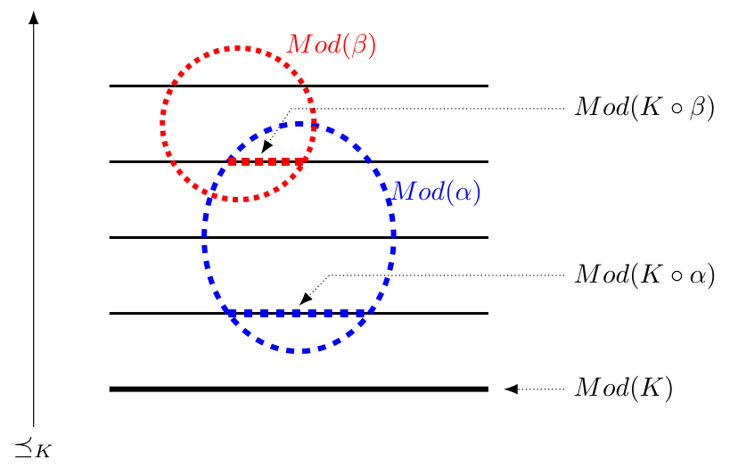

## Summary
Florence Dupin de Saint-Cyr and Henri Prade model a narrative joke as a context that induces a defeasible expectation followed by a punchline that overturns that expectation while explaining the original context. They call such a statement potentially funny for a particular listener, then extend the model so incongruity consists of violating and reasoning in disregard of a listener-recognized strict or default norm. The proposal connects humor to belief revision, nonmonotonic reasoning, and possibility theory, but remains a preliminary account of selected joke mechanisms rather than a sufficient theory of laughter.

## Key Claims
- A punchline is surprising when revising on the context and revising on context plus punchline select incompatible preferred models; it is revealing when revision by the punchline entails the context.
- Defeasible commonsense expectations are necessary to the model: an agent with only strict rules does not form the provisional conclusion that the punchline overturns.
- Narrative order and brevity matter formally: giving the revealing punchline first prevents the reversed statement from being surprising, while added context can disclose the punchline or make it fail to explain the entire setup.
- Incongruity is modeled relative to listener-recognized norms: after setting aside one strict or default norm, the full statement supports its violation and the punchline still explains the context.
- Surprise, revelation, and incongruity are listener-dependent and insufficient to characterize humor by themselves; superiority, delivery, identification, emotion, culture, and multi-agent reasoning remain outside the model.

The figure ranks interpretations by plausibility. The preferred models after hearing the context $\alpha$ and those after integrating punchline $\beta$ occupy different layers, creating surprise, while the preferred $\beta$ models lie inside $Mod(\alpha)$, making the punchline revealing.

## Key Quotes
> "Whatever the case (surprising punchline or incongruity) the joke requires a resolution, this is its revealing side." - the authors' summary of the common mechanism

> "Incongruity is not so much a matter of removing a norm from the listener knowledge base but rather a violation of this norm by focusing on exceptional situations." - qualification of the formal disregard operation

## Connections
- [[BeliefRevision]] - supplies the minimal-change semantics for integrating the context and punchline.
- [[NonmonotonicReasoning]] - lets a listener form defeasible expectations from incomplete context and retract them after the punchline.
- [[ComputationalHumor]] - the paper offers a formal, listener-relative account of selected joke-comprehension mechanisms.
- [[IncongruityResolution]] - norm violation and revelation-in-disregard formalize one route from incongruity to resolution.
- [[FlorenceDupinDeSaintCyr]] - coauthor who extends earlier work on jokes and belief revision.
- [[HenriPrade]] - coauthor whose possibility-theoretic work grounds the plausibility ordering used by the model.
- [[BayesianUpdating]] - related evidence-driven belief change, but probabilistic conditioning is not the paper's ordinal AGM-style revision mechanism.

## Contradictions
- No direct contradiction with an existing wiki claim was found. The paper instead qualifies any sufficient-condition account of humor: surprise and explanation also occur in detective stories and scientific discovery, while incongruity can produce wonder rather than laughter.
- The converted source flags 86 math expressions as unparsed while retaining their original TeX. The central definitions were readable, but fine-grained notation should be checked against the published paper before exact formal reuse.
