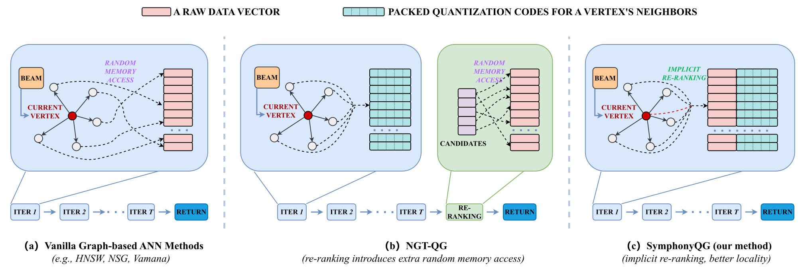
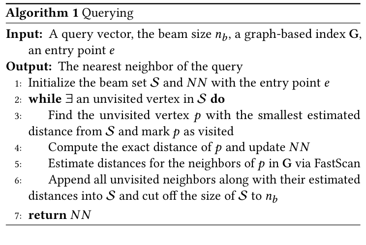
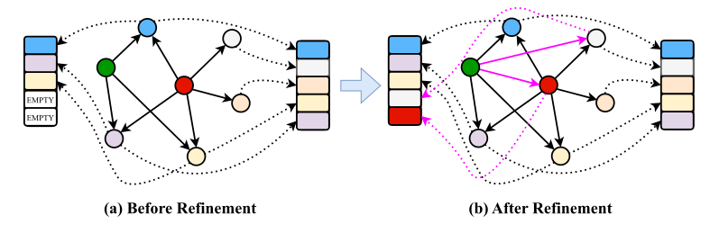
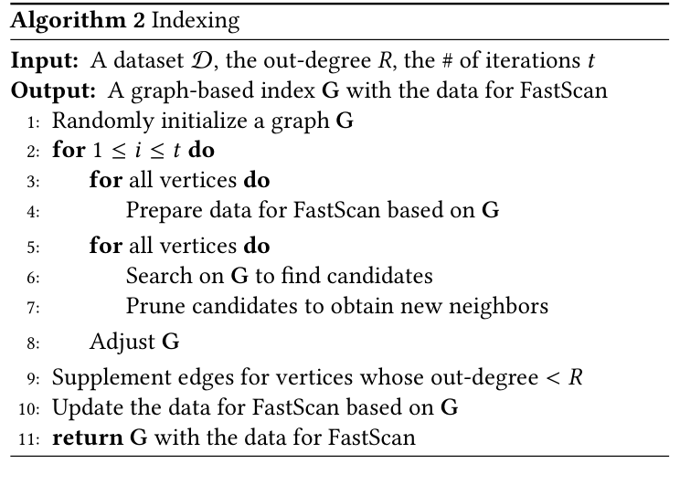
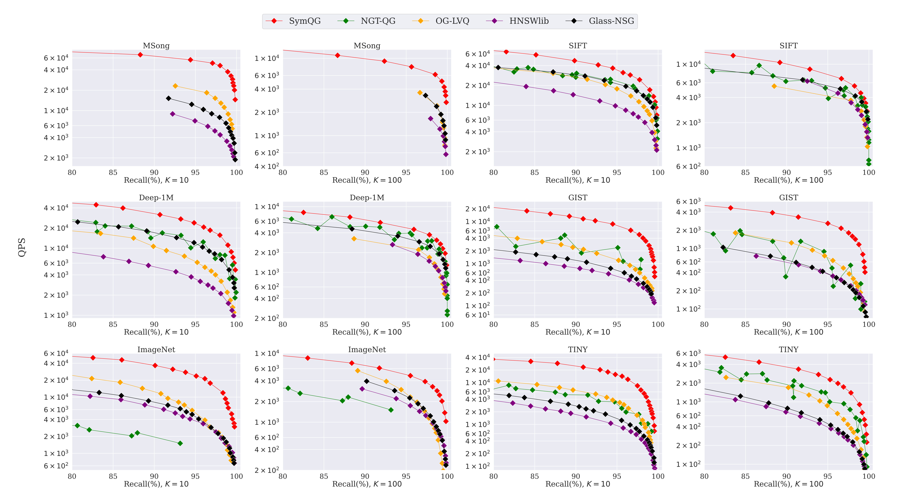
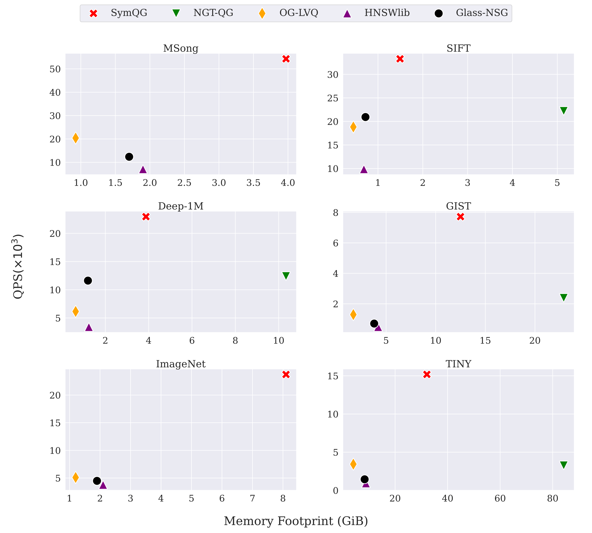
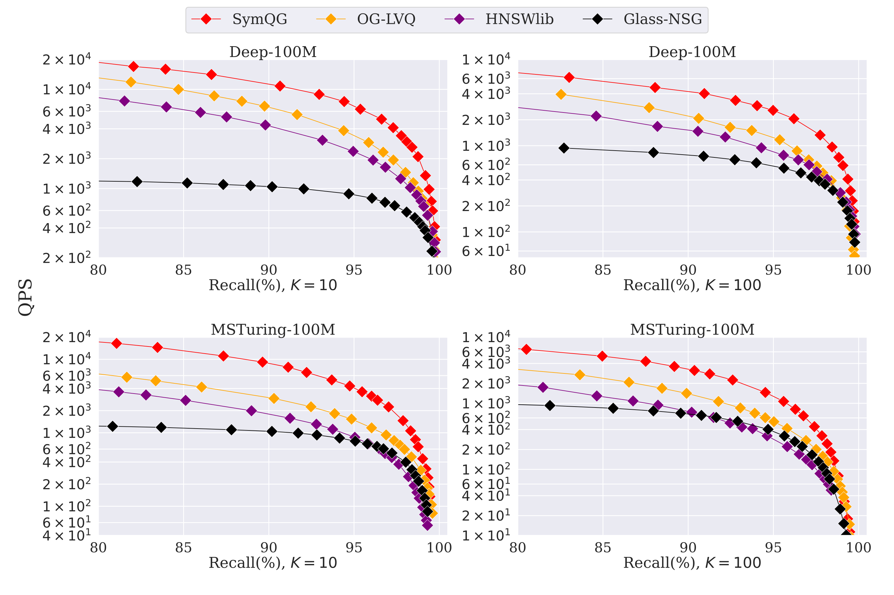
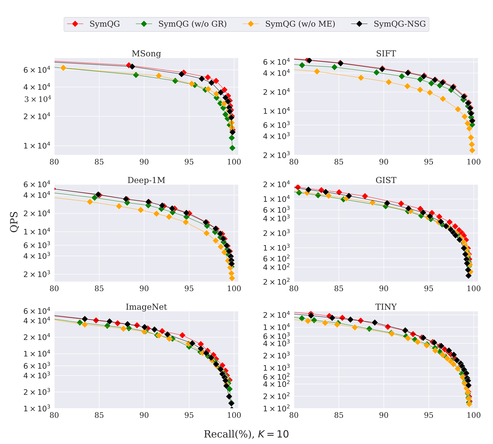

## Summary
Gou, Gao, Xu, and Long present [[SymphonyQG]], an in-memory [[ApproximateNearestNeighborSearch]] design that co-designs [[RaBitQ]], FastScan, graph traversal, data layout, and graph construction. It replaces NGT-QG's terminal exact reranking with exact scoring as vertices are visited, uses multiple center-relative estimates to protect recall, and fills graph out-degrees to SIMD batch boundaries. In first-party tests, it leads four graph baselines on the reported QPS-recall frontier and indexes at least eight times faster than NGT-QG, while duplicating neighbor codes creates a substantial memory premium and the implementation supports only Euclidean distance and cosine similarity.

## Key Claims
- Vanilla graph ANN repeatedly fetches separately stored neighbor vectors and computes exact distances, while NGT-QG improves locality with packed neighbor codes but reintroduces random reads during terminal reranking.

- SymphonyQG normalizes each neighbor relative to the current vertex, stores a distinct one-bit-per-dimension RaBitQ code beside that vertex, and algebraically separates center-dependent factors so one query lookup table can be reused across visits.
- Querying performs exact distance computation only when a vertex is visited, estimates all of its neighbors in 32-code FastScan batches, and keeps multiple estimates when a vertex is encountered from different centers so underestimation can help expose the true nearest neighbor without unbounded errors.

- Graph construction repeatedly uses the same accelerated search to generate candidate neighbors, applies NSG pruning, and then relaxes an angle threshold per vertex until the out-degree fills the target FastScan batch.

- At 95% Recall@10 across MSong, SIFT, Deep-1M, GIST, ImageNet, and TINY, the paper reports 1.5–4.5× the QPS of the strongest dataset-specific baseline and 3.5–17× HNSWlib; NGT-QG fails to reach 80% recall on MSong and degrades sharply on ImageNet.

- The throughput gain is not free: duplicated neighbor codes yield total storage of `n(32D + 32R + DR)` bits, making the code overhead equal to one or two copies of the raw vectors at out-degree 32 or 64.

- On Deep-100M and MSTuring-100M, SymphonyQG reports at least 2.5× the QPS of the strongest included baseline at 95% recall and completes indexing within two hours; NGT-QG is excluded after failing to build within one day and 1 TB of RAM.

- Ablations across six datasets attribute consistent gains to multiple estimated distances and graph refinement, while the accelerated constructor is reported to build at least 2.5× faster than NSG without materially reducing the resulting graph's query performance.

## Key Quotes
> "supplementing edges for a graph to fill a batch does not increase the time cost of distance estimations"

> "our method may be unsuitable for memory-limited scenarios"

## Connections
- [[SymphonyQG]] - project and implementation introduced by the paper.
- [[ApproximateNearestNeighborSearch]] - in-memory retrieval problem optimized through graph, quantization, and memory-layout co-design.
- [[VectorQuantization]] - compact neighbor codes replace most exact high-dimensional distance calculations.
- [[RaBitQ]] - bounded unbiased estimator adapted from IVF clusters to center-relative graph neighborhoods.
- [[HNSWIndex]] - classical graph baseline that SymphonyQG outperforms in the authors' experiments while consuming more memory.
- [[VectorDatabase]] - application context where query throughput, index construction, recall, and memory must be traded jointly.

## Contradictions
- The paper challenges the idea that terminal full-precision reranking is necessary for high-recall quantized ANN: its implicit exact scoring during traversal leads the tested baselines, but that conclusion is specific to the proposed traversal and duplicated layout.
- The evaluation is first-party, CPU- and implementation-sensitive, uses tuned in-memory Euclidean or cosine datasets, and does not independently establish a universal state of the art.
- Higher QPS exchanges for much larger memory use than OG-LVQ, Glass-NSG, or HNSWlib; at 100 million vectors the paper explicitly leaves memory reduction as future work.
- The method does not cover inner-product search, disk-resident indexes, distributed operation, dynamic-update behavior, or production tail latency, and its proposed update path is only future-work speculation.
