## Summary
Weston Pace, Chang She, Lei Xu, Will Jones, Albert Lockett, Jun Wang, and Raunak Shah argue that structural encoding—the mapping from nested arrays to stored buffers—is a first-order control on columnar random access, compression, scan throughput, and metadata cost. Their first-party LanceDB experiments show that carefully configured [[ApacheParquet]] can perform strong NVMe point lookup, while [[LanceFormat]] adaptively combines miniblock and full-zip encodings to reduce nesting-dependent I/O and search-cache cost without giving up the tested scan performance. The comparisons are hardware-, implementation-, and workload-specific, and both formats remain below the tested NVMe device's limits in some cases.

## Key Claims
- NVMe favors small reads for random access while S3 needs much larger requests for bandwidth, so one physical layout cannot be assessed independently of the storage tier.

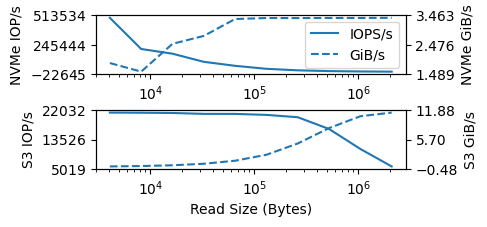

- Parquet, Arrow IPC, and Lance organize the same broad components differently: Parquet nests pages in column chunks and row groups, Arrow stores buffers in record batches, and Lance uses disk pages with either miniblock chunks or full-zip data.

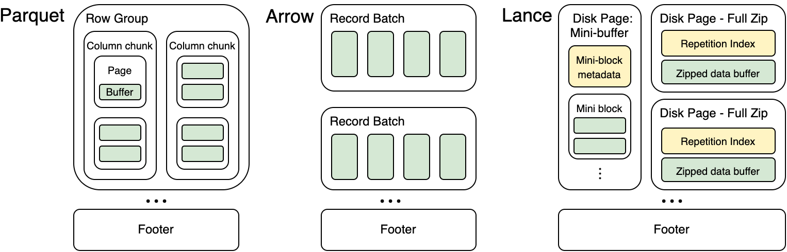

- Parquet flattens nested values into repetition levels, definition levels, and page-contained data buffers. A page-offset index can locate the page for one row in one I/O, but the page becomes the read-amplification unit and very small pages can make the in-memory index large.

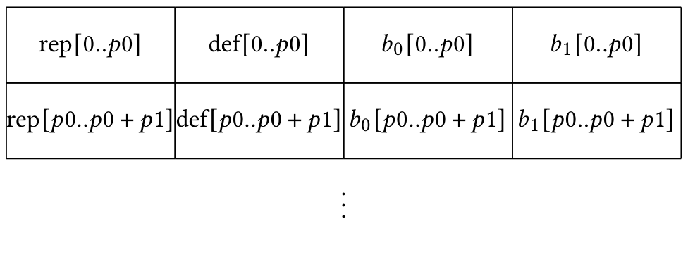

- Arrow-style nested layouts avoid page decoding but may require serial reads across validity, offset, and value buffers; the illustrated nullable list-of-strings lookup needs five reads in three phases.

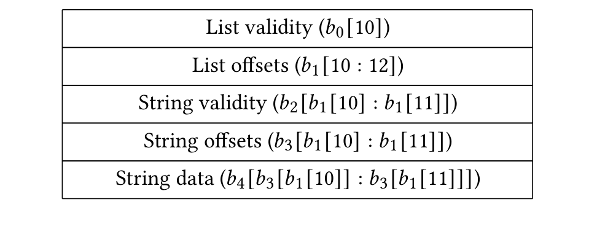

- Lance full-zip encoding interleaves a control word and the compressed buffers for each large value, using a repetition index for variable-width top-level lookup. This keeps a fixed-width lookup to one I/O and a variable-width lookup to two regardless of represented nesting depth, but requires transparent per-value compression and can store filler bytes for fixed-width nulls.

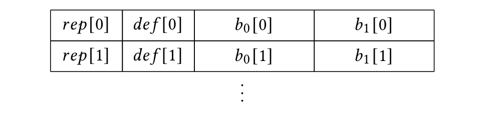

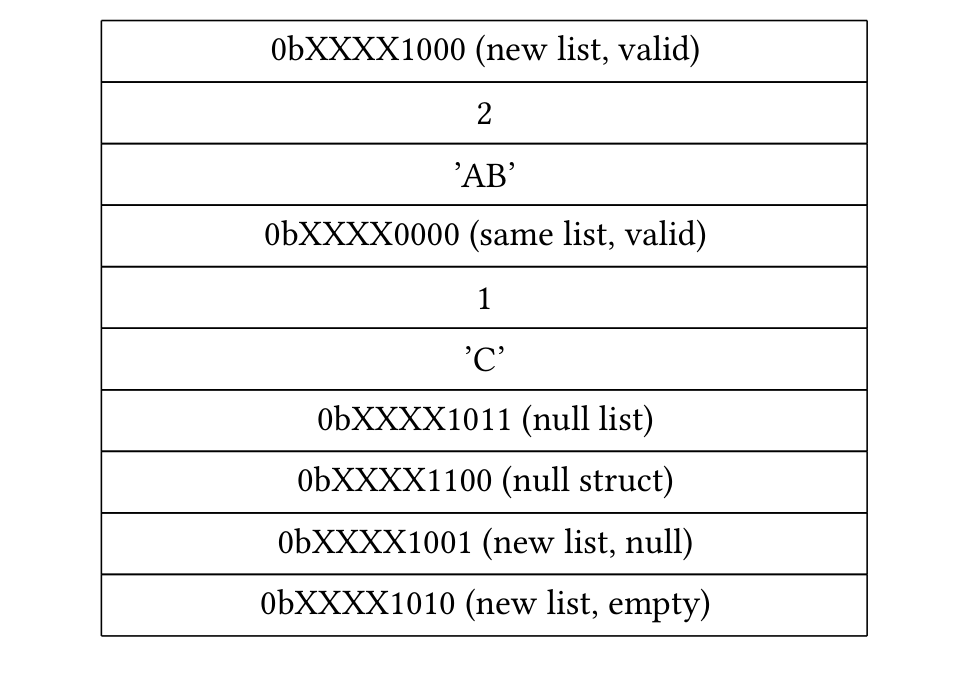

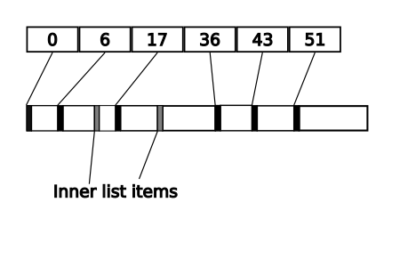

- Lance miniblocks target roughly 4–8 KiB compressed chunks for small values, retaining vectorized and opaque compression at the cost of decoding a whole chunk for one value. Per-chunk metadata and nested repetition indexes form a bounded search cache; the paper estimates at most 1.28 GiB per billion rows for a non-repeated column under its current design, versus 20 GiB for one-page-per-value parquet-rs indexes.

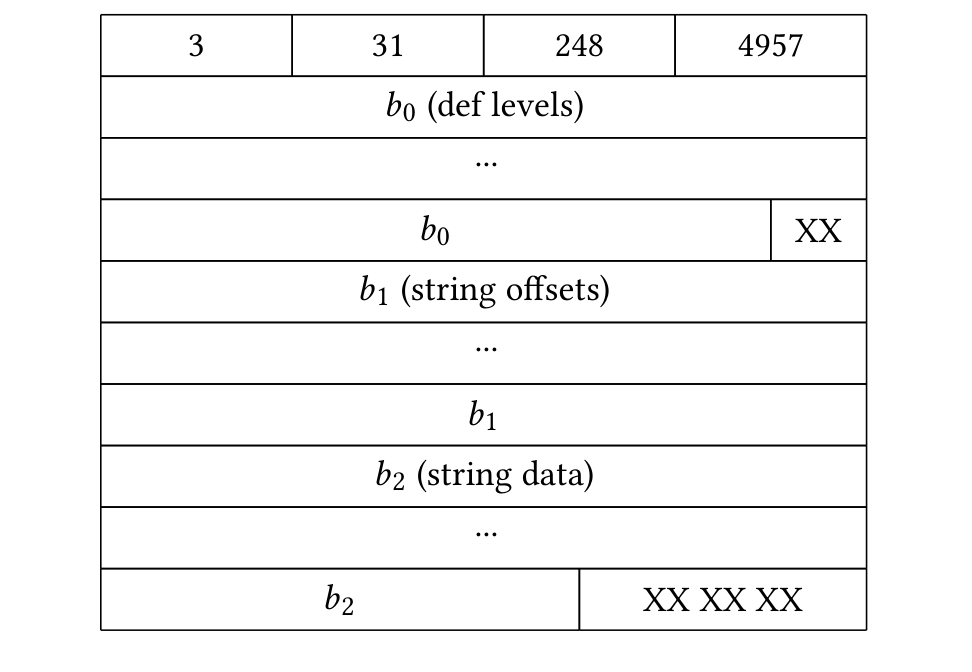

- Benchmark design must control coalesced access: overlap in selected pages disappears as datasets grow and depends strongly on value width and available page cache.

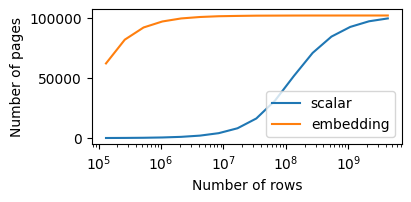

- With optimized parquet-rs settings and 8 KiB pages, Parquet fetched hundreds of thousands of values per second for most tested types and improved the default small-scalar result from about 5,500 to about 350,000 rows per second. Larger pages reduced point-lookup throughput; compression had a modest reported cost, while dictionary encoding performed poorly in the random-data test.

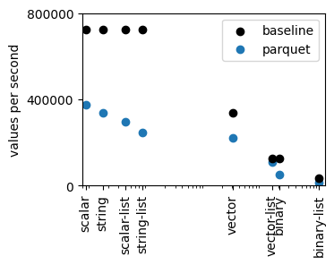

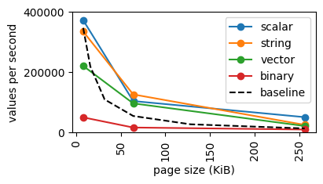

- Arrow-style Lance 2.0 performed well on simple types but deteriorated with strings and deeper nesting as more buffers required more I/O. Lance 2.1 and Parquet were more stable across nesting; full zip was lighter than miniblock for point access at every tested value width.

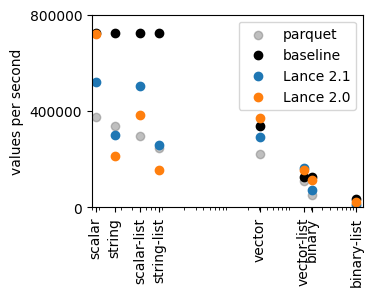

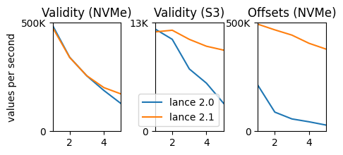

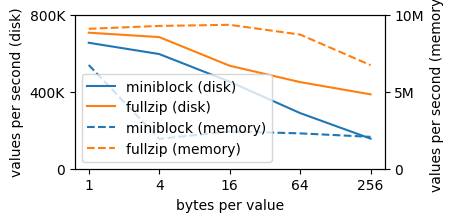

- Lance's tested encodings achieved compression ratios comparable to Parquet. In scans, Parquet often used about half the available disk bandwidth and row-group preferences varied by data type; Lance matched or exceeded the best tested Parquet throughput in seven of eight categories, primarily through better I/O utilization, while dates slightly favored Parquet and some Lance cases remained CPU- or scheduling-bound.

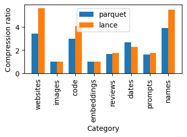

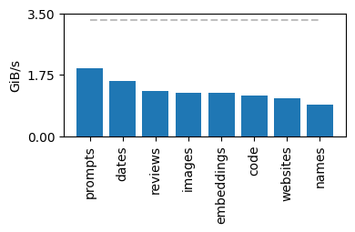

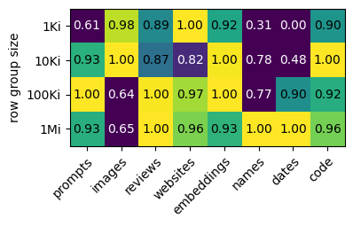

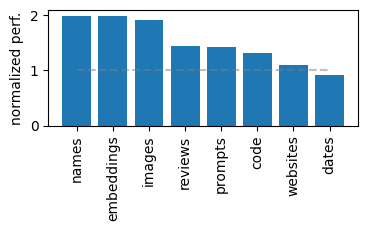

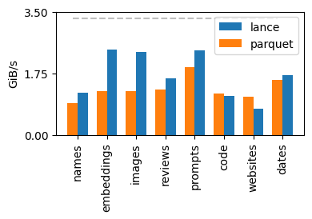

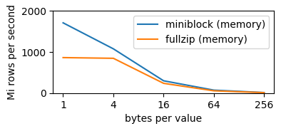

- Packing struct fields after compressing them independently reduces I/O when fields are fetched together, but scanning one field must read the rest; at five fields the experiment shows roughly twice the random-access throughput for packed data alongside declining single-field scan speed.

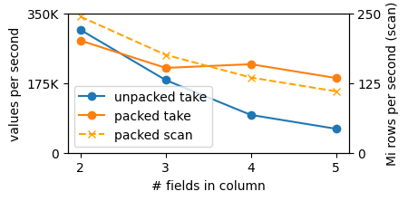

## Key Quotes
> "effective encoding of a column's structure ... is the key to unlocking the disk's performance" — the paper's distinction between structural and compressive encoding.

> "there is no universally correct structural encoding" — the authors' case for configurable rather than single-purpose physical layouts.

## Connections
- [[LanceFormat]] - implements the adaptive miniblock and full-zip structural encodings evaluated by the authors.
- [[ApacheParquet]] - mature comparison format whose page offset index enables much stronger random access than default settings suggest.
- [[ApacheArrow]] - supplies the in-memory-oriented multi-buffer structural layout modeled through Lance 2.0.
- [[ColumnarStorageTradeoffs]] - gains controlled evidence about I/O size, read amplification, cache size, nesting, decoding, compression, and scan scheduling.
- [[StoragePerformanceBenchmarking]] - coalescing, page cache, dataset scale, implementation tuning, and physical-device baselines materially change the result.
- [[LanceDB]] - employer of the authors and project context for the Lance implementation.

## Contradictions
- The paper qualifies the existing secondary Lance source's broad comparison by showing that optimized Parquet with a page offset index and 8 KiB pages can deliver strong NVMe random access and that both formats leave device performance unused in some cases.
- The scan and random-access results are first-party measurements on one Samsung 970 EVO Plus, one eight-core CPU, parquet-rs 54, Lance 2.0/2.1, selected data types, and warm metadata. They do not establish universal format rankings across modern versions, clouds, devices, concurrency levels, writes, or operational workloads.
- The nested repetition-index design is broader than the implementation evaluated: Lance 2.1 supported only one level of list lookup, run-length full zip was not implemented, and sector alignment plus `io_uring` were left as future work.

## Image Notes
All 21 effective local image references were opened and retained once at their semantic positions. They include six layout or encoding diagrams and fifteen storage or benchmark visualizations; filenames were replaced with descriptive canonical names and recorded in the source manifest.
