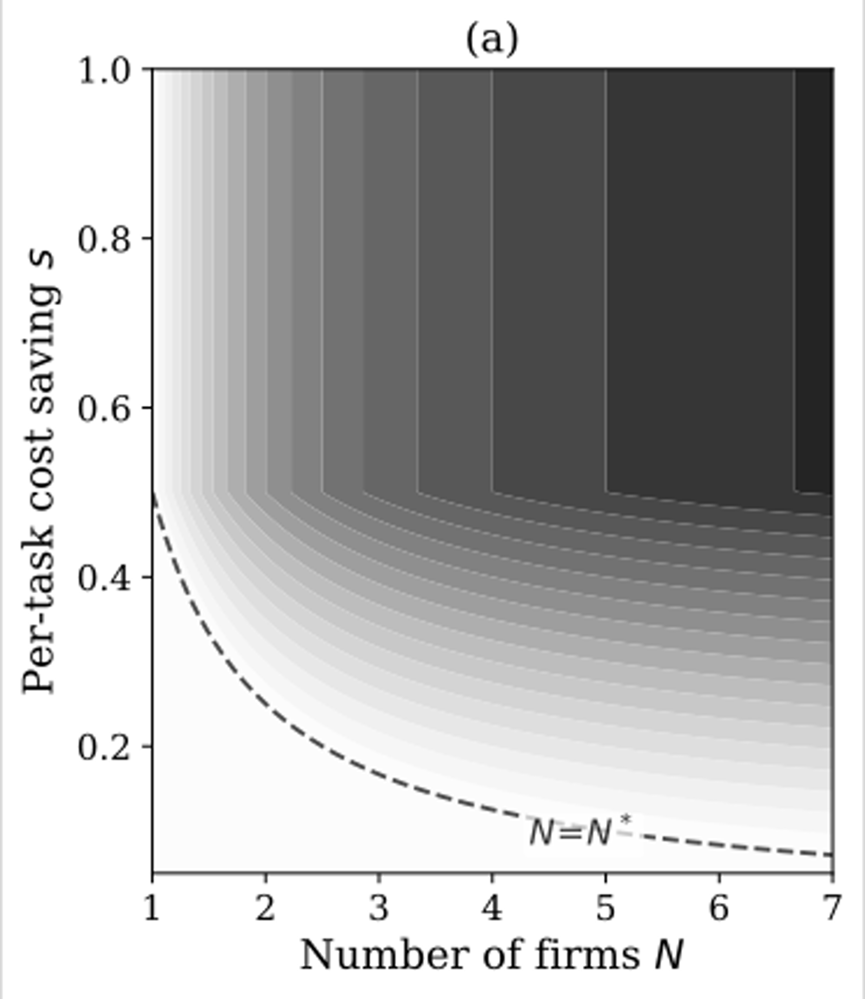
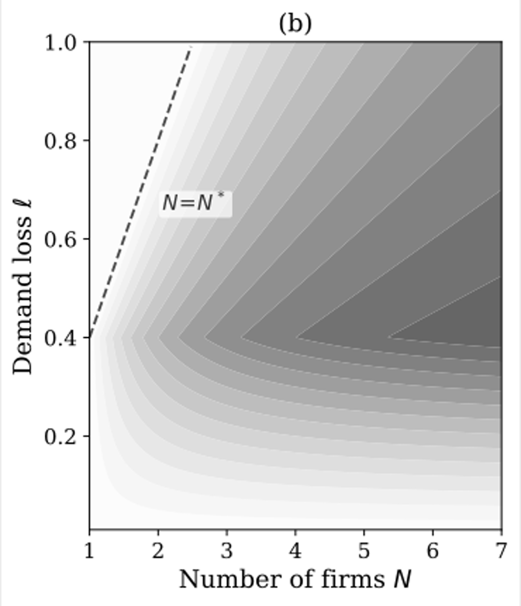
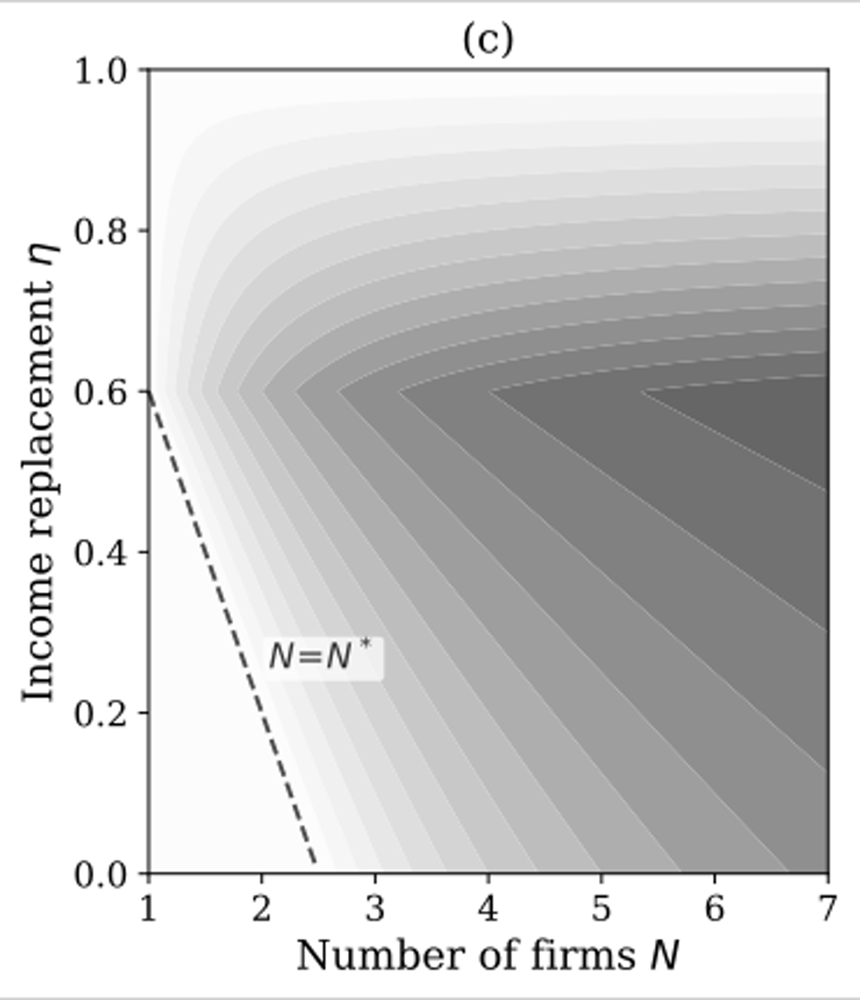
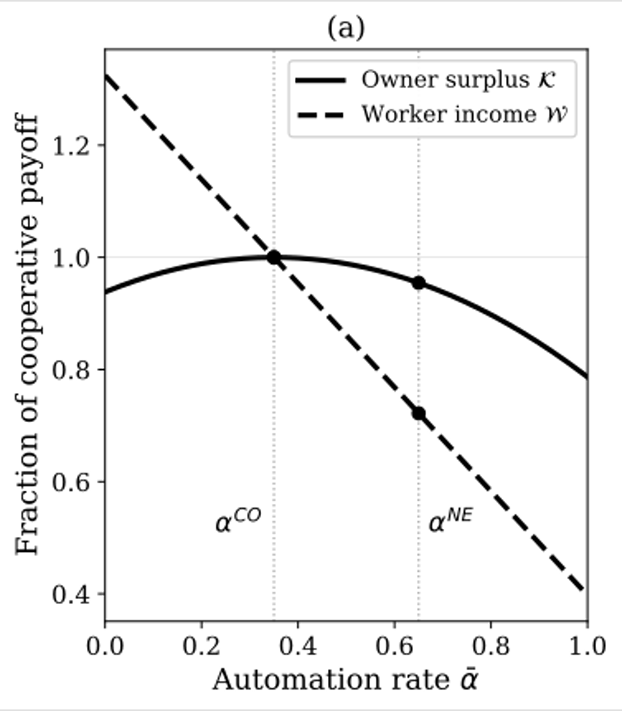
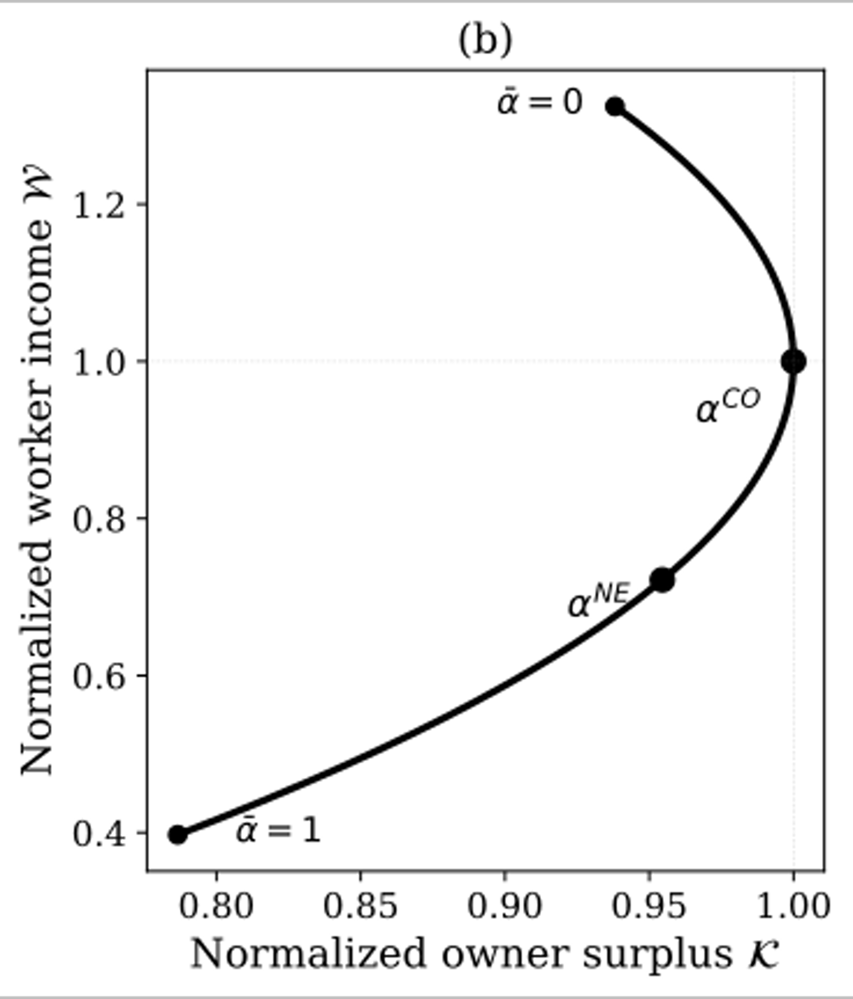
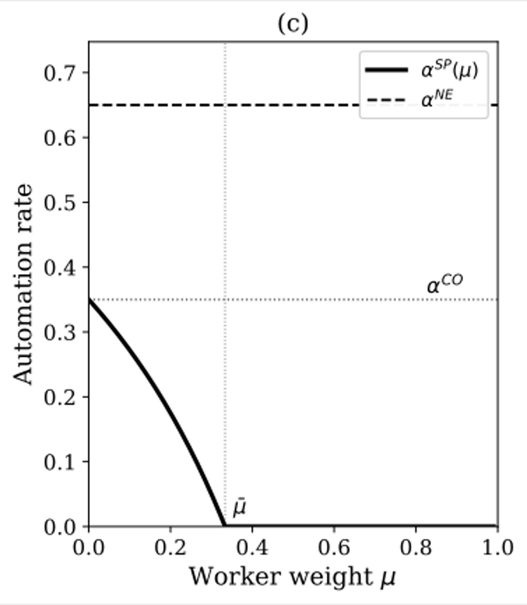

## Summary
[[BrettHemenwayFalk]] and [[GerryTsoukalas]] model an [[AutomationDemandExternality]] in which each competing firm captures the full cost saving from AI automation but bears only part of the demand lost when displaced workers lose income. The resulting dominant-strategy equilibrium can automate beyond the profit-maximizing cooperative rate, leaving both workers and owners worse off; greater competition and AI productivity can widen the distortion. Within the model, only a correctly calibrated [[PigouvianAutomationTax]] fully aligns the private automation margin with the cooperative optimum, while the empirical importance of the mechanism depends on incomplete worker-income replacement and failure of displaced spending to return through other sectors, investment, borrowing, or interest-rate adjustment.

## Key Claims
- A firm internalizes only `1/N` of the sectoral demand loss caused by its own layoffs, so the competitive equilibrium automation rate exceeds the cooperative rate whenever the modeled externality is active.
- The interior over-automation wedge is `l(1 - 1/N) / k`: it grows with the number of firms and demand lost per displaced worker, and shrinks with integration friction.
- With frictionless adoption, automation can become a Prisoner's Dilemma: full automation is strictly dominant even when collective restraint would increase every firm's profit.
- Over-automation is modeled as deadweight loss rather than a transfer to owners; the Nash rate can leave both aggregate owner surplus and worker income below their cooperative values.

- Unconditional basic income and proportional capital-income taxation change payoff levels but not the marginal automation incentive in the paper's formulation. Retraining, targeted income replacement, worker equity, capital-income recycling, and partial coalitions narrow the wedge without generally eliminating it.
- A per-task tax of `l(1 - 1/N)` charges each firm for the demand loss imposed on rivals and implements the cooperative optimum; directing revenue toward income replacement or retraining can reduce the required tax over time.
- Higher AI productivity adds a unilateral market-share incentive whose gains cancel when all firms automate, widening the equilibrium wedge without changing the modeled cooperative optimum.

## Key Quotes
> "each firm captures the full cost saving from automation but bears only a fraction of the demand loss" - the paper's central externality.

> "better AI, far from mitigating the externality, amplifies it" - the stated Red Queen effect.

## Connections
- [[AutomationDemandExternality]] - the paper's central product-market mechanism connecting layoffs, lost worker spending, rival revenue, and excessive automation.
- [[PigouvianAutomationTax]] - the only modeled instrument that fully corrects the active externality at the private decision margin.
- [[WorkplaceAutomation]] - extends activity-level automation analysis into competitive firm incentives, demand feedback, and worker displacement.
- [[BrettHemenwayFalk]] - coauthor affiliated with the University of Pennsylvania in the paper.
- [[GerryTsoukalas]] - coauthor affiliated with Boston University in the paper.

## Contradictions
- The paper qualifies optimistic [[WorkplaceAutomation]] accounts in which displaced activity is reabsorbed into equal- or higher-paid work: incomplete and slow income replacement makes automation reduce the demand firms collectively depend on.
- The result is a theoretical vulnerability, not evidence that a current economy-wide AI demand crisis exists. It relies on a one-period, symmetric, single-sector model and becomes a real rather than pecuniary externality only when lost spending is not fully reabsorbed through other consumption, investment, borrowing, or interest-rate adjustment.
