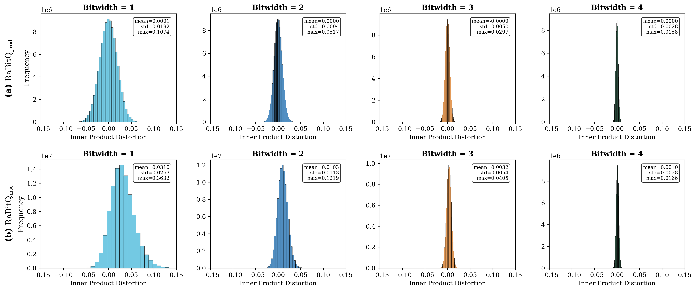
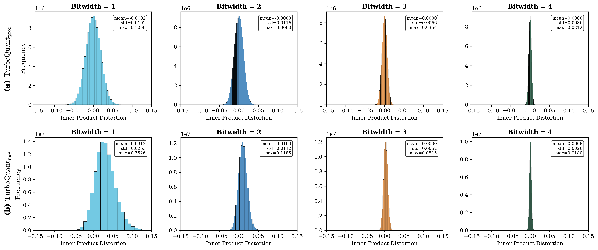
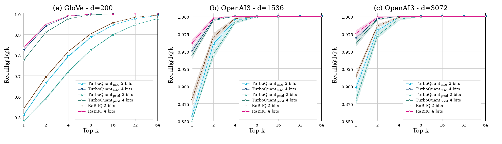
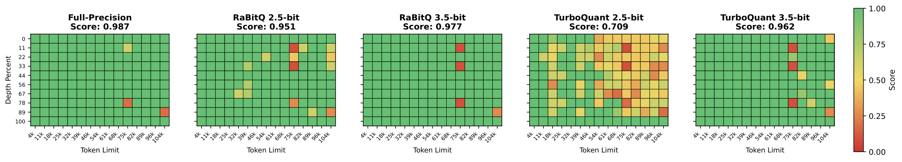

## Summary
This technical note by [[RaBitQ]] authors places RaBitQ and [[TurboQuant]] in one [[VectorQuantization]] framework and argues that their shared random-rotation structure obscures meaningful differences in codebooks, estimators, theoretical guarantees, and execution paths. Its released-artifact evaluation reports that RaBitQ generally has tighter inner-product error, higher approximate-nearest-neighbor recall, faster same-hardware quantization, and better 2.5-bit KV-cache results, while the methods are close at 3.5-bit KV-cache quantization. The comparison also alleges undisclosed hardware asymmetry and unreproducible TurboQuant runtime and recall results, but it remains an interested-party rebuttal rather than independent replication.

## Key Claims
- Both methods separate vector norm and direction, apply a shared random rotation, and quantize the rotated normalized coordinates; the principal differences come after this common preprocessing.
- RaBitQ uses a shifted uniform integer codebook, chooses a rescaling factor, stores one scalar, and estimates inner products directly from unsigned codes without codebook decoding; its bit structure can support coarse-to-fine incremental estimation.
- TurboQuant uses Lloyd-Max or one-dimensional k-means centroids for reconstruction. Its unbiased inner-product variant spends one bit per coordinate on a signed QJL residual correction, stores both vector and residual norms, and still decodes the first-stage centroid indices.
- The note claims RaBitQ has a sub-Gaussian tail guarantee attaining the optimal bit-width dependence of `log log(1/delta)`, whereas the published TurboQuant variance guarantee yields only `log(1/delta)` through Chebyshev's inequality.
- In the displayed DBpedia inner-product experiment, both unbiased variants remain near zero mean. At bit widths 2 and 3, RaBitQ's reported standard deviations are 0.0094 and 0.0050 versus TurboQuant's 0.0116 and 0.0066; the paired maximum errors are 0.0517/0.0297 versus 0.0600/0.0354.

The RaBitQ figure separates unbiased `prod` from reconstruction-oriented `mse` variants. The unbiased row stays centered near zero while its spread narrows from 0.0192 at one bit to 0.0028 at four bits; the reconstruction row is positively biased at lower bit widths.

The matching TurboQuant figure shows the same qualitative distinction, but its unbiased estimator has wider distributions than RaBitQ above one bit in these tests. At four bits the reported standard deviations are both 0.0036 for TurboQuant variants, versus 0.0028 for both displayed RaBitQ variants.

- On 100,000 four-bit vectors, the same-hardware GPU comparison reports RaBitQ versus TurboQuant quantization times of 0.009/0.011 seconds at 200 dimensions, 0.065/0.114 at 1,536 dimensions, and 0.152/0.276 at 3,072 dimensions. A faster RaBitQ GPU configuration using FWHT reports 0.003, 0.008, and 0.013 seconds, though that changes the rotation and quantization implementation.
- Across GloVe-200 and two OpenAI3 datasets, ten-run mean Recall@1@k curves place RaBitQ above both TurboQuant variants at two and four bits, with the largest gaps at small `k` and two bits; all methods converge toward perfect recall as `k` grows.

The recall figure also shows the reconstruction-oriented TurboQuant variant outperforming its unbiased inner-product variant in every displayed setting, a task-level result that complicates choosing variants from estimator theory alone.

- In KV-cache tests on Llama-3.1-8B-Instruct, the full-precision Needle-In-A-Haystack score is 0.987, RaBitQ scores 0.951 at 2.5 bits and 0.977 at 3.5 bits, and TurboQuant scores 0.709 and 0.962. LongBench-E averages likewise favor RaBitQ at 2.5 bits on both tested models, while the two methods are effectively tied at 3.5 bits on Llama.

The heatmaps localize TurboQuant's 2.5-bit failures: low scores appear across most needle depths and become denser at longer contexts, whereas both 3.5-bit methods remain close to the full-precision pattern.

- The authors could not run the released TurboQuant KV-cache code unchanged because it referenced an unpublished CUDA package and contained construction and control-flow bugs. They also report TurboQuant quantization times up to roughly two orders of magnitude slower than the original paper's figures on the stated A100 hardware.
- Private correspondence quoted by the note says the earlier TurboQuant comparison ran a Python RaBitQ implementation on a single CPU core with multiprocessing disabled while TurboQuant ran on an A100 GPU; the original report allegedly did not disclose this asymmetry.

## Key Quotes
> “TurboQuant offers no clear and consistent advantage over RaBitQ.” — the note's overall empirical conclusion.

> “we were using a single-core CPU instance, and multiprocessing was indeed disabled” — quoted private correspondence from a TurboQuant author about the RaBitQ baseline.

## Connections
- [[VectorQuantization]] — common framework for compressed vector representations that preserve reconstruction or inner products.
- [[RaBitQ]] — method developed by the note's authors and favored by its theoretical and empirical comparison.
- [[TurboQuant]] — competing method whose codebook, estimator, claims, and released implementation are examined.
- [[ApproximateNearestNeighborSearch]] — task where compressed inner-product estimates are ranked and evaluated with Recall@1@k.
- [[KVCacheCompression]] — second application where low-bit key caches are tested on retrieval and long-context benchmarks.
- [[BlockQuantization]] — adjacent low-precision design problem; the KV-cache experiment separately scales outlier and non-outlier channel groups.
- [[VectorDatabase]] — application setting in which vector codes reduce storage and similarity-computation cost.

## Contradictions
- The note directly disputes TurboQuant's reported empirical advantage, arguing that its runtime and recall results are not reproducible from released artifacts and that its RaBitQ baseline used undisclosed asymmetric hardware and parallelism.
- The methodological comparison is authored primarily by RaBitQ researchers and should be read as a technically detailed rebuttal. It provides code and repeated trials but no independent third-party replication, and some baseline facts rely on private email correspondence.
- The theory comparison is scope-sensitive: it contrasts RaBitQ's tail bound with the variance guarantee proved for TurboQuant's unbiased inner-product estimator. It does not show that every TurboQuant use, especially reconstruction-oriented deployment, inherits the Chebyshev-derived tail rate as its practical quality limit.
- Several variants change more than a method label: fast RaBitQ uses different rotation machinery, TurboQuant's reconstruction and unbiased variants optimize different objectives, and the KV-cache study repairs and unifies code that could not run as released. Those choices improve transparency but prevent every number from being a direct reproduction of the original artifacts.
