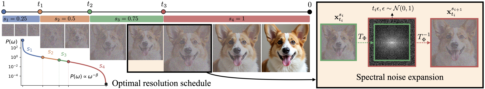
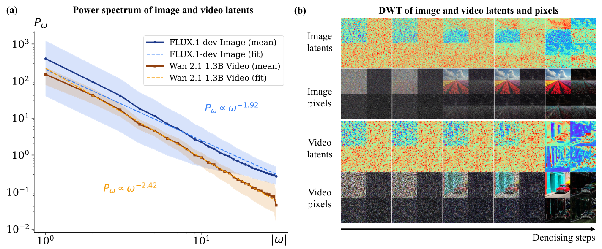
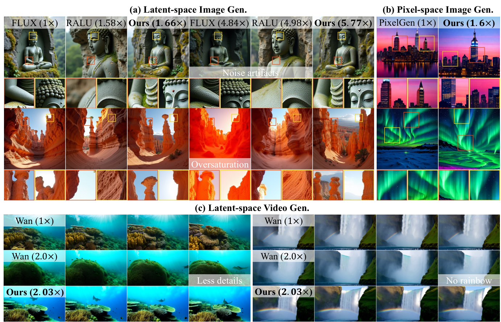
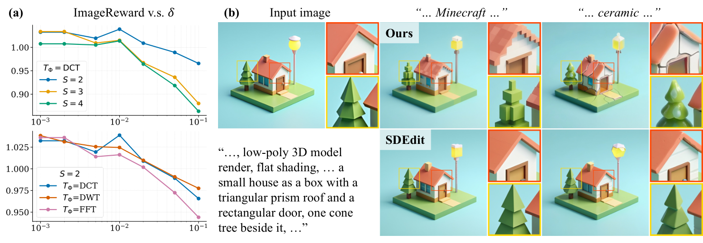

## Summary
[[HowardXiao]], [[BrianChao]], [[LiorYariv]], and [[GordonWetzstein]] introduce [[SpectralProgressiveDiffusion]], a progressive-resolution method that exploits the tendency of diffusion and flow-matching models to recover low spatial frequencies before high-frequency detail. It keeps early denoising at reduced resolution, expands the spectrum with correctly scaled high-frequency noise at power-spectrum-derived transition times, and optionally fine-tunes the model on the same staged trajectory. Tests on latent- and pixel-space image generation and latent-space video generation report substantial speedups with qualified quality retention, while the method assumes useful cross-resolution behavior and shows increasing artifacts under aggressive schedules.

## Key Claims
- Natural-image and learned image/video latent power spectra decay with spatial frequency, while Gaussian noise has a flat spectrum; early reverse-process high frequencies are therefore disproportionately noise-dominated.

- Spectral noise expansion embeds the current low-resolution coefficients in a larger spectrum, fills newly representable high-frequency coefficients with noise scaled to the transition time, then inverse-transforms and aligns both state magnitude and timestep before denoising resumes.
- A per-frequency activation criterion bounds the Bayes-optimal velocity predictor's deviation from pure noise under a Gaussian coefficient model. Combining that criterion with each resolution's Nyquist limit yields transition times controlled by one error tolerance `delta` rather than a separately tuned time for every stage.
- The framework applies without architectural changes to pretrained diffusion or flow-matching models; a stage-specific fine-tuning objective can reduce the gap between ordinary pretraining and the progressive-resolution inference path.
- On FLUX.1-dev, the reported training-free schedules reach up to 7.09x wall-clock speedup and 7.36x FLOP reduction at the most aggressive evaluated regime. On WAN 2.1 video generation, two- and three-stage schedules report 2.03x and 2.54x speedups, respectively.

- LoRA fine-tuning for 2,000 iterations improves the progressive variants' reported quality metrics on Z-Image and PixelGen while preserving most of their inference savings.
- Larger `delta` and more resolution stages trade quality for speed; DCT, DWT, and FFT behave similarly in the reported ablations, while DCT is the default because it is real-valued and supports non-power-of-two scaling.
- The same frequency-selective initialization enables image editing that changes high-frequency texture or style while retaining low-frequency geometry more consistently than the tested SDEdit-style baseline.

## Key Quotes
> "high-resolution computation on noise-dominated frequencies is largely redundant" - the efficiency premise.

> "extending the framework to temporal frequencies is a natural direction" - an acknowledged boundary of the spatial-spectrum method.

## Connections
- [[SpectralProgressiveDiffusion]] - the proposed progressive-resolution inference and fine-tuning framework.
- [[DiffusionModelSampling]] - the broader reverse-process setting whose solver path, schedule, resolution, and model evaluations jointly determine cost and output.
- [[HowardXiao]] - coauthor affiliated with Stanford University and supported by a Stanford Graduate Fellowship.
- [[BrianChao]] - coauthor supported by Stanford and NSF graduate fellowships.
- [[LiorYariv]] - Stanford-affiliated coauthor.
- [[GordonWetzstein]] - Stanford-affiliated coauthor.
- [[DeepLearning]] - supplies the learned velocity predictor whose expensive high-resolution evaluations the schedule reduces.

## Contradictions
- The paper extends [[DiffusionModelSampling]] beyond step count, solver order, stochasticity, and noise scheduling: spatial resolution and frequency activation can also vary along one denoising trajectory to reduce model-evaluation cost.
- Reported quality retention is not uniform. More aggressive `delta` values produce ghosting and halo artifacts, extra stages give diminishing speed gains, and some quantitative metrics fall even when qualitative examples look competitive.
- The activation-time proof assumes independent Gaussian spectral coefficients and monotonically decreasing power with frequency. Natural data and learned latents need not satisfy those assumptions exactly, so the schedule is a principled approximation rather than a universal optimum.
- Experiments cover four named backbones, selected benchmarks, one principal hardware class, 200 video prompts, and source-selected qualitative examples. They do not establish independent replication, human preference, energy use, temporal-frequency acceleration, or behavior outside the models' multi-resolution training support.
