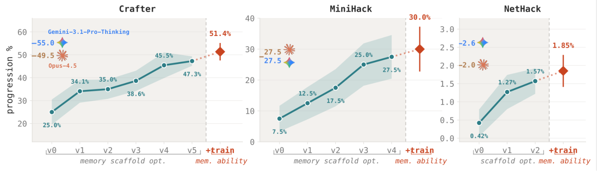
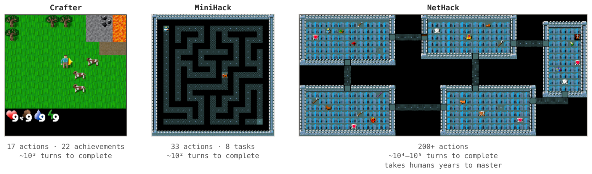
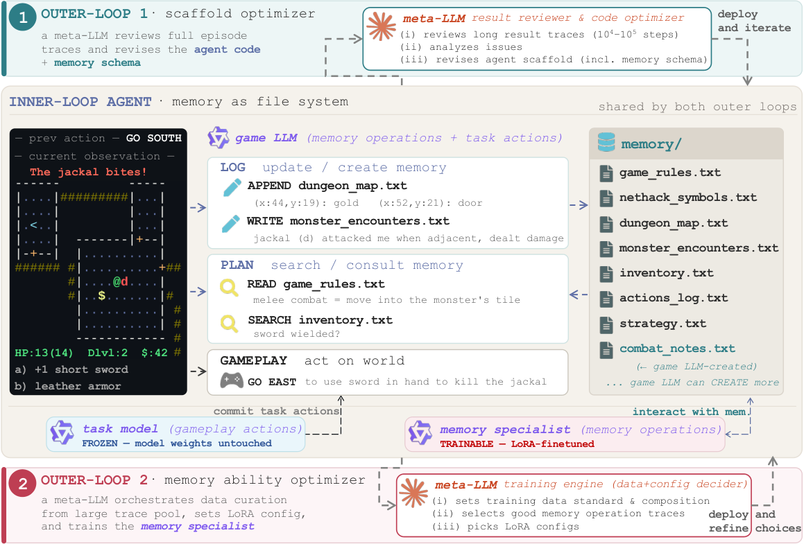
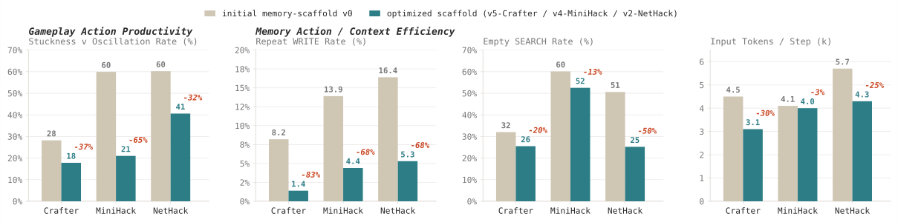
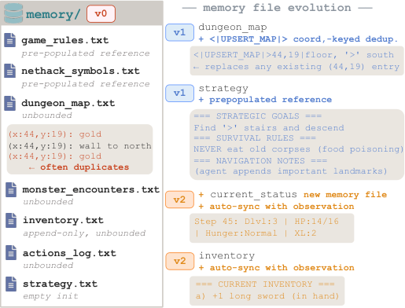
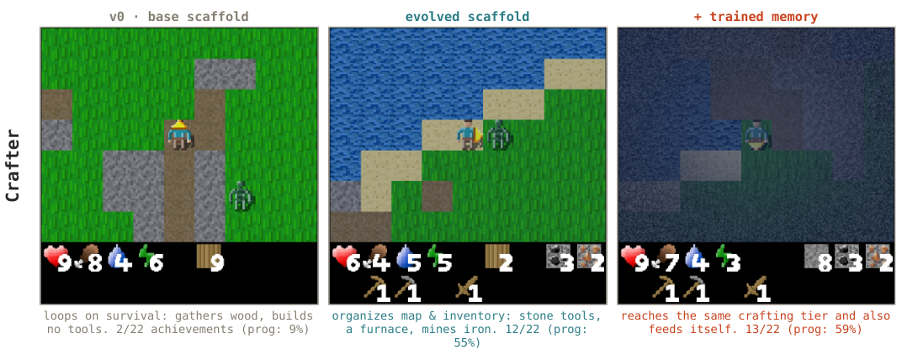
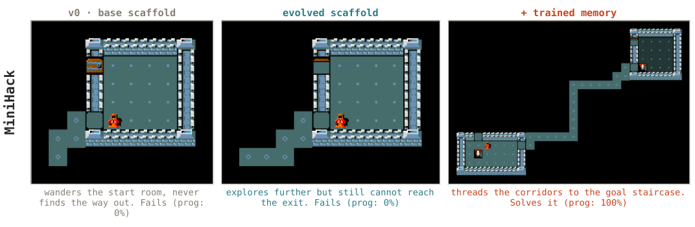
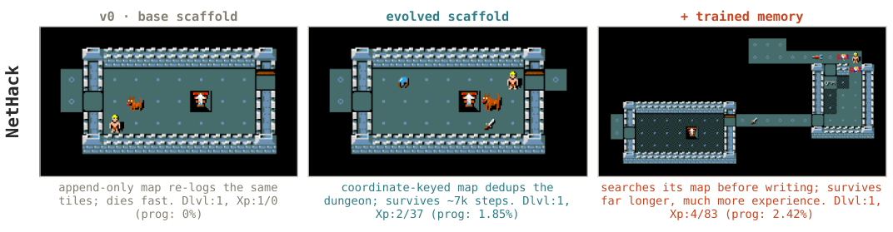

## Summary
Wu, Zhu, Zhang, Wang, and Yeung-Levy present [[AutoMem]], a framework that treats [[AgentMemory]] management as a trainable [[Metamemory]] skill rather than only a fixed retrieval architecture. A meta-LLM first revises prompts, code, action vocabulary, and file schemas from complete long-horizon trajectories; a second loop selects good memory operations from the agent's own traces and LoRA-trains a dedicated memory specialist while leaving the gameplay model frozen. Across Crafter, MiniHack, and NetHack, the authors report roughly 2–4× progression gains over the initial file-memory agent, but the evidence is limited to three games, separately optimized per-environment systems, fresh episodic memory, and small fixed evaluation sets.

## Key Claims
- Memory management can be represented as explicit read, write, append, search, create, and update actions chosen alongside task actions, making each decision observable and trainable.
- [[AutoMem]] separates memory skill into structure and proficiency: one outer loop revises the agent scaffold from complete traces, while another curates the agent's own good memory actions and configures LoRA training.
- The inner loop separates LOG, which decides what to record after an observation, from PLAN, which retrieves information before choosing a world action.
- Scaffold optimization raises reported progression from 25.00% to 47.27% in Crafter, 7.50% to 27.50% in MiniHack, and 0.42% to 1.57% in NetHack without changing model weights.
- Memory-specialist training further raises progression to 51.36%, 30.00%, and 1.85%, respectively, while the frozen gameplay model retains responsibility for task-action commitment.
- The optimized scaffolds reduce unproductive gameplay actions by 32–65%, redundant writes by 68–83%, empty searches by 13–50%, and per-step input context by 3–30% across the reported environments.
- Concrete scaffold changes include coordinate-keyed map upserts, auto-synchronized inventory and status files, bounded action logs, preloaded strategy knowledge, loop detection, and validation before impossible or unsafe actions.
- The trained specialist develops a consult-before-write pattern: LOG-phase writes per search fall 54% in Crafter and 72% in both MiniHack and NetHack.

## Key Quotes
> "Memory management is an independently learnable skill" — conclusion

> "long-horizon task improvement can decompose into trajectory-level review and targeted revision" — conclusion

## Connections
- [[AutoMem]] — research framework implementing the two-loop optimization process.
- [[AgentMemory]] — broader capability whose action policy and supporting structure are optimized.
- [[Metamemory]] — cognitive framing for deciding what to encode, retrieve, and organize.
- [[LLMContextManagement]] — external files reduce the amount of history that must remain in active context.
- [[ParameterEfficientFineTuning]] — LoRA adapts the memory specialist without modifying the gameplay model.
- [[SoftwareVerification]] — fixed-seed progression gates decide whether scaffold revisions are retained.

## Contradictions
- The paper complements architecture-centered memory sources by showing that memory-operation proficiency can be trained, but it does not replace their requirements for provenance, conflict handling, retention, privacy, correction, authorization, or cross-session lifecycle management.
- The strongest claims are source-scoped: evaluation uses three procedurally generated games, ten fixed seeds, only five NetHack episodes, one 32B base-model family, and separate scaffolds and specialists per environment.
- Memory starts fresh each episode, so the study does not test persistent cross-episode knowledge, memory evolution, forgetting, privacy, or conflict resolution.
- Full AutoMem changes both the scaffold and a dedicated memory model; claims that “memory alone” drives the gain mean the gameplay model remains frozen, not that the overall agent is unchanged.
- Comparisons with frontier systems use BALROG leaderboard results and progression rates rather than matched cost, latency, token use, or identical inference configurations.
- The paper reports means and standard errors but no statistical significance tests, independent replication, real-world task study, general memory policy, or safety evaluation for high-stakes deployment.
