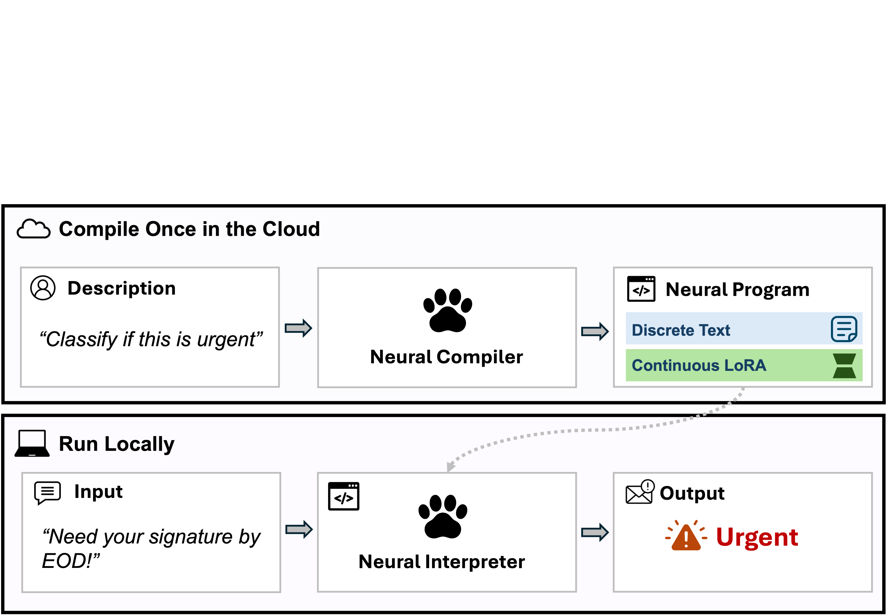
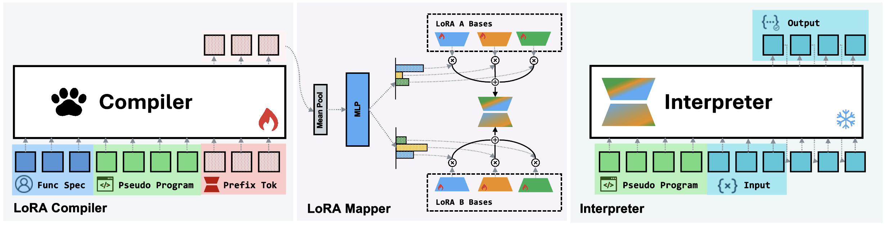
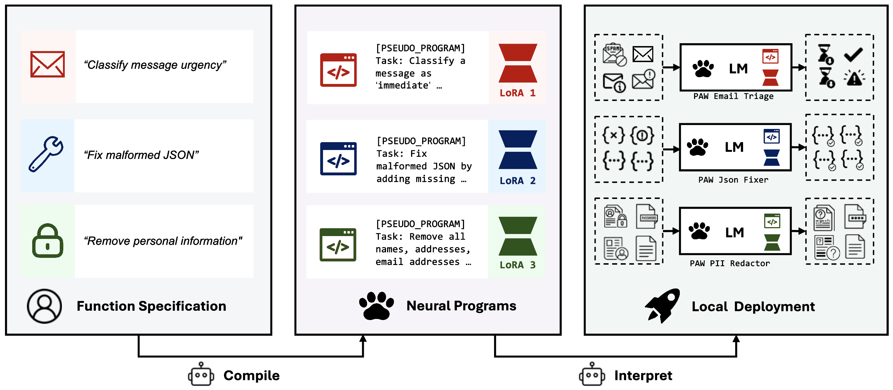

## Summary
Zhang, Hotsko, Kim, Nie, Shieber, and Deng propose [[ProgramAsWeights]], a compiler-interpreter system for turning a natural-language [[FuzzyFunctions|fuzzy function]] specification into a reusable neural program. A prompted 4B pseudo compiler rewrites the specification and a trained 4B LoRA compiler emits a task-specific [[ParameterEfficientFineTuning|PEFT]] module for a frozen 0.6B interpreter. On the paper's synthetic [[FuzzyBench]] evaluation, the best Qwen3-0.6B configuration reaches 73.78% exact match versus 68.70% for direct Qwen3-32B prompting, while quantized local execution uses a shared roughly 430–484 MB base plus a 23 MB adapter. The evidence is promising but bounded by synthetic data, coupled compiler-interpreter pairs, opaque continuous programs, single-step tasks, and first-party case studies.

## Key Claims
- The useful unit of amortization can be a function definition: invoke a large model once to build a reusable task artifact, then execute each input with a small frozen local model.
- A PAW program is hybrid: a discrete pseudo-program restates the task and supplies examples, while a generated continuous adapter provides behavior that text prompting alone does not reliably induce in the small interpreter.
- The LoRA compiler mean-pools task-conditioned hidden states and predicts mixing coefficients over shared rank-64 bases for attention and MLP modules; this simpler mapper outperformed more expressive variants in the reported ablations.
- On FuzzyBench's verified held-out specifications, Qwen3-0.6B PAW reaches 73.78% exact match, exceeding direct Qwen3-32B prompting at 68.70% and same-base full fine-tuning at 58.40%.
- A $Q4_K_M$ 0.6B base plus $Q4_0$ adapter occupies about 507 MB and scores 64.53% on the 4,096-example quantization subset, 1.27 points below the 65.80% bf16 reference; $Q6_K$ plus $Q4_0$ is effectively unchanged at 65.75%.
- Swapping the compiler for a vision-language model while retaining the text-only interpreter supports image-conditioned tasks, but the preferred PEFT and pseudo-program design depend on output form and context pressure.
- The pseudo-program acts as a specification denoiser: under heavy typos it improves accuracy by 4.46 points over feeding the raw specification to the interpreter.
- Five application studies cover log triage, site navigation, search reranking, tool-call preprocessing, and a multilingual word game, illustrating composition around deterministic code rather than validating long-horizon neural programs.

## Key Quotes
> "PAW reframes the foundation model from a per-input problem solver into a tool builder." — abstract

> "The crucial difference is that the executable here is a learned parameter blob, and the runtime is a neural network." — Section 2

## Connections
- [[ProgramAsWeights]] — the paper's compiler-interpreter system and developer-facing neural-program artifact.
- [[FuzzyFunctions]] — the class of underspecified or noise-sensitive functions targeted by the paradigm.
- [[ParameterEfficientFineTuning]] — LoRA and prefix-tuning supply the continuous program representation.
- [[FuzzyBench]] — the 10M-example synthetic training and evaluation dataset introduced with the system.
- [[LocalFirstSoftware]] — compiled adapters can be cached, versioned, distributed, and executed offline after the shared interpreter is installed.
- [[QuantizationAwareTraining]] — related low-precision concerns shape the local deployment footprint, although the reported PAW deployment uses post-training GGUF quantization.

## Contradictions
- No direct contradiction with an existing wiki page was identified.
- The paper qualifies any broad claim that one generated adapter form is universally best: LoRA leads on text and diagram-style tasks, while prefix-tuning is stronger on the reported long-form image-to-markup tasks.
- The 73.78% headline comes from a synthetic benchmark generated by gpt-5.2 and filtered by model agreement; the paper does not establish equivalent accuracy across independently collected production tasks.
