## Summary
[[ZhenyuHou]], [[YujiangLi]], [[JieTang]], and [[YuxiaoDong]] present [[SingleRolloutAsynchronousOptimization]] (SAO), an [[AsynchronousReinforcementLearning]] method that trains on each completed agent trajectory instead of waiting for prompt-level response groups. The method combines direct rollout-to-current-policy importance ratios, double-sided token masking, a more frequently updated frozen-attention critic, and observation-skipping token-level advantage estimation. On one Qwen3-30B-A3B backbone, the authors report stable long-running training and higher reasoning and coding accuracy than GRPO variants, but the evidence is first-party, backbone- and task-specific, and does not isolate throughput, total compute, or production GLM-5.2 results.

## Key Claims
- Grouped sampling creates a synchronization barrier in asynchronous workloads: completed trajectories wait for the slowest response in their prompt group, increasing policy lag and making [[GroupRelativePolicyOptimization]] structurally awkward when only one trajectory is available per prompt.

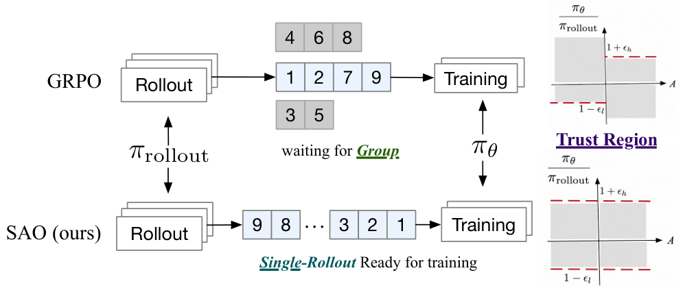

- SAO computes token importance ratios directly between the current policy and the recorded rollout probabilities, then masks every token outside a double-sided trust interval instead of preserving standard PPO's advantage-dependent one-sided clipping behavior.
- Single-rollout updates remove the group barrier but require a learned value baseline. SAO performs two critic updates per policy update, freezes the critic's attention parameters while updating its MoE projections, and scales value pretraining to reduce cold-start error.
- For action-observation-action traces, skip-observation GAE connects the final token of one model action directly to the first token of the next, avoiding value propagation through externally generated observation tokens.
- Across the paper's four reasoning benchmarks, SAO reports 74.0%-97.3% accuracy versus 55.8%-84.2% for GRPO; on SWE-Bench Verified it reports 29.8% versus 27.0% for GRPO with direct importance sampling and 23.0% for the base model.

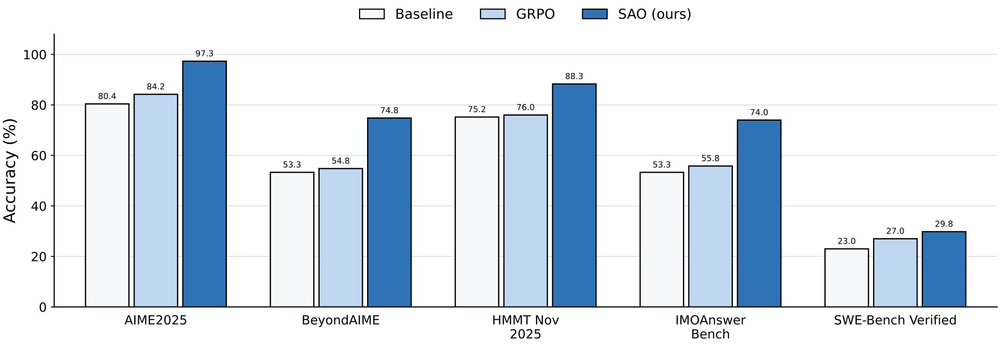

- Vanilla GRPO collapses around 160 steps in all three displayed training curves, while GRPO with direct importance sampling remains stable and SAO separates more clearly after about 400 steps.

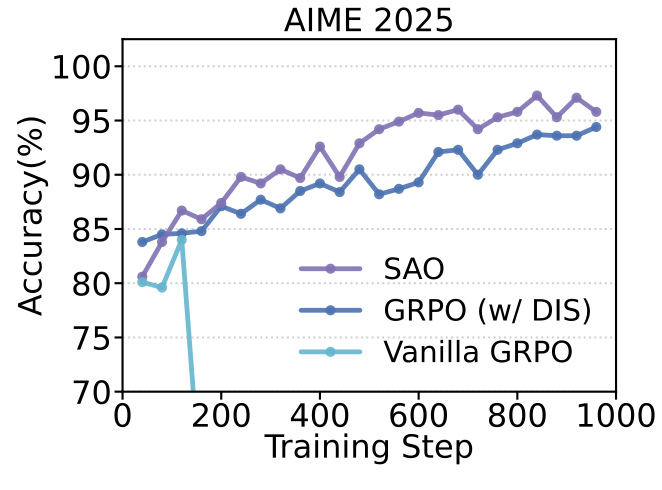

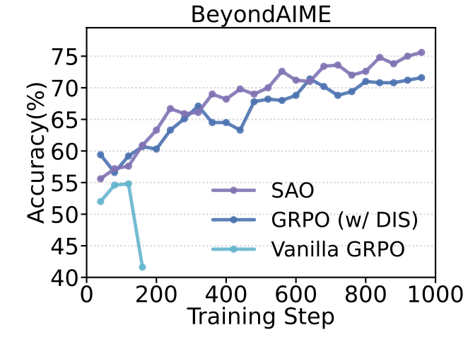

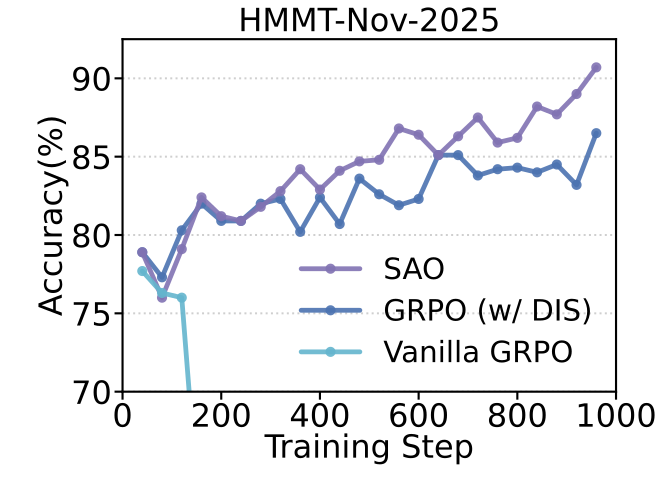

- The ablations associate two critic updates with higher late-stage explained variance, frozen attention with much lower critic gradient norms, and direct importance masking with a nonzero clip ratio absent from collapsing vanilla VAPO.

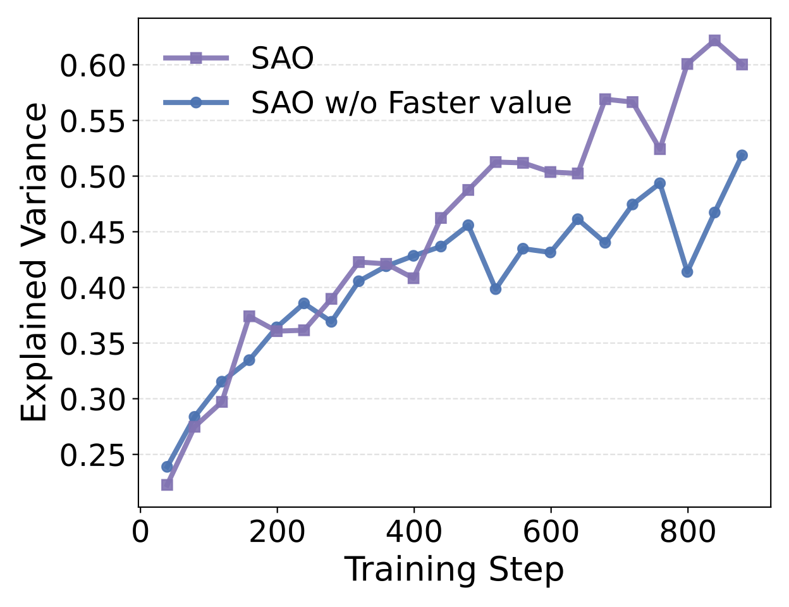

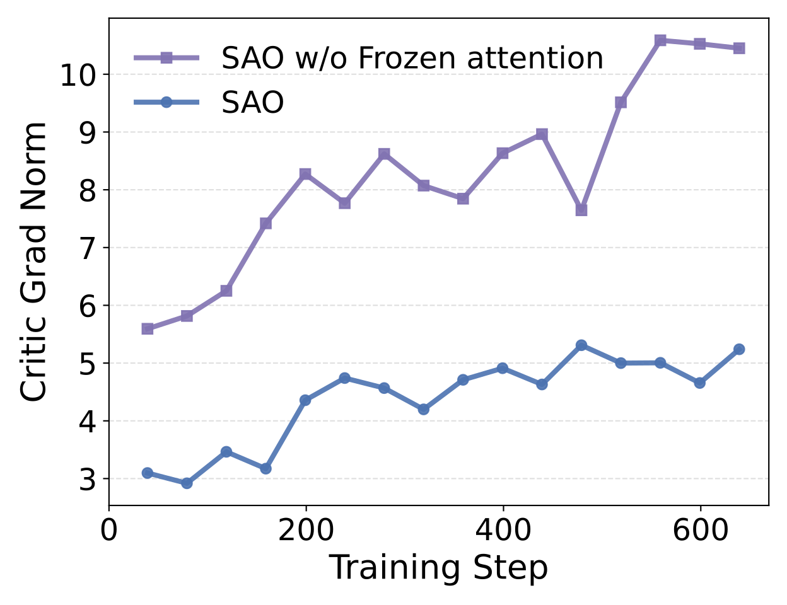

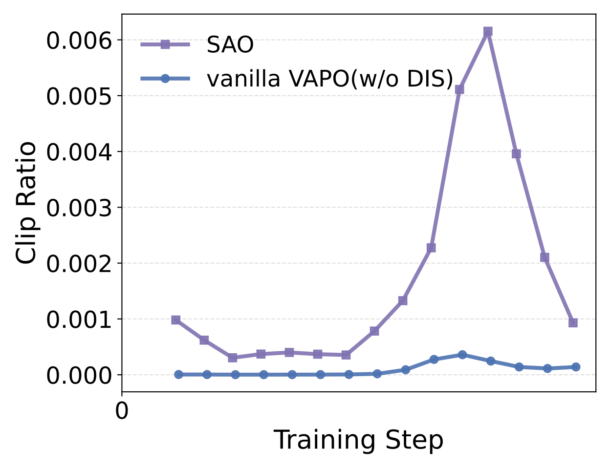

- In a simulated online writing task, SAO realigns toward sequentially changing style rewards and eventually recovers to higher reward than a 128-sample running-mean baseline; token-level training also outperforms two step-level variants at 400 steps.

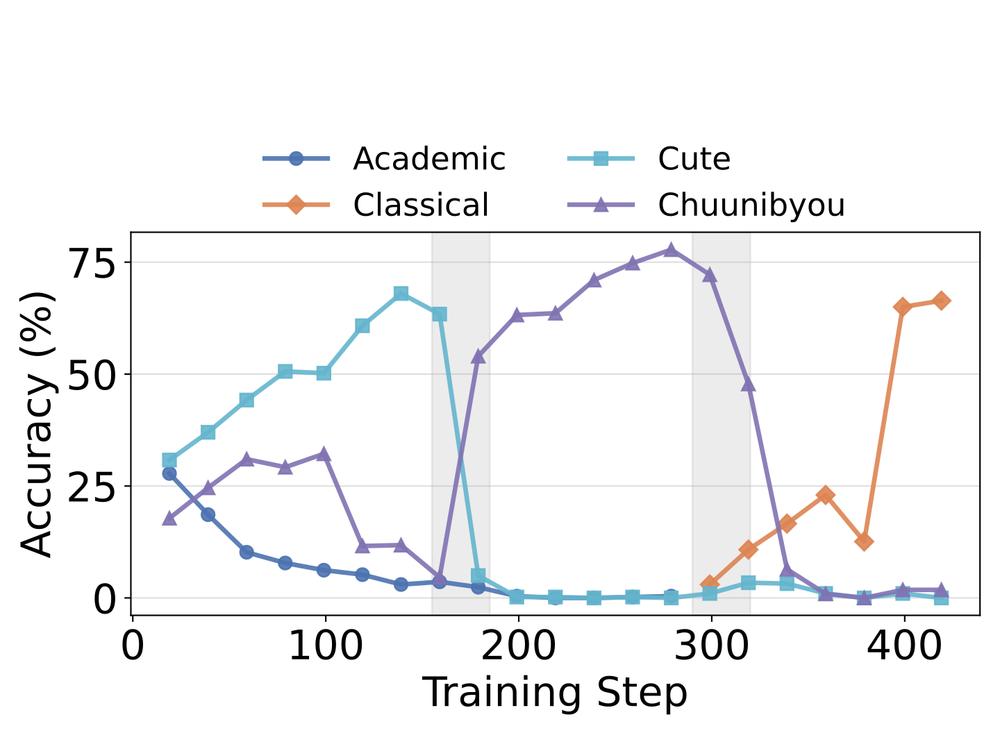

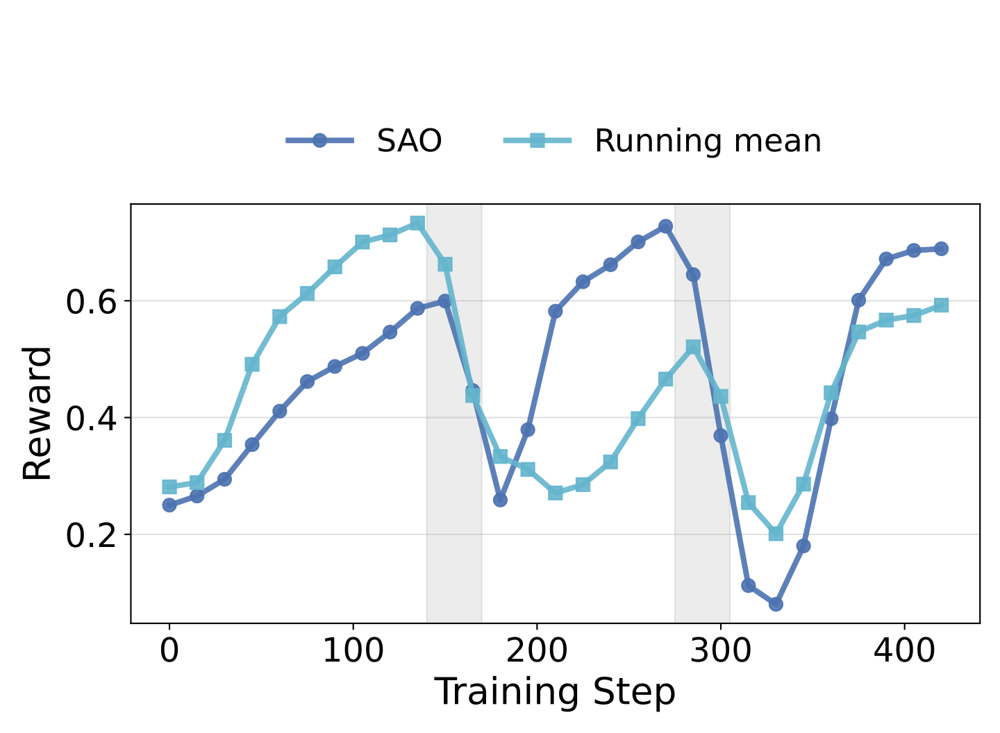

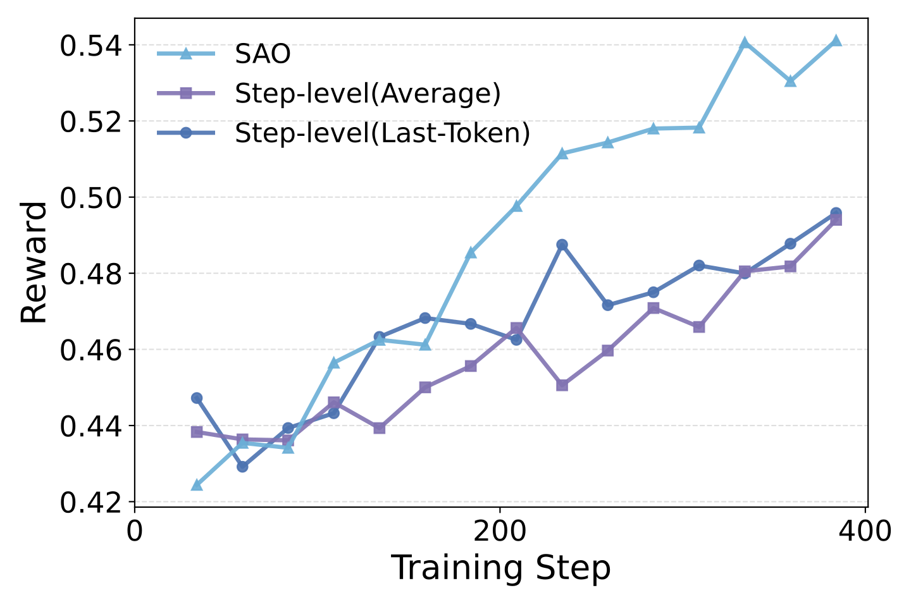

## Key Quotes
> "each trajectory becomes available for training immediately upon completion" — the scheduling distinction between SAO and grouped asynchronous optimization.

> "we accept a controlled degree of off-policy bias" — the tradeoff made by using recorded rollout probabilities directly instead of reconstructing historical old policies.

## Connections
- [[SingleRolloutAsynchronousOptimization]] — the proposed actor-critic method and its linked stability mechanisms.
- [[AsynchronousReinforcementLearning]] — the broader actor-learner setting in which variable rollout length creates stragglers and policy lag.
- [[GroupRelativePolicyOptimization]] — grouped, critic-free baseline whose synchronization requirements motivate SAO.
- [[ReinforcementLearning]] — broader policy-learning framework for the reasoning, coding, and online adaptation experiments.
- [[ZhenyuHou]] — equal-contribution Tsinghua University author and former Z.AI intern during the work.
- [[YujiangLi]] — equal-contribution Tsinghua University author and former Z.AI intern during the work.
- [[JieTang]] — Tsinghua University coauthor.
- [[YuxiaoDong]] — Tsinghua University coauthor.

## Contradictions
- The paper directly qualifies the wiki's earlier critic-removal benefit for GRPO: eliminating a value model reduces one source of cost and error, but grouped response completion can increase latency and policy staleness in asynchronous, long-horizon agent workloads.
- The comparison does not establish that single-rollout optimization is universally better. All principal experiments use one Qwen3-30B-A3B backbone and agentic reasoning, coding, or simulated style tasks; smaller models, dense-reward environments, short synchronous rollouts, and open-ended RLHF may behave differently.
- Several changes are bundled. SAO combines single-rollout sampling, direct double-sided masking, scaled value pretraining, two critic updates, frozen attention, and skip-observation GAE, so endpoint gains do not isolate a single-rollout causal effect.
- The online study uses an LLM judge and controlled binary style rewards rather than real users. The authors explicitly require stronger safeguards, monitoring, and privacy review for live adaptation.
- The abstract says SAO was deployed in GLM-5.2 training, but the paper supplies no GLM-5.2 ablation, compute accounting, throughput comparison, or production outcome attributable to SAO.
