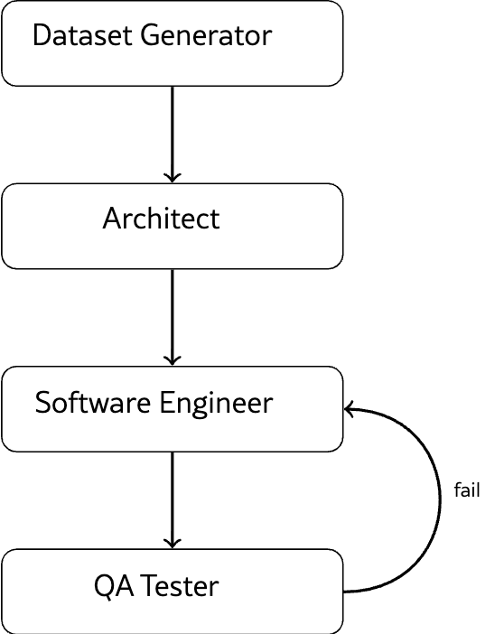
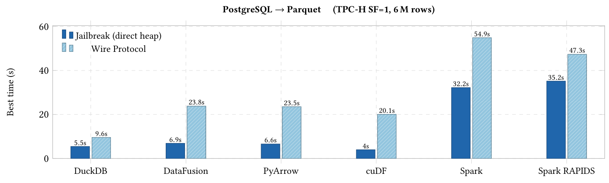
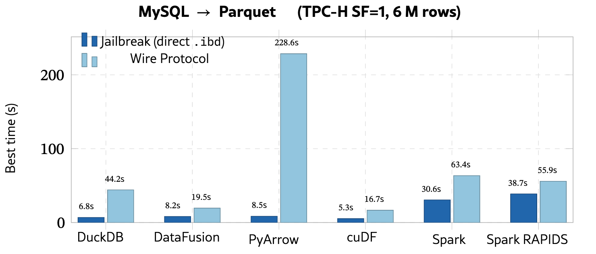
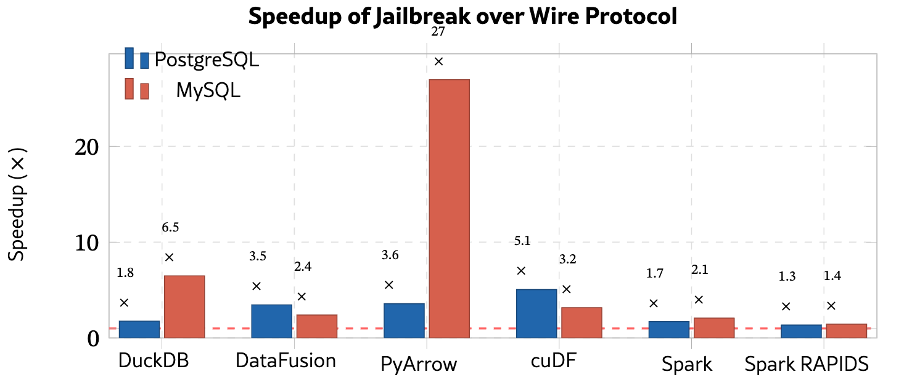

## Summary
Victor Giannakouris and Immanuel Trummer present [[Jailbreak]], a database-bypass method that reads PostgreSQL heap files and MySQL InnoDB tablespaces directly into Apache Arrow buffers instead of moving rows through a database server and wire protocol. Their hand-assisted C++ readers reproduce all 22 TPC-H query results in the tested snapshot setting and reduce database-to-Parquet time across six engines, while a four-role agent pipeline is proposed and implemented to regenerate such readers from schemas, documentation, and source code. The evidence supports [[DatabaseBypass]] and [[AgenticStorageReaderSynthesis]] as promising bounded techniques, but not yet as safe general replacements for database-managed reads.

## Key Claims
- Direct storage readers can remove query execution, row serialization, client deserialization, and format-conversion work from analytical exports while emitting zero-copy Arrow RecordBatches.
- The PostgreSQL and MySQL readers decode page layouts, tuple visibility or deletion state, type encodings, variable-width values, and selected index metadata in single sequential scans.
- On TPC-H SF=1 `lineitem` extraction to Parquet, the paper reports 1.3-5.1x PostgreSQL speedups and 1.4-26.9x MySQL speedups across DuckDB, DataFusion, PyArrow, cuDF, Spark, and Spark RAPIDS.
- A Dataset Generator, Architect, Coder, and QA Tester form a bounded generate-compile-run-compare-repair loop; deterministic row and aggregate checks are the primary oracle, with an LLM diagnosing only failures.

- Checkpoints, retry history, repeated-source hashes, and resume support make generation failures inspectable, but the authors have not yet reported convergence rates, generation latency, agent ablations, or broad version coverage.
- The evaluated path assumes analytical snapshots or controlled replicas; direct file access does not inherit the database server's full transaction, concurrency, authorization, recovery, compatibility, or semantic guarantees.

## Key Quotes
> "This bottleneck is not inherent to the data itself, but to the access path." - motivation for bypassing the server-mediated export path

> "A correctly functioning reader requires no LLM invocation in the QA step at all." - deterministic verification boundary

## Connections
- [[Jailbreak]] - project implementing and proposing the direct-reader approach.
- [[VictorGiannakouris]] - coauthor and Cornell researcher.
- [[ImmanuelTrummer]] - coauthor and Cornell researcher.
- [[DatabaseBypass]] - direct storage-file access pattern evaluated by the paper.
- [[AgenticStorageReaderSynthesis]] - schema-to-reader generation and verification workflow.
- [[AgenticWorkflowPatterns]] - the Coder-QA loop is an evaluator-optimizer workflow with a deterministic oracle.
- [[PostgreSQLPageArchitecture]] - the PostgreSQL reader depends on heap-page headers, line pointers, tuple headers, and BRIN summaries.
- [[PostgreSQL]] - one of the two evaluated source databases.
- [[MySQL]] - one of the two evaluated source databases.
- [[DatabaseCentricApplicationLogic]] - bypass trades database-owned semantics and enforcement for a narrower analytical data path.

## Contradictions
- No direct factual contradiction was identified. The source qualifies database-centered designs by showing a faster snapshot-export path, but its lightweight PostgreSQL visibility test is not equivalent to the complete live-server transaction machinery in every state.
- The paper's “full correctness” claim is bounded to all 22 TPC-H query results in the tested schemas and versions; converting arbitrary-precision numeric or decimal values to float64 and omitting broader concurrency and version tests prevents treating it as universal type-complete equivalence.
