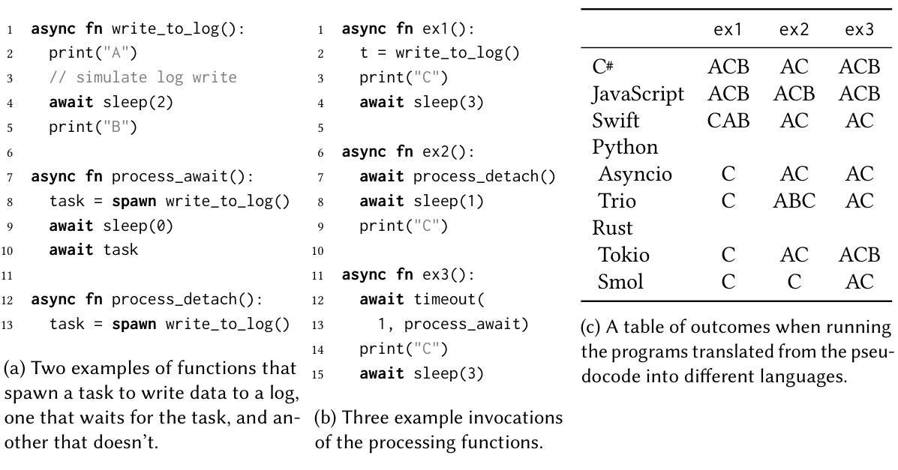
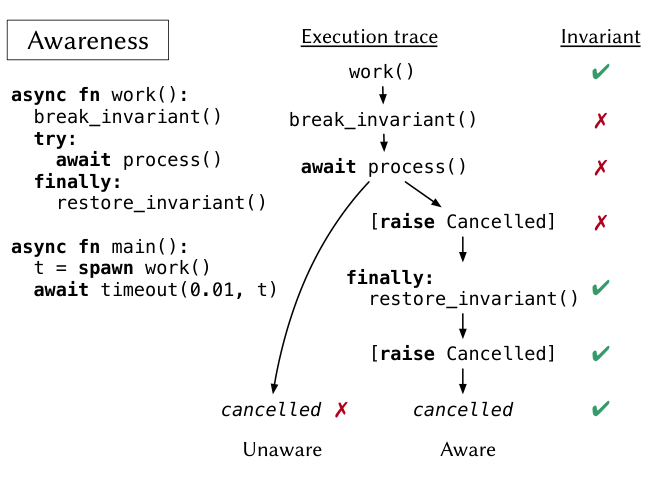
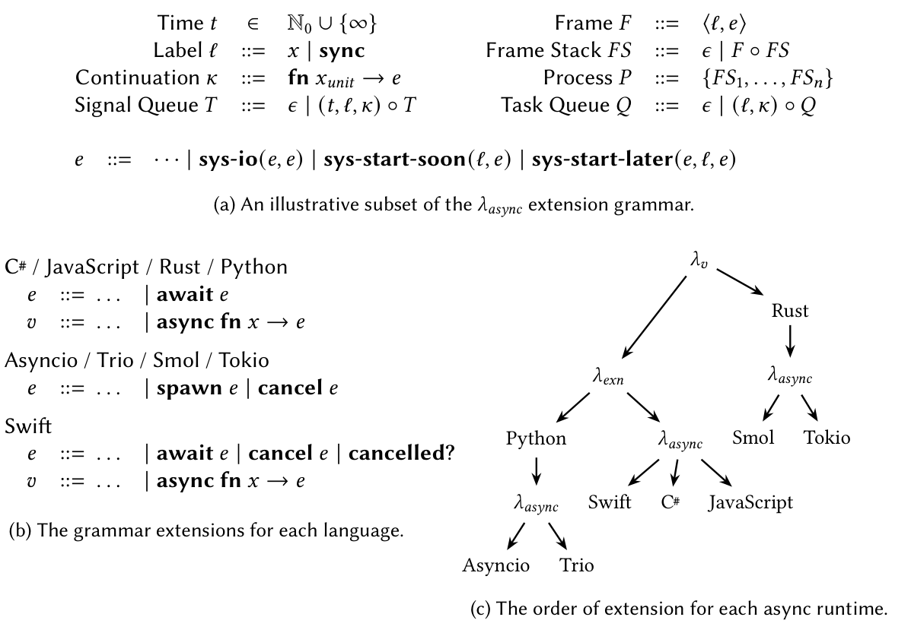
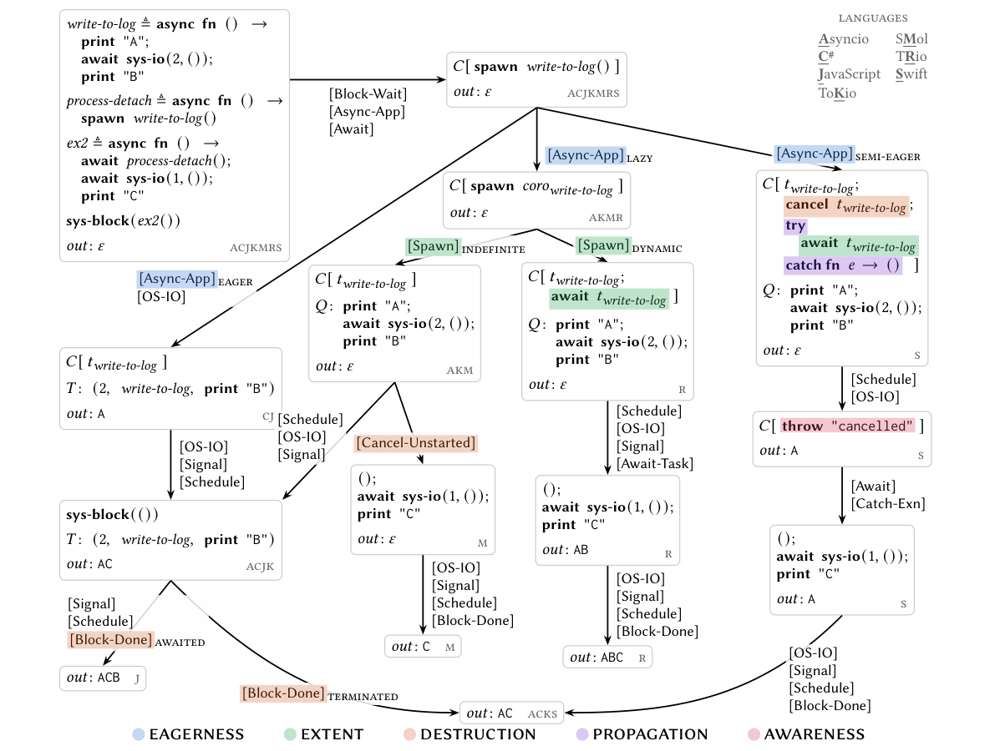

## Summary
[[GavinGray]], [[ShriramKrishnamurthi]], and [[WillCrichton]] define [[StraightLineAsynchrony]] as the direct-style paradigm represented by `async`/`await` and show that shared syntax conceals materially different execution semantics. Their comparison of JavaScript, C#, Swift, Python with Asyncio or Trio, and Rust with Tokio or Smol identifies nine design dimensions spanning task start, task end, and cancellation. An executable Redex semantics and differential fuzzer explain the observed divergence, but the paper deliberately stops short of empirically ranking the alternatives by performance, defects, or developer expectations.

## Key Claims
- Similar-looking `async`/`await` programs can differ in whether and when operations occur; across three small programs, none of the seven surveyed runtime combinations has the same complete output profile as another.

- The start of an asynchronous computation varies along eagerness—lazy, eager, or semi-eager—and suspension—statically guaranteed or dynamically conditional. These choices trade predictable allocation and control against interoperability, runtime overhead, concurrency, and starvation risk.
- Task end-of-life behavior varies through extent, runtime reference strength, destruction, and exception propagation. [[StructuredConcurrency]] corresponds chiefly to dynamic task extent, but scope exit can still await or cancel children and may or may not propagate their failures.
- Integrated cancellation differs in awareness, graph direction, and persistence. Cancellation-aware tasks can restore invariants or perform cleanup, while unaware cancellation can stop a coroutine without letting its asynchronous body repair logical state.

- The operational model factors the languages through a shared async platform built over mutable state, exceptions where applicable, delimited continuations, task and signal queues, and runtime-specific extensions.

- The model's branching derivation explains not only different outputs but identical outputs reached for different semantic reasons—for example, C# runtime termination and Swift scope-exit cancellation can both yield `AC`.

- The executable artifact includes language examples, Redex models, and a differential fuzzer that generates programs, runs each 50 times, and checks observed outputs against the model's possible outputs.

## Key Quotes
> "Async/await are just keywords" — the paper's warning that common surface syntax does not determine a common semantic model.

> "The book is not closed on the design of straight-line asynchrony." — the authors' qualification that the taxonomy covers an evolving design space.

## Connections
- [[StraightLineAsynchrony]] - the paper's name for direct-style asynchronous programming organized around `async` functions and `await` points.
- [[StructuredConcurrency]] - dynamic task extent is one component of structured designs, while destruction and failure propagation remain separate choices.
- [[ConcurrentProgramming]] - the paper characterizes asynchrony as cooperative concurrency and distinguishes it from physical parallel execution.
- [[GavinGray]] - Brown University coauthor and artifact author.
- [[ShriramKrishnamurthi]] - Brown University coauthor.
- [[WillCrichton]] - Brown University coauthor.

## Contradictions
- The paper challenges any assumption that `async`/`await` knowledge transfers directly between languages: identical keywords do not imply the same function-call, task-lifetime, exception, or cancellation behavior.
- It qualifies a simple equation of structured concurrency with automatic cancellation. Swift cancels child work at scope exit, whereas Trio awaits child work and reraises failures; structure, destruction, and propagation are distinct axes.
- The taxonomy is a semantic comparison, not evidence that one point on an axis is generally superior. The authors explicitly identify missing empirical data on overhead, attainable concurrency, realistic bug prevention, developer expectations, and error rates.
- The detailed formalization covers seven runtime combinations and excludes token-based cancellation from its integrated-cancellation model. C++20 is intentionally unclassified because libraries can configure every axis, while Kotlin and evolving Zig designs are discussed but not modeled.
- Differential fuzzing increases confidence in correspondence but observes each generated program only 50 times, so nondeterministic behaviors outside those samples may remain unobserved.
