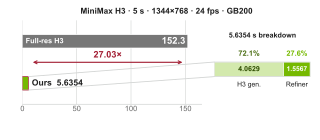
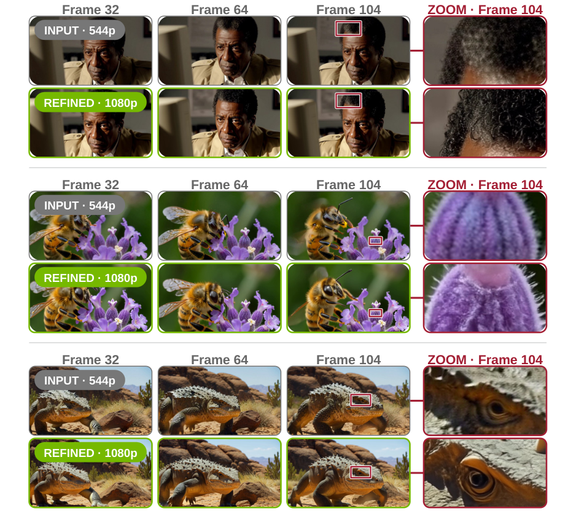
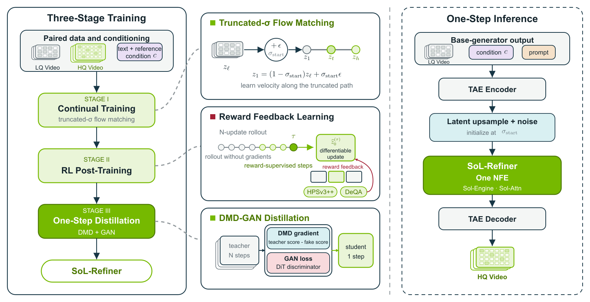
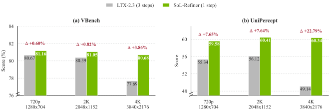
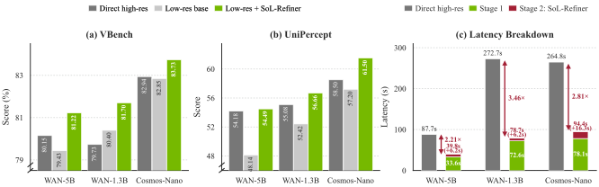
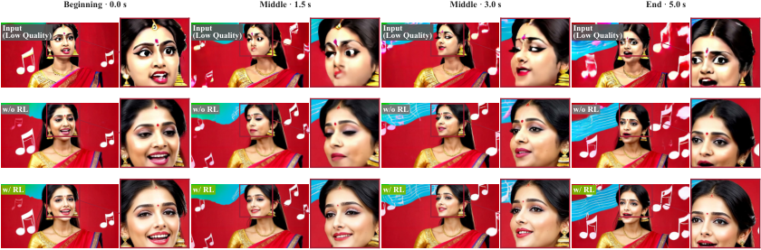
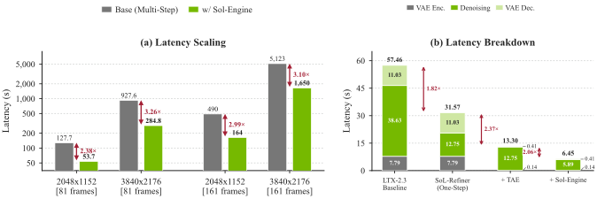

## Summary
[[HaozheLiu]], [[TianYe]], [[ShuchenXue]], and colleagues at [[Nvidia]] present [[SoLRefiner]], a one-step model that improves and optionally upsamples generated videos while leaving the base generator unchanged. Its three-stage recipe learns a low-to-high-quality flow, applies frame-based reward feedback to a multi-step refiner, and distills that teacher through a three-step intermediate into a one-step DMD-GAN student. On the authors' 150-video [[RefinerBench]], the one-step model leads the evaluated external refiners on average VBench and UniPercept scores at roughly 2K output, while a tiny autoencoder and Sol-Engine reduce measured refinement latency from 57.461 to 6.447 seconds. The evidence is first-party and benchmark-specific: the 23-step variant remains better, frame rewards do not assess long-range temporal consistency, and the method does not target major semantic, geometric, or motion errors.

## Key Claims
- [[VideoRefinement]] can separate low-resolution content and motion generation from one target-resolution denoising step, allowing the refiner to improve fine detail and repair some synthesis artifacts without retraining the base generator.
- Continual training uses paired low- and high-quality videos and a truncated-sigma flow path whose noisiest endpoint retains information from the input rather than starting from pure noise.
- Reward feedback learning scores three temporally stratified frames with HPSv3++ and DeQA after a no-gradient rollout, then backpropagates through one selected late denoising update.
- [[OneStepDiffusionDistillation]] first trains a three-step DMD student, then combines distribution matching, a projected DiT discriminator, implicit distribution alignment, and approximate R1 regularization to produce the one-step model.
- Under a shared-input protocol, one-step SoL-Refiner reports VBench and UniPercept averages of 0.81048 and 60.4150, exceeding the evaluated external refiners on those averages, although the paper's own 23-step variant scores higher.
- At 4K, the paper reports relative gains of 3.86% VBench AVG and 22.79% UniPercept AVG over the three-step LTX-2.3 Refiner; across WAN-5B, WAN-1.3B, and Cosmos-Nano, low-resolution generation plus refinement reduces latency by 54.7%–71.1% while improving the two reported means over direct high-resolution generation.
- In the authors' 2K latency setting on one H100, one-step distillation, a tiny autoencoder, and Sol-Engine reduce refinement latency from 57.461 to 6.447 seconds, an 8.91x speedup over LTX-2.3 Refiner.

The pipeline image makes the boundaries explicit: paired-video continual training establishes the refinement vector field; reward learning updates selected late steps using decoded frames; DMD-GAN distillation compresses the teacher; and inference encodes with a TAE, upsamples and noises the latent, executes one refiner evaluation, then decodes.

The selected qualitative comparison shows cleaner face contours, eyes, mouth, and jewelry across four aligned frames after RL post-training, but source-selected examples do not establish average temporal behavior.

## Key Quotes
> "Only N_R refiner NFEs process target-resolution tokens. We target N_R=1" - the computational objective of the two-stage design.

> "Correcting large semantic, geometric, or motion errors is not an explicit training objective." - the paper's stated task boundary.

## Connections
- [[SoLRefiner]] - the one-step video-refinement model and acceleration stack introduced by the paper.
- [[RefinerBench]] - the 150-video shared-input benchmark used for cross-refiner comparison.
- [[VideoRefinement]] - separates base content and motion generation from high-resolution detail recovery and artifact mitigation.
- [[OneStepDiffusionDistillation]] - staged DMD and adversarial compression method used to reach one refiner evaluation.
- [[DiffusionModelSampling]] - broader inference process whose target-resolution model-evaluation count is reduced to one.
- [[Nvidia]] - affiliation of all listed authors and developer of the evaluated Sol-Engine acceleration stack.
- [[HaozheLiu]] - equal-contribution lead author.
- [[TianYe]] - equal-contribution lead author.
- [[ShuchenXue]] - equal-contribution lead author.
- [[YitongLi]] - coauthor working on the refiner and Sol-Engine stack.
- [[JunsongChen]] - coauthor working on efficient video generation.
- [[HaopengLi]] - coauthor connected to Sol-Engine and Sol-Attn.
- [[JinchengYu]] - coauthor connected to the refiner and related SANA video work.
- [[DuominWang]] - coauthor connected to the inference-acceleration stack.
- [[RuihuaZhang]] - coauthor connected to the inference-acceleration stack.
- [[LeiZhu]] - coauthor of the refinement study.
- [[SongHan]] - coauthor and NVIDIA/MIT researcher in efficient deep learning systems.
- [[EnzeXie]] - coauthor connected to the SANA and Sol video-generation projects.

## Contradictions
- The one-step result is not a quality-equivalent replacement for the full teacher: the paper reports that its 23-step model achieves higher VBench and UniPercept averages.
- Refiner-Bench covers outputs from three AI video generators, not camera-captured degradation or general video editing, and its external-refiner outputs are not all evaluated at exactly the same output dimensions.
- Frame-based rewards sample only three frames and do not directly optimize long-range temporal consistency; automated VBench and UniPercept scores do not substitute for blinded human preference or independent replication.
- Large semantic, geometric, and motion errors remain outside the explicit objective, so “artifact repair” should be read as local visual correction rather than general video reconstruction.
- Reported latency depends on H100, GB200, or GB10 hardware, resolution, frame count, step count, quantization, and implementation choices; the 8.91x and 27.03x figures refer to different baselines and settings.
