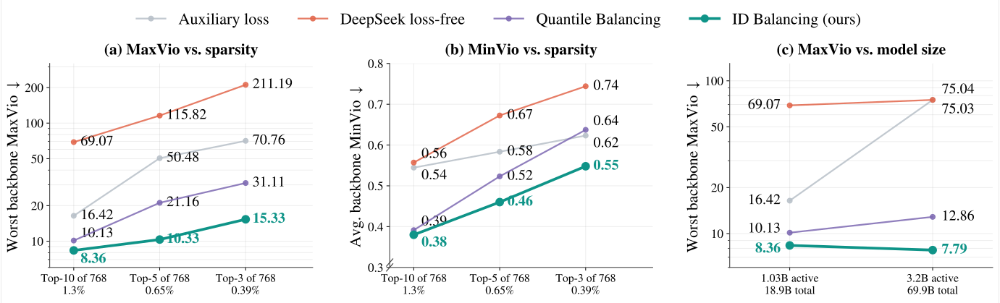
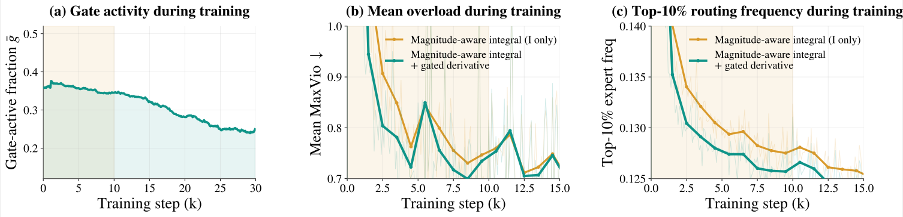
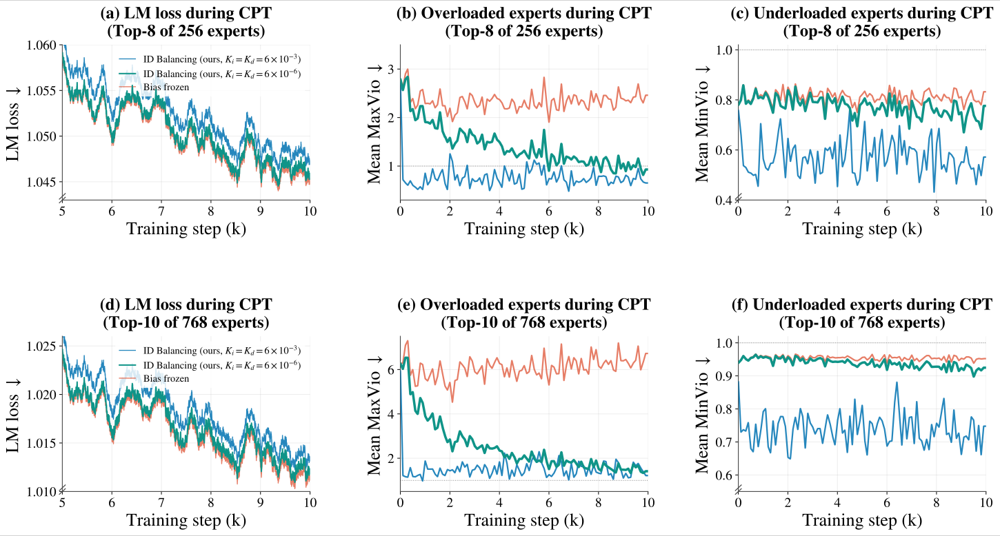
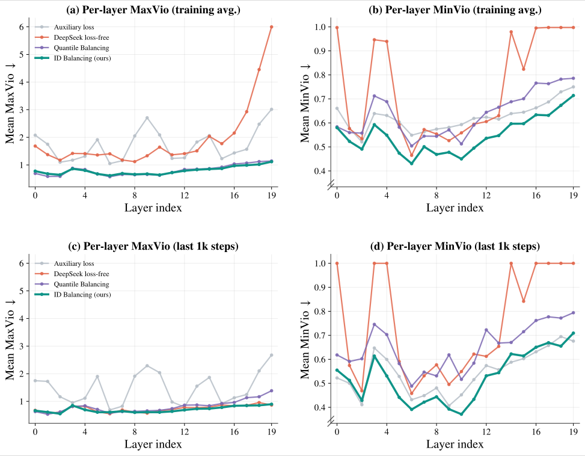
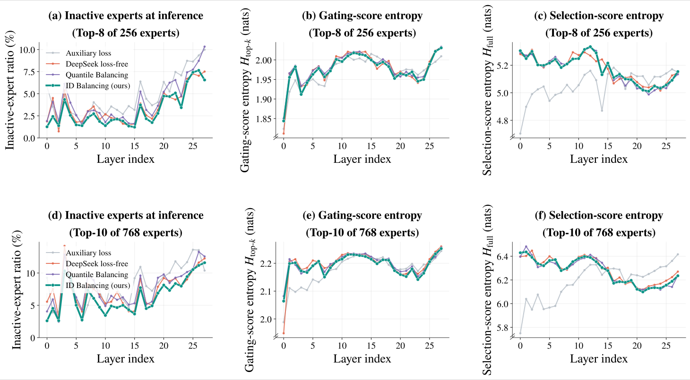

## Summary
[[PengJin]], [[ZihanQiu]], [[ZekunWang]], [[BoZheng]], [[DayihengLiu]], and their [[QwenTeam]] collaborators reinterpret auxiliary-loss-free [[MixtureOfExpertsLoadBalancing]] as generalized PID control and propose [[IDBalancing]]. The method accumulates normalized load-error corrections, adds a derivative correction only while an existing imbalance worsens, and re-centers expert biases without adding a balancing gradient to the language-modeling objective. Across one decoder-only MoE family, the authors report stronger load control as routing becomes sparser and capacity grows, but the model-size comparison changes several configuration variables together and the results remain first-party.

## Key Claims
- MoE load imbalance becomes harder as the active fraction falls because small score changes near the Top-K boundary can redirect tokens, overloading some experts while leaving others undertrained.
- DeepSeek's sign-based loss-free update acts as fixed-step integral control: it remembers past error direction but discards magnitude. Quantile Balancing acts as a generalized proportional controller because it directly follows a target computed from the current batch's score margins.
- ID Balancing updates each expert bias with a magnitude-aware integral term and an accumulated derivative term gated by whether the previous error and its change share a sign, then subtracts the mean bias because a common shift cannot affect Top-K rankings.
- The update needs only O(E) token-count feedback per MoE layer, keeps the control bias outside combination weights, and does not inject a balancing gradient into the language-modeling objective.
- In Top-3-of-768 routing, ID Balancing reports worst backbone MaxVio of 15.33 versus 31.11 for Quantile Balancing and training-average MinVio of 0.55 versus 0.62 for the best baseline; its worst MaxVio stays near 8 as total parameters rise from 18.9B to 69.9B under Top-10-of-768 routing.

- The derivative gate is most active early, falling from roughly 0.38 to 0.25, and reduces early overload and concentration among the busiest 10% of experts relative to the integral-only update.

- During continued pretraining, reducing both gains by 1,000 times keeps LM loss within 0.001 of frozen-bias training in the second half while correcting load drift; full gains control load more strongly but worsen loss.

- ID Balancing shows lower or comparable overload and lower underload than Quantile Balancing across all 20 tested backbone layers, although underload generally increases with depth for every method.

- On nine downstream benchmarks, ID Balancing reduces the average inactive-expert ratio relative to auxiliary loss from 4.7% to 3.1% for Top-8-of-256 and from 8.4% to 6.4% for Top-10-of-768; entropy values across different score families are not directly comparable.

## Key Quotes
> "corrections should scale with the load error and respond when the imbalance worsens" — the control principle motivating the method.

> "Adding the same constant to every expert bias leaves the score ranking" — the invariance supporting zero-mean re-centering.

## Connections
- [[IDBalancing]] — the proposed integral-derivative expert-bias controller.
- [[MixtureOfExpertsLoadBalancing]] — the broader capacity-utilization and training-stability problem.
- [[QwenTeam]] — Alibaba research team credited with the study.
- [[PengJin]] — equal-contribution coauthor.
- [[ZihanQiu]] — equal-contribution coauthor.
- [[ZekunWang]] — equal-contribution coauthor.
- [[BoZheng]] — equal-contribution coauthor.
- [[DayihengLiu]] — corresponding author.
- [[DeepSeekV41Flash]] — existing sparse-MoE model profile whose Top-6-of-384 routing illustrates the wider architecture family.

## Contradictions
- ID Balancing does not dominate every comparator on every metric. Quantile Balancing gives tighter backbone balance in the high-learning-rate stress test, while derivative gains improve early backbone load at the cost of higher MTP overload.
- The scaling comparison does not isolate parameter count: the 18.9B and 69.9B models differ in depth, width, active parameters, total parameters, and training duration.
- The evidence covers one family of decoder-only hybrid-attention MoE models with fixed Top-K routing; transfer to other architectures, routers, datasets, optimizers, and independent implementations is untested.
- Competitive LM loss and downstream averages do not establish equal behavior on every task, and load balance itself does not prove better specialization, capacity quality, or end-user performance.
- The derivative update is gated and accumulated, so it is a generalized control analogy rather than a classical standalone derivative output with an established stability proof.
