## Summary
[[TianshuoQiao]], [[NaiqianZheng]], [[XiaopengLiu]], [[ShuguangWang]], [[DiandianGu]], [[XuanzheLiu]], and [[XinJin]] present [[FastCI]], a production framework for [[GPUIntensiveContinuousIntegration]] in LLM training systems. It replaces coarse file-to-test mappings with sampled function-level runtime evidence, prunes tests only when execution context and validation metadata match, prioritizes likely failures, and reduces workload dimensions outside each test's stated scope. The ByteDance evaluation reports large latency and GPU savings, but it is a first-party study over one proprietary framework, and its strongest coverage measure is narrower than complete behavioral equivalence.

## Key Claims
- File-level path mappings over-select tests yet can still miss modified-code coverage; runtime evidence can connect changed functions to the particular end-to-end jobs that executed them.

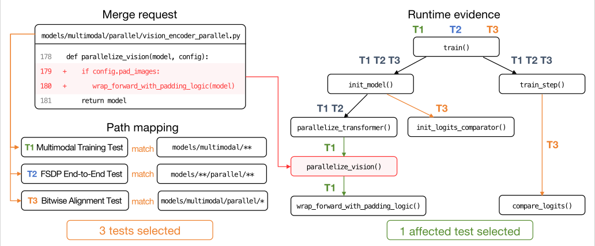

- FastCI combines four stages: evidence-guided selection, context-aware pruning, risk-aware scheduling, and workload-optimized execution, while feeding successful traces and outcomes back into persistent state.

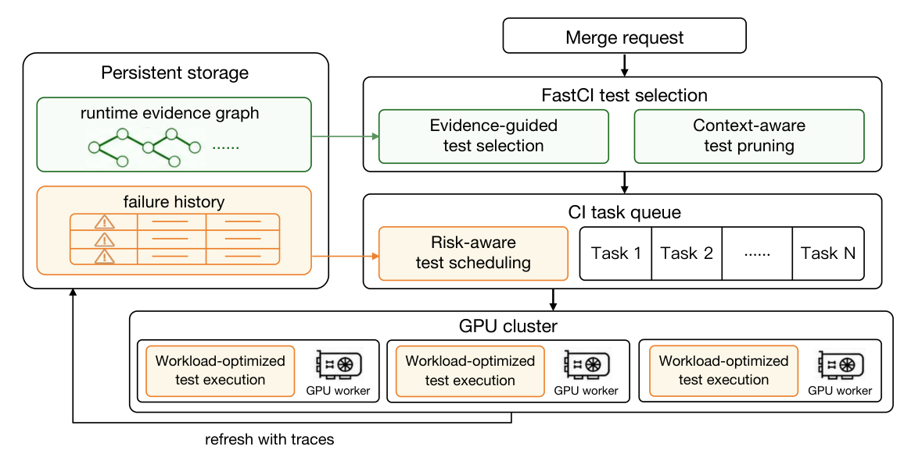

- When sampling misses a changed method or function, selection expands conservatively through other methods in the same class or statically identified callers before consulting observed runtime evidence.

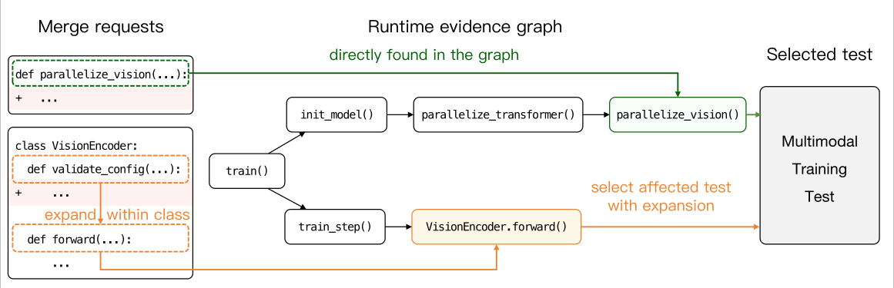

- Tests are pruned only when their three-hop caller/callee context around a modified entity and their validation metadata are identical; the cheapest historical GPU-cost representative is retained for each equivalence group.

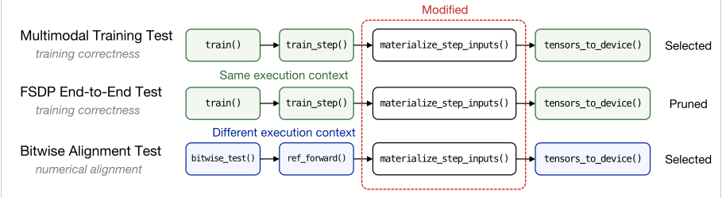

- Risk-aware scheduling combines historical change-test failure association with recent test instability, weighting the first signal more heavily as observations accumulate. Against production FIFO order, FastCI reports a 63.6% lower median first-failure rank and 89.2% less median GPU consumption before the first failure.

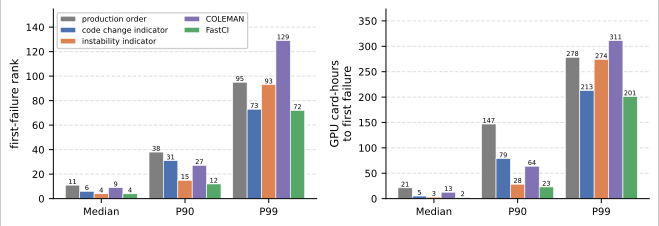

- Workload optimization reduces only dimensions classified as outside a test's validation purpose, applies changes as runner overrides, periodically compares pass/fail outcomes against the original workload, and restores the original when outcomes diverge.
- In the shadow-CI end-to-end comparison, FastCI selects 19.9% of full-CI tests and reduces GPU use, CI latency, and queueing time to 18.6%, 6.1%, and 1.8% of full CI, respectively.

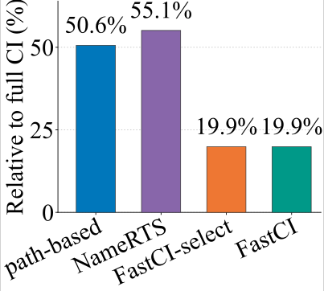

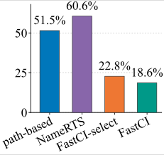

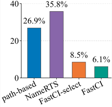

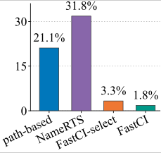

- FastCI's CI-latency and queueing-time distributions dominate the evaluated baselines across percentiles; 81.2% of full-CI latency observations and 71.9% of full-CI queue observations exceed the displayed 360-minute range.

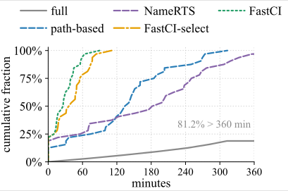

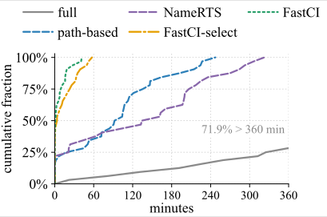

- At 50 Hz, tracing adds 4.1% overhead and the final pruned selection retains 99.2% of full-suite modified-code line coverage. In the paper's production rollout, FastCI handled 784 CI runs over three weeks with no reported regression caused by omitted tests and reduced average CI latency by 58.4%.

## Key Quotes
> "precise test selection should move from static file-level path mapping to function-level runtime evidence" — motivation for FastCI's selection design.

> "an entity absent from the trace is treated as missing evidence" — the conservative interpretation of sampling gaps.

## Connections
- [[FastCI]] — the proposed and deployed CI optimization framework.
- [[GPUIntensiveContinuousIntegration]] — the broader resource-allocation and verification problem addressed by the paper.
- [[SoftwareVerification]] — FastCI seeks cheaper feedback while preserving modified-code evidence.
- [[ConfidenceBasedTesting]] — validation purpose determines which test workload dimensions may be reduced.
- [[CodingAgentMinimalTooling]] — the paper identifies increased code-change frequency from coding agents as one source of CI pressure.

## Contradictions
- The evidence comes from one proprietary LLM training framework and a first-party author team spanning Peking University and ByteDance Seed; the end-to-end shadow experiment sampled production merge requests over only two days, while the deployment observation covers 784 runs over three weeks.
- Context-aware pruning lowers affected-test recall from 84.5% to 66.2% even as modified-code line coverage falls only from 99.8% to 99.2%. Executing the same lines does not establish equivalent inputs, assertions, states, or fault detection.
- The offline coverage reference excludes module-level code, native C++, and CUDA execution, and it treats entry into executable Python function lines as the affected-test signal; its retention metric is therefore not complete behavioral coverage.
- Runtime sampling is intentionally incomplete, especially for short-lived functions and native execution. Class and caller expansion reduces but does not prove the absence of false negatives, and new modules can yield zero selected tests when no prior execution evidence exists.
- Workload validation compares pass/fail outcomes periodically rather than proving semantic, numerical, performance, or hardware-topology equivalence for every run; failures that appear only under the original scale may occur between checks.
- The 77.5% latency and 63.9% GPU reductions use the deployed path-based pipeline as baseline, while the chart values relative to full CI answer a different comparison. No independent reproduction, monetary cost accounting, or cross-framework evaluation is provided.
