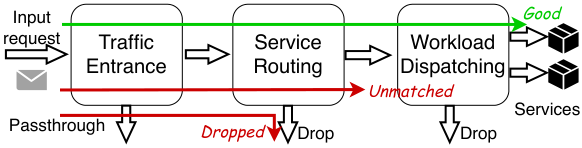
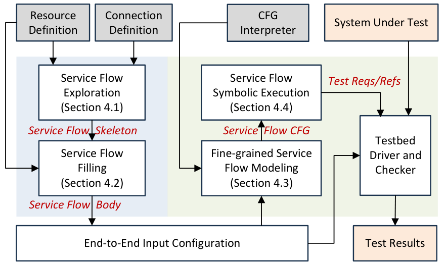
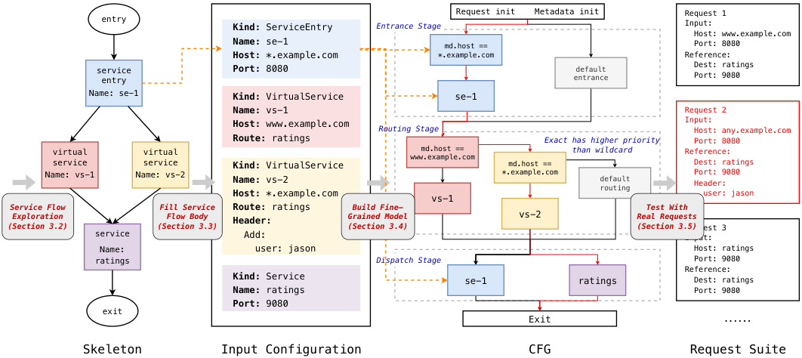
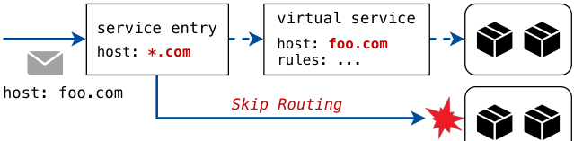
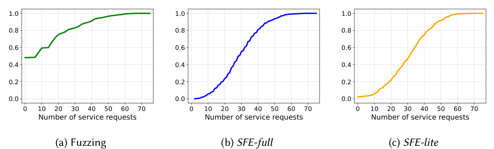

## Summary
[[NaiqianZheng]], [[TianshuoQiao]], [[XuanzheLiu]], and [[XinJin]] present [[MeshTest]], an automated framework for [[ServiceFlowAwareTesting]] of service-mesh traffic management. It first generates connected configuration-resource graphs and concrete configurations, then interprets each configuration as a fine-grained control-flow graph and uses symbolic execution to produce real requests with expected outcomes. Across Istio, Linkerd, and Cilium, the authors report 25 previously unknown bugs, 20 confirmed and 10 fixed, while preserving important limits: the oracle depends on manually encoded and iteratively refined system semantics, the study is first-party, and the method does not cover performance, topology, reconciliation, or all request-drop behavior.

## Key Claims
- A service-mesh request crosses traffic entrance, service routing, and workload dispatching; an end-to-end test input must connect resources so at least one request traverses the complete path without leaving dangling resources.

- MeshTest separates high-level resource topology from detailed fields: service-flow exploration creates DAG skeletons, then connector-aware filling propagates host, port, and protocol keys before constraint-aware fuzzing adds other values.
- SFE-full enumerates the bounded service-flow skeleton space layer by layer and is argued sound and complete; SFE-lite grows end-to-end paths around direct, split, and merge interaction seeds to cover pairwise interactions more cheaply.
- The oracle translates a concrete configuration into a system-specific CFG that includes explicit resources, priority rules, default routes, and multi-stage effects, then symbolically explores feasible paths to generate requests and reference outputs.

- The authors report 25 new bugs: 19 in Istio, four in Linkerd, and two in Cilium. Many involve resource interactions, priority competition, routing bypass, or dispatching rather than isolated field validation.

- In the reported comparison, template fuzzing produced configurations that passed validation 46.9% of the time and contained an end-to-end flow 8.1% of the time, whereas both MeshTest variants reached 100% on those measures; the baseline found six of the 25 bugs.

- SFE-lite generated 520 cases in under one second and required about 1.6 machine-hours for a campaign; SFE-full generated 128,120 cases in 72.8 seconds but could require about 390 machine-hours to execute. Oracle execution averaged 6.87–14.94 seconds per configuration across the evaluated systems.

## Key Quotes
> "MeshTest is a service flow centric approach." - the organizing design principle.

> "The soundness of test results rely on the correctness of the service flow CFG model." - the paper's central oracle qualification.

## Connections
- [[MeshTest]] - the framework introduced and evaluated by the paper.
- [[ServiceFlowAwareTesting]] - the testing method that connects resource orchestration, formal behavior models, and executable requests.
- [[SoftwareVerification]] - broader practice of checking behavior with complementary evidence rather than configuration validation alone.
- [[FastCI]] - another testing-systems project coauthored by the same four Peking University researchers.
- [[NaiqianZheng]] - first-listed author of the MeshTest paper.
- [[TianshuoQiao]] - coauthor of the exploration and evaluation work.
- [[XuanzheLiu]] - coauthor and Peking University researcher.
- [[XinJin]] - corresponding author.

## Contradictions
- The paper calls the oracle false-positive-free under an explicit correctness assumption, but the system-specific CFG cannot be formally proven correct and is refined after discrepancies. An alarm therefore initially distinguishes specification-model mismatch from implementation mismatch only through manual analysis.
- SFE-full is complete only with respect to the bounded, documentation-derived skeleton space, not the full configuration or implementation state space. Body filling samples one concrete body per skeleton rather than taking a Cartesian product of all field choices.
- SFE-lite guarantees pairwise interaction coverage, not reliable coverage of three-or-more-resource interactions; three reported bugs fall outside that guarantee.
- Results come from the authors' implementation and selected versions of three systems. The paper reports no independent replication, confidence intervals, mutation analysis, or comparison with mature service-mesh-specific end-to-end generators.
- Table 3 contains source-preserved arithmetic inconsistencies: its entrance and routing row totals do not equal the displayed per-system counts.
- The method excludes performance, security as a primary target, network topology, state reconciliation, implementation-specific details outside the model, and much dropped-request behavior.
