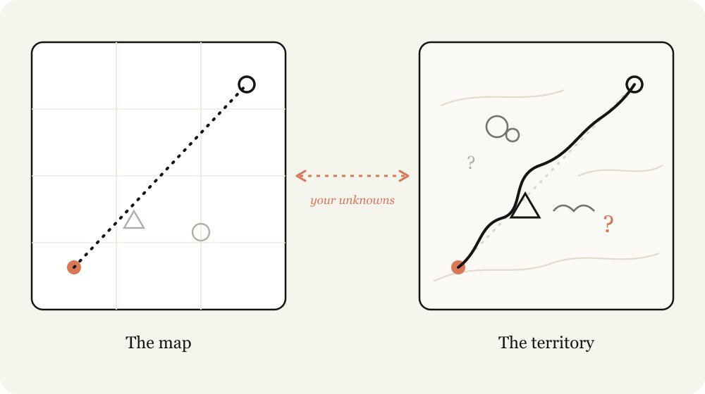
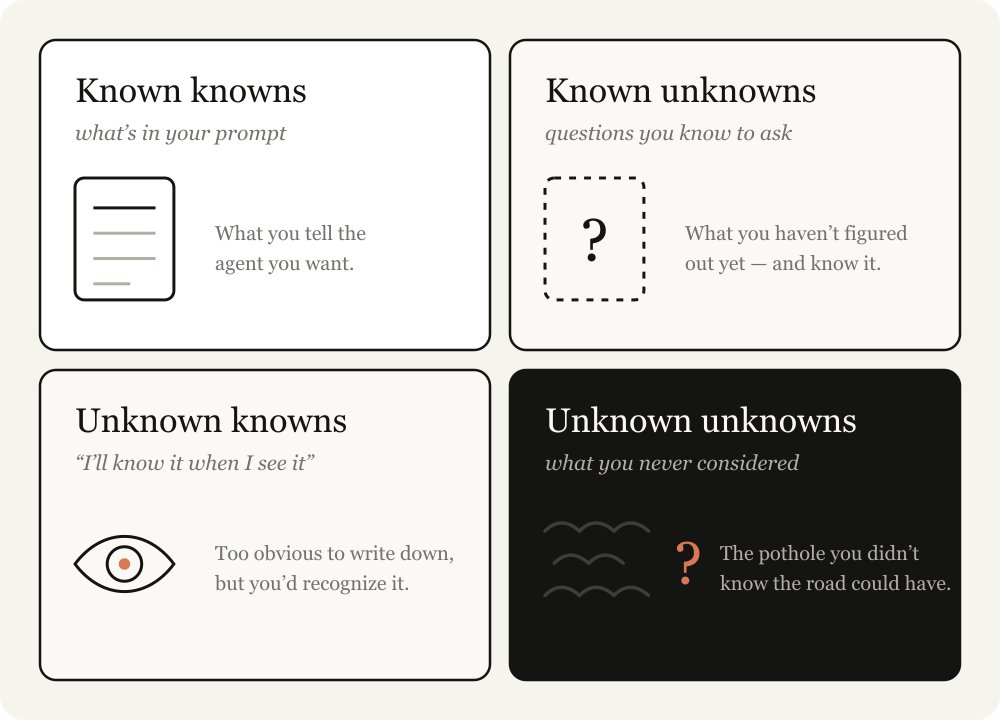
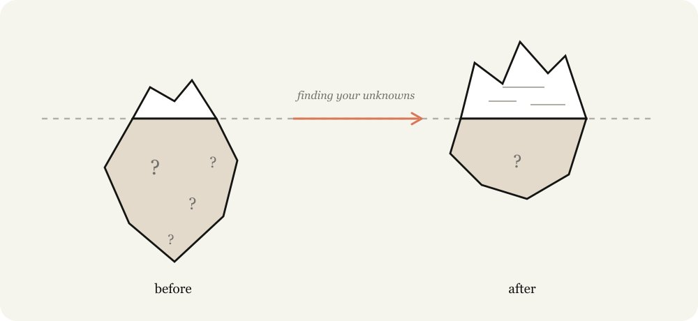
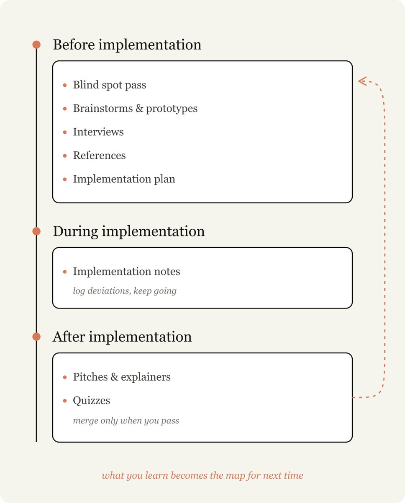
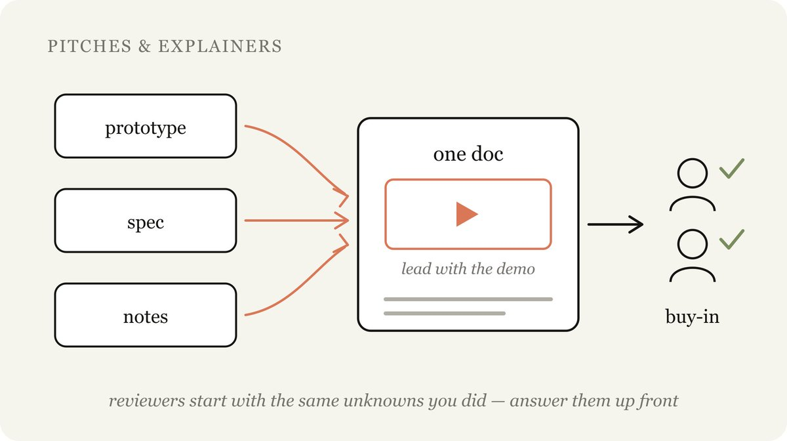

## Summary
[[Thariq]] argues that strong long-horizon work with [[Claude]] is limited less by raw model capability than by the user's ability to expose the gap between a prompt's map and the codebase or real-world territory. He classifies those gaps as known knowns, known unknowns, unknown knowns, and [[UnknownUnknowns]], then presents a before-during-after [[AIAgentCollaboration]] workflow for discovering them through blind-spot passes, prototypes, interviews, references, plans, implementation notes, explainers, and quizzes. The account is a practitioner field guide rather than comparative evidence, and its strongest claims about Fable depend on the author's skill, tasks, and model access.

## Key Claims
- A prompt, plan, or skill is only a map; the codebase, users, domain, and constraints form the territory, and the difference is the set of decisions an agent may have to guess.
- The four-part uncertainty model separates what is stated, questions already recognized, tacit preferences recognized on sight, and gaps the user has not considered.

- Planning alone cannot eliminate uncertainty because implementation can reveal edge cases or show that the original problem framing was wrong; discovery must continue before, during, and after coding.

- Before implementation, blind-spot passes target unknown unknowns; brainstorms and lightweight prototypes surface tacit “I’ll know it when I see it” criteria; interviews expose consequential ambiguities; references convey hard-to-verbalize intent; and plans foreground decisions likely to change.
- During implementation, a temporary notes artifact records deviations and conservative decisions without forcing the agent to stop at every newly discovered edge case.
- After implementation, pitches and explainers transfer the team's newly acquired context to reviewers, while quizzes test whether the human actually understands the resulting system before merging.

- Combining the prototype, specification, and implementation notes into one demo-led explainer can reduce reviewer uncertainty and accelerate informed approval.

## Key Quotes
> "The map is not the territory." — on why prompts and plans cannot encode every implementation constraint.

> "Every explainer, brainstorm, interview, prototype, and reference is a cheap way to find out what you didn't know." — on moving discovery earlier.

## Connections
- [[Thariq]] — author and practitioner presenting the unknowns-driven workflow.
- [[Claude]] — Fable is the Claude model variant used in the author's examples.
- [[ClaudeCode]] — coding environment used for planning, implementation notes, prototypes, and the launch-video case.
- [[UnknownUnknowns]] — one quadrant of the framework and the main target of blind-spot passes.
- [[AIAgentCollaboration]] — the workflow treats context disclosure, questioning, artifacts, and review as joint uncertainty reduction.
- [[PrototypeFirstProductDiscovery]] — fast visual or functional artifacts expose tacit preferences before expensive implementation.
- [[SpecDrivenAgentDevelopment]] — implementation plans and specs externalize intent while preserving room to respond to newly discovered constraints.
- [[SoftwareVerification]] — the post-implementation quiz is a human-understanding gate, not a substitute for behavioral tests.

## Contradictions
- The source strengthens the wiki's planning and collaboration material but rejects the idea that sufficiently detailed up-front planning can remove all consequential ambiguity; plans should surface likely decision points and permit evidence-driven pivots.
- The article is one expert practitioner's qualitative account. It provides no task sample, baseline, defect rate, time comparison, independent evaluation, or evidence that the named artifacts always outperform direct iteration.
- The Fable-specific capability claim may not transfer across models, users, domains, or safety levels. More elicitation can also create overhead, premature commitment, or false confidence, and quizzes demonstrate articulated understanding rather than production correctness.
