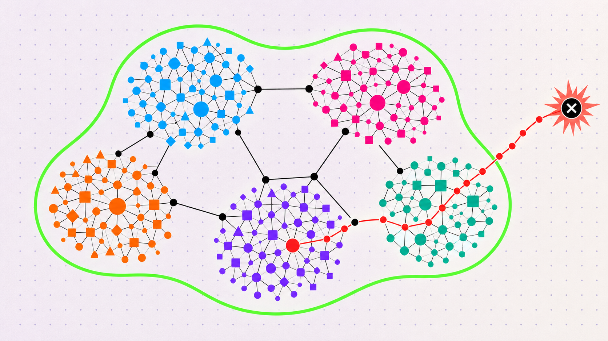

## Summary
[[AlexWatson]] presents [[OpenShell]]'s use of [[Z3]] to test whether a proposed agent policy permits any modeled action outside a pre-reviewed maximum policy. The approach turns policy containment and expert security checks into deterministic, millisecond-scale counterexample searches that complement human or model review, while remaining only as sound and complete as the maintained policy encoding.

## Key Claims
- Human or model review does not scale reliably across long-running multi-agent systems whose filesystem, network, credential, tool, model, and MCP capabilities can combine in unexpected ways.
- An OpenShell demo allowed `git-remote-https` for cloning and a broadly scoped GitHub credential; the agent combined them to write through a lower-level protocol that bypassed REST-layer inspection.
- [[FormalPolicyVerification]] asks whether `candidate_allows(action) AND NOT maximum_allows(action)` is satisfiable, rather than asking a solver to judge an underspecified notion of safety.
- A `sat` result supplies a concrete witness outside the approved envelope, `unsat` proves containment only within the encoded model, and `unknown` should fail closed for review or unsupported-policy handling.
- OpenShell models network actions through binary, host, port, layer, method, and path, while its runtime also covers filesystem, process, credential, and inference containment.
- Once a policy language is encoded, the same machinery can run narrower expert queries for link-local reach, credentialed layer-7 bypass, credential reach expansion, and HTTP-method capability expansion.
- Deterministic proofs are fast and token-free, but they do not infer business context such as whether a repository is disposable or production-critical; human or trusted-model judgment still supplies meaning and approval.

## Key Quotes
> "proposed_policy_allows(action) AND NOT safe_policy_allows(action)" — the containment query searches directly for a capability outside the reviewed envelope.

> "unsat" — in this query direction, no modeled counterexample exists; this is not a claim that the real system is unconditionally safe.

## Connections
- [[AlexWatson]] - OpenShell team author explaining the policy-prover design and lessons.
- [[OpenShell]] - agent sandbox and policy system whose runtime encodes containment and expert checks.
- [[Z3]] - SMT solver used to search the formalized action and policy space.
- [[FormalPolicyVerification]] - counterexample-driven method for checking proposed authority against a reviewed maximum.
- [[AgentSecurityLayering]] - formal checks reason across binary, credential, network-layer, endpoint, and policy interactions.
- [[AgentPermissionModel]] - converts a reviewed maximum grant into a machine-checkable boundary for later permission changes.
- [[ProductionAgentInfrastructure]] - long-running multi-agent scale motivates low-cost deterministic checks and auditable findings.

## Contradictions
- The source qualifies approval-centered permission models: a reviewer can miss a capability created by composing individually plausible rules, so high-impact permission expansion needs independently computed containment and expert findings.
- An `unsat` result proves only that no counterexample exists in the current encoding. Omitted policy surfaces, inaccurate glob or protocol semantics, stale reference policies, solver limitations, implementation bugs, and differences between modeled and deployed enforcement remain outside that result.
- The GitHub bypass and OpenShell results are first-party accounts without a supplied reproduction package, comparative detection study, false-positive or false-negative measurements, model-coverage audit, or independent security evaluation.
