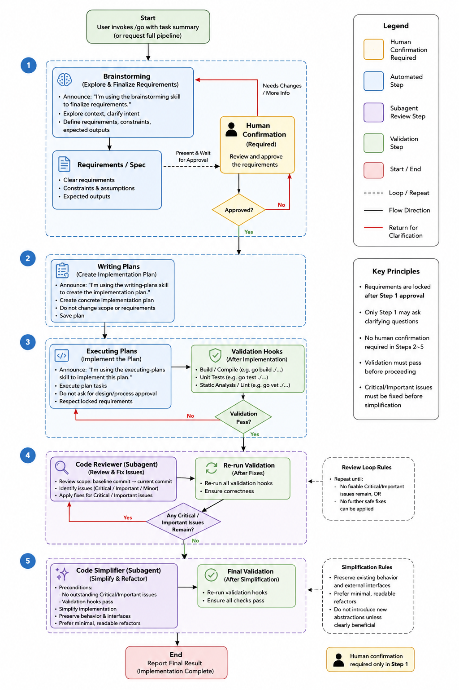
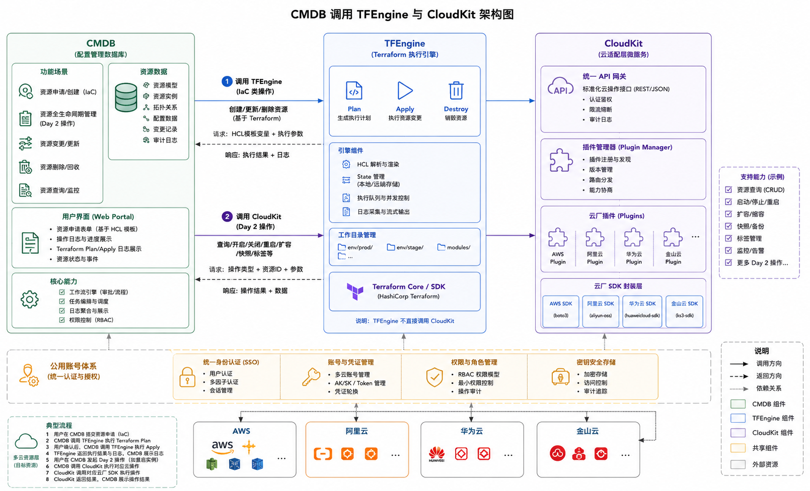

## Summary
[[Zhu327]] describes a team-scale [[HarnessEngineering]] system that moves coding agents from repeated conversational supervision into a gated pipeline covering requirements, planning, implementation, validation, review, simplification, API E2E testing, and evidence-driven incident investigation. The article then extends the same emphasis on explicit interfaces and validation into parallel [[AgentTeam]] work and a multi-cloud CMDB architecture where [[TFEngine]] handles Terraform lifecycle operations and [[CloudKitService|CloudKit]] handles provider-specific Day 2 operations. It is a detailed practitioner design report, but it supplies no controlled productivity, defect, incident-resolution, portability, or cost comparison.

## Key Claims
- A coding-agent harness should encode architecture constraints and project rules, ask for human approval while requirements are still fluid, and then run implementation, validation, review, repair, simplification, and final checks without repeated conversational confirmation.

- API E2E tests can become the human acceptance boundary when external HTTP and gRPC services are replaced by `mockd`, real disposable databases run through `testcontainers-go`, assertions use `httpexpect`, and interface-changing plans must design tests and fixtures before implementation.
- [[AgenticIncidentResponse]] should gather the four golden signals, recent changes, clustered logs, and downstream health before moving through explicit hypotheses, discriminating evidence, validated versus unvalidated claims, remediation, and a blameless postmortem.
- Decomposing large requirements into dependency-aware vertical issues lets several agents work concurrently with smaller context surfaces, but human QA, architecture, interface design, and acceptance judgment remain explicit boundaries.
- [[MultiCloudLifecycleManagement]] benefits from separating declarative resource create/update/delete operations from provider-SDK Day 2 actions while unifying account, identity, authorization, audit, and CMDB state.

- [[TFEngine]] exposes HCL-backed Terraform plan, apply, destroy, state, queue, and log behavior, while [[CloudKitService|CloudKit]] places AWS, Alibaba Cloud, Huawei Cloud, and Kingsoft Cloud SDK workflows behind plugins and a common API gateway.

## Key Quotes
> “要写清楚架构约束，制定好项目的规约。” — on making architecture and project rules part of the harness rather than leaving them implicit.

> “我们人类要做的是接口和抽象的设计，内部的实现完全交给 AI。” — on the article's proposed human boundary in a highly constrained agent workflow.

## Connections
- [[Zhu327]] - practitioner-author and builder of the described development, SRE, and multi-cloud systems.
- [[HarnessEngineering]] - central practice joining instructions, architecture rules, tools, validation, review, and recovery paths around agents.
- [[SoftwareVerification]] - build, unit, static-analysis, E2E, review, and final-validation gates decide whether automated work can proceed.
- [[AgentTeam]] - dependency-aware issue decomposition is used to bound context and enable parallel implementation.
- [[AgenticIncidentResponse]] - evidence-driven alert triage, hypothesis-led diagnosis, remediation, and learning workflow distilled into Skills.
- [[MultiCloudLifecycleManagement]] - separation of declarative and imperative operations across four cloud providers.
- [[TFEngine]] - Terraform execution engine used for IaC lifecycle operations and transparent plans, results, and logs.
- [[CloudKitService|CloudKit]] - plugin-based service used for provider-specific Day 2 cloud operations.
- [[Cursor]] - coding environment whose per-request billing motivated a one-request pipeline in the reported team workflow.
- [[Terraform]] - selected provisioning substrate because the four target clouds did not have adequate common Pulumi support.

## Contradictions
- The source qualifies claims that autonomy or agent count alone improves delivery: its own workflow depends on locked requirements, architecture rules, executable checks, issue dependencies, human acceptance, and explicit recovery loops.
- The reported one-request pipeline can consume up to 20 million tokens, but the source provides no before-and-after request, token, latency, defect, or review-effort measurements; reduced interaction count is not established as lower total cost.
- The E2E, incident, and multi-cloud designs are first-person implementation reports without test inventories, production incident outcomes, provider conformance results, repository-wide measurements, or independent reproduction.
