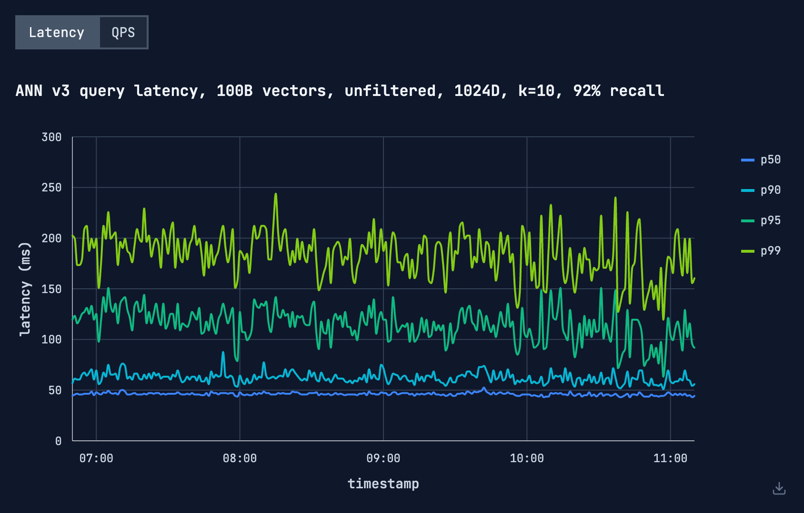
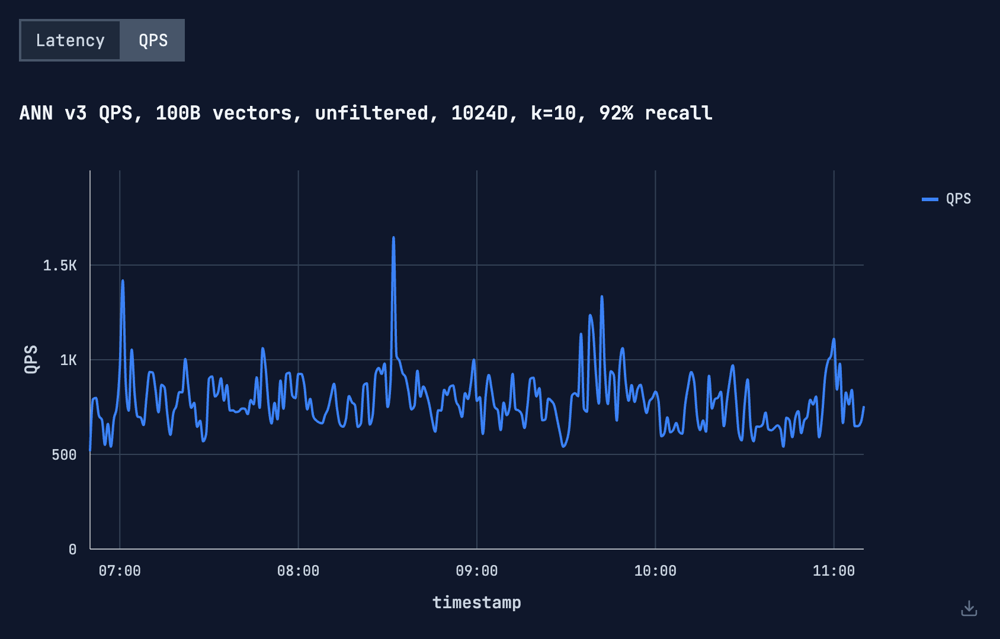

## Summary
[[NathanVanBenschoten]] explains how [[Turbopuffer]] combines a wide, shallow SPFresh-derived hierarchy, one-bit [[RaBitQ]] filtering, full-precision reranking, SIMD kernel work, local NVMe, and random sharding in [[ANNv3]]. The first-party account reports search over 100 billion 1,024-dimensional vectors at thousands of cluster-wide queries per second and approximately 200 ms p99 latency, while its inspected traces expose variability around that headline and the article omits enough deployment and benchmark detail to prevent independent reproduction.

## Key Claims
- Vector distance evaluation has low arithmetic intensity at full precision because each fetched data-vector element is used once, making the initial design bandwidth-bound rather than primarily instruction-bound.
- A roughly 100-way SPFresh-derived hierarchy bounds cold object-storage round trips by tree height, keeps frequently accessed centroids in higher memory tiers, and gives spatial locality to lower-tier reads.
- Scanning about 500 clusters of 100 vectors at 1,024 dimensions and `f16` precision requires roughly 100 MB per tree level; the article estimates that hierarchy alone would leave the lowest level NVMe-bound near 100 QPS per machine.
- One-bit RaBitQ codes compress data vectors by 16× relative to `f16` and 32× relative to `f32`; error bounds identify an uncertain candidate set, and the article says fewer than 1% of narrowed candidates normally require full-precision reranking.
- Quantization moves three upper tree levels into a 504 MiB shared L3 cache, leaves quantized leaf data in DRAM, and reduces scattered full-vector NVMe reads enough for an estimated 10,000-QPS bandwidth ceiling per machine.
- The compressed scan then becomes compute-bound: moving a core kernel from AVX2 to AVX-512 `VPOPCNTDQ` reportedly improved its microbenchmark by 30% and production throughput by about 5%.
- At cluster scale, vectors are assigned randomly across storage-optimized machines, every query fans out to all shards, and shard-local top-k results are merged globally; capacity scales out, but query cost grows linearly with shard count.

The retained latency chart covers a little over four hours. P50 remains near 45 ms, p90 is usually around 55–75 ms, p95 varies more widely, and p99 is commonly around 150–210 ms with several excursions above 220 ms; the visual therefore supports an approximate operating target rather than a strict per-interval 200 ms ceiling.

The matching throughput trace is mostly about 550–1,000 QPS, with short peaks near 1,650 QPS. Both charts specify an unfiltered 100-billion-vector, 1,024-dimensional, top-10 workload at 92% recall, but neither exposes machine count, shard count, concurrency, dataset construction, warm-up, cost, or percentile aggregation.

## Key Quotes
> "The key to making the most of the available hardware is to push down bottlenecks and balance resource utilization." — on treating the memory hierarchy as an end-to-end resource budget.

> "This is why it is crucial to maximize the efficiency of a single machine before turning to distribution." — on avoiding linear scale-out cost before local optimization.

## Connections
- [[Turbopuffer]] — company and search service whose architecture and first-party measurements the article presents.
- [[NathanVanBenschoten]] — author and Turbopuffer chief architect.
- [[ANNv3]] — vector-search implementation described by the article.
- [[ApproximateNearestNeighborSearch]] — retrieval problem addressed through hierarchical candidate narrowing and refinement.
- [[ArithmeticIntensity]] — framework used to diagnose the shift from bandwidth-bound full-precision distance work to compute-bound binary estimation.
- [[RaBitQ]] — one-bit quantizer supplying bounded candidate estimates before exact reranking.
- [[VectorQuantization]] — compression mechanism that simultaneously reduces traffic and changes tier residency.
- [[SPFresh]] — incremental centroid-based ANN design extended into the hierarchical tree.

## Contradictions
- The article's "200ms p99" headline is best treated as an approximate target or aggregate result: the retained time-series chart visibly includes multiple p99 intervals above 200 ms.
- The theoretical 100, 1,000, 10,000, 33,000, and 50,000 QPS calculations are roofline-style estimates based on stated bandwidths and scan volumes, not measured end-to-end ceilings. Production reportedly saturates near 1,000 QPS per machine after quantization makes the kernel compute-bound.
- This is a vendor-authored launch article. It supplies no independent reproduction, full hardware and cluster configuration, index-build or update cost, dataset distribution, filter workload, failure experiment, cost comparison, or raw methodology sufficient to generalize the reported frontier.
