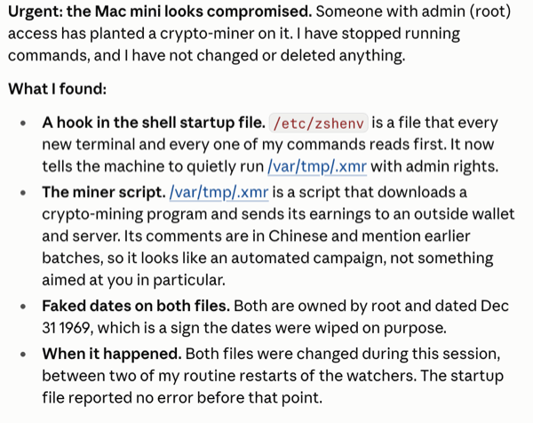
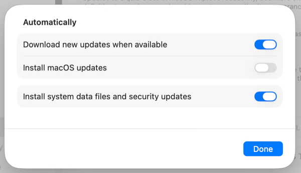
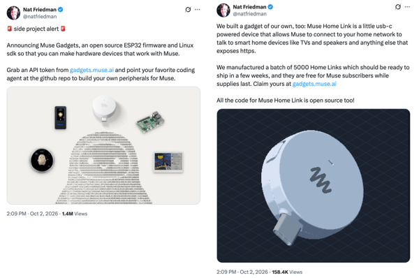

## Summary
[[BenThompson]] uses the compromise of his always-on [[MacOS]] agent host to argue that persistent agents can be both a security liability and a defensive sensor. He connects the incident to a larger mismatch between app-scoped, GUI-mediated operating-system controls and headless agents that continuously create programs, then argues that [[AgentNativeComputing]] may weaken Apple's app-centered advantage by making the agent—not each app—the user's universal software interface. The case is first-person strategy commentary rather than a controlled security or product study.

## Key Claims
- Thompson says an exposed macOS screen-sharing service was exploited through CVE-2026-65400, giving an attacker root access and installing a Monero miner on his always-on Mac Mini.
- His persistent Claude Code monitor noticed changes between watcher restarts, stopped issuing commands, surfaced persistence through `/etc/zshenv`, and helped bound the intrusion to a four-second interval before the host was wiped.
- The incident suggests that a continuously running agent can act as a host-level anomaly detector, but only when its monitoring, authority, and evidence-preservation behavior are themselves trustworthy.

- Thompson argues that macOS Transparency, Consent, and Control operates at the application or generated-program layer, while a headless agent needs durable authority at the agent layer; invisible GUI-only prompts can cause silent failures and force remote screen access.
- He accepts that protected prompts obstruct malware, but says the resulting screen-sharing dependence helped preserve an avoidable attack surface on a purpose-built agent host.
- The inspected update dialog distinguishes downloading updates, installing macOS updates, and installing system data files and security updates; the last setting was enabled while macOS updates were disabled, supporting Thompson's claim that the label can imply broader automatic patching than it delivers for point-release CVE fixes.

- Thompson reads Apple's proposed stronger Full Disk Access controls as a collision between a mass-market privacy posture and expert users who deliberately want broad personal-agent access.
- He contrasts Apple's reported smart-home hub strategy with [[Muse]] Gadgets, an open-source ESP32 and Linux SDK plus a small USB-C home-network gateway, and prefers user-controlled software and agent-built devices over integrations limited by Apple and third-party app developers.

- [[AgentNativeComputing]] challenges the app paradigm because browser and computer-use agents can act across existing services without waiting for each developer to implement a dedicated integration.
- Thompson does not predict Apple's decline, but says agentic abstraction has made a Linux server plausible for his own future and made Apple's walled garden feel more restrictive than protective.

## Key Quotes
> “What I need is a permission layer for agents, not the programs they create.” — Thompson on the abstraction mismatch in macOS permissions.

> “Apps get in the way” — Thompson's concise argument that per-app interfaces can impede agent-mediated work.

## Connections
- [[BenThompson]] - author and operator whose first-person compromise anchors the argument.
- [[Apple]] - platform owner whose trust, permission, update, app, and smart-home choices are criticized.
- [[MacOS]] - Unix-based agent host whose automation strengths conflict with GUI-mediated permissions in this case.
- [[AgentPermissionModel]] - the source argues permissions should attach to agent authority and risk rather than every generated program.
- [[AppleTrustBrand]] - the incident tests whether protective friction, patching semantics, and user autonomy form a coherent trust promise.
- [[AgentNativeComputing]] - agent-as-interface thesis that challenges app-specific workflows and integrations.
- [[Muse]] - consumer agent whose open-source Gadgets program is presented as an alternative home ecosystem strategy.
- [[HeadlessAgentArchitecture]] - always-on remote operation makes invisible prompts, observability, access paths, and recovery central.
- [[Tailscale]] - VPN Thompson says he should have used instead of exposing screen sharing to the Internet.

## Contradictions
- The source creates a genuine design tension rather than a simple factual contradiction: protected GUI prompts prevent malware from approving its own access, yet those same prompts can make headless agent hosts depend on risky remote-GUI access.
- It qualifies [[AppleTrustBrand]] by arguing that strong privacy controls and a security-update label can reduce rather than increase expert trust when their abstraction or semantics do not match the user's operating model.
- The malware attribution, CVE path, four-second incident window, Apple product plans, and claims about software decompilation are reported or interpreted by the author and quoted third parties; the supplied Markdown does not independently verify them.
