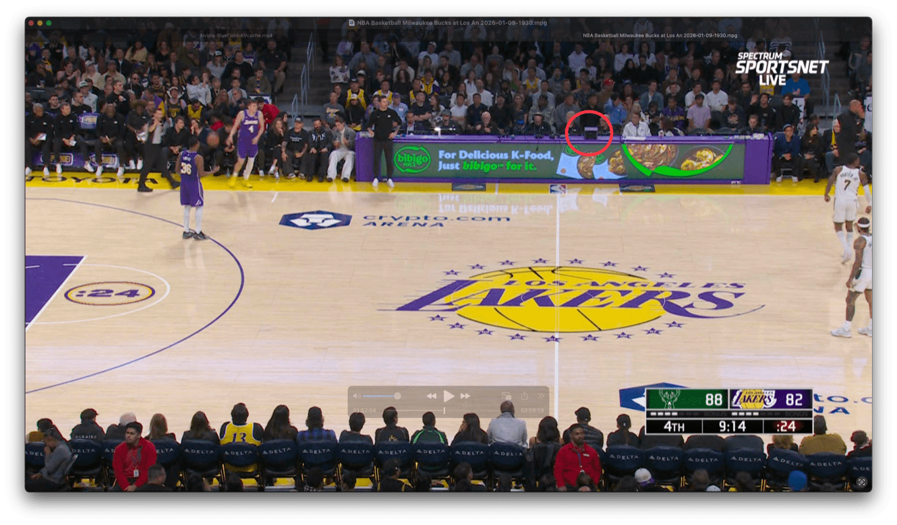
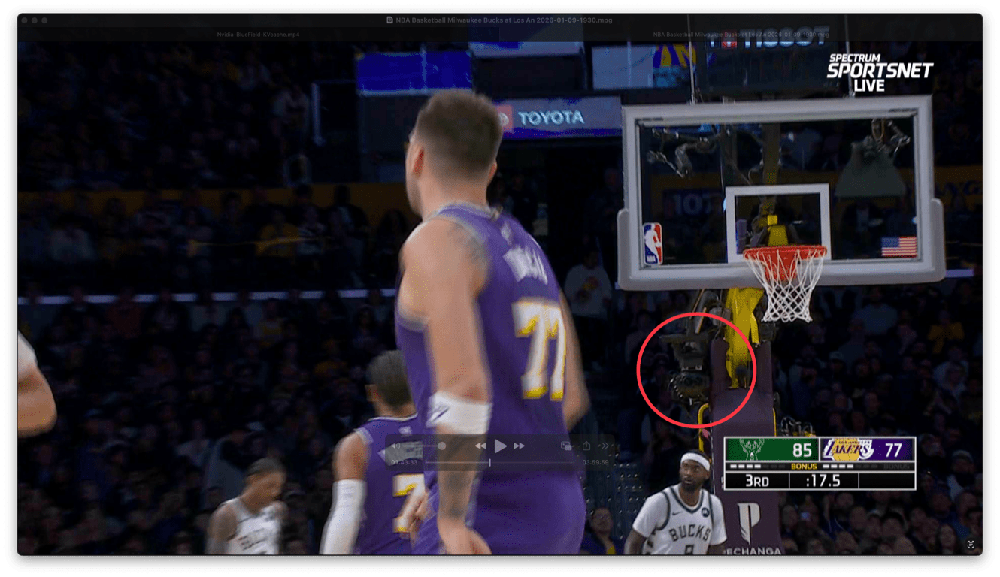

## Summary
[[BenThompson]] argues that [[Apple]] is applying television's multi-camera production grammar to [[VisionPro]], even though immersive video derives its distinctive value from sustained presence in one place. His first-person account of an NBA broadcast says the scorer's-table and baseline views each convincingly conveyed player scale and physicality, but producer-controlled cuts forced repeated spatial reorientation and made the experience worse than television. The proposed alternative is a low-production "ticket to live": fixed cameras, venue sound, visible in-arena information, and viewer choice, which could also reduce cost enough to expand coverage.

## Key Claims
- Television solved the problem of translating three-dimensional live events to a two-dimensional screen through many cameras, editing, commentary, graphics, and studio segments; those conventions are not automatically appropriate for an immersive medium.
- Apple's early NBA demonstration suggested that a fixed courtside immersive camera could approximate physical attendance more closely than ordinary television.
- Apple's five-minute 2024 MLS review used 54 shots—about one cut every six seconds—and only 2:32 of gameplay, which Thompson says prevented presence and sometimes made the ball difficult to relocate.

- The 2025 Metallica video repeated the same production choice: 14 cameras and interviews produced an enjoyable documentary, but not the feeling of remaining at the concert.
- In the January 2026 Bucks-Lakers broadcast, the scorer's-table camera conveyed players' height, speed, and power from a stable courtside position.

- A camera beneath the basket offered a different but individually credible seat, yet producer-directed cuts between it and other positions repeatedly disrupted spatial orientation.

- A presence-first broadcast could omit dedicated hosts, announcers, graphics, and live switching, use venue sound and information already visible in the scene, and offer fixed viewpoints or viewer choice at lower production cost.
- Only six Lakers games were announced for the 2025–26 immersive schedule; Thompson argues that simplifying production could make cameras routine across sports, concerts, and conventions and better justify Vision Pro's $3,499 price.

## Key Quotes
> "What makes the Vision Pro unique is the sense of presence" — Thompson's criterion for judging immersive production.

> "one camera, with no production" — the proposed alternative to television-style switching.

## Connections
- [[BenThompson]] - author using first-person product experience to argue for medium-specific production.
- [[Stratechery]] - publication where the open letter and production critique appeared.
- [[Apple]] - device maker and immersive-content producer criticized for importing television conventions.
- [[VisionPro]] - headset whose differentiated value is framed as presence rather than a physically uncomfortable television.
- [[NBA]] - league and live-event setting for the Bucks-Lakers broadcast.
- [[VirtualRealitySports]] - sports-media category whose production grammar and economics the source updates.
- [[ImmersiveMediaProduction]] - presence-first framework derived from the source's fixed-viewpoint argument.

## Contradictions
- The source qualifies the 2017 expectation in [[inside-the-nbas-virtual-reality-strategy]] that recurring production would steadily improve live VR: by January 2026, Thompson still found producer-directed camera switching actively harmful and the announced schedule limited to six Lakers games.
- The argument that one fixed camera needs "no production" is a directional simplification, not a complete cost model. Capture, spatial audio, encoding, transmission, rights, app delivery, camera protection, accessibility, moderation, and technical operations remain necessary.
- The judgments come from one experienced enthusiast watching one geographically restricted game through a VPN. The source provides no viewer study, comfort comparison, willingness-to-pay distribution, production budget, rights analysis, or retention data.
