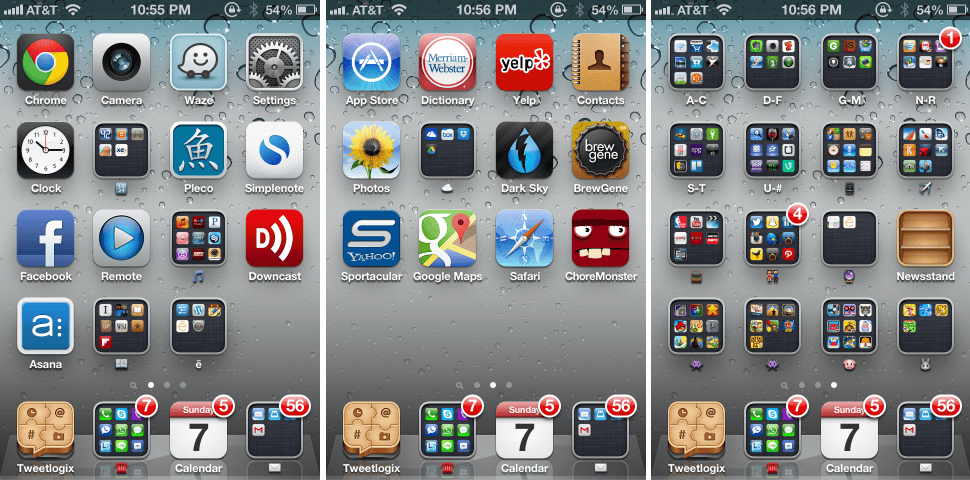
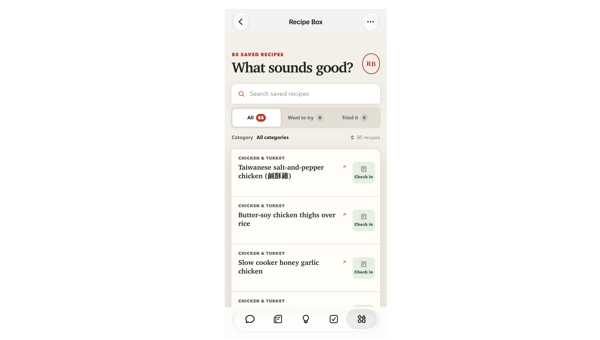
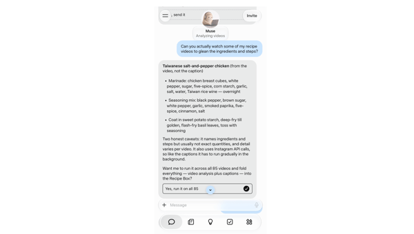

## Summary
[[BenThompson]] argues that an AI agent equipped with a computer can replace task-specific app interaction with natural-language delegation, operate existing software, and generate disposable personal interfaces on demand. Using [[Muse]] and [[MicrosoftCopilot]] as consumer and enterprise cases, he extends [[AggregationTheory]] from controlling discovery to controlling inspiration and execution: the agent that owns user context, credentials, and the primary conversation could become both platform and aggregator. The article is a first-person strategy forecast built around one recipe-organizing experiment and product announcements, not evidence of broad adoption, reliable autonomy, or durable market power.

## Key Claims
- Apps succeeded by exposing many distinct [[JobsToBeDone|jobs]], but users ultimately want outcomes rather than the work of learning and operating hundreds of interfaces.
- An agent becomes materially different from a chatbot when it has a computer: probabilistic language reasoning can delegate deterministic work to software, persist state, and act across apps and websites through [[ComputerUse]].
- [[Muse]] reportedly gives each user a virtual machine with two CPU cores, 8 GB of RAM, and 8 GB of storage, making a hosted computer part of the consumer-agent product rather than an optional integration.
- Thompson's Muse experiment turned saved Instagram posts into a searchable recipe box in about five minutes, then continued extracting ingredients from captions and videos while encountering Instagram rate limits.
- [[GenerativeUI]] makes software abundant by creating task-specific, potentially disposable interfaces for one user; the scarce input shifts toward deciding what is worth doing.
- The article extends [[AggregationTheory]] from discovery to inspiration: an agent that frames goals and abstracts apps into suppliers may control both demand and the user's expression of desire.
- [[MicrosoftCopilot]] and Muse are presented as bids to combine platform and aggregator power, with Microsoft advantaged by enterprise identity and work surfaces and Meta advantaged by consumer reach and messaging distribution.

The older home-screen image makes the app-era tradeoff concrete: many jobs were made mobile, but each remained packaged behind a separate learned interface.

The generated app shows 85 saved recipes with search, category, cuisine, and meal filters, plus individual recipe cards; it is evidence of a useful personalized UI, not of completeness or accuracy.

The follow-up screenshot shows Muse analyzing videos, extracting ingredients from three recipes, and acknowledging rate limiting, illustrating both asynchronous execution and dependence on a supplier's access constraints.

## Key Quotes
> “The ability to do stuff is becoming abundant; what is scarce is volition.” — Thompson's proposed shift from discovery to inspiration.

> “Apps get abstracted away into an implementation detail.” — on the agent becoming the user's primary interface.

## Connections
- [[BenThompson]] - author applying jobs-to-be-done and aggregation strategy to agent-mediated computing.
- [[Muse]] - consumer-agent case combining messaging, a hosted computer, background work, and generated interfaces.
- [[MicrosoftCopilot]] - enterprise-agent case combining chat, app generation, long-running work, identity, permissions, audit, and governance.
- [[AgentNativeComputing]] - broader shift from app-specific interaction toward agents that operate and create software.
- [[GenerativeUI]] - on-demand interface creation illustrated by the personal recipe box.
- [[ComputerUse]] - mechanism through which agents operate existing apps and websites when APIs or dedicated integrations are insufficient.
- [[AggregationTheory]] - strategic frame extended from discovery and demand aggregation toward inspiration and execution.
- [[JobsToBeDone]] - explains why users may prefer stating desired outcomes to learning each supplier's interface.
- [[ConversationalUI]] - messaging is proposed as the initial interaction layer for agents, with richer natural interfaces expected later.

## Contradictions
- The thesis that pre-built UI is “dead” conflicts in degree with the article's own evidence: the successful outcome is a generated graphical recipe app, and the screenshots show chat, filters, cards, navigation, and status feedback working together rather than language replacing UI.
- One successful personal workflow does not establish general task reliability, interface quality, accessibility, security, maintenance, or user demand; the recipe extraction remained incomplete and rate-limited.
- Claims about current model speed, universal UI operation, Muse hardware allocation, Copilot architecture, distribution advantage, and future single-agent concentration are product or strategy assertions in the supplied article, not independently verified benchmarks or market outcomes.
- Agents may abstract suppliers from users, but services can still constrain access through authentication, rate limits, destination blocking, pricing, terms, anti-automation controls, and scarce proprietary data.
- Context and credential concentration may increase agent stickiness while also increasing privacy, security, governance, switching, and systemic-failure risks.
