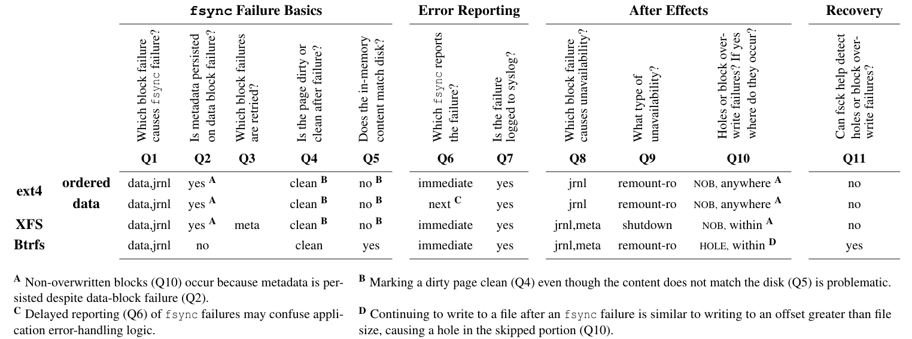
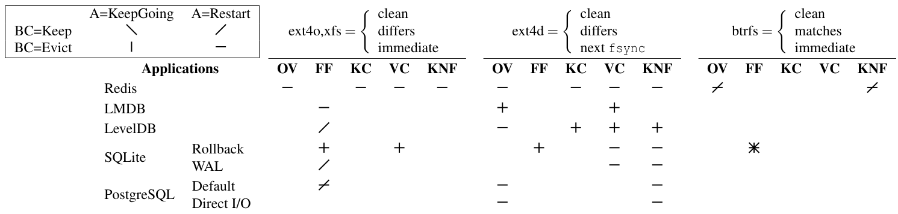

## Summary
Rebello and collaborators inject single transient block-write faults to characterize how Linux 5.2.11 ext4, XFS, and Btrfs handle failed `fsync` calls, then use [[CuttleFS]] to emulate those reactions beneath Redis 5.0.7, LMDB 0.9.24, LevelDB 1.22, SQLite 3.30.1, and [[PostgreSQL]] 12.0. The study shows that an `fsync` error leaves persistence state uncertain: all three filesystems mark failed pages clean, but their retained contents, error timing, metadata behavior, and availability reactions differ. Application strategies ranging from ignoring the return code to rollback or crash-restart still produced false failures, stale or missing data, and corruption under the tested workloads because recovery sometimes consumed page-cache state that did not match disk.

## Key Claims
- A failed `fsync` is not safely repaired by immediately retrying it on the tested Linux filesystems: failed data pages were marked clean, so a later call could succeed without resubmitting the lost write.
- Filesystem reactions were materially different. Ext4 and XFS could retain new clean data in memory while disk held old contents; Btrfs reverted memory to the prior on-disk state; ext4 data-journal mode could report a checkpoint failure on a later `fsync`.
- Copy-on-write Btrfs avoided the non-overwritten data blocks observed with ext4 and XFS in these workloads, but it could create holes after a failed append because the process file offset advanced while filesystem state reverted.
- No tested application strategy handled every emulated reaction correctly. Ignoring errors, reverting state, restarting, checksumming logs, and using direct I/O each covered only part of the failure space.
- Page-cache state is not evidence of durable state. Recovery that reads cached log or journal data can accept a transaction that the application already reported as failed, while later eviction or restart can expose stale or corrupt disk contents.
- Durability testing should inject sector- or block-level faults beneath the filesystem and continue workloads after failure; mocking syscall return codes or testing only crash-restart paths misses consequential intermediate states.
- The findings are bounded to simple insert/update workloads, named software versions, Linux 5.2.11, and single transient write faults; complex workloads or newer implementations may behave differently.

The filesystem table shows the shared clean-page behavior and the important divergences: immediate versus delayed error reporting, memory/disk agreement, remount-read-only versus shutdown, non-overwritten blocks versus holes, and Btrfs-only checker detection in the tested cases.

The application table ties anomalies to both application restart and buffer-cache eviction. Apparent recovery can therefore change when a clean page is reclaimed, the filesystem restarts, or the machine reboots, even without another logical database operation.

## Key Quotes
> "Application developers can only assume that the underlying file system experienced a fault"

> "Applications should read the on-disk content of files when performing recovery."

## Connections
- [[FsyncFailureSemantics]] - captures the cross-layer uncertainty and recovery constraints exposed by failed persistence barriers.
- [[CuttleFS]] - project built to emulate page-state, content, and error-timing reactions for application durability tests.
- [[DataDurability]] - shows that an acknowledgement and an `fsync` call are meaningful only within a precise storage failure contract.
- [[PostgreSQL]] - crash-restart avoided blind retry but still produced false failures or data loss under some emulated reactions in version 12.0.
- [[SQLite]] - rollback-journal and WAL modes failed differently when recovery read cached state or delayed errors hid damaged database pages.
- [[Redis]] - version 5.0.7 did not check the tested append-only-file `fsync` result before acknowledging success.
- [[ChaosEngineering]] - related practice, while this study specifically requires deterministic low-level storage fault injection and post-failure continuation.

## Contradictions
- No direct contradiction with the wiki's existing durability material was found. The study qualifies simple replication or crash-restart narratives by showing that local acknowledgement, cache, filesystem, and disk states can diverge before higher-level recovery begins.
- The paper's comparative claims are experimental results for 2020-era software and one bounded fault model, not timeless guarantees about current ext4, XFS, Btrfs, or database releases.
