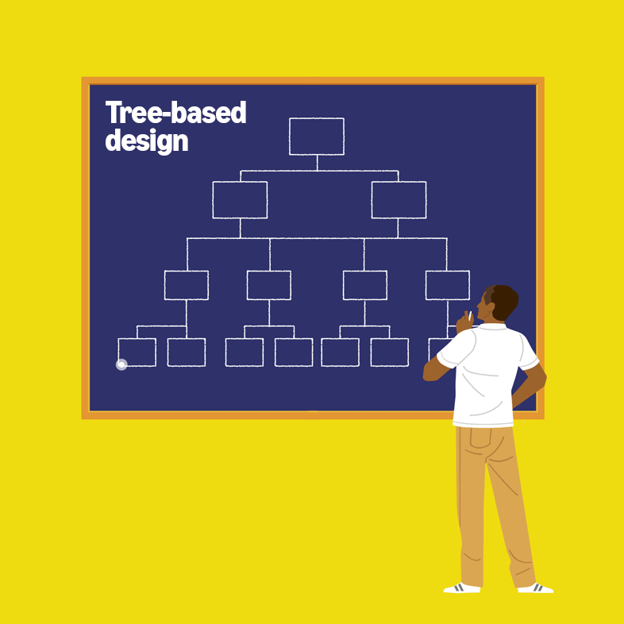
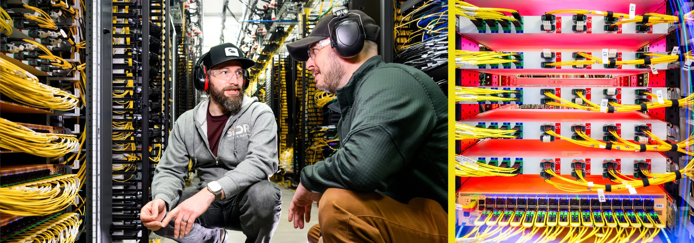

## Summary
Amazon describes how [[AWS]] turned random-graph theory into a flat data-center network by combining deterministic optical wiring in a passive ShuffleBox with the Spraypoint multipath routing protocol. The account follows [[GiacomoBernardi]], [[RatulMahajan]], and [[SeshadhriComandur]] from Penrose-inspired and simulated designs through a hand-wired production proof in Ireland, then reports faster traffic movement, fewer devices, lower network-equipment electricity use, and a 2025–2026 rollout. These results and the claimed mathematical proof are first-party summaries; the linked technical report was not included in this ingest.

## Key Claims
- [[RandomGraphDataCenterNetworks]] can replace a prescribed router hierarchy with a flat, path-rich topology intended to reduce bottlenecks and single points of failure.

- The passive ShuffleBox makes apparently random fiber interconnection reproducible: a fixed internal permutation plus quasi-random connections between boxes yields the desired graph without technicians manually wiring millions of individual random links.
- Spraypoint routes across the irregular topology in two phases: a source sprays traffic toward neighboring routers, then waypoint routers point it toward the destination, using many paths rather than restricting traffic to shortest paths.

- The team reports roughly 530 processor-years of simulation across hundreds of thousands of failure scenarios, followed by mathematical modeling and a hand-wired production proof in Ireland whose behavior matched the models.

- AWS says the design works with existing routers, fiber, optical modules, and transceivers; the new elements are ShuffleBox and Spraypoint.
- Amazon reports up to roughly 33% faster data movement across most tested real-world traffic conditions, 40% lower electricity consumption for network equipment, fewer intervening devices, billions of dollars in hardware savings, and lower associated emissions.
- The article says AWS began deployment in Spain and Germany in 2025 and planned adoption across most of its global data centers during 2026.

## Key Quotes
> “Shortest paths aren't always the best option.” — Comandur explains why slightly longer alternatives can reduce congestion by increasing path choice.

> “We started with experiments, observed results, and then asked: ‘But why does this work?’” — Bernardi describes simulations preceding the mathematical explanation.

> “You turn it on, it functions.” — Matt Rehder states the operational goal that customers should not need to notice the network.

## Connections
- [[AWS]] - company developing and deploying the flat random-graph data-center architecture.
- [[RandomGraphDataCenterNetworks]] - architecture combining reproducible physical connectivity, path-diverse routing, simulation, and mathematical validation.
- [[DataCenterNetworkFabric]] - established concept broadened by a non-hierarchical, path-rich fabric design.
- [[NetworkResilienceTradeoffs]] - frames the source's claimed reduction in bottlenecks and failure points against unreported control-plane and correlated-failure behavior.
- [[GiacomoBernardi]] - principal applied scientist who initiated the router-topology work and co-led implementation.
- [[RatulMahajan]] - networking researcher who recruited graph-theory expertise and co-led the work.
- [[SeshadhriComandur]] - graph theorist who supplied the mathematical model and ShuffleBox wiring formula.

## Contradictions
- The architecture supports the proposition that added path diversity can improve throughput and route around failures, but it does not erase [[NetworkResilienceTradeoffs]]: the article gives no operational incident rate, convergence behavior, control-plane limit, correlated-failure test, tail-latency distribution, or long-term maintenance result.
- The performance, energy, cost, novelty, proof, and rollout statements come from Amazon's own article. This ingest did not independently inspect the linked technical report, benchmark methodology, mathematical derivation, hardware counts, baseline topology, or deployment telemetry.
- “Up to 33% faster” and “40%” lower network-equipment electricity use have different scopes: the former is reported for most tested traffic conditions, while the latter is an AWS expectation relative to its previous architecture; neither supports a claim about total data-center energy or every workload.

## Image Notes
- All seven inline images, five video posters, three animated GIFs, and five short MP4 clips were opened or sampled. The retained tree and Penrose animations preserve distinct design stages at their shared semantic position; the Spraypoint analogy and hand-wired proof add path and implementation evidence not captured by a portrait or generic rack photograph.
- Blank or duplicate video posters, the team portrait, two contextual data-center photographs, and the decorative tangled-fiber hero illustration were omitted. The short videos repeat the prose and retained diagrams; no unsupported claim was inferred from filenames or captions alone.
