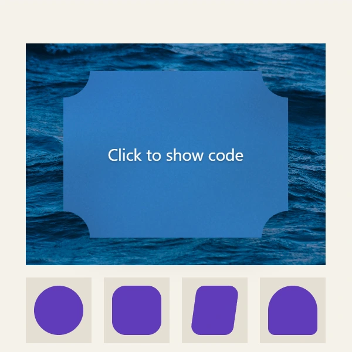
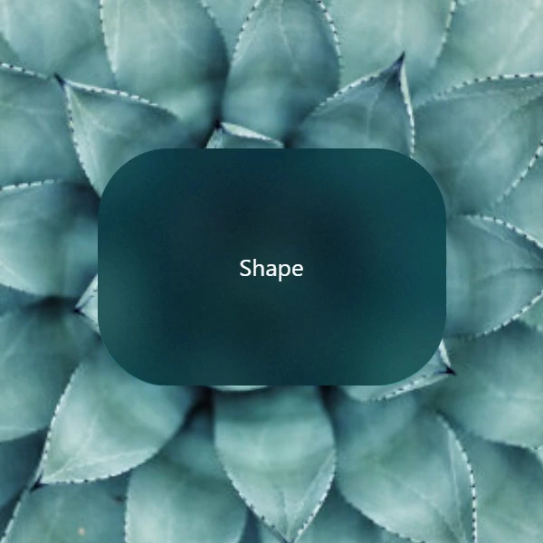
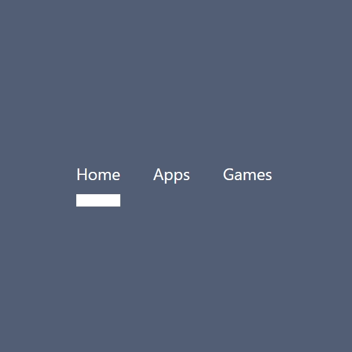
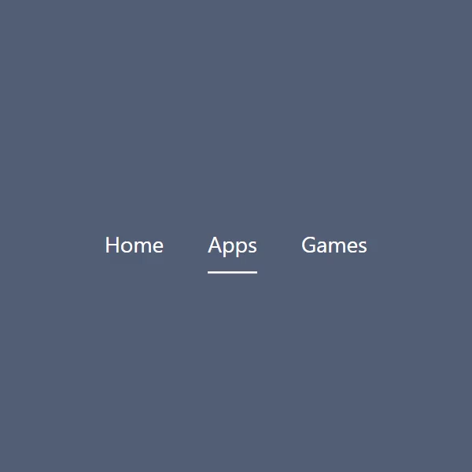
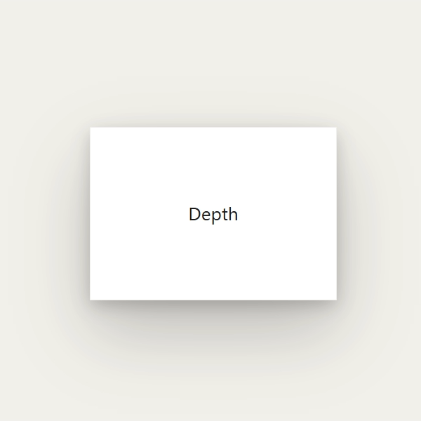
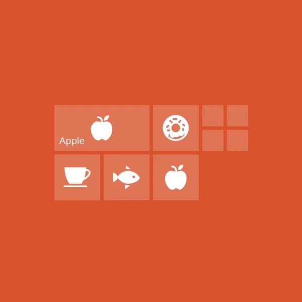
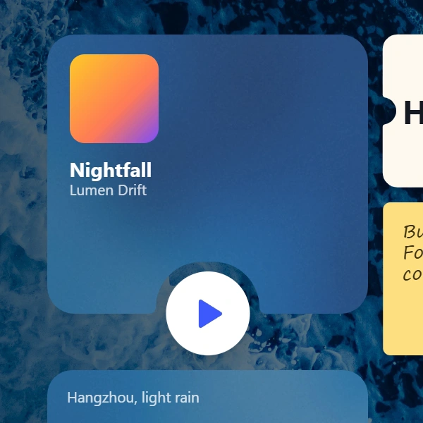

## Summary
[[LossesDon]] recounts rebuilding [[AxiomDesignSystem]] from a collection of meticulously reproduced effects into a shared Web Component architecture for geometry, rendering, and typed design tokens. The system combines selected ideas from early [[MaterialDesign]] and [[FluentDesign]] while treating coherent rules, accessibility, performance, and implementation constraints as more important than isolated spectacle. The project also serves as a source-scoped case of expert-directed [[AICodingPractice]]: Claude, Kimi, and DeepSeek accelerated optimization and implementation, but the author supplied the long-developed design model, visual judgment, browser knowledge, and acceptance work.

## Key Claims
- A useful design system should raise the minimum quality of implementations without capping expert expression; a loose philosophy or a library of unrelated effects does neither.
- Combining design languages requires reconciling their underlying metaphors: early Material stacks surfaces outward like paper, while early Fluent uses inward depth and window-like acrylic surfaces.
- [[DesignSystemArchitecture]] makes visual coherence executable by giving Reveal lighting, elevation, acrylic, navigation, and pressure effects one Shape geometry layer, Surface scheduler, and Typed OM token mechanism.

- A shared Shape vocabulary lets corner, border, and shoulder decorations propagate across components and keeps Canvas and SVG representations aligned.

- Animation APIs can deliberately hide fragile timing details: the navigation indicator exposes shape and damping while its tuned morph sequence remains internal.

- Browser defects may require perceptual rather than literal equivalence: on Firefox, Axiom computes the tilted outer graphics geometrically but leaves the content layer flat to avoid a backdrop-filter/CSS-3D framebuffer failure.
- Canvas rendering trades some performance for stable pixel alignment in continuously variable shadows at fractional display scales.

- The shared infrastructure supports higher-order behaviors such as mixed-size tile drag reflow and compositions that combine geometry, material, lighting, and motion.

- The author reports Claude Opus finding a layout read/write scheduling error and producing a benchmarked improvement of more than 20x, then helping implement paired Canvas/SVG geometry; this is a first-person project result, not an independent model benchmark.

## Key Quotes
> "一个好的设计系统应当提高设计美感的下限，且没有降低设计美感的上限。" - on constraint as support rather than uniformity.

> "如果你对这些底层的设计逻辑与渲染机制不做消化，直接把它们生硬地凑在一起，做出来的就会是犹如『尸块』一样的东西。" - on why isolated visual effects do not form a system.

> "如果七年前我们没有花时间在那边数毛、做回归、算公式，也没有在脑子里想清楚整套图形基建应该怎么拆解，那今天就算直接把诉求交给 LLM，它们可能也没法把质感复刻得这么准确。" - on prior expertise as the substrate for AI acceleration.

## Connections
- [[AxiomDesignSystem]] - the rebuilt component and graphics system described by the report.
- [[LossesDon]] - author and long-term designer of Axiom.
- [[DesignSystemArchitecture]] - shared geometry, scheduling, token, and component semantics that replace isolated effects.
- [[MaterialDesign]] - source of the outward surface metaphor and soft multi-layer elevation model.
- [[FluentDesign]] - source of reveal lighting, acrylic material, spatial metaphor, pressure, and navigation motion.
- [[AICodingPractice]] - expert-directed use of several models for optimization, implementation, visual comparison, and browser debugging.
- [[Claude]] - model family credited with optimization and much of the new implementation.
- [[Firefox]] - browser whose rendering defect forced a perceptually equivalent pressure-effect fallback.

## Contradictions
- The source strengthens the view that explicit design models and behavioral evidence can let experts delegate substantial implementation, but qualifies broad automation claims: the reported result depended on seven years of prior experiments, a detailed specification, manual visual judgment, overnight debugging, and repeated boundary fixes.
- The author's judgment that later Material, Fluent, and Liquid Glass systems declined is a practitioner critique, not comparative accessibility research or a full evaluation of those systems.
- Performance figures, browser behavior, and AI contributions are first-person reports without independent reproduction; the animated demos establish visible behavior but not runtime cost, accessibility outcomes, or cross-browser correctness.
