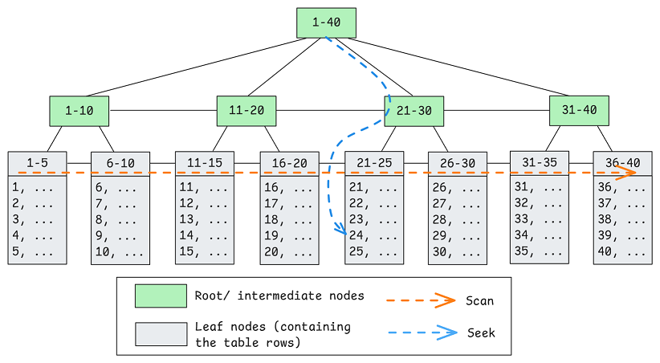
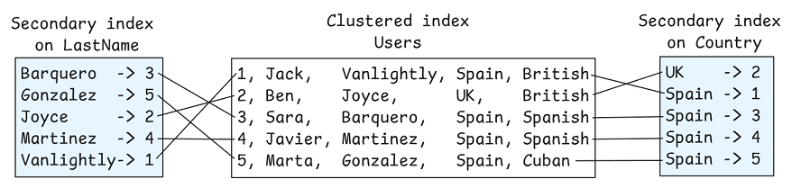
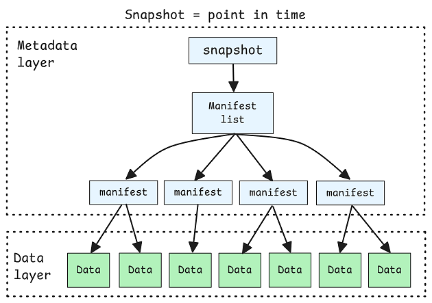
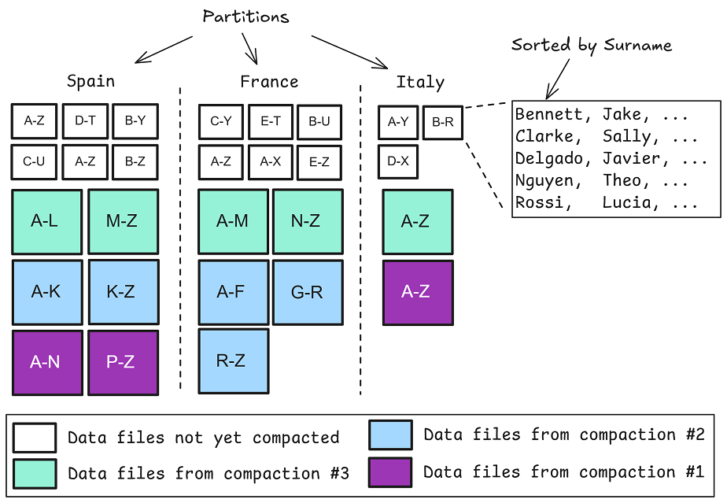
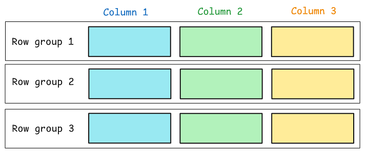
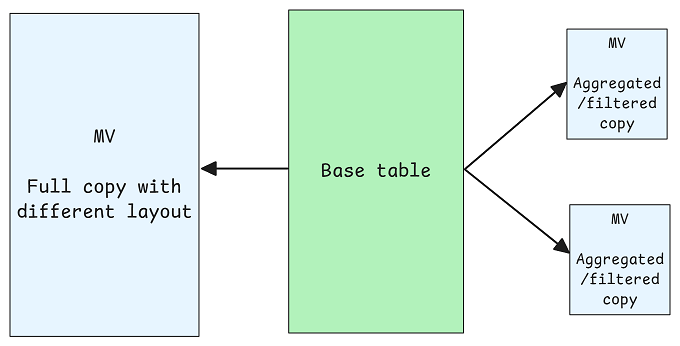
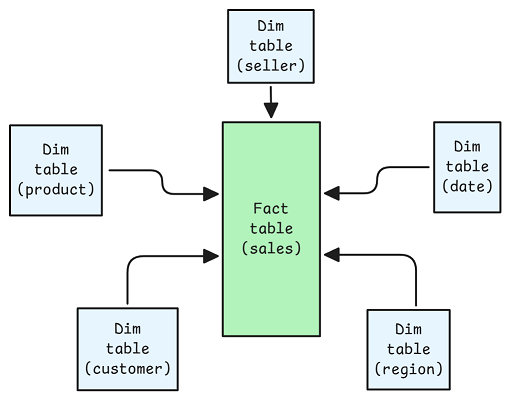

## Summary
[[JackVanlightly]] argues that relational indexes and [[OpenTableFormats|open table formats]] pursue the same high-level goal—reducing I/O—but encode different workload assumptions. OLTP systems use row-oriented clustered and secondary B-trees for selective access, whereas analytical tables such as [[ApacheIceberg]] rely on column projection, physical locality, file and row-group statistics, and [[DataPruning]] over large immutable files. The durable design rule is to align partitioning, sorting, compaction, auxiliary metadata, and logical modeling with dominant queries; alternate materialized layouts can cover query diversity that one canonical layout cannot.

## Key Claims
- A clustered B-tree stores rows in primary-key order and supports logarithmic seeks, while a secondary index maps other predicates to clustering keys; whether repeated lookups beat a scan depends on selectivity, storage, covering columns, and optimizer statistics.

- Analytical scans make row-level pointer chasing and synchronously maintained secondary B-trees unattractive. Open table formats instead catalog immutable columnar files and try to eliminate irrelevant columns, files, row groups, and values before or during execution.
- An Iceberg snapshot points through a manifest list and manifests to unordered data files. Query speed therefore depends less on a tree traversal to a row than on whether metadata can prove that whole branches of physical data are irrelevant.

- Partitioning creates guaranteed file-level locality, sorting narrows value ranges within and sometimes across files, and compaction merges small independently sorted writes into fewer files with more useful global range locality.

- Iceberg manifest min/max values can prune files, while [[ApacheParquet]] row-group statistics can prune lower-level blocks. These statistics only become selective when the physical layout keeps related values together; broad overlapping ranges expose layout drift rather than fixing it.

- Bloom filters can reject absent exact-match values without false negatives, and sidecar histograms or primary-key-to-file maps can assist particular systems, but they do not make one layout optimal for every analytical predicate.
- Materialized views and transparent projections exchange storage and maintenance for alternative physical representations, making them the closest analytical analogue to a secondary index for supporting diverse access patterns.

- Star schemas make analytical access paths more predictable: small dimensions can be scanned or cached, while a large fact table is coarsely partitioned and sorted on selective keys so metadata can skip data effectively.

## Key Quotes
> "Ultimately, in open table formats, layout is king." — on performance depending on sustained alignment between data organization and queries.

> "You can’t sort or cluster the table twice without making a copy of it." — on why alternate projections require duplicated physical representations.

## Connections
- [[JackVanlightly]] - author contrasting OLTP indexing with analytical physical design.
- [[ApacheIceberg]] - primary open-table-format example used for metadata, partitioning, sorting, and compaction.
- [[ApacheParquet]] - immutable columnar data-file layer whose row-group statistics provide lower-level pruning.
- [[OpenTableFormats]] - workload-shaped metadata layer over columnar data files.
- [[DataPruning]] - central query-planning mechanism for avoiding irrelevant files and row groups.
- [[ColumnarStorageTradeoffs]] - broader design space around scan granularity, metadata, selective access, and maintenance.

## Contradictions
- The article deliberately simplifies both sides: not every relational table is a clustered B-tree, and engines and formats vary in secondary indexes, partition semantics, Bloom-filter placement, clustering, optimizer behavior, and maintenance implementation.
- Saying secondary indexes add little to warehouses is a workload-level argument, not a universal prohibition. Highly selective analytical queries, proprietary search structures, primary-key maintenance, and hybrid transactional/analytical systems can favor index-like structures.
- Min/max pruning, Bloom filters, materialized views, and star schemas are explained conceptually but not benchmarked. Their value depends on data distribution, predicate selectivity, engine support, file sizing, storage latency, freshness requirements, and rewrite cost.
- The suggestion that richer sidecars will enter core open-table-format specifications is a forecast. Platform-specific alternate layouts have independent lifecycle, consistency, interoperability, and maintenance costs that the article does not measure.

## Image Notes
All seven effective local image references were opened and retained once at their semantic positions. They provide evidence about B-tree access paths, secondary-index mappings, Iceberg metadata boundaries, compaction and sort locality, Parquet row groups, alternate materialized layouts, and star-schema relationships; no referenced image was decorative or duplicated.
