## Summary
[[SebastianRaschka]] explains [[ReasoningEffort]] as a learned control over how much inference-time computation a fixed reasoning model spends, usually expressed through response length but created by post-training rather than by a magic prompt or delimiter. Across GPT-OSS, Inkling, DeepSeek V4, Nemotron 3 Ultra, Kimi, GLM-5, and Qwen3, the disclosed recipes combine mode-labeled prompts or chat templates with supervised examples, effort-conditioned rewards, token penalties, hard budgets, specialist models, and distillation. The practical result is a cost, latency, and quality control whose gains are task- and model-dependent and often diminish at the highest settings.

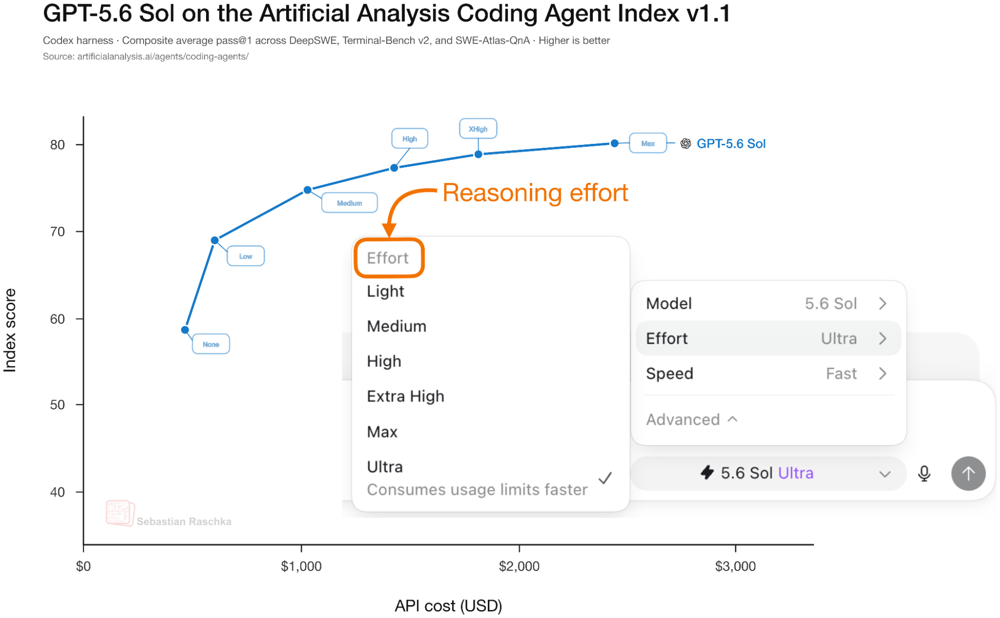

## Key Claims
- A reasoning model emits an intermediate trace before its final answer; extra inference tokens can support decomposition, backtracking, and self-correction, but neither the trace nor its fluency proves humanlike or faithful reasoning.
- Training compute and inference-time compute are separate scaling axes. Choosing another trained model changes the weights and per-token capability, while changing effort keeps one model fixed and changes how much computation it spends on the answer.

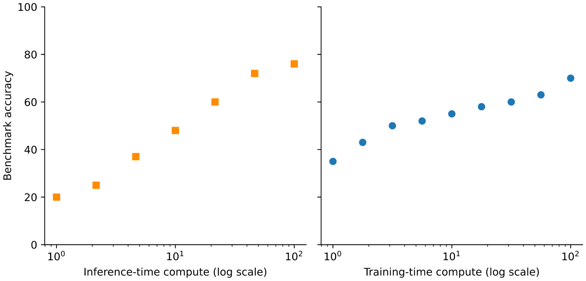

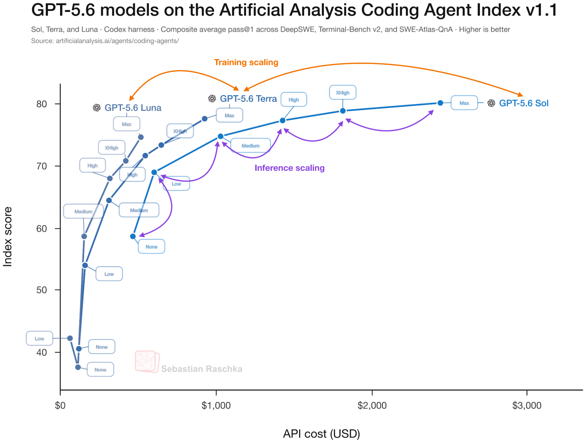

- [[DeepSeekR1|DeepSeek-R1-Zero]] demonstrates that outcome-based reinforcement learning with verifiable rewards can induce extended reasoning without rewarding the correctness of each intermediate step. Its rule-based reward checks final-answer accuracy and required output format, while the trace itself is ignored.

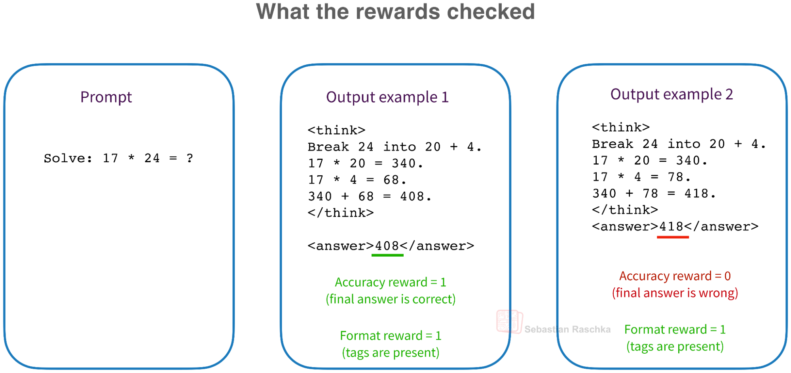

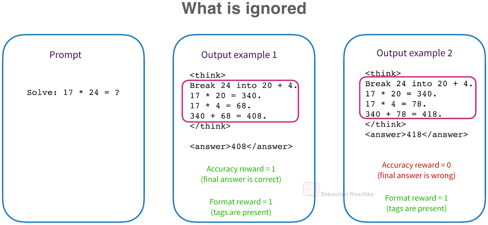

- Literal `&lt;think&gt;` delimiters organize and optionally hide a trace; they do not create reasoning ability. A format reward can teach their use, while an empty `&lt;think&gt;&lt;/think&gt;` prefill can force a trained hybrid model directly into answer generation.
- Qwen3's Thinking Mode Fusion uses supervised thinking and non-thinking examples followed by general RL, showing that an inference toggle depends on learned mode following rather than tokenizer syntax alone.

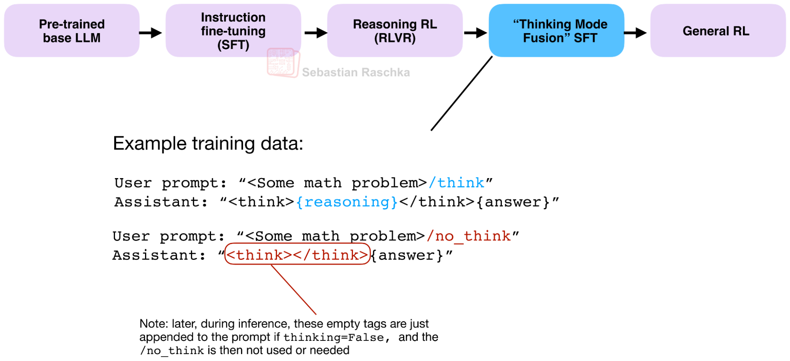

- GPT-OSS exposes low, medium, and high effort through a system-message label. Its reported results associate higher effort with more generated tokens and higher benchmark accuracy, but the article treats analogous GPT-5.6 internals as an informed hypothesis because OpenAI has not disclosed them.

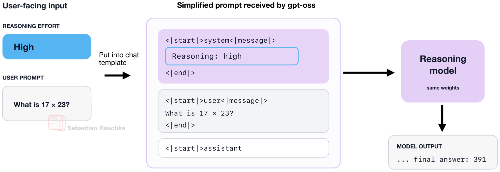

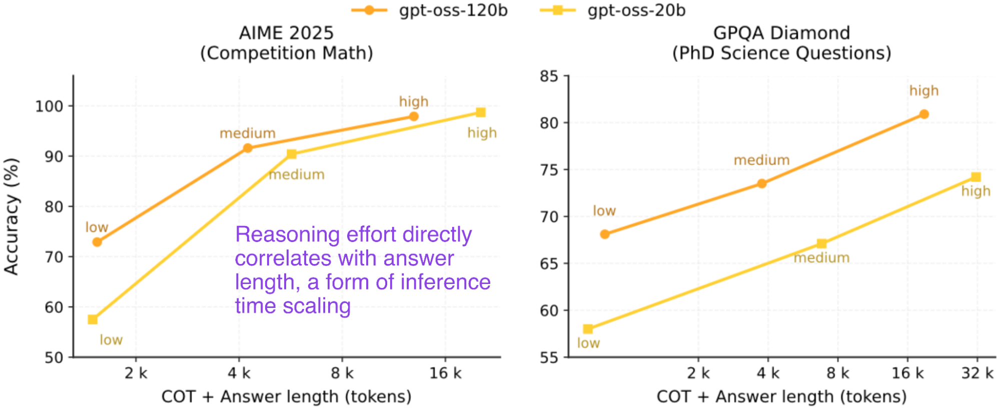

- Effort control can be learned during RL by conditioning on an effort label and changing the per-token penalty, during SFT by pairing effort labels with traces of the desired length, or through both stages. Inkling makes the control continuous and assigns higher token cost to lower requested effort.

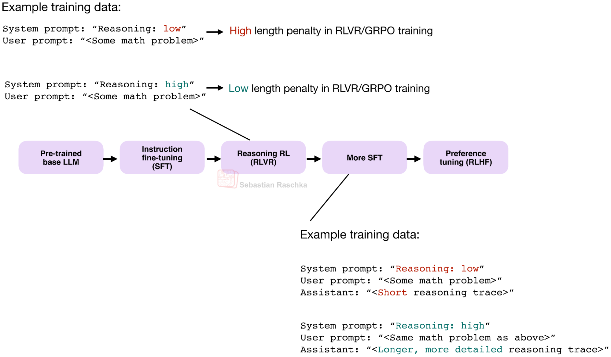

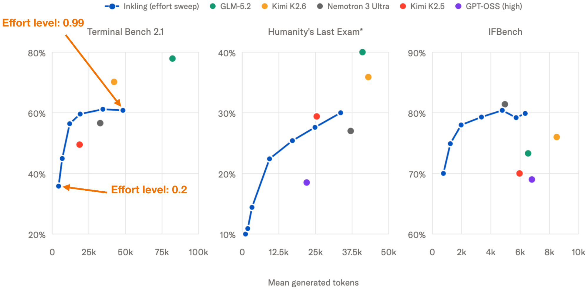

- The disclosed open-weight recipes are not interchangeable. DeepSeek V4 trains modes with different context windows and length penalties before multi-teacher on-policy distillation; Nemotron adds teacher-generated medium-effort data, random trace truncation, limited effort-specific RLVR, and an optional hard budget.

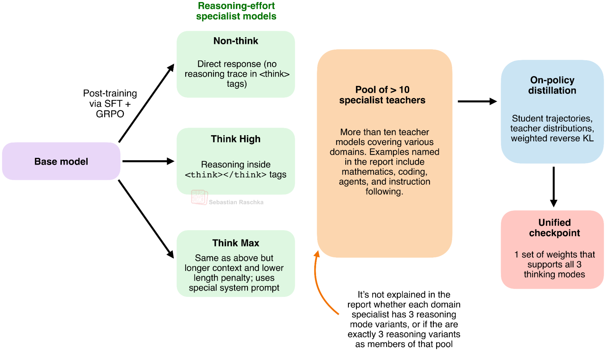

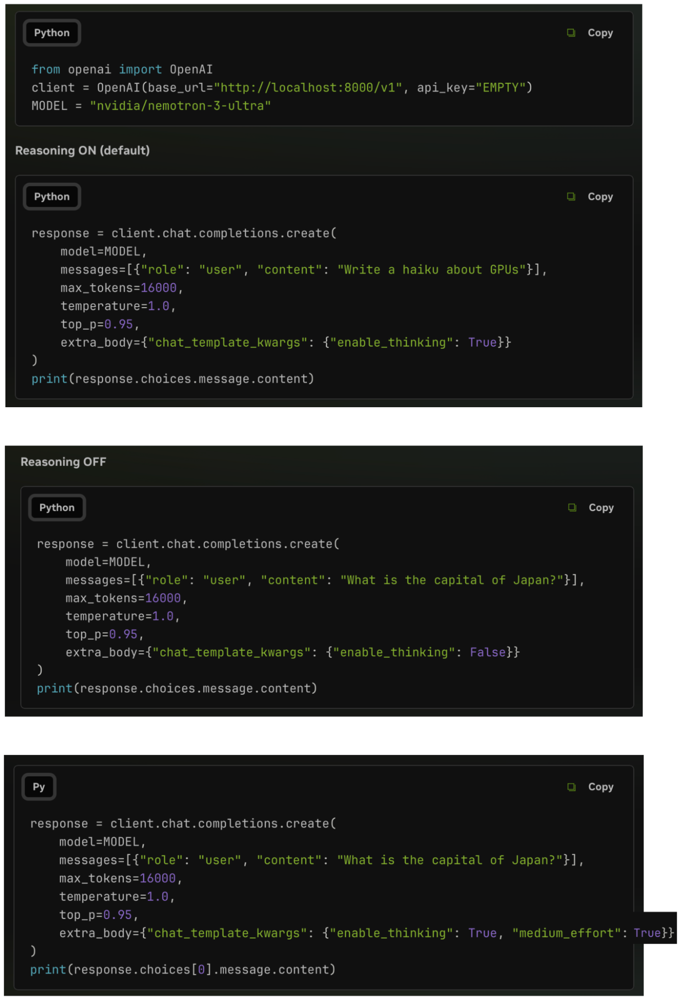

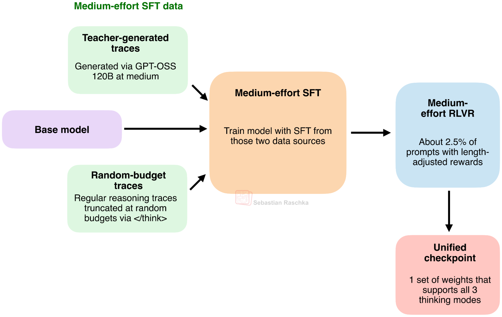

- Kimi's Toggle alternates budget-limited training that rewards efficient correct solutions with unconstrained training that preserves inference scaling; Kimi K3 instead distills nine domain-by-effort specialists into one model. GLM-5 emphasizes turn-level, interleaved, and preserved thinking for multi-turn and tool-using work rather than several scalar effort levels.

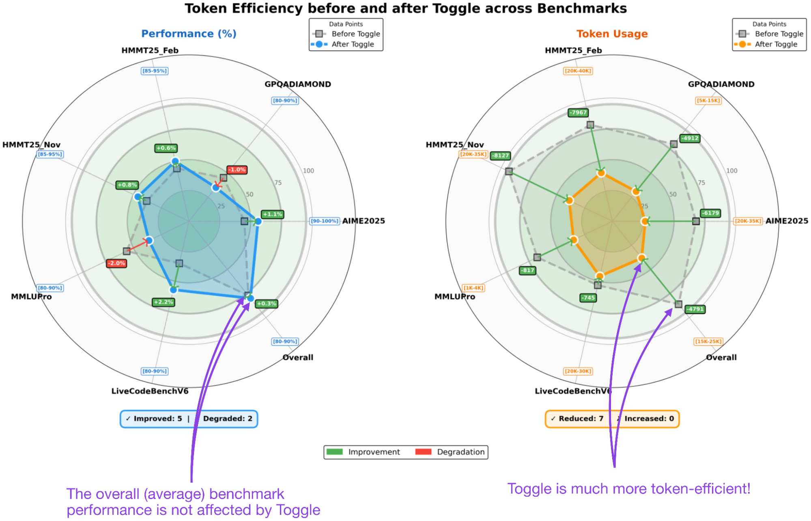

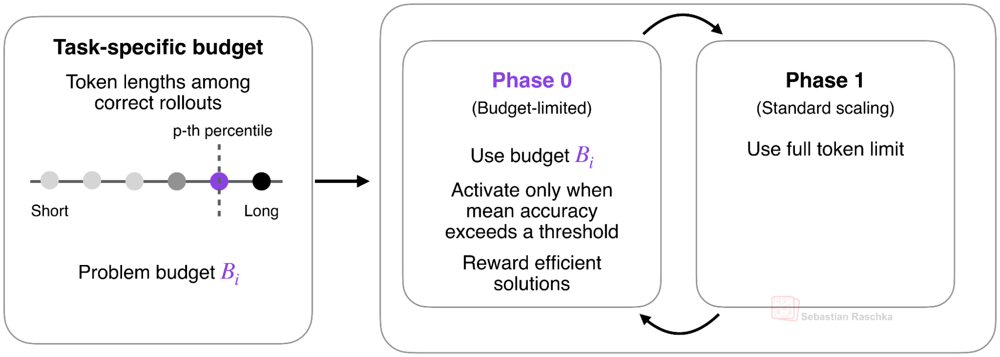

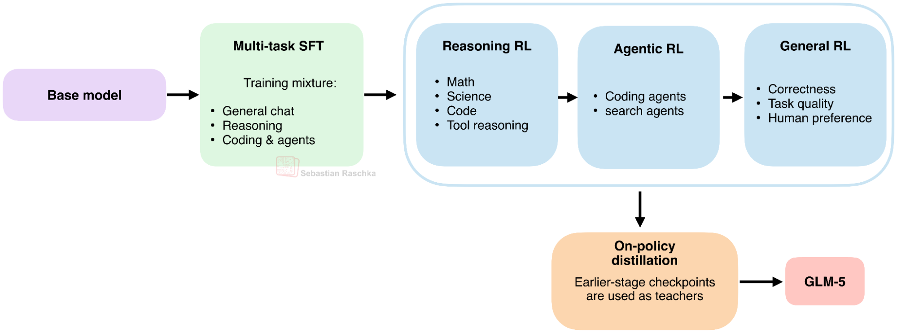

- Across the six compared open-weight systems, shared ingredients include learned mode signals, mode-conditioned SFT or RL, and explicit budget robustness, but similar user-facing labels can hide materially different training and serving mechanisms.

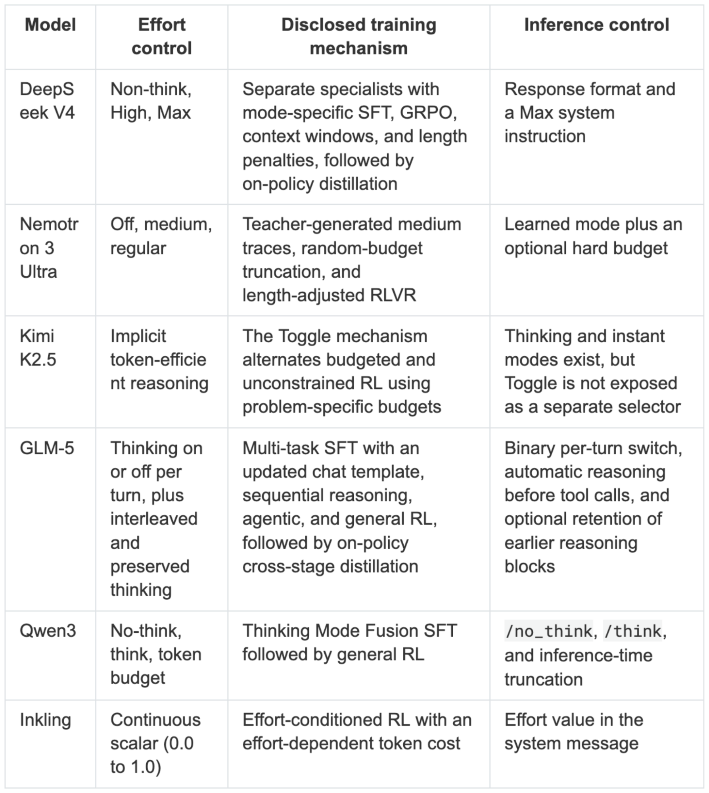

- Higher effort generally raises token use, latency, and cost and can improve difficult-task performance, but returns flatten or become uneven. A smaller model at higher effort can sometimes overlap a larger model at lower effort, so the useful operating point depends on task, benchmark, price, and latency constraints.

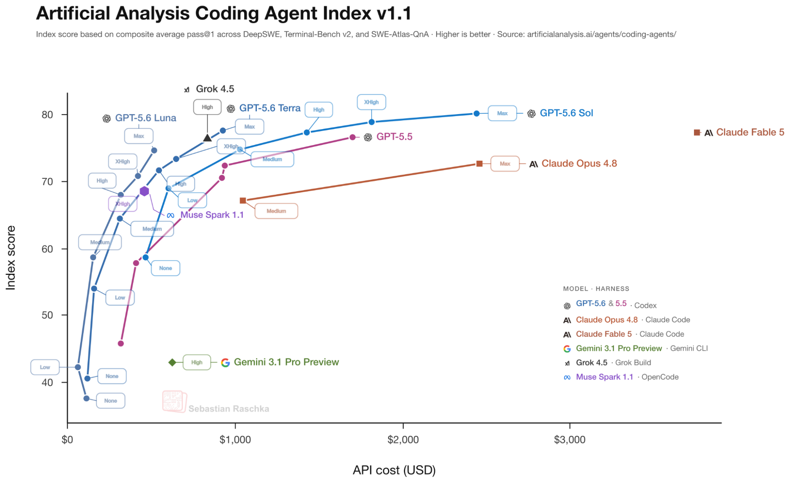

## Key Quotes
> "The model weights stay the same, but the model is allowed to spend fewer or more tokens working on the answer."

> "Similar labels can be backed by separate specialists, mixed SFT data, mode-conditioned rewards, hard token budgets, or combinations of these methods."

## Connections
- [[ReasoningEffort]] - central synthesis of learned effort controls, inference budgets, and the quality-cost-latency tradeoff.
- [[ChainOfThoughtReasoning]] - intermediate trace whose length and availability effort controls try to regulate.
- [[ReinforcementLearning]] - trains reasoning behavior and can condition rewards or length penalties on the requested effort.
- [[ReasoningModelDistillation]] - combines specialist behaviors into unified checkpoints and transfers efficient trajectories.
- [[DeepSeekR1]] - early reasoning family used to explain verifiable outcome rewards and the distinction between traces and reward signals.
- [[SebastianRaschka]] - author of the comparative technical explainer.

## Contradictions
- The article explicitly qualifies its proposed GPT-5.6 mechanism: GPT-OSS documents a system-prompt effort label, but that does not prove proprietary GPT-5.6 uses the same internal training or serving path.
- Reasoning effort is not identical to a hard token cap. Learned modes change how a model uses tokens, while an external budget may truncate a trace and require separately trained recovery behavior.
- More effort is not universally better. The reported curves are model-, benchmark-, price-, and provider-specific, and the highest settings show diminishing or uneven gains.
- The article synthesizes mostly vendor technical reports and first-party benchmarks. It does not provide controlled equal-compute comparisons across recipes, disclose all reward formulas and data mixtures, or establish which method generalizes best to interactive assistants, coding agents, and open-ended tasks.
