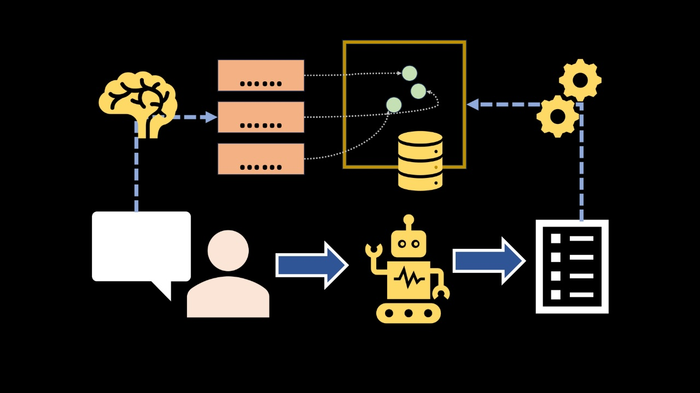
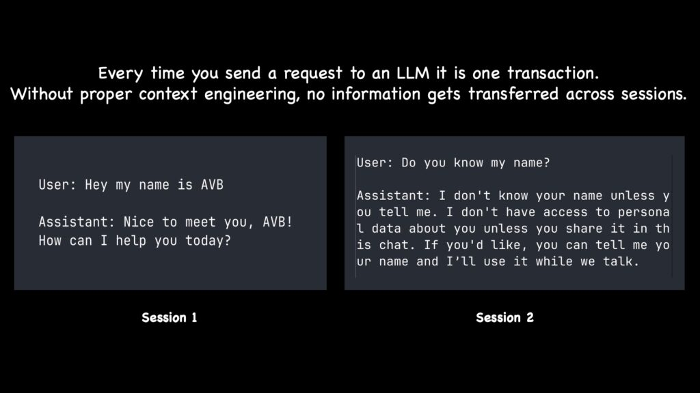
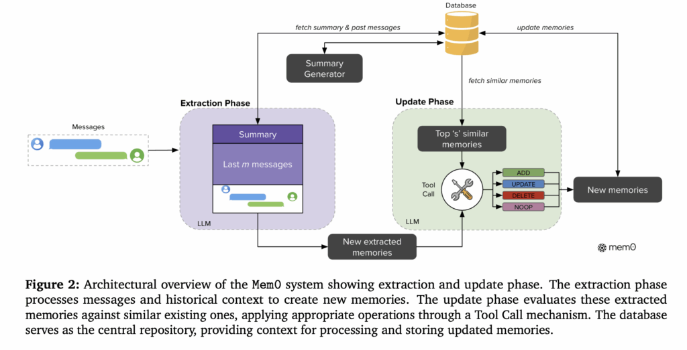
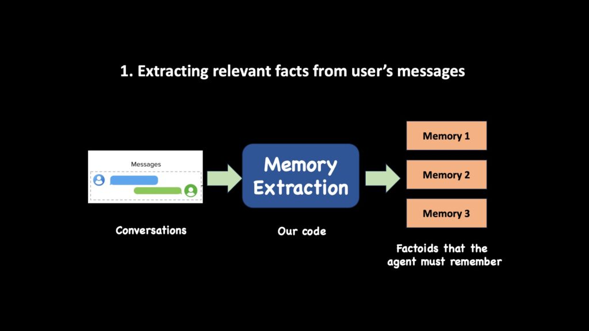
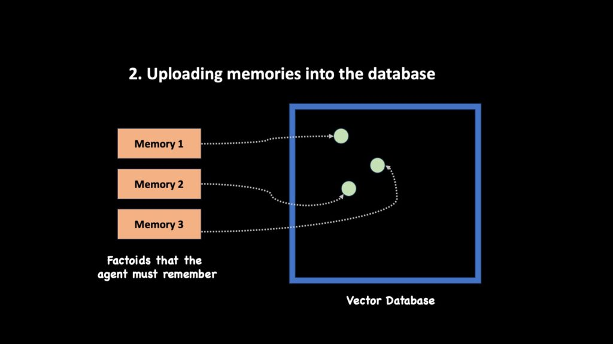
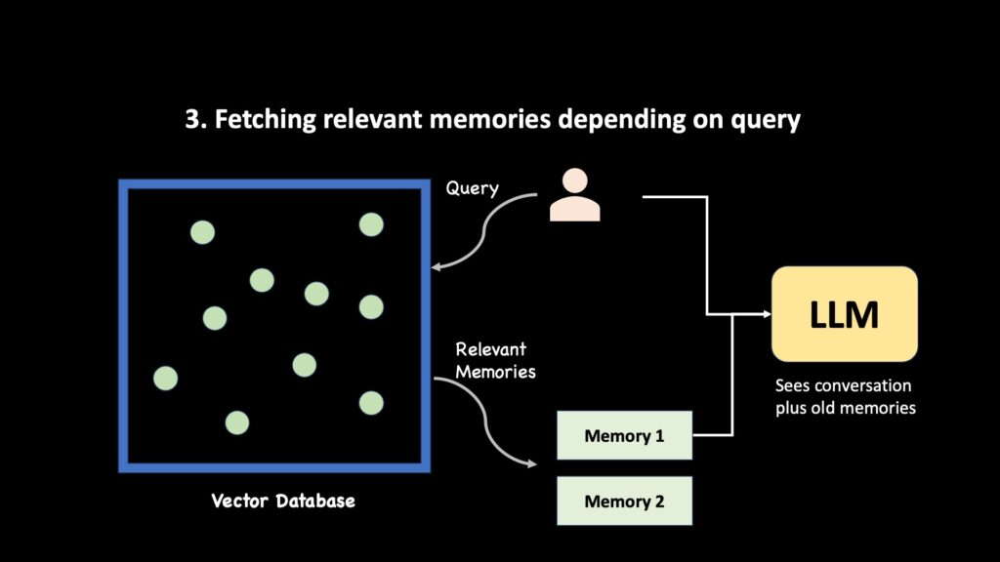
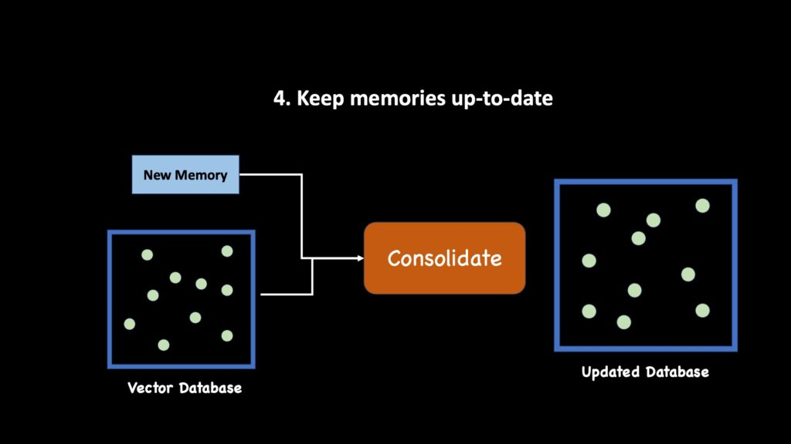
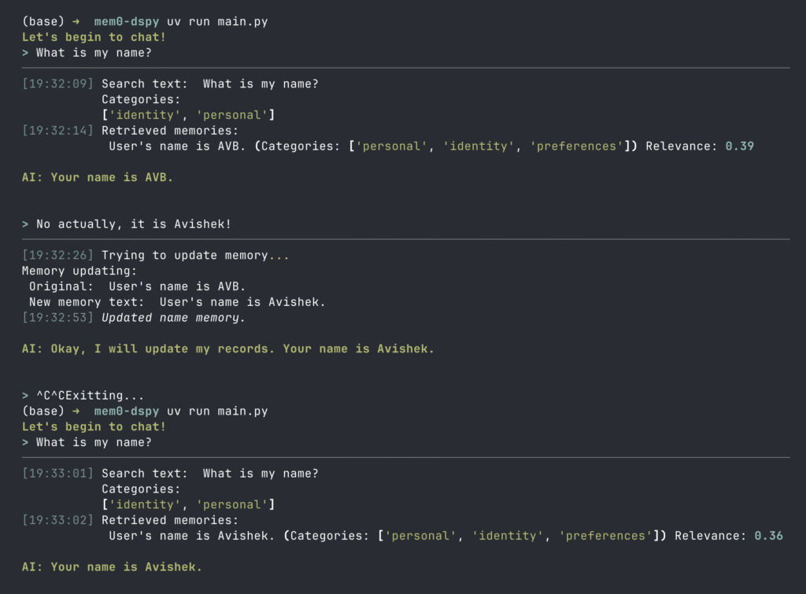

## Summary
[[AvishekBiswas]] presents a beginner-oriented implementation of persistent [[AgentMemory]] inspired by [[Mem0]]. The design uses [[DSPy]] to extract atomic user factoids and run ReAct agents, OpenAI embeddings plus [[Qdrant]] for per-user similarity retrieval, and explicit add, update, delete, or no-op maintenance actions. It is a useful architecture walkthrough rather than runnable reference code or an evaluated memory system: several snippets contain inconsistent names or identifiers, and the worked extraction output contradicts its own conversation.

The cover compacts the article's intended loop: conversation reaches an agent, candidate memories are stored externally, maintenance logic updates them, and later requests can retrieve them back into the model's context.

The cross-session example makes the motivating boundary explicit: separate model calls do not carry a user's name forward unless the application supplies persistent context.

The cited Mem0 diagram separates extraction from maintenance. Messages and historical context produce candidate memories; the update phase compares those candidates with similar stored memories before choosing add, update, delete, or no-op, while the database remains the shared persistence layer.

## Key Claims
- Persistent personalization is an application-level [[LLMContextManagement|context-engineering]] problem because each model call otherwise begins without cross-session state.
- A useful memory candidate is a short, self-contained user fact that can be embedded and retrieved independently; extraction should return nothing when a turn contains no durable information.
- The tutorial stores 64-dimensional `text-embedding-3-small` vectors in [[Qdrant]], indexes `user_id`, and applies the user filter from trusted application state rather than asking the model to generate it.
- Retrieval should be optional: a ReAct agent can decide whether it needs memory, formulate `search_text`, and call similarity search only when the current transcript is insufficient.
- Memory maintenance is not append-only logging; related prior records should be compared with new evidence and handled through add, update, delete, or no-op actions.
- Metadata, keyword search, category filters, time ranges, graph storage, prompt injection of integral facts, and file-backed records are presented as extensions rather than one mandatory architecture.
- The article's diagrams and terminal example show a four-stage lifecycle—extract, embed/store, selectively retrieve, and consolidate—ending with a corrected name surviving a process restart.

The extraction diagram maps a conversation to several independently retrievable factoids rather than preserving the whole transcript as one record.

The storage diagram shows atomic memories becoming points in vector space, matching the implementation's separate payload and embedding fields.

The retrieval diagram preserves the direction of flow: a query reaches the store, selected memories return, and only then are conversation plus old memories supplied to the LLM.

The maintenance diagram treats consolidation as a transformation of existing state plus new evidence, rather than unconditional insertion.

The terminal example shows retrieval by identity and personal categories, replacement of “AVB” with “Avishek,” process exit, and successful recall of the corrected name in a new run.

## Key Quotes
> "A short, self-contained fact—an atomic unit—that can be embedded and retrieved later with high precision." — the article's definition of a good memory record.

> "Importantly, every step above should be optional." — on avoiding retrieval and maintenance work when the turn does not require it.

## Connections
- [[AvishekBiswas]] — author of the tutorial and its original illustrations.
- [[Mem0]] — research architecture that inspires the extraction and maintenance split.
- [[DSPy]] — signature, structured-output, tool, and ReAct framework used for extraction, response generation, and maintenance.
- [[Qdrant]] — vector database used for per-user embedding storage and filtered similarity search.
- [[AgentMemory]] — broader persistence, retrieval, and maintenance capability implemented by the tutorial.
- [[LLMContextManagement]] — frames memory as selective construction of model context.
- [[Embeddings]] — represent atomic factoids and retrieval queries as vectors.
- [[VectorDatabase]] — supplies storage, filtering, and similarity retrieval without independently deciding memory truth or lifecycle.
- [[MemoryConflictResolution]] — relevant when a new statement contradicts or supersedes an old record.
- [[AgenticRAG]] — optional ReAct tool calls make memory retrieval model-directed rather than unconditional.

## Contradictions
- The source does not contradict the wiki's current [[AgentMemory]] synthesis, but its compact tutorial should not be mistaken for the full governance model: provenance, temporal validity, calibrated confidence, retention, privacy, user correction, authorization, and evaluation remain largely unspecified.
- The extraction example is internally inconsistent. After the user says they like tea more, the displayed output says they used to like tea but no longer do and still says they like coffee, demonstrating that structured extraction can be confidently wrong.
- Several snippets are not runnable as printed: `add_memory(memory_ext)` uses undefined `memory_text`; `%H:%m` formats month rather than minutes; `categories`, `memory_ids`, and some displayed record fields are undefined or mismatched; and the delete tool passes logical memory indexes where the database helper expects point IDs.
- The article supplies no benchmark for extraction fidelity, retrieval precision or recall, false writes, cross-user isolation, contradiction handling, latency, cost, or comparison with simpler file-backed state. The 64-dimensional embedding choice, thresholds, top-k, and ReAct iteration limits are tutorial settings rather than validated defaults.
