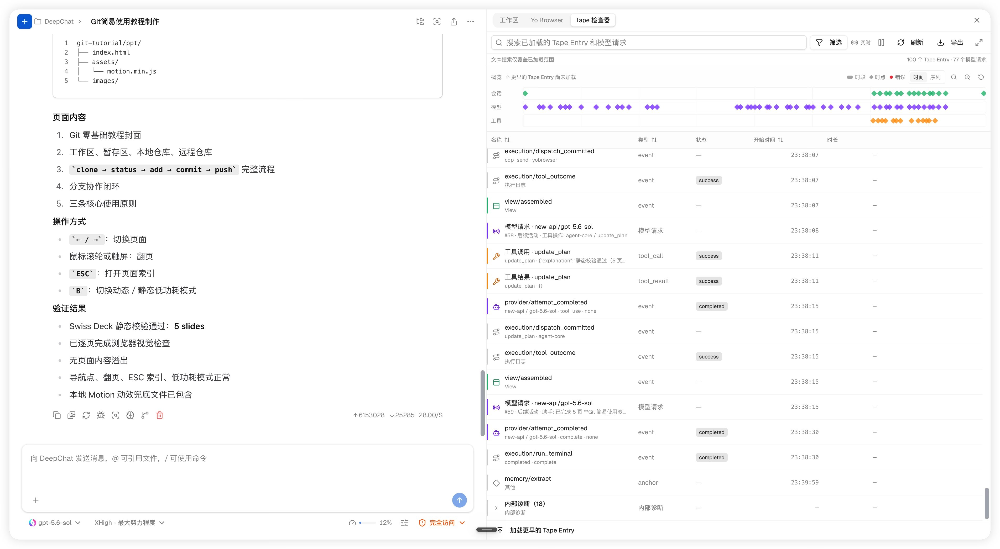

## Summary
DeepChat developer 灰灰 explains how [[DeepChat]] adopted [[PsiACE]]'s [[TapeAndAnchors|Tape]] model without stopping or immediately migrating the existing product: the mutable message table continued to serve the chat UI while append-only facts began to supply model context and audit evidence. The account shows how immutable entries, anchors, per-request ViewManifests, boundary-only compaction, a write-ahead [[EffectLog|Execution Journal]], and a Tape Inspector separate recorded facts from current UI state and the context assembled for one model request. The result improves traceability and crash recovery, but explicitly stops at uncertainty when a tool was durably marked for dispatch and no outcome was recorded.

## Key Claims
- One mutable message history cannot simultaneously satisfy people who want editable current state, models that need a selected per-turn context, and investigators who need the original sequence of events.
- [[TapeAndAnchors|Tape]] preserves messages, tool activity, corrections, withdrawals, and runtime events as append-only facts; views and anchors determine what a reader sees without replacing or deleting those facts.
- DeepChat introduced Tape beside its existing message table and lazily migrated old conversations when they were reopened, avoiding an all-at-once product migration.
- A ViewManifest records which Tape entries, anchor, budget allocation, prompt hash, and tool-definition hash informed a model request, allowing the transient assembled view to be checked against persistent evidence.
- [[DynamicContextCompression|Compaction]] can move the context boundary even when summarization fails or produces no size reduction, because Tape keeps the omitted history searchable; success is measured by whether the next view is actually smaller.
- The [[EffectLog|Execution Journal]] writes `dispatch_committed` before invoking a tool and `tool_outcome` afterward. A dispatch without an outcome is classified as `indeterminate` and parked rather than automatically retried.
- Tape Inspector joins session, model, tool, view, terminal, anchor, and memory activity on one timeline without becoming a second source of truth.

## Key Quotes
> "更可靠的交互，胜过更聪明的记忆。" — the Tape design stance emphasized by the article.

> "账记不上，动作便不能越过边界。" — the rule that durable dispatch evidence must precede tool execution.

> "纸带没有让系统变得无所不知。它只是让不知道也有了准确的名字。" — on treating an uncertain post-crash effect as `indeterminate` rather than guessing.

## Connections
- [[DeepChat]] - product implementation that adopted Tape incrementally and added ViewManifest, boundary-only compaction, an Execution Journal, and Tape Inspector.
- [[PsiACE]] - originator of the append-only Tape model and its separation between durable history and reconstructed views.
- [[TapeAndAnchors]] - append-only factual substrate whose anchors change the default read boundary without erasing earlier entries.
- [[EffectLog]] - write-ahead execution evidence that separates dispatch commitment from observed tool outcome.
- [[DynamicContextCompression]] - redesigned so summary generation and boundary movement are independent and evaluated by actual context reduction.
- [[HarnessEngineering]] - the source distinguishes temporary scaffolding for model limitations from durable boundaries for permissions, identity, effects, recovery, and evidence.
- [[AgentSystemTransparency]] - ViewManifest and Tape Inspector make model context and tool execution inspectable after the fact.
- [[AgentResumability]] - crash classification prevents uncertain external effects from being mistaken for safely replayable work.

The retained product screenshot shows a chronological event table and overview tracks for session, model, and tool activity. Visible rows pair `execution/dispatch_committed` with `execution/tool_outcome`, interleave `view/assembled` and model requests, record `provider/attempt_completed` and `execution/run_terminal`, and expose search, filtering, refresh, and export controls.

## Contradictions
- The article is a first-party implementation narrative. It provides pull-request dates and architectural detail but no independent reliability audit, crash-injection results, false-classification rate, context-quality benchmark, storage-growth measurement, or security evaluation.
- `dispatch_committed` proves that local checks passed and the call reached the dispatch boundary; it cannot prove whether an external system applied the effect. The source correctly limits this state to `indeterminate` and forbids automatic retry.
- DeepChat still keeps the mutable message table and Tape side by side, and the ordinary chat UI is not yet projected from Tape. The article does not evaluate divergence detection or repair between those representations.
- Tape preserves evidence but does not itself provide idempotency, rollback, compensation, external transactionality, access control, retention, or required deletion.
- ViewManifest records selection metadata and hashes rather than a second full request body; reconstruction therefore also depends on retained Tape facts and request traces.
- The original cover image was inspected and omitted as decorative. The Tape Inspector screenshot was retained because it adds concrete UI evidence beyond the prose.
