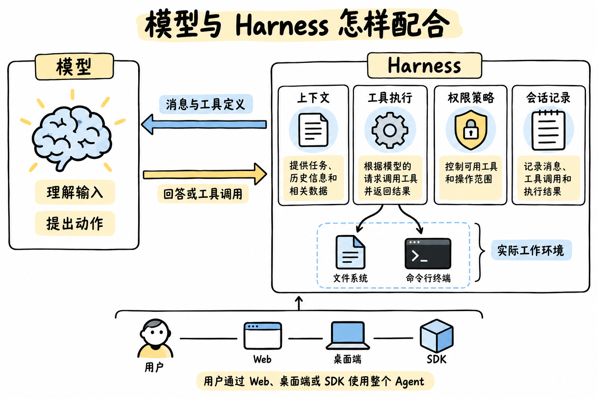
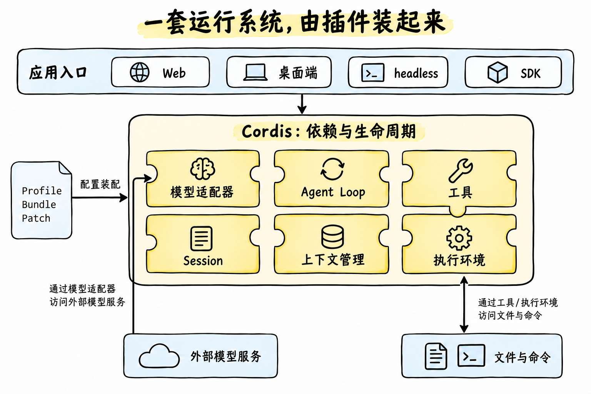
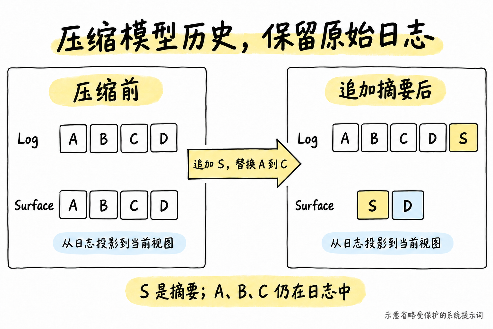
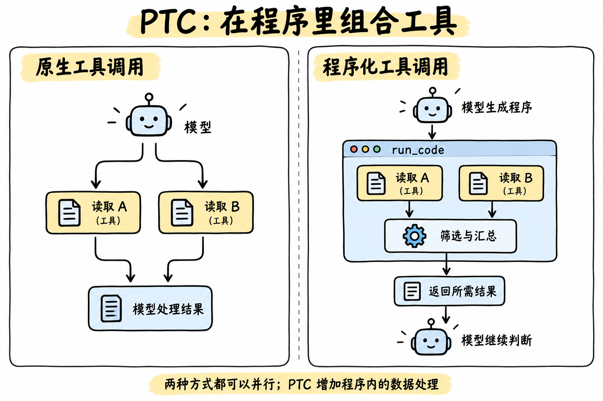
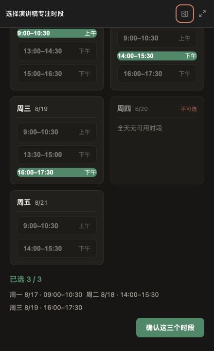

## Summary
[[YuxiaLuo]] presents [[DeepSeekHarness]] as a local-first coding agent and a composable agent runtime in which Cordis plugins provide model adapters, tools, sessions, context policy, persistence, and execution environments. The source separates append-only session evidence from the derived message surface sent to the model, explains checkpointed persistence and conservative crash recovery, and introduces [[ProgrammaticToolCalling]] as a way to filter or combine tool results inside generated code before returning compact output to the model. It is a detailed source-reading analysis against one 2026-09-10 commit, but the author did not run the complete application, install the community plugins, or benchmark DSH against Codex or Claude Agent SDK.

## Key Claims
- An agent is not the model alone: a harness prepares context, executes and governs tools, maintains session state, handles cancellation and failures, and connects model decisions to a real working environment.
- [[DeepSeekHarness]] uses Cordis dependency and lifecycle management plus Profile, Bundle, and Patch configuration layers so applications can reuse or replace model, tool, session, storage, context, and execution components.
- Skills supply task methods and can package setup scripts, while plugins supply runtime capabilities; the two can be combined without treating instructions as the execution mechanism itself.
- A Turn can contain multiple model-and-tool Steps; only calls declared concurrency-safe run in parallel, and file-tool writes can reject stale observed versions rather than silently overwrite intervening changes.
- Session Log is append-only execution evidence, while Surface is the derived current message view; compaction can append a summary and replace an earlier range in Surface without deleting the original events from Log.
- Persistence is buffered but checked before model requests and top-level tool execution. A crash after an effect but before its result is saved remains uncertain, and recovery must inspect external state rather than assume the tool did not run.
- [[ProgrammaticToolCalling]] can reduce model-visible intermediate output by generating a `run_code` program that invokes governed tools, filters or aggregates their results, and returns only the needed data.

## Key Quotes
> “Agent = Model + Harness.” - the source's compact architectural relation.

> “配置描述它怎样运行，会话记录留下实际发生的过程。” - on combining declared composition with execution evidence when evaluating changes.

## Connections
- [[YuxiaLuo]] - author who reconstructed the runtime from source and documentation.
- [[DeepSeekHarness]] - central runtime, configuration, persistence, and extension system analyzed by the article.
- [[HarnessEngineering]] - DSH turns harness concerns into replaceable plugins and layered application configuration.
- [[TapeAndAnchors]] - DSH independently separates retained session evidence from a smaller derived model-facing view.
- [[AgentResumability]] - persistence checkpoints and interrupted-run repair support continuation while preserving uncertainty about unrecorded outcomes.
- [[ProgrammaticToolCalling]] - generated programs compose existing governed tools and reduce intermediate context volume.
- [[GenerativeUI]] - the retained GenUI example stores interface selections for use by a later agent turn.
- [[LLMContextManagement]] - Surface derivation, tool-result spillover, pruning, and summarization determine the active model history.
- [[LLMToolingSkills]] - Skills provide progressively loaded operating instructions over installed runtime capabilities.
- [[SoftwareVerification]] - configuration changes should be evaluated through recorded behavior, correctness, latency, and model usage rather than architecture claims alone.

## Contradictions
- The source's plugin-oriented architecture complements rather than replaces the stronger side-effect contracts in [[EffectLog]]: DSH records calls and checkpoints persistence, but a crash after an external effect and before its result is durable still cannot establish exactly-once execution.
- The SDK example resumes only within the same runtime. Its server creates an uncached session instead of calling the separate resume service, so passing an old session ID into a new SDK process does not restore persisted history in the analyzed version.
- PTC can reduce model-visible tool output when filtering rules are clear and results are large, but generated-code cost, runtime failures, retries, latency, and answer quality must be measured; the small heading example does not establish a net benefit.
- Dynamic Cordis plugins exist only in process memory until packaged and configured for future starts. Community integrations for GenUI, Lark, and scheduled tasks were described from their documentation rather than installed and tested.
- The Codex and Claude comparisons identify extension-surface differences, not a controlled same-task benchmark. The source is tied to commit `c291e7961a`, root version `0.1.5-rc.2`, and documentation checked on 2026-09-13.
