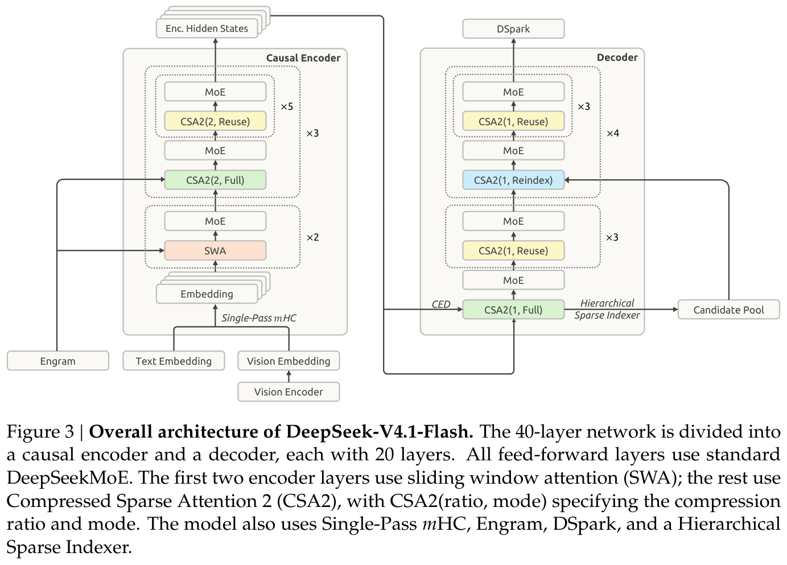
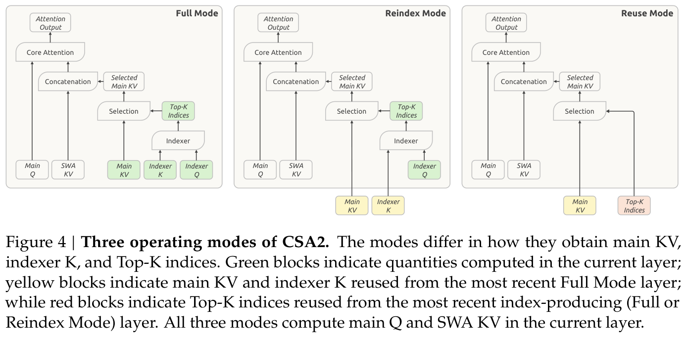
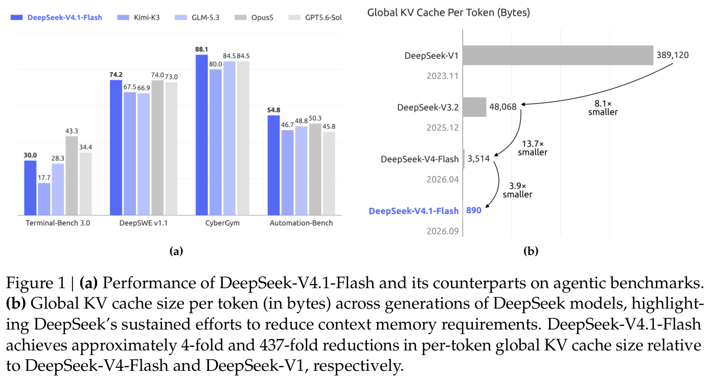
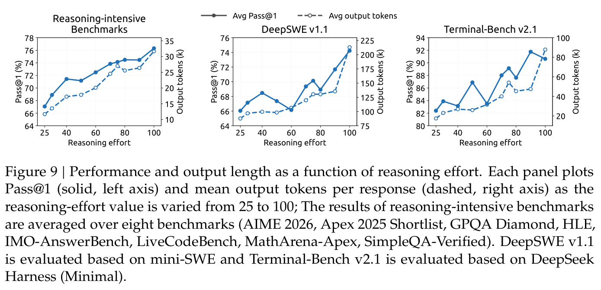
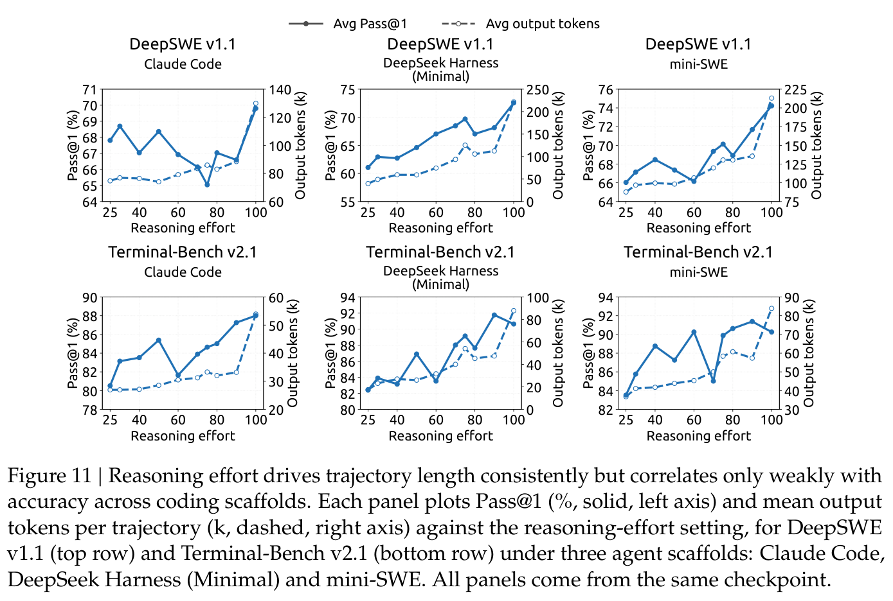
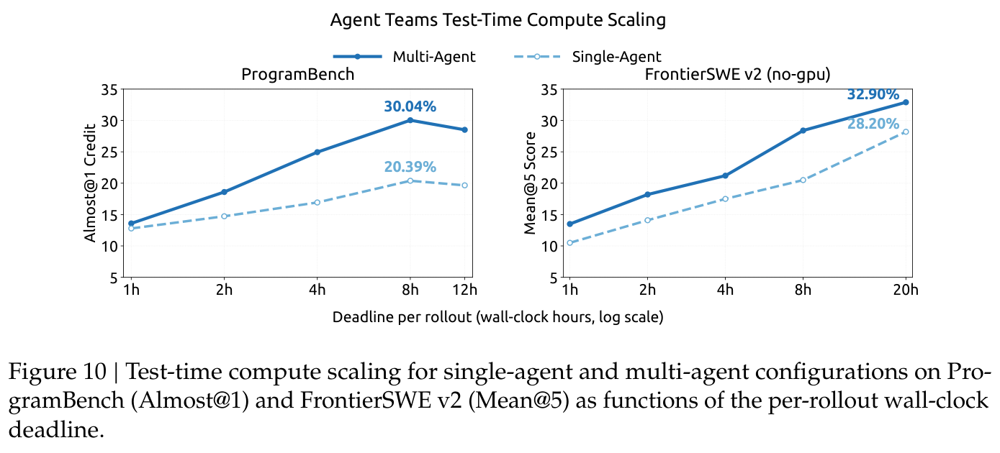

## Summary
DeepSeek-AI presents [[DeepSeekV41Flash]], a 552B-backbone-parameter multimodal mixture-of-experts model that couples [[CausalEncoderDecoderArchitecture]], [[CompressedSparseAttention2]], FP4 global KV, and bounded sliding-window replay to reduce prompt computation and long-context cache storage. The first-party report also describes 45T-token multimodal pre-training, data- and environment-centered [[AgenticReinforcementLearning]], asynchronous rollout infrastructure, learned [[ReasoningEffort]], and preliminary [[AgentTeam]] training. Its strongest evidence is a detailed architecture and systems account; benchmark, quality-retention, production-scale, and cost claims remain first-party and are not independently reproduced.

## Key Claims
- The 40-layer backbone splits into a 20-layer causal encoder and 20-layer decoder. Decoder global KV is projected from the encoder boundary, so long prefills activate about 8B parameters per token rather than the 16B used during decode; bounded replay reconstructs only the most recent 128-token local window rather than the exact depth-expanded history.

- [[CompressedSparseAttention2]] combines channel, sequence, layer, and precision reductions. Full layers compute global content and addresses, Reindex layers share content but choose new Top-K addresses, and Reuse layers share both while retaining layer-specific queries and sliding-window KV.

- Cross-layer reuse plus FP4 global KV reduces the reported HBM-resident global cache to 890 bytes per token, about one quarter of DeepSeek-V4-Flash. Removing sliding-window KV from long-lived storage and recovering misses with approximate replay reduces the reported persistent host-memory or SSD footprint to about one eighth.

- The model has 552B backbone and 196B Engram parameters, uses a 128-token local attention window, supports contexts up to one million tokens, and trains native vision and language capabilities on 45T tokens with a 7:1 text-only-to-multimodal token ratio. DeepSeek-ViT is first contrastively trained on about 47B image-text pairs, then autoregressively tuned on 236B tokens before integration.
- The post-training recipe is deliberately conventional—SFT, RL, and on-policy distillation—while the claimed gains come from scalable task synthesis, mocked and containerized environments, lifecycle re-auditing, over 40 distillation teachers, and model merging across successive RL runs.
- [[DSec]] reportedly scales to millions of concurrent sandboxes by sharding placement, accepting eventual global consistency while enforcing local admission, and using NUMA-bound worker VMs, AppArmor, and eBPF. The report says density rose from roughly 1,000 to more than 2,500 live containers per physical node before measurable degradation.
- A scalar effort value from 1 to 100 changes an exponential reasoning-token penalty during RL. Aggregate evaluations show longer outputs and generally higher accuracy at higher effort, but scaffold-specific results contain plateaus and dips; the public low, high, and max tiers map to 50, 75, and 100.

- Preliminary multi-agent experiments reward task performance, collaboration, and lower dependency-DAG critical-path latency. Under explicit deadlines, the strongest observed multi-agent configurations outperform the strongest available single-agent baselines on the chosen ProgramBench and FrontierSWE v2 subsets.

## Key Quotes
> "All substantive changes lie instead in the data pipeline." — on the report's claimed source of post-training gains rather than algorithmic novelty.

> "no finite test suite can cover every extreme input and deployment condition" — on selection errors and approximate replay at untested boundaries.

## Connections
- [[DeepSeekV41Flash]] - model whose architecture, training, deployment system, and evaluations the report documents.
- [[CausalEncoderDecoderArchitecture]] - stops bulk prompt processing at the causal-encoder boundary while projecting decoder global memory from it.
- [[CompressedSparseAttention2]] - shares global content and sparse selections across layers through Full, Reindex, and Reuse modes.
- [[HierarchicalSparseIndexer]] - performs one full decoder scan and bounds later reindexing to a shared candidate pool.
- [[KVCacheCompression]] - joins structural reuse, FP4 storage, lifecycle separation, and bounded recomputation.
- [[ReasoningEffort]] - conditions token penalties and deployment-time cost-quality behavior on a scalar effort request.
- [[AgenticReinforcementLearning]] - trains tool-using policies in synthesized, verified, and continuously re-audited environments.
- [[AsynchronousReinforcementLearning]] - maintains sample-level rollout concurrency while bounding staleness and masking overly stale tokens.
- [[DSec]] - sandbox substrate for environment construction, rollout execution, isolation, and preemption-safe resumption.
- [[DSpark]] - semi-autoregressive speculative decoder trained after pre-training and kept aligned during post-training.

## Contradictions
- The report's broad statement that the model can complete over 95% of real-world tasks is not tied to a defined task distribution or reproducible protocol. Its own evaluation says gaps remain on science-heavy agent tasks, hard reasoning edge cases, and leading closed-source visual systems.
- Aggregate reasoning-effort results improve smoothly, but Appendix B shows non-monotonic Pass@1 curves within several scaffold–benchmark pairs even as output length rises monotonically. Effort therefore controls spend more reliably than it guarantees per-scaffold accuracy.
- CSA2 selection and SWA Bounded Replay deliberately approximate full execution. The authors report negligible degradation in tested settings but identify sparse-retrieval selection errors and replay-boundary state reconstruction as unresolved robustness limits.
- Benchmark comparisons mix harnesses, sampling counts, context windows, model access modes, and first-party evaluation infrastructure. The reported rankings do not isolate architecture, data, scaffold, token budget, or test-time compute as causal factors.
- The source is a first-party technical report. Training-data details, ablations, production cost accounting, independent replication, and complete safety evaluation are not provided; several comparisons involve unreleased or contemporaneous systems.
