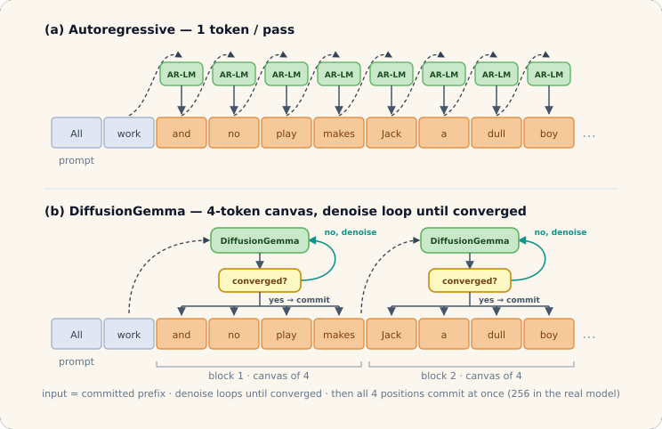
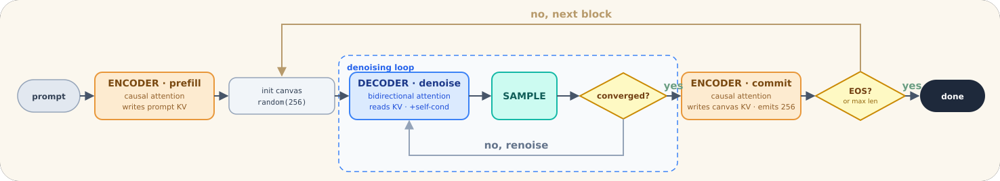
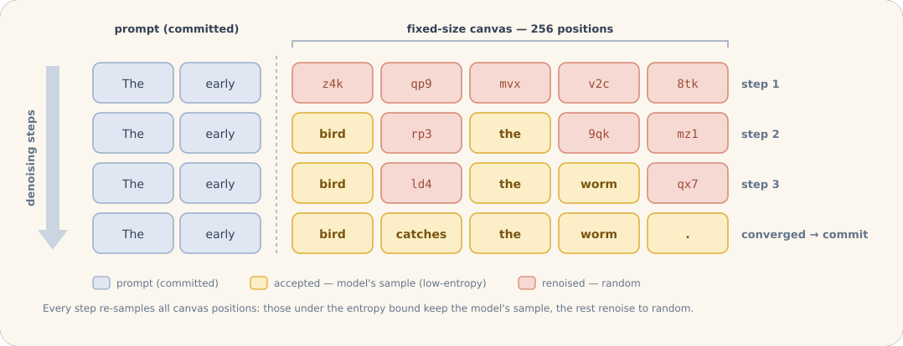
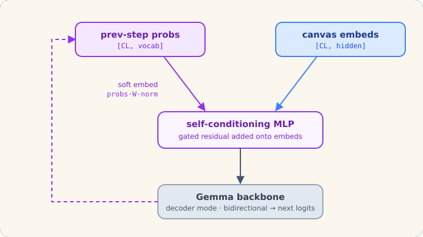
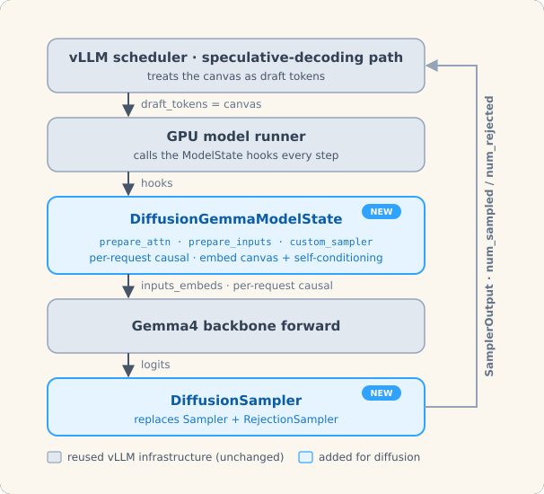
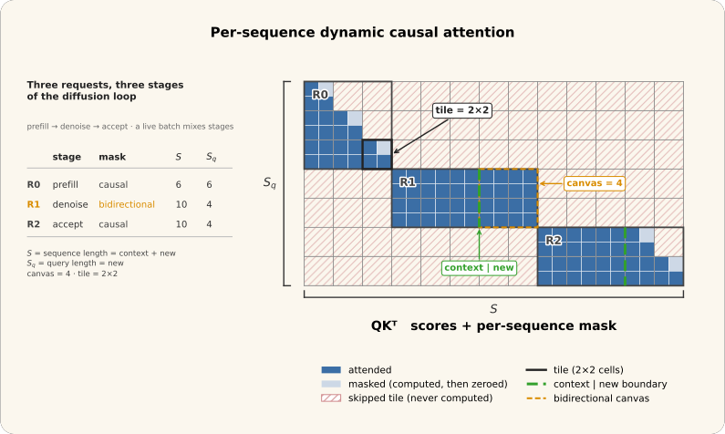
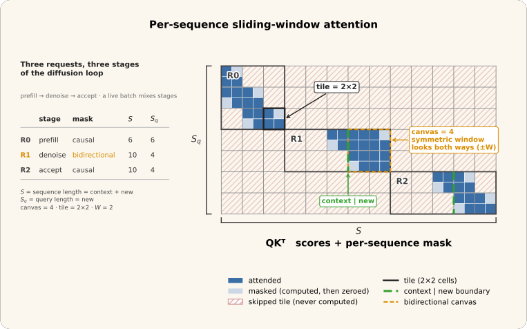
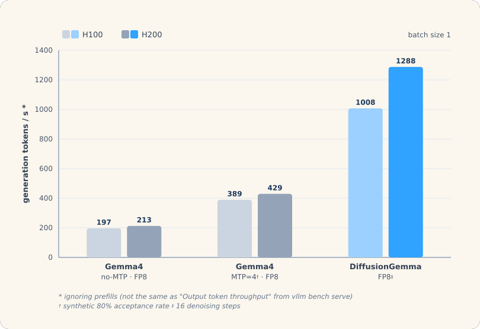

## Summary
The [[VLLM]] and [[DeepMind]] teams describe how [[DiffusionGemma]], a 26B-parameter model built on Gemma4, generates fixed 256-token blocks by repeated bidirectional denoising while retaining causal prefill and commit passes. A new per-request ModelState and diffusion sampler reuse vLLM's speculative-decoding accounting, scheduler, model runner, KV cache, and prefix caching while adding self-conditioning, entropy-bounded acceptance, convergence checks, dynamic per-sequence causality, and symmetric sliding windows. The teams report reference-level accuracy and very high batch-one FP8 generation rates, but the performance evidence is first-party, hardware- and configuration-specific, and excludes prefill.

## Key Claims
- Autoregressive models emit one token per pass, whereas DiffusionGemma repeatedly refines every position in a 256-token canvas and commits the whole converged block at once; blocks themselves remain left-to-right because each conditions on the committed prefix.

- One shared Gemma4 backbone alternates between an encoder mode with causal attention that writes prompt or committed-block KV and a decoder mode with bidirectional attention that reads cached context while denoising the canvas.

- Each denoising step samples candidates for all positions, retains the most confident positions until their accumulated entropy crosses a fixed budget, and replaces the rest with random tokens. Convergence requires a stable argmax canvas plus low mean entropy, unless a hard step cap terminates the loop.

- Self-conditioning feeds the previous step's full token distributions through probability-weighted embeddings and a gated MLP residual, preserving soft belief information even when a position is renoised; it is disabled for prefill and commit.

- vLLM models the canvas as speculative draft tokens. ModelState prepares embeddings and attention and installs `DiffusionSampler`, while the existing scheduler and runner consume `num_sampled` and `num_rejected`; denoise steps reject the whole query length so the logical KV position does not advance, and commit emits 256 clean argmax tokens.

- A live batch can mix causal prompt prefill, bidirectional denoising, and causal commit requests, so Triton Attention and FlashAttention 4 were changed from one batch-wide causal flag to a per-sequence tensor while preserving tile skipping.

- Sliding-window layers retain a left-only window for causal phases but use a symmetric window of `W` positions on each side during bidirectional denoising, for `2W + 1` canvas positions.

- FP8 DiffusionGemma reportedly reaches 1,008 generation tokens/s on one H100 and 1,288 on one H200 at batch size one and 16 denoising steps, versus 197/213 for FP8 Gemma4 without MTP and 389/429 for a synthetic 80%-acceptance MTP=4 baseline.

- The release includes FP8 and NVFP4 compressed-tensors checkpoints; the article says preliminary AIME 2025, GPQA Diamond, and GSM8k validation was run with and without thinking, but delegates actual evaluation and recovery scores to the model cards.

## Key Quotes
> "one set of layers, used two ways" - on sharing Gemma4 weights between causal encoding and bidirectional denoising.

> "only a commit advances it" - on keeping speculative-decoding sequence accounting stationary during denoising.

## Connections
- [[DiffusionGemma]] - the block-diffusion language model and implementation being described.
- [[DiffusionLanguageModels]] - model family that iteratively denoises token canvases rather than committing one next token per pass.
- [[VLLM]] - inference engine whose ModelState, sampler, attention backends, and speculative path host the implementation.
- [[DeepMind]] - co-developer of DiffusionGemma and co-authoring organization.
- [[SpeculativeDecoding]] - existing execution and accounting path repurposed for full-canvas denoising and commit.
- [[AttentionMechanism]] - switches per request between causal, bidirectional, and symmetric sliding-window masks.

## Contradictions
- No direct contradiction with the wiki was found. The source expands [[SpeculativeDecoding]] from accepted-prefix draft verification into a reusable serving protocol; DiffusionGemma's denoise steps intentionally reject the whole canvas for accounting rather than verify draft tokens against a separate target model.
- The throughput chart is a first-party batch-one comparison on single H100/H200 GPUs, ignores prefill, fixes DiffusionGemma at 16 denoising steps, and gives the MTP baseline a synthetic 80% acceptance rate. It does not establish aggregate-throughput, tail-latency, energy, cost, long-output, or high-concurrency superiority.
- The article asserts parity with the Hugging Face reference but supplies no task table in the post. Quantized benchmark scores are deferred to external model cards, and no BF16 throughput, quality-versus-step, convergence-rate, prompt-length, or workload-distribution results are shown.
- Fixed 256-token commits may generate work beyond an early end-of-sequence or requested length, while entropy thresholds, hard step caps, and random renoising make latency and quality depend on request difficulty and configuration.
