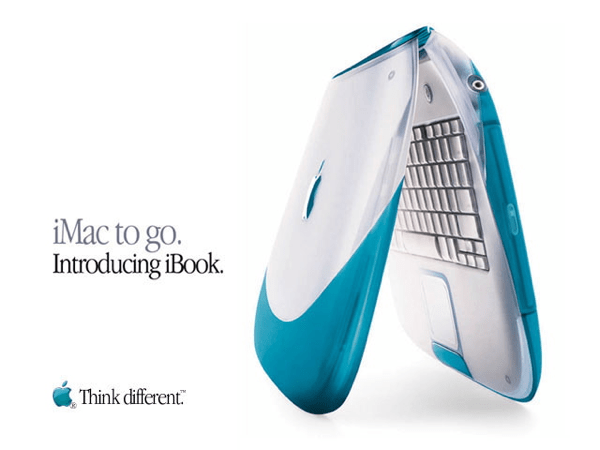
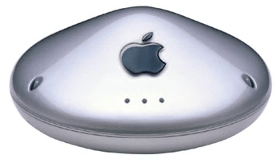

## Summary
[[BenThompson]] argues that Apple's proposed [[HomeView]] and Home Collection address real smart-home needs by combining useful shared displays with one-tap setup, integrated control, reliable partner hardware, and privacy. He connects that promise to the 1999 AirPort launch, when [[SteveJobs]] paired Lucent's standards-based wireless technology with Apple's ease of use and industrial design. The trust case is qualified by Apple's later abandonment of AirPort, recurring-revenue incentives, and the larger risk of committing long-lived home infrastructure to [[Siri]], which the article portrays as slower, less reliable than its predecessor on basic tasks, and behind newer agents in action-taking capability. The inspected product images and keynote video support the historical AirPort comparison but do not independently validate the announced 2026 products or future reliability.

## Key Claims
- HomeView's strongest use cases are persistent household information, thermostat control, doorbell response, camera access, and hands-free information in places such as kitchens.
- [[SmartHomeInteroperability]] remains the binding problem: useful devices lose value when connections fail, apps fragment control, or access becomes unintuitive at the moment of need.
- Apple's Home Collection partnership with LG Electronics and Schneider Electric is presented as an AirPort-like strategy: combine partner hardware with Apple-controlled setup, management, integration, and privacy rather than manufacture every component itself.
- One-tap iPhone setup, management through Apple Home, no separate vendor account, and end-to-end encryption are launch promises that could turn [[AppleTrustBrand]] into practical home-system value.
- Apple's discontinuation of AirPort after long update gaps weakens the durability case for entrusting long-lived household infrastructure to the company.
- Paid iCloud+ camera history and preferential Apple Music support show that home integration can also serve Apple's recurring-revenue and ecosystem-lock-in incentives.
- Siri is the largest product risk because HomeView was designed around voice and personal household context, yet the source says the delayed assistant is slower, error-prone on basic tasks, and already behind action-taking agents.
- A home-system purchase creates monetary and opportunity costs because thermostats, locks, cameras, doorbells, and wall-mounted displays are replaced much less often than phones.
- The source interprets the product as a test of Apple's post-[[TimCook]] ability to pair privacy and ease of use with useful AI, owned core technology, and products customers love.

The iBook advertisement establishes that AirPort was introduced as an extension of Apple's primary portable-computer product rather than as an isolated networking accessory. In the inspected keynote video, Jobs browses the web while carrying the iBook, presents the 802.11 and Lucent partnership, and demonstrates card installation and automatic setup.

The AirPort base-station image supports the article's industrial-design comparison: Apple wrapped standards-based partner technology in a recognizable consumer product and a simpler integrated experience.

## Key Quotes
> “modern technology that is easy to use and private too” — Thompson's summary of Apple's durable selling proposition.

> “do you trust Siri to actually work?” — the article's central qualification.

## Connections
- [[BenThompson]] — author comparing AirPort's historical trust proposition with Apple's 2026 home strategy.
- [[Apple]] — company whose integration, privacy, product durability, services incentives, and AI execution are evaluated.
- [[HomeView]] — shared household display and voice interface at the center of the article.
- [[Siri]] — primary interface whose reliability determines much of HomeView's value.
- [[AppleTrustBrand]] — privacy and ease-of-use promise extended from services and platform controls into the home.
- [[SmartHomeInteroperability]] — system-level reliability problem Apple Home Collection is intended to reduce.
- [[SteveJobs]] — presenter of the 1999 AirPort launch used as the historical comparison.
- [[TimCook]] — former CEO whose services focus, product pruning, and AI strategy are criticized.
- [[HomePod]] — earlier Apple home product in the ecosystem context.
- [[AppleServicesMachine]] — iCloud+ camera history and Apple Music support connect the home strategy to recurring services revenue.

## Contradictions
- The source deepens an existing tension in [[AppleTrustBrand]]: Apple's privacy and integration strengths can justify household trust, while opaque controls, abandoned product lines, and weak AI execution can consume that trust.
- It qualifies the early fragmented-market account in [[SmartHomeInteroperability]] with a 2026 launch proposal, not evidence of shipped reliability, adoption, support longevity, or successful partner execution.
- The AirPort comparison is historical analogy rather than proof that Home Collection will receive durable support; the source explicitly uses AirPort's discontinuation as counterevidence.
