## Summary
The author presents [[DuckDBObjectStorage]], a community extension that places an unchanged native [[DuckDB]] database above [[SlateDB]] and [[ApacheOpenDAL]], making object storage the durable substrate without a separate catalog service or database. The design preserves DuckDB indexes, constraints, WAL, checkpoints, types, and extensions while offering one fenced writer and many snapshot-consistent but potentially stale readers. First-party tests and benchmarks are promising, but the system remains DuckDB-only, accepts tens-of-milliseconds commit latency and roughly ten-second reader lag, performs local writes far below native speed, and has not yet implemented fail-fast writer exclusion or query-level snapshot pinning.

## Key Claims
- Unlike Iceberg or DuckLake, the extension stores a native DuckDB database and keeps all metadata and writer coordination in the bucket, so no adjacent catalog service or catalog database is required.

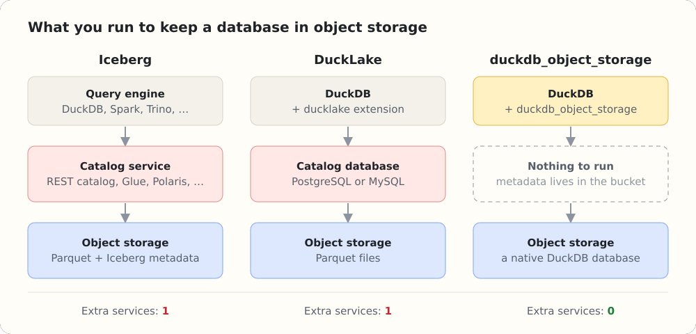

- Jobs attach the same bucket-backed database directly instead of building and repeatedly uploading a local `.duckdb` file; read-only processes can attach from other machines.

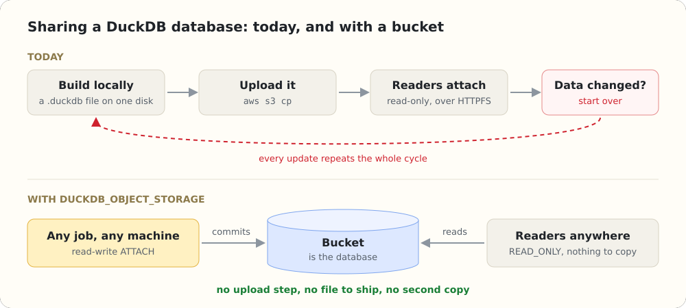

- Preserving DuckDB's native format retains ART, R-tree, and experimental HNSW indexes; enforced keys; native types and catalog objects; adaptive compression; small WAL-backed writes; and ordinary database operations, at the cost of DuckDB-only readability and one concurrent writer.

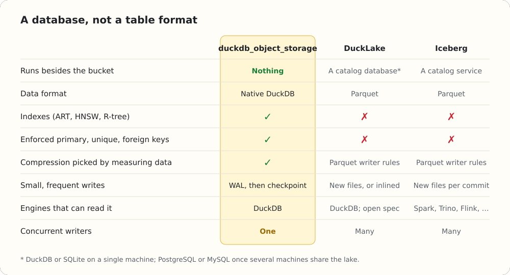

- DuckDB measures candidate encodings per column segment at checkpoint and keeps the estimated smallest, allowing choices such as bit-packing for sorted timestamps and dictionary encoding for low-cardinality strings.

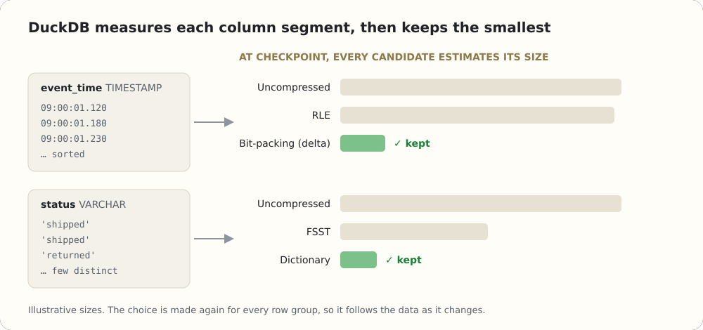

- The extension replaces the filesystem rather than DuckDB's storage engine: C++ forwards filesystem calls through C FFI to a Rust core, SlateDB supplies an object-backed LSM tree, and OpenDAL supplies S3-compatible, local, and memory backends.

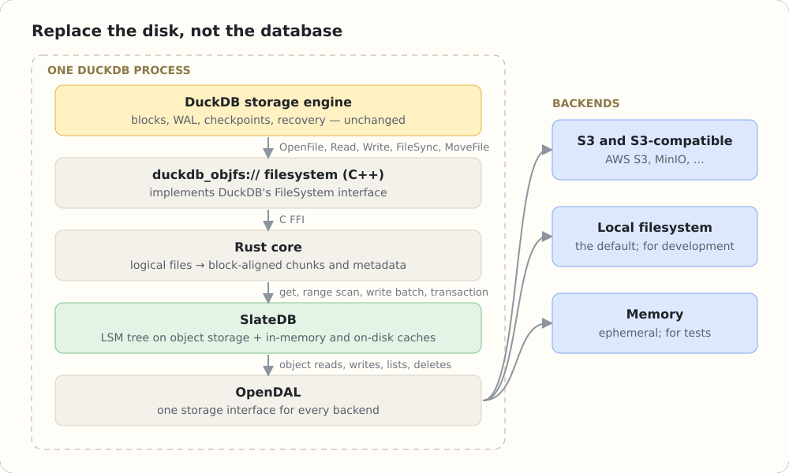

- Mapping mutable files to one immutable object would rewrite the whole object for a block update; SlateDB instead writes one key per changed block and removes obsolete versions through background compaction.

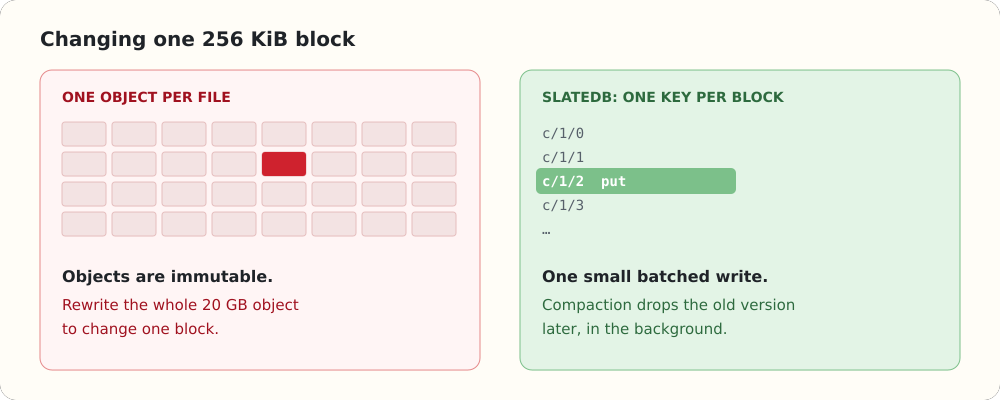

- A 12 KiB header offset and 256 KiB chunks align every DuckDB block with one SlateDB content key, while separate path and metadata key families hold identity, size, time, and layout.

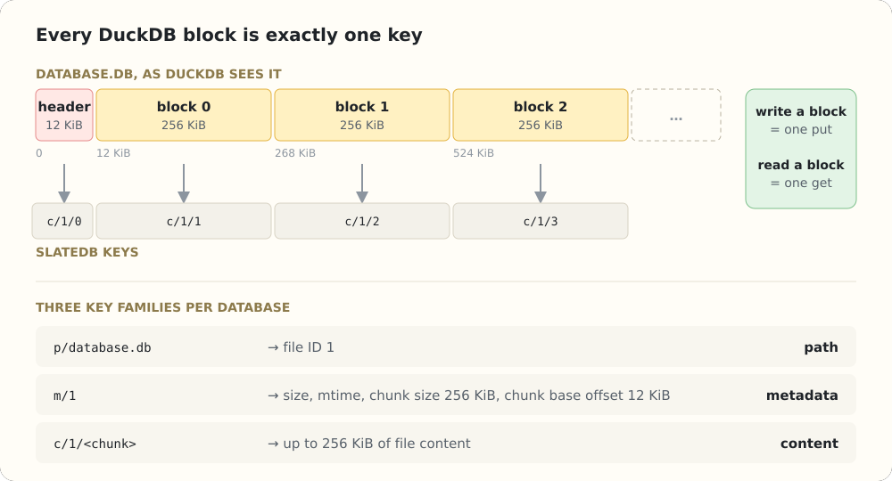

- `FileSync` atomically batches dirty chunks, deletes, and metadata and flushes them before returning; checkpoint renames are transactions that repoint path keys without copying file data.

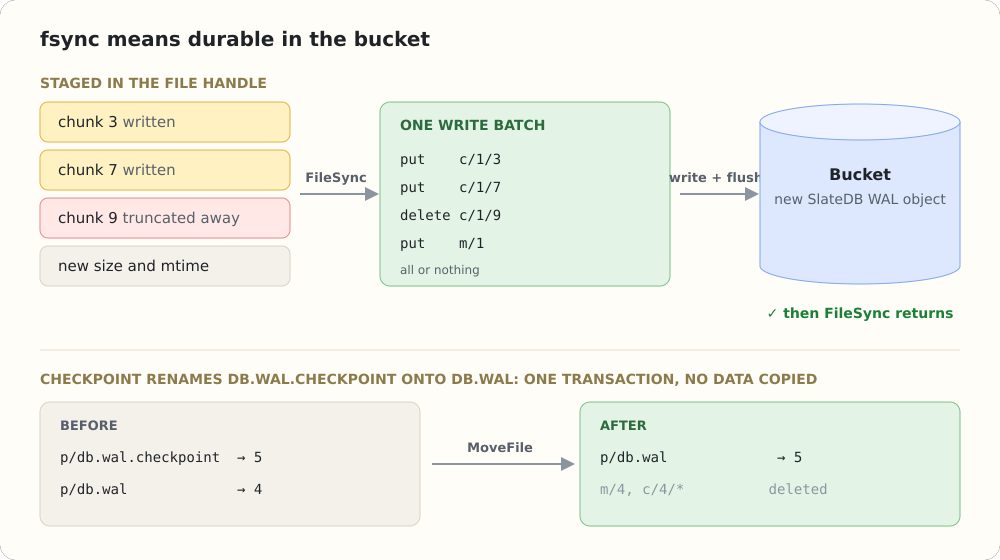

- One writer owns durable changes while non-fencing readers poll committed manifests. A mistaken newer writer takes over the manifest and causes the older writer to fail on a later flush rather than diverge silently.

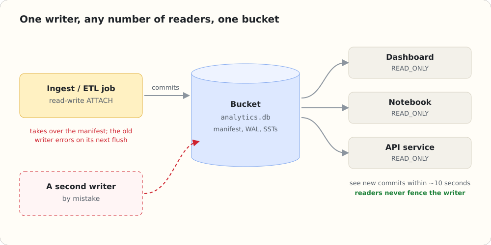

- In the reported 40-million-row rewrite test, a reader moved from the original table to rewrites four and six as whole versions and never observed a sum composed from mixed checkpoints.

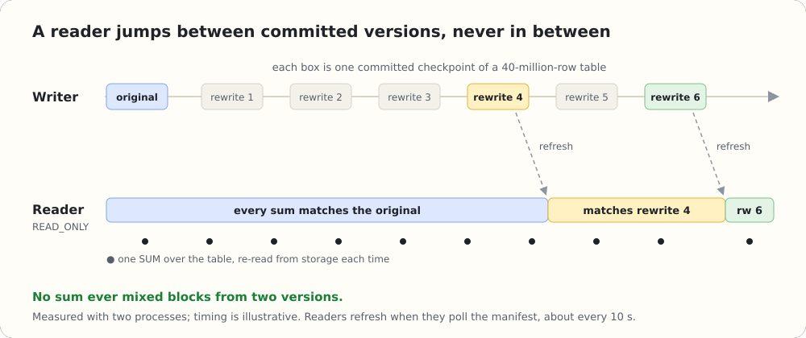

- Reads coalesce contiguous chunks into parallel range scans, use up to 4 MiB read-ahead, and pass through 512 MiB block and 128 MiB metadata caches plus an optional persistent disk cache.

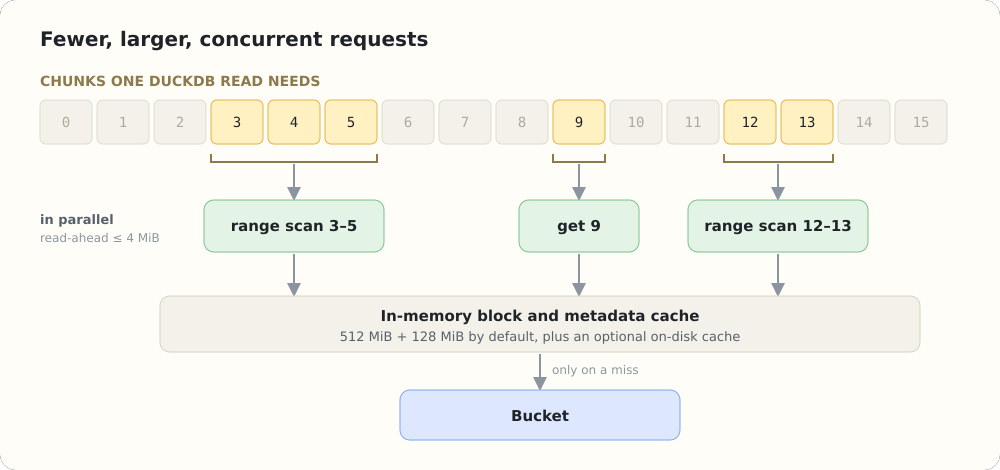

- [[Duckherder]] builds distributed query execution on the same storage model: the driver is the only writer, read-only workers fetch shared row-group partitions from the bucket, and the driver merges partial results.

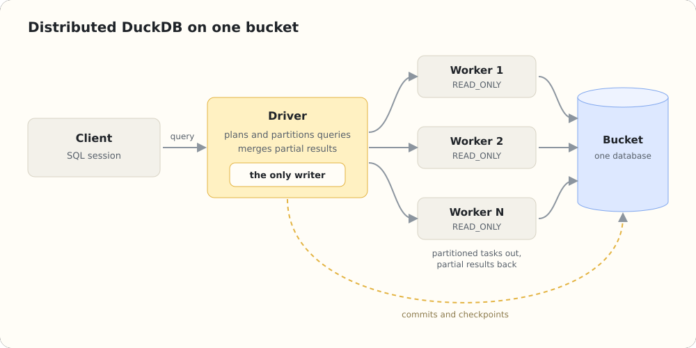

- On an Apple M4 with DuckDB 1.5.5, the author reports geometric-mean TPC-H read times of 0.92× native in memory, 1.08× on local disk, and 1.20× for a cold S3 process versus HTTPFS; writing and delivering to S3 is charted at 1.05× the comparison time.

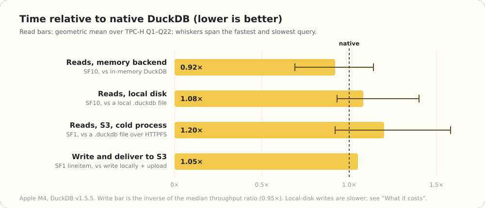

- Current commits pass through both DuckDB's WAL and SlateDB's WAL. The roadmap would make either SlateDB's log the commit log or keep DuckDB's WAL authoritative while bypassing SlateDB's log for block writes.

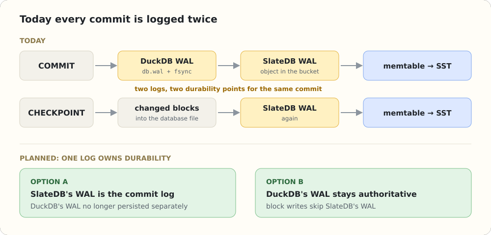

- A future SlateDB-backed block manager could map block IDs directly to keys, make checkpoints transactional at the block layer, and enable point-in-time or branching semantics, but DuckDB does not yet expose the required extension seam.

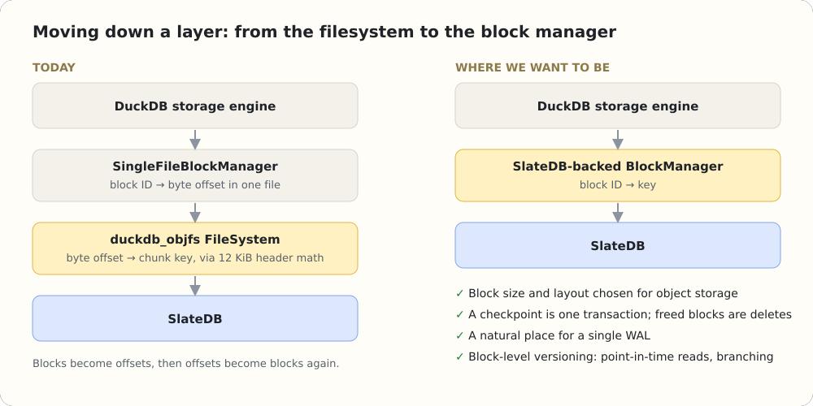

## Key Quotes
> "We didn't change DuckDB's storage engine. We replaced the disk underneath it." - on preserving database behavior through a filesystem extension.

> "Readers can be a little behind. They are never inconsistent." - on manifest-polled committed snapshots.

## Connections
- [[DuckDBObjectStorage]] - the community extension and principal system described by the article.
- [[DuckDB]] - database whose unchanged storage engine, on-disk format, constraints, indexes, WAL, and checkpoints are preserved.
- [[SlateDB]] - embedded LSM layer translating mutable filesystem operations into object-storage keys, batches, manifests, compaction, and caching.
- [[ApacheOpenDAL]] - backend abstraction through which SlateDB reaches S3-compatible, local, and memory storage.
- [[Duckherder]] - distributed query extension using one writer and multiple read-only workers over the shared database.
- [[ObjectStorageNativeDatabase]] - design pattern of retaining native database semantics over immutable object storage.
- [[ApacheParquet]] - interoperable table-format representation deliberately traded away to preserve the full DuckDB database feature set.
- [[StoragePerformanceBenchmarking]] - frames the article's cold-process, cache-state, workload, latency, and backend-specific results.

## Contradictions
- “Nothing else to run” means no separate service: compaction, garbage collection, caching, manifest polling, and fencing still execute inside the writer or reader processes and consume resources and object-store requests.
- Readers are snapshot-consistent but not strongly current: they may lag about ten seconds, and query-level snapshot pinning across Duckherder workers is explicitly future work.
- Writer safety is fencing rather than fail-fast exclusivity. A second writer is not rejected immediately; it takes over and the first fails later on I/O.
- The benchmark is first-party, uses one Apple M4, two TPC-H scales, different baselines by backend, geometric means, and a Taipei-to-`ap-east-2` path. It does not establish production tail latency, cost, contention, recovery time, or multi-tenant behavior.
- The native-format advantage is also a compatibility cost: the bucket contains SlateDB objects rather than a directly openable `.duckdb` file, and Spark or Trino cannot consume it as an open table format.
- Local writes reportedly run at 0.19× native speed; every durable commit adds an object-store round trip, and the double-WAL path remains unresolved.
- DuckDB's redirected SQLLogicTest suite excludes about 55 design- or fixture-related tests, and the article reports no extension-bug skips, but that is not independent verification or proof of all failure and recovery behavior.

## Image Notes
All 15 effective local SVG references were opened, converted to publication-compatible PNGs, and retained at their semantic positions. They supply deployment, feature, encoding, architecture, key-layout, durability, consistency, read-path, distributed-execution, benchmark, and roadmap details that are not fully replaceable by the surrounding prose.
