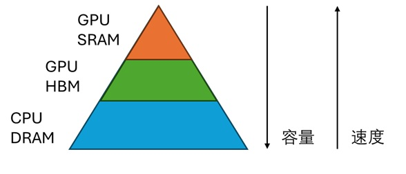
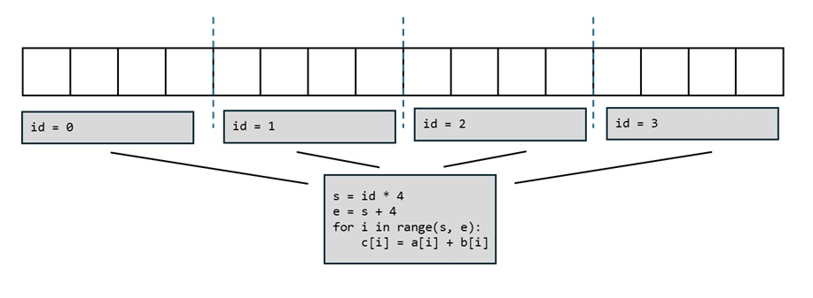
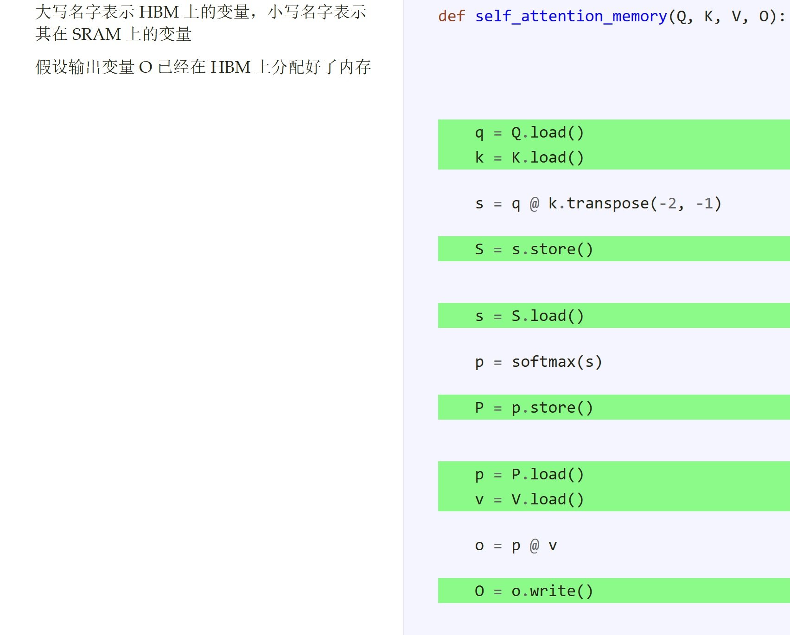
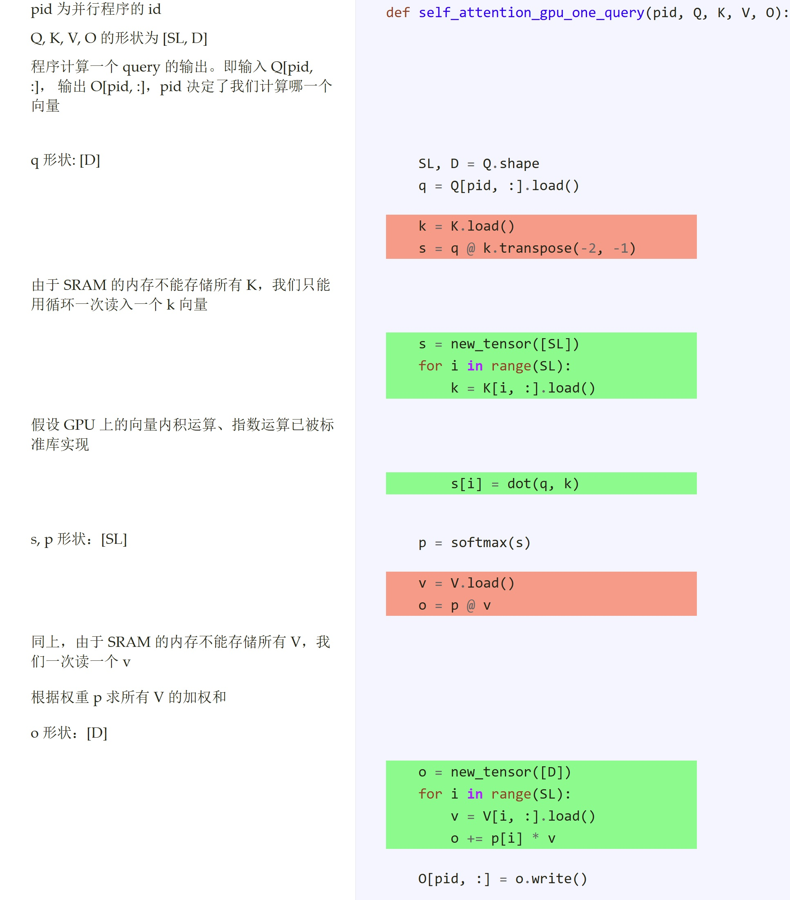
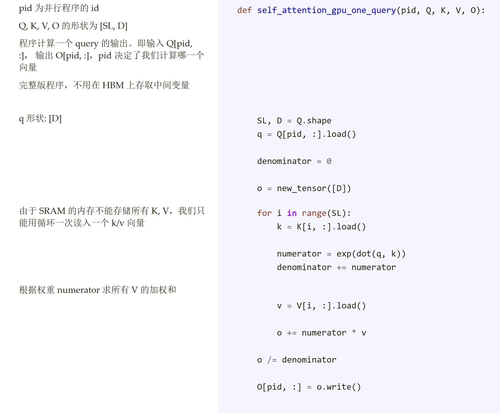

## Summary
[[ZhouYifan]] derives a deliberately simplified [[FlashAttention]]-like forward pass from the GPU memory hierarchy, [[OperatorFusion]], and per-query [[ParallelProgramming]]. The tutorial shows why materializing score and probability matrices in high-bandwidth memory is expensive, then rewrites attention so each query streams over keys and values, accumulates an unnormalized weighted value sum plus the softmax denominator, and normalizes once after the loop. Its value is conceptual rather than implementation-complete: the author explicitly says this is not the actual FlashAttention algorithm.

## Key Claims
- GPU computation must move data from HBM into limited, faster SRAM before arithmetic, so memory traffic and temporary allocation can dominate an otherwise simple computation.

- [[OperatorFusion]] can reuse loaded inputs and keep intermediate values in SRAM instead of repeatedly storing them to and loading them from HBM.
- GPU work should be partitioned into independent, similarly sized pieces selected by a program ID; attention permits this across queries because each query output is independent.

- Conventional attention forms score and softmax-probability matrices of shape `[SL, SL]`, even though inputs and outputs have shape `[SL, D]`; when sequence length greatly exceeds head dimension, those intermediates create disproportionate HBM traffic.

- Assigning one query to one program removes cross-query dependence, but a naive per-query rewrite still creates length-`SL` score and probability vectors and must stream keys and values because SRAM cannot hold them all.

- Softmax can be algebraically fused with value aggregation: accumulate `exp(q·kᵢ) vᵢ` and `exp(q·kᵢ)` in one pass, then divide the output accumulator by the denominator after the loop. This removes sequence-length intermediate arrays in the tutorial's simplified model.

## Key Quotes
> “不反复读取同一批数据、不读写中间结果是两个常见的优化场景。” — on the memory benefit of operator fusion.

> “这篇文章介绍的并不是真正的 FlashAttention 算法。” — the author's boundary on the simplified derivation.

## Connections
- [[ZhouYifan]] — author of the tutorial.
- [[FlashAttention]] — the memory-efficient attention family motivated through a simplified streaming derivation.
- [[AttentionMechanism]] — supplies the query-key softmax and weighted-value computation being reorganized.
- [[OperatorFusion]] — keeps shared inputs and intermediate results on chip across what would otherwise be separate kernels.
- [[GPUMemoryHierarchy]] — makes HBM traffic and constrained SRAM capacity first-class algorithm-design constraints.
- [[ParallelProgramming]] — partitions independent query outputs across GPU programs selected by ID.

## Contradictions
- No direct contradiction with existing attention pages was found; this source complements their mathematical description with an implementation-oriented memory account.
- The tutorial intentionally omits the usual `1/√d` score scaling from its derivation and does not present numerically stable online softmax, block tiling, masking, batching, multiple heads, backward recomputation, or a real CUDA/Triton kernel.
- Its one-key-at-a-time, one-query-per-program pseudocode explains elimination of large intermediates but is not evidence of production performance or a faithful specification of the published FlashAttention algorithms.
