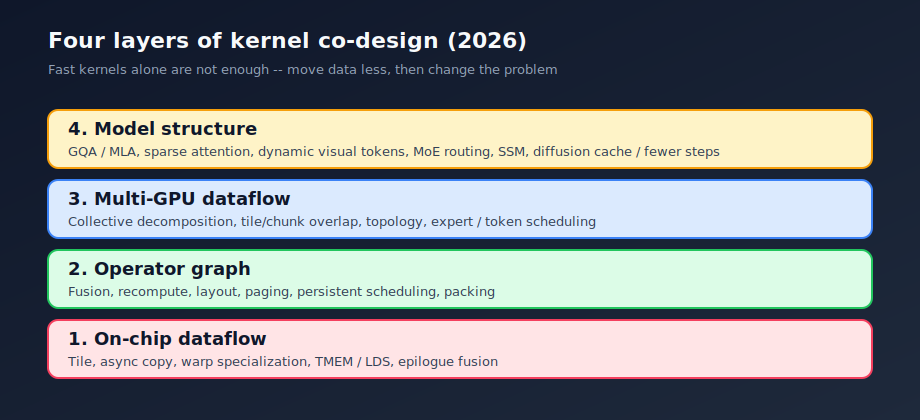
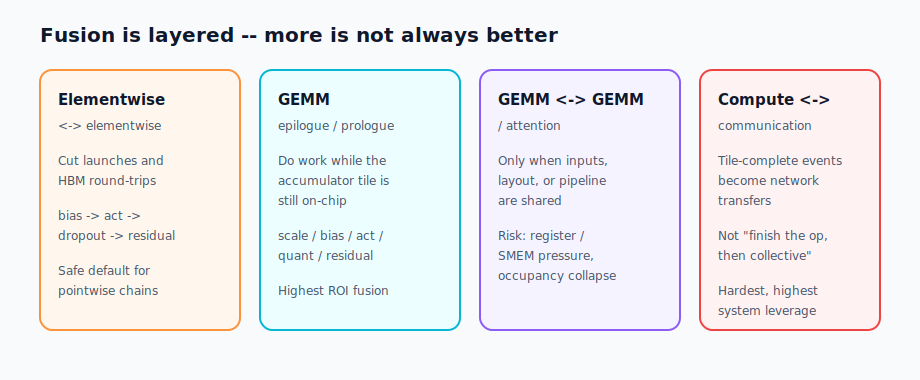
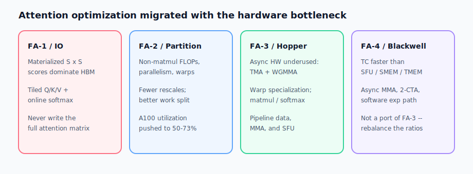
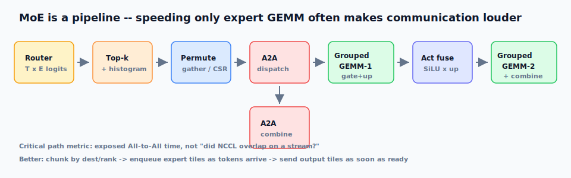
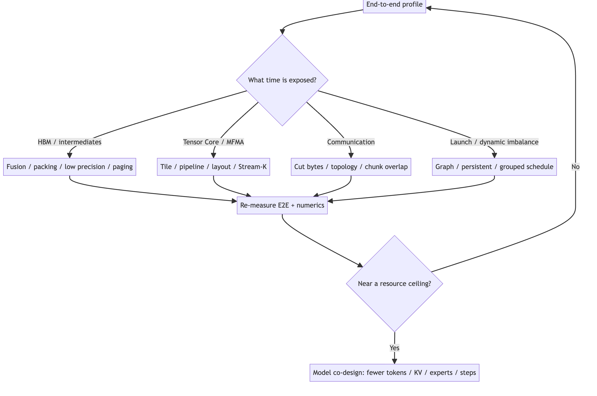

## Summary
[[DuoAn]] presents [[FoundationModelKernelOptimization]] as a four-layer co-design problem spanning on-chip dataflow, operator graphs, multi-GPU execution, and model structure. The field guide argues that real foundation-model paths are often limited by HBM traffic, cache and temporary state, collectives, dynamic imbalance, and launch overhead rather than nominal FLOPs, then maps those constraints across dense Transformers, [[FlashAttention]], MoE, multimodal workloads, diffusion, and SSMs. Its practical discipline is to profile end to end, optimize the exposed resource, and remeasure throughput, latency, memory, numerics, and quality rather than treating isolated kernel TFLOP/s as success.

## Key Claims
- A useful lower bound separates effective compute, HBM traffic, and network traffic, then adds launch, synchronization, and load-imbalance costs; low Tensor Core use therefore does not identify one universal remedy.
- [[OperatorFusion]] has increasing levels of ambition: pointwise chains and GEMM epilogues often have the safest return, while GEMM-to-GEMM and compute-to-communication fusion require compatible layouts and pipelines and can lose to register pressure, spills, or occupancy collapse.

- Training, prefill, and decode expose different shapes and resources: training adds backward, optimizer, and synchronization; prefill favors large GEMMs; decode is commonly dominated by small GEMM or GEMV, KV-cache bandwidth, scheduling, and per-token collectives.
- [[FlashAttention]] generations illustrate moving hardware bottlenecks: FA1 removes quadratic HBM materialization, FA2 improves partitioning, FA3 pipelines Hopper TMA and WGMMA with warp specialization, and FA4 reschedules around Blackwell Tensor Core, SFU, shared-memory, and TMEM ratios.

- MoE performance belongs to the complete router-to-combine pipeline, not expert GEMM alone; fine-grained arrival, grouped computation, and output-send dependencies can reduce exposed All-to-All time more effectively than whole-tensor stream overlap.

- Memory optimization has six distinct levers: dematerialization, compression or lower precision, packing or paging or layout, recomputation, sharding or offload or prefetch, and allocator or lifetime control.
- Model changes can compound beyond one kernel: fewer visual tokens reduce work across later layers, smaller KV representations improve every decode step, and diffusion caching or fewer solver steps remove repeated denoiser calls.
- Optimization should begin with a frozen workload and end-to-end profile, choose a response from the exposed bottleneck, and loop through end-to-end and numeric validation before escalating to model co-design near a resource ceiling.

## Key Quotes
> “Optimize data movement first, not peak FLOPs.” — the guide's first triage rule.

> “The KPI is exposed communication on the critical path.” — on evaluating overlap rather than overlapping stream durations.

## Connections
- [[DuoAn]] — author of the field guide.
- [[FoundationModelKernelOptimization]] — the guide's four-layer, resource-led optimization framework.
- [[FlashAttention]] — worked example of algorithm and schedule evolution with accelerator generations.
- [[OperatorFusion]] — mechanism for removing intermediate traffic, bounded by resource compatibility and occupancy.
- [[GPUMemoryHierarchy]] — determines the cost of materialization, reuse, layout, paging, and cache movement.
- [[MixtureOfExpertsLoadBalancing]] — connects routing imbalance with grouped expert work and All-to-All tails.
- [[KVCacheCompression]] — model-and-runtime lever for reducing long-context decode capacity and bandwidth.
- [[MultimodalDataPipelines]] — extends the optimization target to decode, preprocessing, ragged packing, and token budgets.
- [[DiffusionModelSampling]] — exposes cross-timestep reuse and network-call count as diffusion-specific levers.
- [[DistributedNeuralNetworkTraining]] — supplies the collective, parallelism, overlap, and topology context.

## Contradictions
- The source complements the earlier [[flashattention-1]] tutorial by supplying the missing production generations and hardware schedules; it does not contradict that tutorial's explicit boundary that its own one-query streaming loop is not the real FlashAttention algorithm.
- The field guide warns against a FLOPs-first or kernel-only account: reported microkernel throughput can fail to improve end-to-end execution once layout conversion, graph breaks, communication contention, workspace, tails, p99 latency, or quality are included.
- This is a broad practitioner synthesis rather than a new controlled benchmark. Many numerical results are attributed to linked primary sources under particular shapes and hardware, and the guide itself does not reproduce them across its full matrix of model families, GPU generations, software versions, and topologies.
