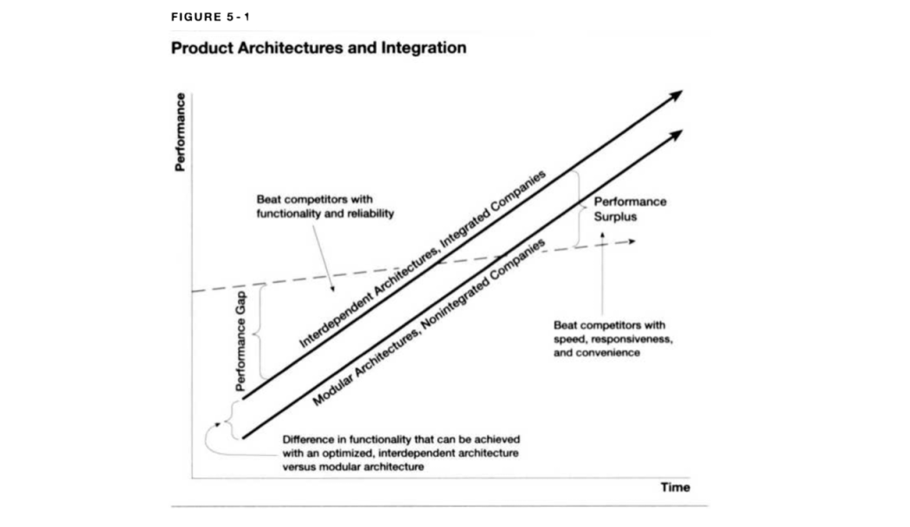

## Summary
[[BenThompson]] argues that frontier AI labs face five accumulated gaps between rapidly improving models and the markets, products, financing, and defenses needed to absorb them: capability, product, pricing, capital, and safety overhangs. He contends that slowing model progress could help [[Anthropic]] and [[OpenAI]] convert current capability into products, lower prices by reallocating compute, and earn returns on infrastructure, while also arguing that a pause could worsen the concrete cybersecurity imbalance between automated attackers and cautious defenders. The essay is a strategic interpretation of company incentives and selected product evidence, not an independent measurement of model economics, cyber outcomes, or the motives behind [[DarioAmodei]]'s frontier-pacing proposal.

## Key Claims
- Model capability may already be good enough for customers to choose on data retention, price, product fit, and convenience rather than accept any condition for the frontier model; this weakens pure capability as a moat.
- The inspected [[ClaytonChristensen]] diagram frames the transition from integrated architectures winning during a performance gap to modular architectures winning on speed, responsiveness, and convenience after a performance surplus appears.
- Microsoft's reported multi-model Copilot harness and the reversal of Anthropic's Fable data-retention condition are presented as evidence that models and harnesses can separate and that non-capability attributes can determine demand.
- The product overhang exists because capable non-frontier models can support sticky personal-agent products such as [[Muse]], potentially letting product owners capture users before frontier labs establish comparable end-user touchpoints.
- The pricing overhang comes from scarce inference supply: high prices can persist while training and research consume compute, whereas slower model development could redirect capacity toward cheaper inference and broader market capture.
- The capital overhang is a timing risk rather than a claim that compute is unnecessary: labs, hyperscalers, and neoclouds need revenue to grow before external financing or novel funding structures reach their limit.
- The safety overhang is asymmetric in the essay's cybersecurity case: automated attackers benefit when any exploit succeeds, while defenders need reliable autonomous remediation, so pacing the frontier could lengthen the period in which offense is ahead.

The emblem supplies the “Live Free or Die” motto that Thompson uses to introduce his preference for freedom, innovation, and adaptive problem solving over precaution grounded in forecasts of far-future harm.

The chart plots performance over time: proprietary interdependent architectures lead while functionality and reliability are insufficient, but once customer needs are exceeded, modular architectures can trade some peak performance for speed, responsiveness, and convenience.

## Key Quotes
> “Pure capability no longer translates directly into a moat.” — Thompson's capability-overhang conclusion.

> “pacing the frontier actually increases the window in which bad things can happen.” — the essay's cybersecurity counterargument to slowing progress.

## Connections
- [[BenThompson]] - author applying integration theory and competitive-strategy analysis to frontier AI.
- [[DarioAmodei]] - Anthropic CEO whose proposal to pace frontier development is the essay's central target.
- [[Anthropic]] - frontier lab portrayed as facing capability, product, pricing, capital, and competitive pressures alongside its stated safety concerns.
- [[OpenAI]] - competing frontier lab portrayed as facing similar commercialization and capital pressures and as setting the contemporary frontier.
- [[FrontierModelOverhangs]] - synthesis of the five gaps and their interaction with competition.
- [[ClaytonChristensen]] - source of the integrated-versus-modular architecture framework used in the capability argument.
- [[ProductCommoditization]] - adjacent pattern in which abundant model capability shifts differentiation toward products, interfaces, cost, and distribution.
- [[AgentNativeComputing]] - product layer where persistent context and user workflows may create stronger switching costs than a model or coding harness alone.
- [[ResponsibleAIRelease]] - governance lens that the essay disputes when frontier pacing is justified by speculative alignment risk rather than demonstrated present harm.
- [[Microsoft]] - provider whose multi-model harness is offered as evidence that the agent layer can be separated from the model.
- [[Muse]] - personal-agent example said to be compelling despite using a model below the capability frontier.
- [[Facebook|Meta]] - company credited with building Muse and supplying its distribution and infrastructure.

## Contradictions
- The essay treats customer rejection of a data-retention condition and one strong Muse experience as signs of a performance surplus, but neither establishes that frontier capability is broadly commoditized across workloads or customers.
- Thompson distinguishes malicious human use from model misalignment and says there is no evidence that LLMs possess a malevolent will; this directly challenges safety arguments that group misuse, autonomous loss of control, and alignment failure into one frontier-risk case.
- The cyber argument establishes a plausible offense-defense asymmetry, not that faster frontier development will reliably favor defenders, be deployed defensively, or avoid increasing offensive capability first.
- Claims about model quality, product adoption, pricing, compute allocation, profitability, training costs, financing limits, and company motives are time-bound assertions in a September 2026 strategy essay and are not independently verified here.
- The article initially says Anthropic's reported profitability excludes training costs, then carries a correction stating that the company is profitable including training costs; the corrected account weakens that specific support for the capital-overhang claim.
- The inference that Anthropic seeks government intervention because OpenAI has regained the lead may reveal aligned incentives, but alignment between safety policy and business interest does not by itself establish insincere motivation.
