## Summary
Shi Qiu, Weinan Liu, Yifan Hu, Jianqin Yan, Zhirong Shen, Xin Yao, Renhai Chen, Gong Zhang, and Yiming Zhang present [[GeminiFS]], a companion file system that lets GPU programs directly issue file-based I/O to NVMe storage while the host file system retains file management. The design embeds a GPU-friendly block map in each pre-allocated file, adds GPU-resident I/O queue pairs to a shared NVMe driver, and supplies a shareable software page cache plus a small POSIX-like library. On one A100-class GPU and one Optane P5800X, the authors report performance close to raw-device [[GPUCentricStorageAccess]] and large gains over CPU-orchestrated baselines, but the prototype narrows semantics and workload shape around predictable, mostly read-only or append-only ML data and does not yet support multiple GPUs.

## Key Claims
- CPU-centric GPU I/O keeps the host in the control path even when DMA moves data directly, whereas GPU-centric I/O places NVMe queues and request submission in GPU memory. The latter avoids host orchestration but raw block access loses the host file system's abstraction, isolation, sharing, integrity, and durability mechanisms.

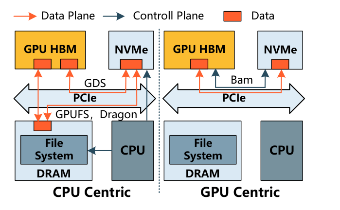

- In the authors' 4 KiB microbenchmarks, GPUfs latency rises sharply once GPU-thread demand exceeds CPU capacity, while increasing GDS batch size amortizes software overhead but leaves average and tail latency around hundreds of microseconds.

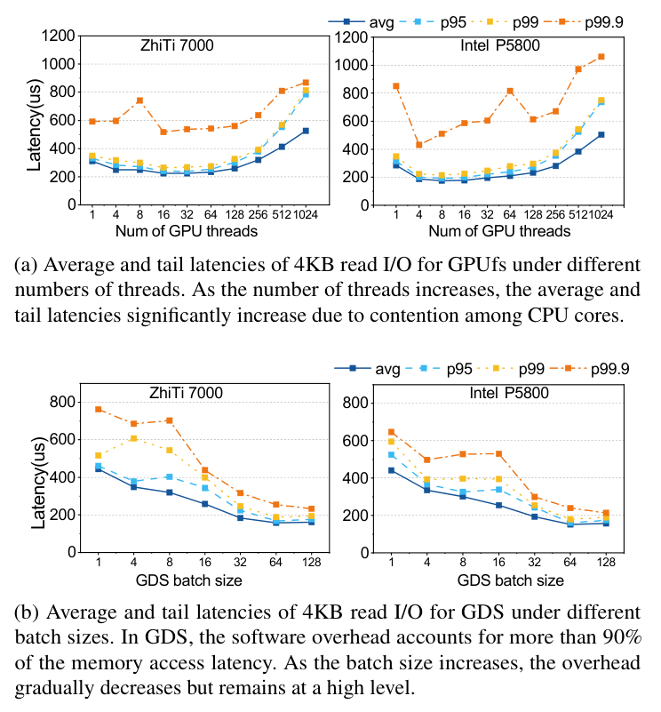

- [[GeminiFS]] divides responsibility instead of reproducing a full file system on the GPU: the host creates, moves, deletes, and pre-allocates files; GVDK Helper extracts block mappings; libGemini performs GPU-side offset translation; the GPU page cache serves repeated access; and SNVMe exposes I/O queue pairs to both processors.

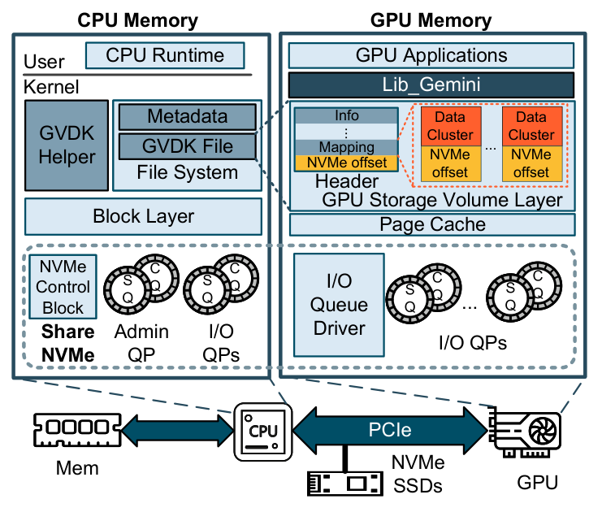

- GVDK stores file attributes, a dirty-bitmap location, and a two-level logical-to-NVMe block map inside each file. Caching this map in GPU memory makes address translation branch-light and avoids live traversal of EXT4 metadata, at a reported mapping overhead of about 0.2% for 4 KiB blocks.

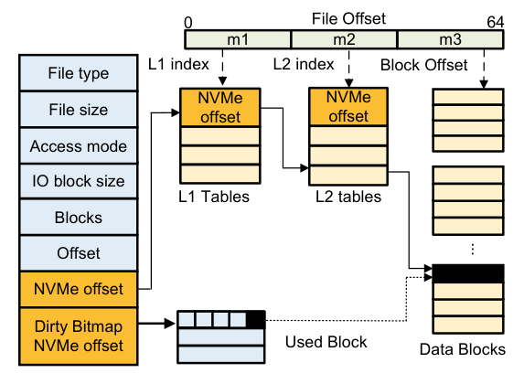

- The CPU/GPU shared NVMe driver keeps the host admin queue and ordinary I/O queues while registering additional GPU-resident queue pairs. GPU memory is pinned and DMA-mapped for the SSD, and GPU threads poll completion queues instead of using host interrupts.
- libGemini deliberately exposes only host-side initialization, open, and close plus device-side read, write, and sync. File creation and metadata embedding happen before device access; read and write translate a validated file offset into an NVMe request without a host bounce buffer.

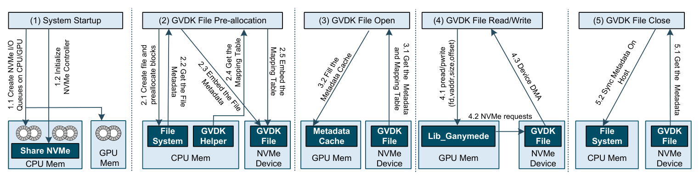

- With caching bypassed, GeminiFS reportedly reaches the tested device's roughly 6 GB/s read ceiling at 1,024 threads, averages 7.33 times GPUfs bandwidth, reaches up to 6.2 times GDS bandwidth at 128–512 threads, and stays within about 4.6% bandwidth and 4.8% latency of raw-device BaM.

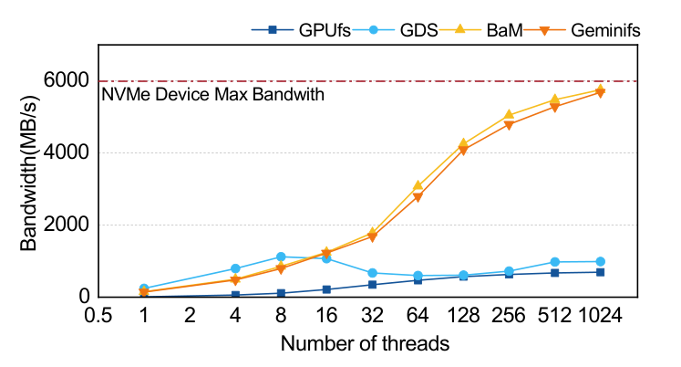

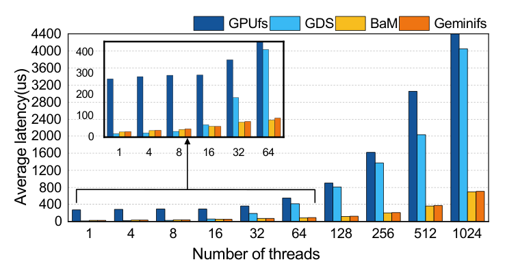

- The GPU page cache is shareable across processes through CUDA IPC handles and reduces lock pressure by acquiring pages per warp and using constant-time hash/list structures. In a memory-replication microbenchmark, any tested prefetch depth lifts sequential performance near the copy ceiling; more warps scale cache bandwidth beyond 640 GB/s, while larger pages approach the separate 120 GB/s kernel-copy limit used in the page-size test.

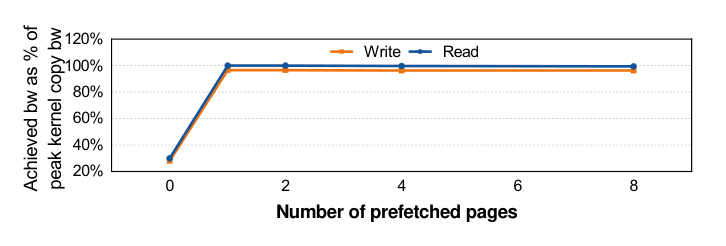

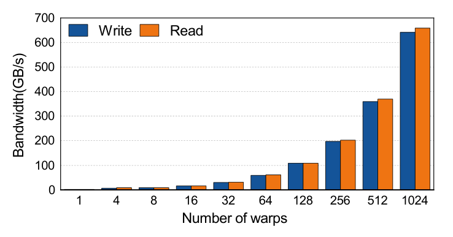

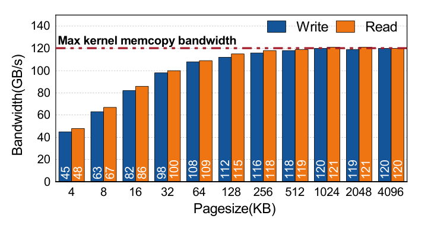

- In a three-step GPT-2 storage study, GeminiFS reportedly shortens total runtime by 10–25% when activations remain in HBM and by 91–94.5% versus GDS and native I/O when 57.96 GB of activations are offloaded per step. The activation-offload result is dominated by the tested small-I/O path and remains far slower than keeping activations in HBM.

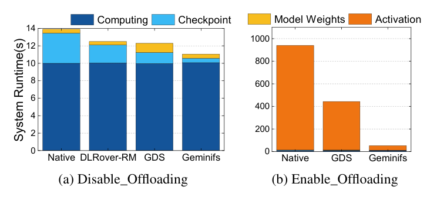

## Key Quotes
> "the GPU does not need to manage the entire NVMe device space; it only needs to correctly read and write it on demand" - the design boundary behind the shared driver.

> "being fully POSIX-compliant is not only costly but also unnecessary for most use cases" - the rationale for libGemini's deliberately narrow interface.

## Connections
- [[GeminiFS]] - the companion file system, GVDK format, shared NVMe driver, page cache, and library evaluated by the paper.
- [[GPUCentricStorageAccess]] - architectural pattern that moves I/O initiation and NVMe queue handling from the CPU to GPU threads.
- [[GPUMemoryHierarchy]] - expands from host DRAM, HBM, and on-chip memory to an NVMe-backed capacity tier with sharply different latency and bandwidth.
- [[HighThroughputIOOptimization]] - the results depend on control-path length, queue placement, concurrency, caching, prefetching, page size, and workload-specific bottleneck attribution.
- [[StoragePerformanceBenchmarking]] - comparison outcomes vary with thread count, batch size, cache policy, access granularity, and whether the benchmark measures the SSD or memory-copy path.

## Contradictions
- No direct contradiction with the wiki was found. The paper extends [[GPUMemoryHierarchy]] beyond its prior compute-kernel model by treating NVMe as a capacity tier reached through explicit file I/O rather than ordinary device-memory loads.
- The design is not a general GPU POSIX file system. It assumes predictable size or pre-allocation, favors read-only and append-only data, leaves consistency to explicit sync, omits directories and much host metadata from the GPU view, and restricts open to GVDK files.
- The main evaluation uses one 64-core host, one 80 GB A100-class GPU, one Optane P5800X, EXT4, 4 KiB storage blocks, and selected synthetic or three-step training workloads. Vendor-specific peer-memory APIs, absent multi-GPU support, no failure-injection study, and no independent reproduction limit generalization.
- The page-cache tests replace NVMe with memory replication and use different ceilings across experiments, so their hundreds-of-GB/s results characterize GPU-memory/cache mechanics rather than end-to-end storage throughput. The GPT-2 section also calls GPT2-124M a 1.5-billion-parameter model, an internal inconsistency that weakens workload reporting.

## Image Notes
All 11 effective local figure references were opened and retained once at their semantic positions. They comprise four architecture or lifecycle diagrams and seven latency, bandwidth, cache-scaling, or training-runtime charts; raw figure filenames were replaced with descriptive canonical names and recorded in the source manifest.
