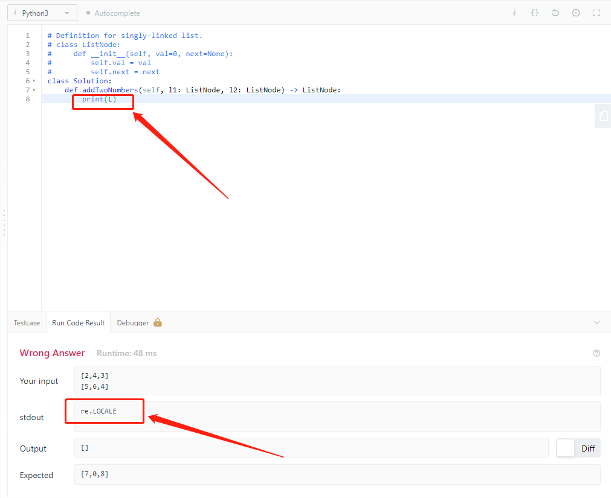
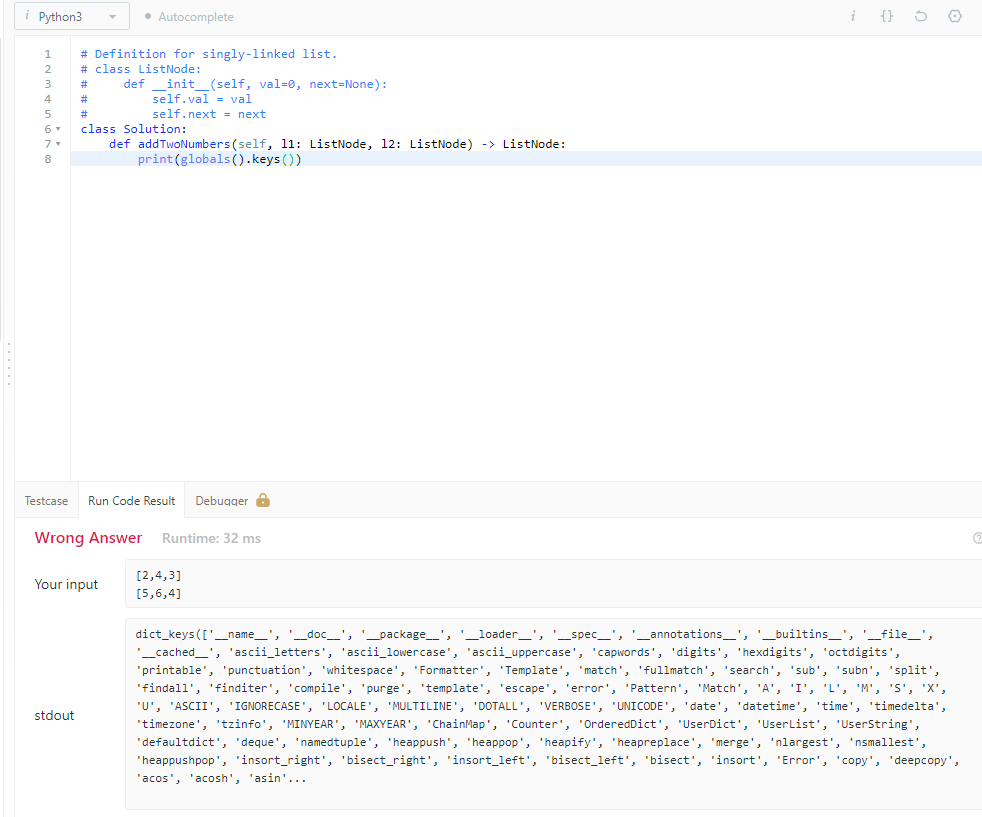
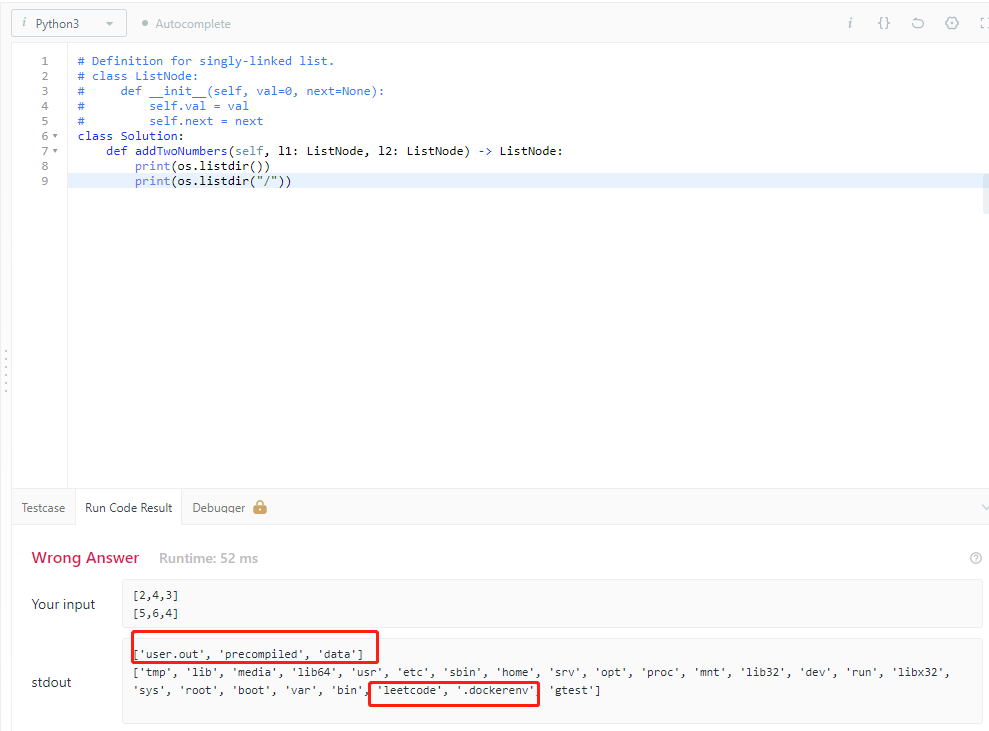
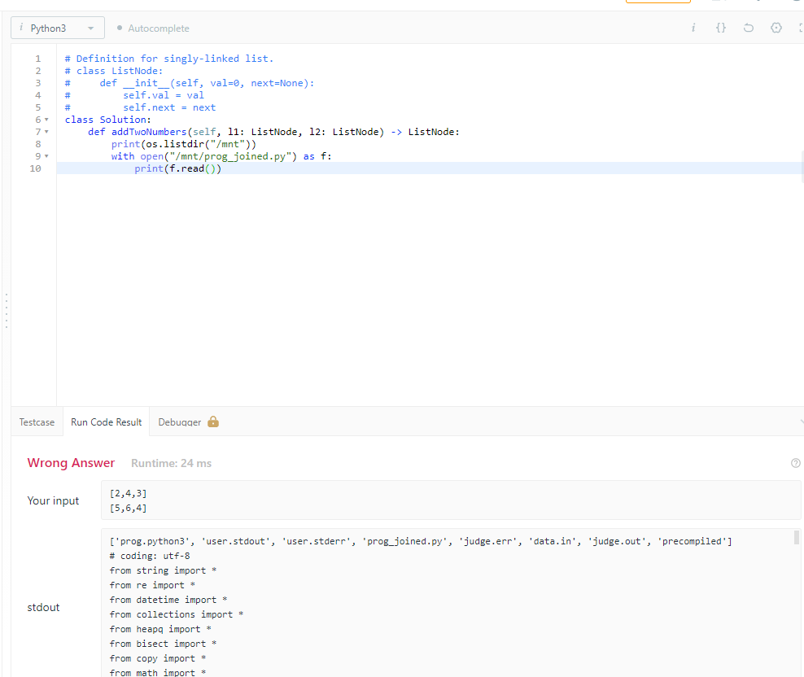

## Summary
[[Yihong0618]] probes the historical [[LeetCode]] Python execution environment from inside a submitted solution and reconstructs a simple [[OnlineJudgeExecutionHarness]]: the platform preloads many standard-library names, inserts user code into a generated program, deserializes test inputs into judge types, invokes the expected `Solution` method, serializes the return value, and runs the result in a container-visible filesystem. The observations are useful evidence about the 2021 runner, but the author's 2026 follow-up explicitly says he does not know whether LeetCode still uses the same Docker-based design.

## Key Claims
- A wildcard import from Python's `re` module leaked `L` into the submission namespace as `re.LOCALE` with numeric value `4`, allowing a misspelled uppercase name to resolve instead of raising `NameError`.

- The 2021 Python environment preloaded names from many standard-library modules through wildcard imports, so submitted code could use numerous functions and types without explicit imports; this convenience also created collision-prone implicit state.

- Filesystem inspection exposed a working directory containing `user.out`, `precompiled`, and `data`, while the root listing included `.dockerenv` and `leetcode`; the author inferred that the runner used [[Docker]].

- The generated `prog_joined.py` combined imports, precompiled serializers and judge data structures, the user's `Solution` class, and a driver loop that read test-case lines, deserialized arguments, invoked the target method, validated and serialized its return value, and wrote framed output.

- The visible `precompiled` package contained bytecode and helper modules for settings, deserialization, serialization, utilities, linked lists, nested integers, and trees, separating reusable judge machinery from generated per-problem glue.
- Printing globals, loaded modules, directory listings, and readable files made runtime introspection the central reverse-engineering method; the source suggests other language runners could be investigated similarly.

## Key Quotes
> "原来 LeetCode 看似神秘的程序运行构造也并不复杂。" — after printing the generated Python runner.

> "五年前是。。。现在我不确定" — the author's 2026 qualification when asked whether submissions still run in Docker.

## Connections
- [[Yihong0618]] — author who inspected the execution environment from submitted code.
- [[LeetCode]] — online judge whose 2021 Python runner is reconstructed.
- [[OnlineJudgeExecutionHarness]] — generated glue that joins platform imports, user code, typed test input, invocation, and output validation.
- [[Python]] — language whose wildcard-import and runtime-introspection behavior made the hidden harness observable.
- [[Docker]] — container runtime inferred from the historical filesystem view, not independently confirmed as LeetCode's current architecture.

## Contradictions
- The 2021 screenshots and generated code support a historical implementation, while the author's 2026 follow-up withdraws any claim that the same Docker-based design remains current.
- The reproduced `threeSum` snippet also contains `nums[r] = nums[r-1]` inside a `while` condition, which is invalid Python syntax. The separate screenshot establishes that `L` resolved to `re.LOCALE`, but it does not establish that the complete snippet exactly as reproduced compiled successfully.
- The article associates many default imports with slow Python parsing without a benchmark or controlled comparison, so that performance explanation remains speculative.
