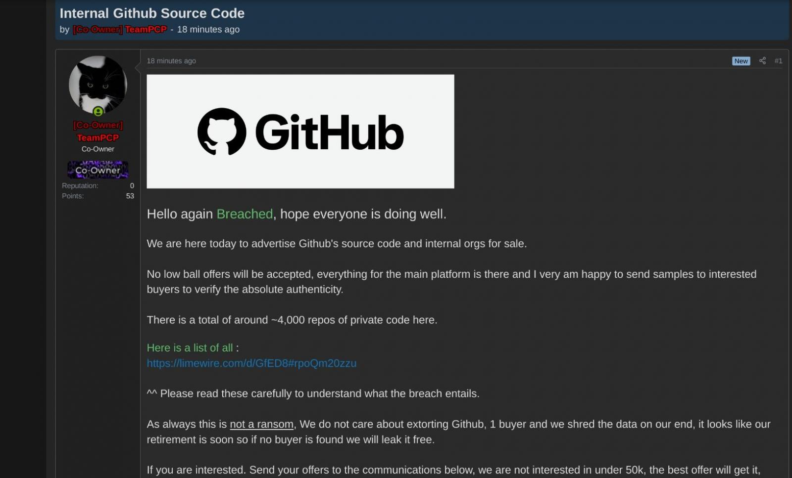

## Summary
GitHub confirmed that a poisoned [[VisualStudioCode|VS Code]] extension compromised an employee device and enabled exfiltration of roughly 3,800 internal repositories. The company removed the malicious extension version, isolated the endpoint, and said it had no evidence that customer data outside the affected repositories was impacted; an update linked the event to a TanStack npm supply-chain attack. [[TeamPCP]] advertised approximately 4,000 private repositories for sale, but GitHub had not publicly attributed the intrusion to the group in the archived article.

## Key Claims
- GitHub said an employee installed a poisoned VS Code extension, after which an attacker exfiltrated GitHub-internal repositories.
- GitHub assessed TeamPCP's claim of roughly 3,800 repositories as directionally consistent with its investigation, while withholding public attribution.
- GitHub removed the malicious extension version from the VS Code Marketplace, isolated the compromised endpoint, and began incident response.
- GitHub reported no evidence that customer data stored outside the affected repositories was impacted, which limits but does not eliminate the incident's potential scope.
- The retained forum screenshot shows a TeamPCP account advertising GitHub internal source code and around 4,000 private repositories, offering samples and seeking bids of at least $50,000.
- The article's May 21 update says GitHub linked the breach to the TanStack npm supply-chain attack.
- Prior malicious VS Code extensions had already demonstrated credential theft, cryptomining, ransomware, and data-exfiltration risks, so marketplace availability and install counts were not sufficient trust signals.

## Key Quotes
> “The attacker's current claims of ~3,800 repositories are directionally consistent with our investigation so far.” - GitHub's stated scope assessment

> “There is a total of around ~4,000 repos of private code here.” - text visible in TeamPCP's forum advertisement

## Connections
- [[GitHub]] - confirmed the employee-device compromise and internal-repository exfiltration, then contained the endpoint and removed the extension version.
- [[TeamPCP]] - claimed possession of the repositories and advertised the data for sale, without confirmed attribution in the article.
- [[VisualStudioCode]] - editor whose extension mechanism and official marketplace supplied the initial compromise path.
- [[DeveloperExtensionSupplyChainAttack]] - attack pattern in which trusted developer tooling becomes the delivery path to privileged code and credentials.

## Contradictions
- The roughly 3,800 repositories in GitHub's assessment and roughly 4,000 in TeamPCP's advertisement are compatible approximations rather than a material contradiction.
- GitHub confirmed internal-repository exfiltration but said it had no evidence of customer-data impact outside affected repositories; the article does not establish that every repository had the same sensitivity or that the investigation was complete.
- GitHub had not attributed the breach in the archived article, so TeamPCP's sale post is evidence of a claim, not proof that the group executed the intrusion.
- The source is a BleepingComputer report checked against an October 4, 2026 Wayback Machine snapshot because the live page was blocked during conversion. Its May 21 update states a TanStack link but does not provide the underlying investigation or enough detail to reconstruct that supply chain.
