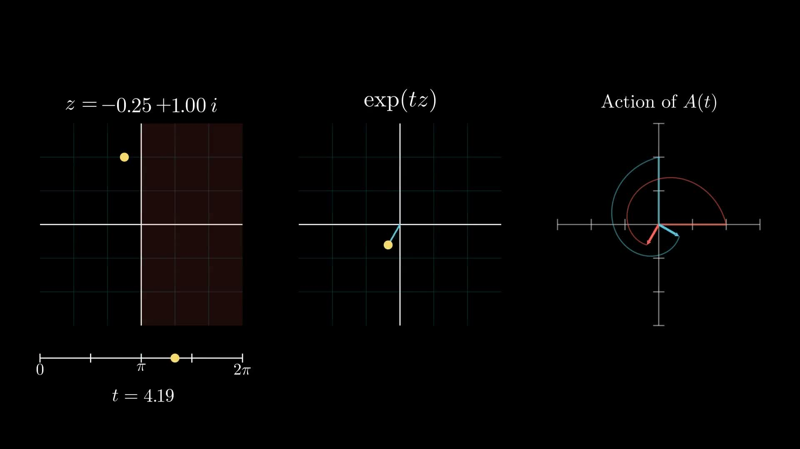
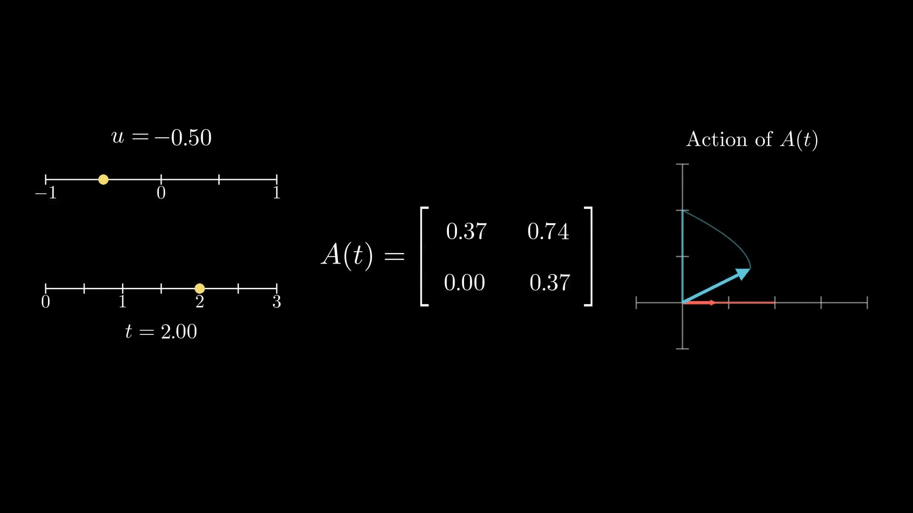

## Summary
[[AlokPuranik]] derives a constrained family of [[PositionalEncoding|positional encodings]] by assuming linear query/key transforms, translation-invariant relative scores, identity at equal times, and continuity. Those assumptions force the relative transform to be a [[OneParameterMatrixGroups|one-parameter matrix group]] `A(t) = exp(tX)`: diagonalizable generators recover NoPE, exponential decay, [[RotaryPositionalEncoding|RoPE]], and damped RoPE, while defective generators introduce polynomial terms and can linearly realize ALiBi after augmenting queries and keys. The result is an algebraic taxonomy rather than evidence that the assumptions are necessary or that every mathematically legal family is useful in trained models.

## Key Claims
- A content-only query-key dot product has no position information, so a time-dependent transform must make the score depend on sequence displacement.
- Under linearity, translation invariance, equal-time identity, and continuity, the relative transform satisfies `A(0) = I` and `A(s+t) = A(s)A(t)`, hence `A(t) = exp(tX)` for a fixed generator matrix.
- Real eigenvalues of a diagonalizable generator yield exponential scaling: zero recovers NoPE, negative values produce causal decay, and positive values create impractical growth.
- Complex-conjugate eigenvalues become two-dimensional rotations under a real change of basis, recovering RoPE; negative real parts add exponential damping as used by the source's cited RetNet and Mamba-3 examples.

- Defective generators produce Jordan blocks whose matrix exponentials contain polynomial time factors, including a shear that maps `(x,v)` to `(x+tv,v)`.

- ALiBi's linear distance penalty lies outside the initial unaugmented linear-transform setup, but an added two-dimensional query/key subspace and a defective generator can produce its `-mt` term.
- The later GRAPE paper independently uses a closely related one-parameter-group framework and connects defective generators with ALiBi, limiting the post's novelty claim.

## Key Quotes
> “The property A(s+t) = A(s)A(t) is a very powerful constraint.” - on the composition law that exposes a one-parameter group.

> “defective matrices give rise to positional encodings involving polynomial terms.” - on the family not produced by diagonalizable generators.

## Connections
- [[AlokPuranik]] - author and Jane Street researcher presenting the derivation.
- [[JaneStreet]] - institutional context in which the positional-encoding question arose.
- [[PositionalEncoding]] - the broader design space constrained by the article's assumptions.
- [[OneParameterMatrixGroups]] - the algebraic structure used to enumerate continuous relative transforms.
- [[RotaryPositionalEncoding]] - recovered from complex-conjugate eigenvalues as two-dimensional rotation blocks.
- [[GroupTheory]] - supplies the identity, inverse, and composition structure of the time-indexed transforms.
- [[AttentionMechanism]] - provides the query-key score modified by the derived transforms.

## Contradictions
- Linearity is adopted as a modeling preference rather than derived from attention requirements; the author explicitly notes that the resulting taxonomy excludes nonlinear score modifications unless the feature space is augmented.
- Translation invariance, equal-time identity, continuity, finite-dimensional square transforms, and equivalence under time-independent basis changes narrow the universe being enumerated. The result is complete only within those assumptions.
- Negative exponential decay is well behaved only for causal attention in the stated direction; without a future mask, the opposite temporal direction grows exponentially.
- The article derives known mechanisms and legal polynomial families but supplies no training experiment, benchmark, stability analysis, or quality comparison establishing that the unexplored defective-generator families are useful.
- The original claim that defective-generator positional encodings appeared unexplored is qualified by the addenda: ALiBi can be represented by such a generator after augmentation, and GRAPE had already developed a closely related framework.
- The retained posters are representative still frames from animations. They show the rotation-and-decay and shear behavior, but not the full time evolution.
