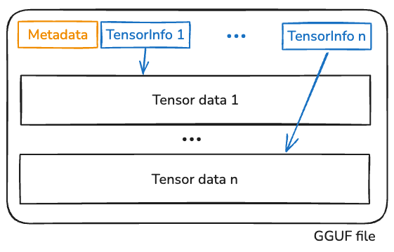
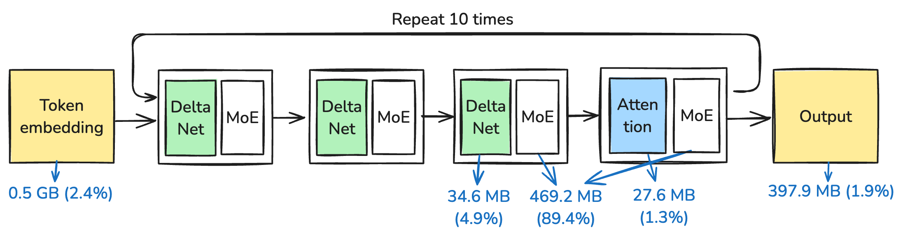
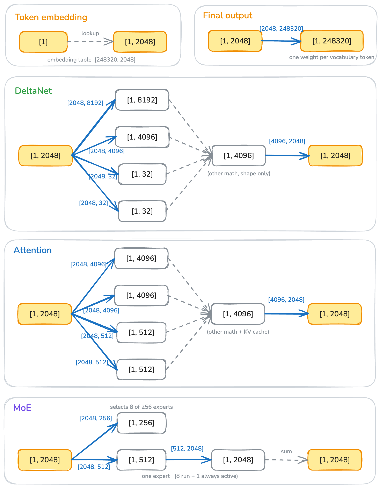
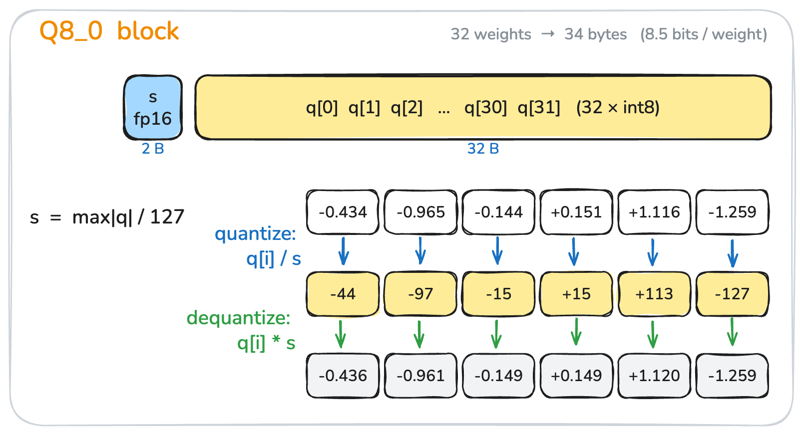
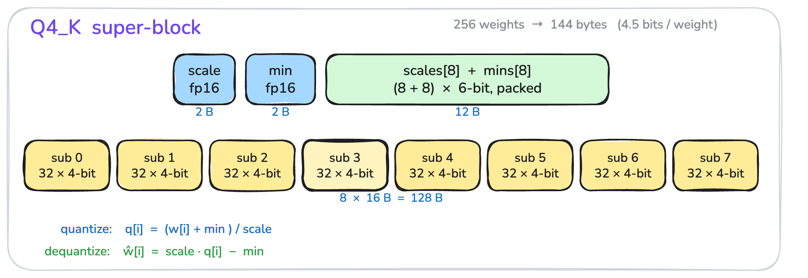
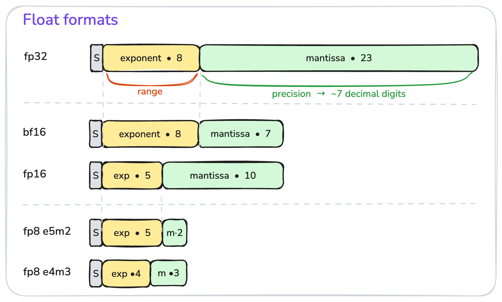
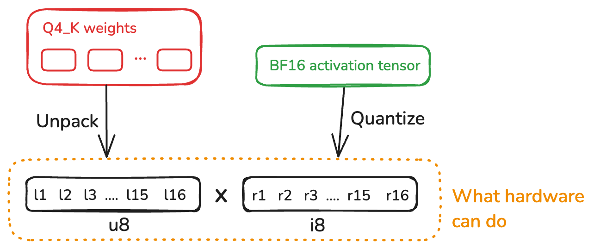
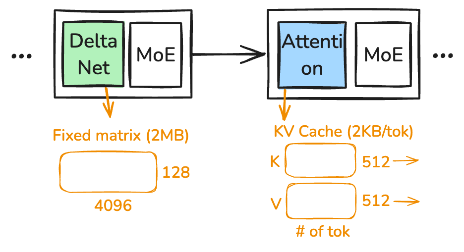

## Summary
[[XiangpengHao]] explains a dependency-free Rust implementation of CPU-only inference for [[Qwen36_35BA3B]], using the model as a concrete path through GGUF parsing, tokenization, tensor shapes, mixed block quantization, direct quantized matrix multiplication, autoregressive state, SIMD, fusion, and intra-request threading. The source's central systems claim is that shape and data movement govern implementation: prefill usually reuses weights enough to become compute-bound, while one-token decode streams them and is usually memory-bandwidth-bound. The reported prototype reaches 117.7 prefill tokens/s and 15.1 decode tokens/s on one roughly 55 GB/s machine, but model quality, portability, correctness methodology, and independent reproduction are not evaluated.

## Key Claims
- GGUF stores model metadata, per-tensor shape, dtype, offset, and length alongside weight bytes, allowing one artifact to mix BF16, F32, Q4_K, Q5_K, Q6_K, and Q8_0 tensors according to precision needs.
- The selected model repeats three DeltaNet-plus-MoE blocks and one attention-plus-MoE block ten times. MoE weights occupy 89.4% of the reported 20.60 GiB artifact, but routing activates 8 of 256 experts, bringing per-token active parameters to roughly 3.3B rather than all 34.66B.

- Decode carries a `[1, 2048]` activation through shape-preserving DeltaNet, attention, and MoE blocks before vocabulary projection; prefill changes the leading dimension to the prompt length while preserving the layer math. Encoding shapes and quantization schemes in Rust types can reject incompatible operations at compile time.

- Block quantization reduces both resident bytes and bandwidth demand. Q8_0 stores 32 signed bytes plus one fp16 scale, while Q4_K stores eight 32-value four-bit sub-blocks, quantized scale/min pairs, and two fp16 super-block parameters for 144 bytes per 256 weights.

- Floating-point formats allocate exponent bits to range and mantissa bits to precision: bf16 retains fp32's eight-bit exponent with seven mantissa bits, whereas fp16 uses a five-bit exponent and ten-bit mantissa. This makes bf16 a convenient between-layer carrier and fp16 suitable for compact quantization parameters where more local precision is useful.

- Materializing Q4_K weights as fp32 before multiplication creates an approximately eightfold weight-traffic expansion. The implementation instead unpacks weights to `u8`, quantizes runtime bf16 activations to Q8_K `i8`, uses CPU `u8 × i8 → i32` dot-product instructions, and applies scales and the cached activation sums around the integer reduction.

- Prefill GEMM can reuse weight tiles across many prompt rows and become compute-bound; decode GEMV uses each streamed weight once and is usually bandwidth-bound. The measured `qmatmul` and routed-expert kernels reach about 49.9 and 48.0 GB/s on a machine the author rates near 55 GB/s usable bandwidth.
- Autoregressive reuse has architecture-specific state costs. Each attention layer adds 2 KB of bf16 K/V state per token in this model, while each DeltaNet layer keeps a fixed 2 MB fp32 matrix; exact prefix sharing lets a longer cached sequence be sliced to reuse an earlier prefix.

## Key Quotes
> "What matters is the shape of the tensors, because that determines the compute and memory requirements." - the article's systems-programming abstraction.

> "There’s a storage reality ... and there’s a compute reality." - on aligning quantized representations with available CPU instructions.

## Connections
- [[LLMInferenceSystems]] - integrates artifact layout, tokenization, tensor execution, state reuse, and hardware-aware optimization into one local runtime.
- [[Qwen36_35BA3B]] - sole model targeted by the implementation and the source of its hybrid DeltaNet-attention-MoE structure.
- [[BlockQuantization]] - Q8_0 and Q4_K show how shared parameters trade payload size, local dynamic range, and decode work.
- [[ArithmeticIntensity]] - explains why prompt GEMM and single-token GEMV expose different bottlenecks.
- [[FoundationModelKernelOptimization]] - supplies the broader end-to-end framework for representation, fusion, SIMD, and threading choices.
- [[PromptCaching]] - exact shared prefixes permit reuse of already computed autoregressive state.
- [[InferenceTokenization]] - model-specific vocabulary, BPE rules, chat templates, and UTF-8 buffering define the runtime's text boundary.

## Contradictions
- The retained tensor-shape diagram labels the embedding vocabulary and output width as 248,320, while the prose specifies 151,936 and uses that value in its embedding discussion. The source does not explain whether the figure came from a different model revision.
- The approximately 3.3B active-parameter calculation is explicitly described as a ballpark that differs from the official method behind the “A3B” label.
- Performance is reported for one author-built engine, one quantized model, one CPU machine, and one benchmark configuration. There is no comparison with llama.cpp or another runtime, no output-accuracy or perplexity validation, no thread count or CPU model in the saved article, and no independent reproduction.
- The source argues that four-bit inference retains most information and cites external quality figures, but this implementation does not measure the selected artifact against an unquantized baseline.
- The engine intentionally omits GPU acceleration, MTP/speculative decoding, and vendor-specific closed tooling, so its design and measured bottlenecks should not be generalized to accelerator serving.
- All eight effective local image references were opened and retained once at their semantic positions with descriptive canonical filenames and a manifest.
