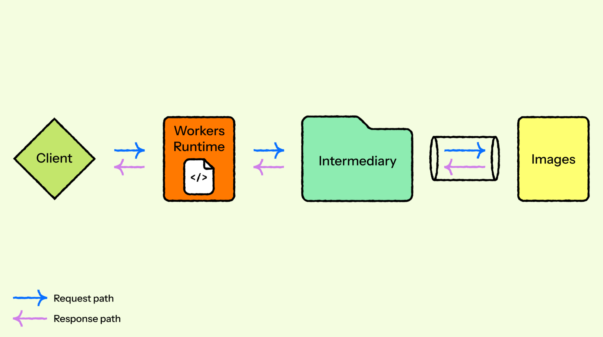
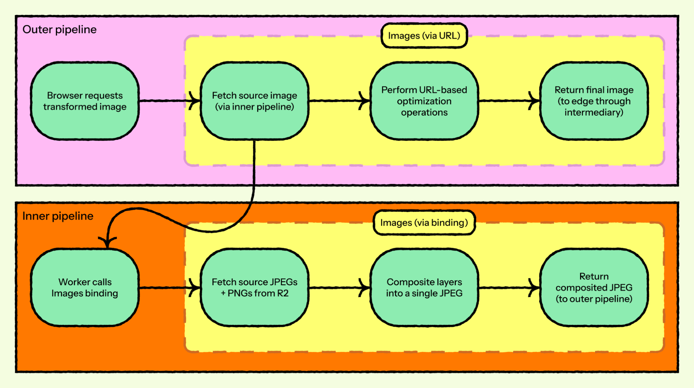
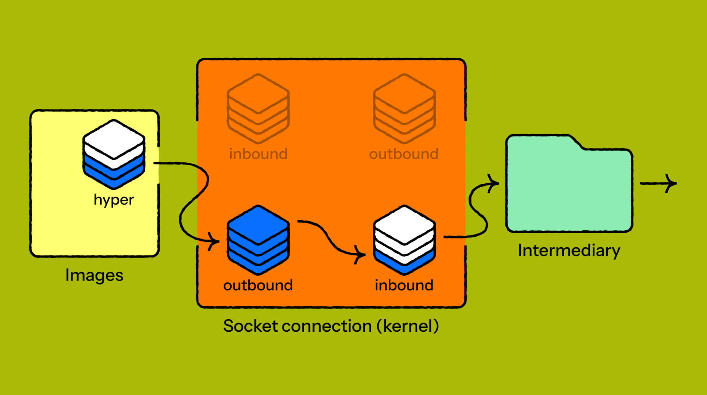

## Summary
[[Cloudflare]] describes a six-week investigation into intermittent truncation of large Images responses after a new local binding changed socket timing enough to expose a long-standing [[Hyper]] HTTP/1 race condition. Under backpressure, hyper could buffer a complete response, partially flush it to a full socket, discard `Poll::Pending`, and shut down while bytes remained unsent, producing HTTP `200` with a body shorter than `Content-Length`. Narrow `strace` tracing, a deterministic constrained-socket test, and a pre-shutdown flush fixed the loss while revealing why application logs, local tests, and fast readers had missed it.

## Key Claims
- The Images binding path runs client requests through the Workers runtime and an intermediary to the Images service, with hyper writing the service's response through a kernel-managed socket buffer.

- Replacing the former FL network path with a same-machine Unix-socket intermediary did not create the bug; Cloudflare's working theory is that the new reader occasionally drained slowly enough for the outbound buffer to fill and expose it.
- The first report used a nested workflow in which an inner Images binding composited R2 JPEG and PNG inputs and returned the JPEG to an outer URL-based optimization pipeline; truncation in the inner return path surfaced as an EOF error only in the outer layer.

- Production failures were timing- and size-dependent: application tracing reported successful encoding and HTTP `200`, while a failing syscall trace showed one roughly 219 KB `sendto` followed immediately by `shutdown` for a 14.9 MB response.
- Hyper's dispatch loop discarded the `Poll::Pending` returned by `poll_flush`; because response encoding was already marked closed and no more request input was wanted, the loop reported completion and triggered socket shutdown with buffered bytes remaining.

- A deterministic test wrapped a TCP stream so that it accepted 8 KB once and then returned `Poll::Pending`; this reproduced shutdown with 492 KB of a 500 KB response still buffered.
- The upstream-safe fix flushes at `poll_shutdown` before issuing socket shutdown. An earlier dispatch-loop fix worked for Cloudflare but could reduce read polling and mishandle keepalive behavior for other users.
- The source treats debugging tools as interventions: broadening the `strace` filter added enough timing overhead to make the race disappear, while narrowly filtered syscall evidence revealed the partial write and premature shutdown.

## Key Quotes
> “These few milliseconds of backpressure ... were all it took to surface a flaw that had been hiding in plain sight.” — on an architectural speedup exposing a latent timing bug.

> “Before shutting down the socket, hyper should first flush any remaining data in its buffer.” — the invariant enforced by the final fix.

## Connections
- [[Cloudflare]] - company whose Images team reproduced, diagnosed, patched, and upstreamed the HTTP/1 truncation fix.
- [[Hyper]] - Rust HTTP library whose shutdown path could close a backpressured socket before its internal write buffer drained.
- [[RaceCondition]] - success depended on the timing between partial flush, readiness, lifecycle completion, and shutdown.
- [[AdaptiveBackpressure]] - a briefly slow reader filled the socket buffer and forced an incomplete asynchronous flush that the state machine failed to respect.
- [[SystemReliability]] - HTTP status and application completion were insufficient evidence that the promised response bytes reached the transport.
- [[ServiceObservability]] - kernel syscall traces exposed a failure below the application telemetry's model of completion.

## Contradictions
- No direct contradiction was found. The article extends [[RaceCondition]] beyond shared-state overwrite examples to asynchronous lifecycle ordering and qualifies simple backpressure accounts: backpressure can reveal latent correctness bugs even when it does not represent system-wide overload.
- The explanation and measurements are a first-party incident account. The causal sequence is supported by syscall traces, a deterministic regression test, customer confirmation, and an upstream patch, but the source provides no independent reproduction, fleet-wide failure rate, latency distribution, or quantitative comparison of the old and new intermediaries.
