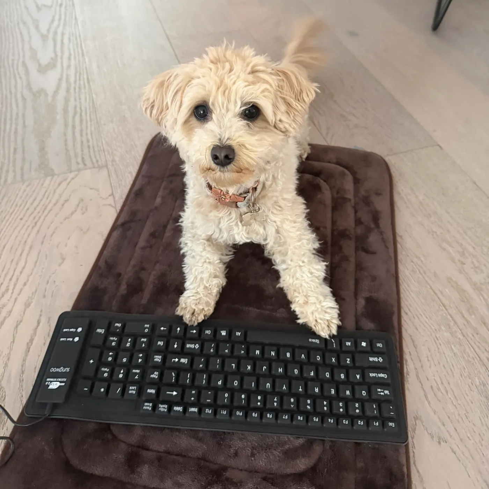
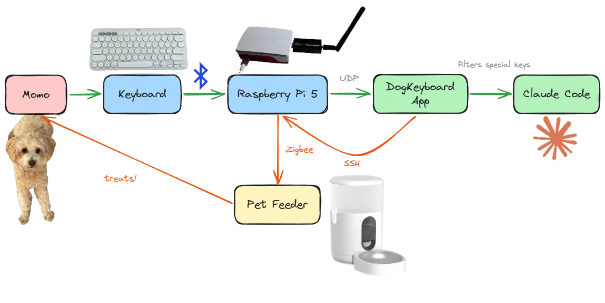
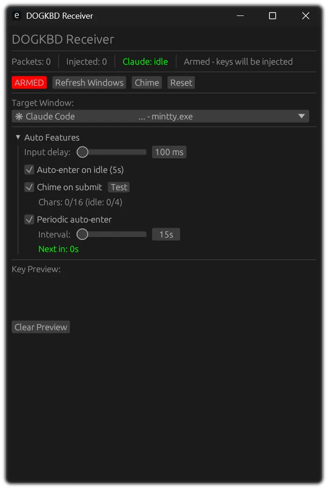
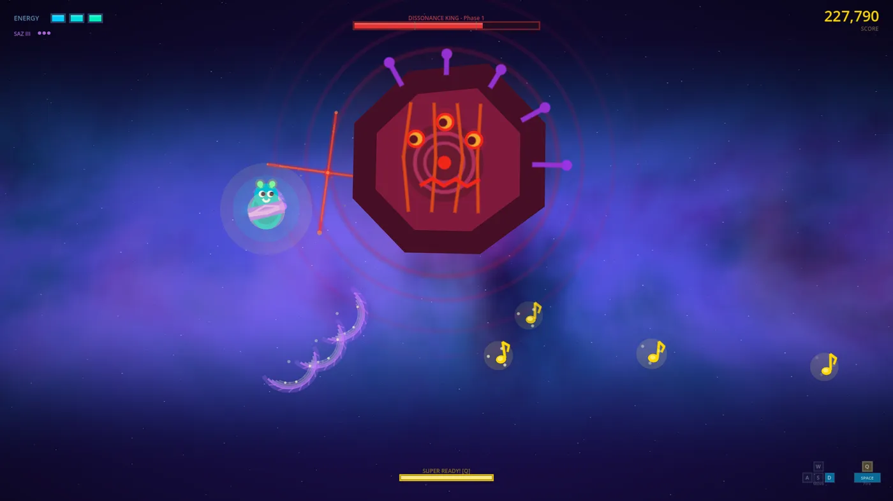

## Summary
[[CalebLeak]] describes a system in which [[MomoDog]] supplies arbitrary keyboard input while [[ClaudeCode]] interprets it as game direction and builds small Godot games. The experiment's durable result is not that random input contains design intent, but that a surrounding [[HarnessEngineering]] layer—prompt framing, minimum requirements, safe input routing, screenshots, scripted play, specialized linters, and memory resets—can turn underspecified input into testable software. Several playable games emerged in one to two hours, but unwinnable levels and reward-loop bugs keep the account a qualified practitioner demonstration rather than proof of autonomous game development.

## Key Claims
- A fictional prompt that treats nonsense as cryptic design language makes [[ClaudeCode]] act on otherwise dismissible input, but explicit minimum requirements for audio, controls, obstacles, and a visible player improve the output more reliably.
- [[DogKeyboard]] mediates the physical workflow: a Raspberry Pi broadcasts keystrokes, the app filters dangerous keys, submits only after an idle-state and character threshold, cues Momo with a chime, and triggers a Zigbee pet feeder as reinforcement.
- Godot's text-based `.tscn` scenes were easier for the agent to inspect and edit than Unity through an unreliable MCP bridge, while Bevy reportedly caused more visual, animation, physics, and coordinate-convention friction.
- Screenshots and scripted input sequences gave the agent observable visual and behavioral feedback, enabling it to play through stages, find a stale health bar, repair it, relaunch, and verify the fix.
- Scene, shader, and input-action linters caught malformed resources and wiring errors before or during execution, extending tests and logs with game-specific feedback.
- Clearing persistent `MEMORY.md` between games stopped an accidental neon-shape style from reinforcing itself, showing that durable agent memory can preserve unwanted local conventions as well as useful lessons.
- The system still produced unwinnable games and a feeder bug taught Momo to seek repeated immediate rewards, illustrating that automated feedback can be incomplete or can reinforce behavior the designer did not intend.

## Key Quotes
> "The magic isn’t in the input. It’s in the system around it." - on the experiment's central causal claim.

> "The bottleneck in AI-assisted development isn’t the quality of your ideas - it’s the quality of your feedback loops." - on why visual, interactive, and lint feedback mattered more than prompt refinement alone.

## Connections
- [[CalebLeak]] - author and builder of the game-generation and animal-training system.
- [[MomoDog]] - cavapoo trained to provide keyboard input in exchange for food rewards.
- [[DogKeyboard]] - input, orchestration, cueing, and reward application around Claude Code.
- [[ClaudeCode]] - coding agent that interprets input, edits the Godot project, runs tools, and iterates on failures.
- [[HarnessEngineering]] - prompt constraints, safe input mediation, test tools, linters, hooks, and memory hygiene form the system's effective scaffold.
- [[AutomatedGameTesting]] - screenshots and scripted controls let the coding agent inspect and play-test its own output.
- [[VibeCoding]] - the experiment is an extreme result-steered case where the ostensible designer does not understand or review code.

## Contradictions
- No direct contradiction found. The source qualifies broad autonomous-coding claims: its strongest games depend on extensive human-built scaffolding, and some generated games remained unwinnable despite automated play-testing.
