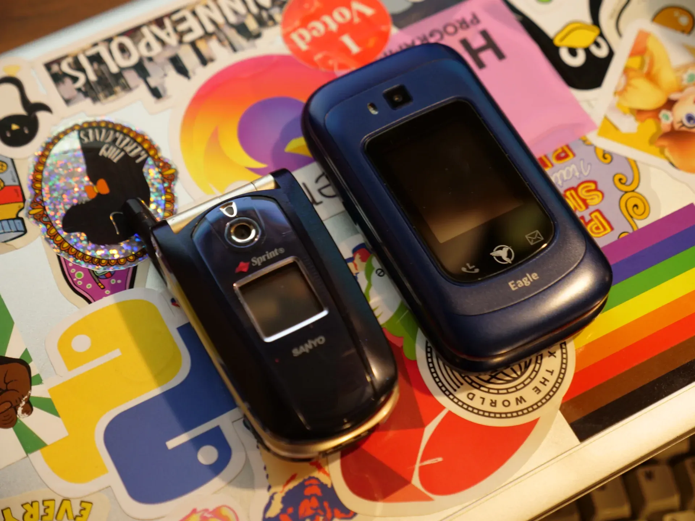
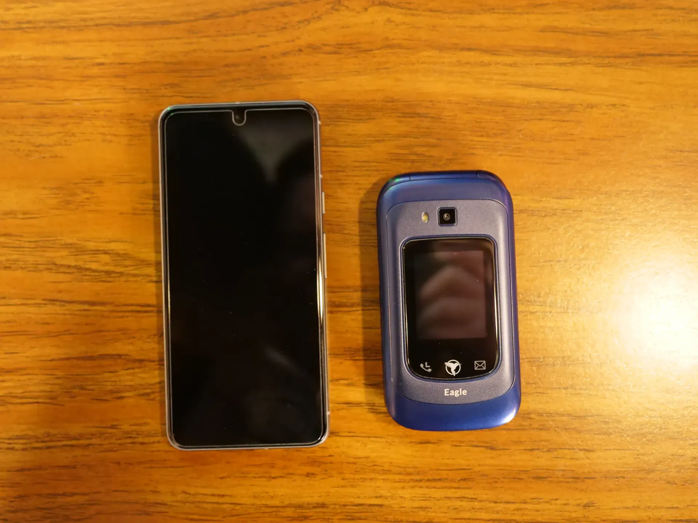
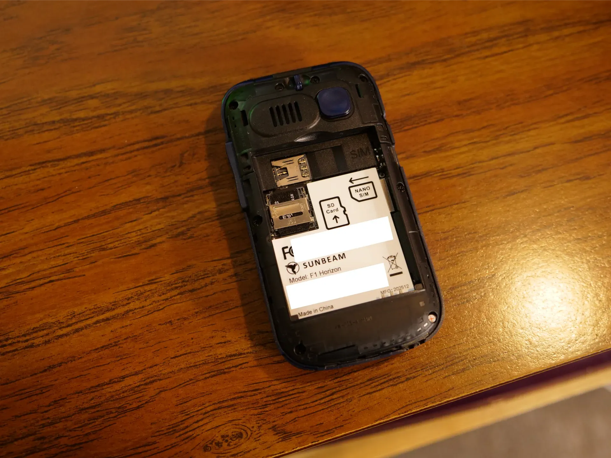
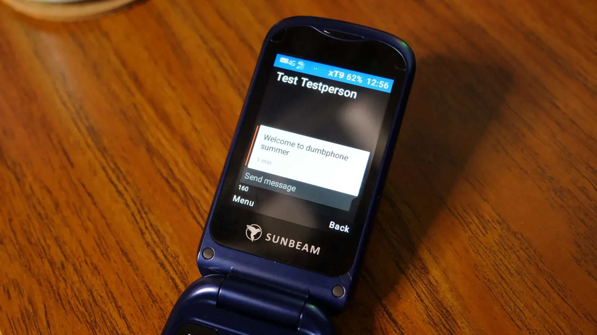

## Summary
Veronica Explains begins a three-month experiment replacing a heavily restricted smartphone with a [[SunbeamF1Horizon|Sunbeam F1 Horizon Eagle]] to test whether physical and software constraints can restore [[DigitalIntentionality]]. Even after disabling the browser and most apps, task reminders, newsletters, and messaging still made connection ambient and encouraged habitual checking or sharing instead of presence. The first-impressions account finds the feature phone deliberately low-engagement but practically capable, while treating security, subscriptions, missing smartphone-dependent services, and the experiment's eventual outcome as unresolved.

## Key Claims
- Removing most smartphone apps did not remove habitual attention capture because the remaining task list, email, and Signal still followed the author throughout the day.
- [[DigitalIntentionality]] can be supported by restoring boundaries around when and where internet access occurs rather than relying only on in-device settings or moment-to-moment restraint.
- A three-month dumbphone trial is framed as a habit-reset experiment and as visible [[RoleModeling]] for a child, not as proof that everyone should abandon smartphones.
- The [[SunbeamF1Horizon]] offers voice calls, SMS, offline HERE maps, optional Waze, 4G hotspot service over Wi-Fi and USB, a removable battery, MicroSD expansion, and nano-SIM access while remaining intentionally unrewarding to use.

- The removable back visibly exposes separate nano-SIM and MicroSD slots and battery contacts, contrasting with sealed contemporary smartphone hardware.

- The phone appears to run an Android-derived BasicOS, creating unresolved questions about Android age, source availability, security, sideloading, ADB access, removable applications, and premium-feature dependence.
- The experiment also exposes [[SmartphoneDependenceExternalities]]: parking, restaurant ordering, and store navigation may assume a QR scanner, web browser, or smartphone app even when the user deliberately opts out.

## Key Quotes
> "I need to get my bearings again." - on why reducing smartphone functionality still felt insufficient.

> "the entire internet follows you around" - on the difference between bounded dial-up-era access and ambient mobile connectivity.

> "I literally don't want to spend time on it." - on treating limited interaction as the feature phone's purpose rather than a usability defect.

## Connections
- [[DigitalIntentionality]] - central practice of shaping technology access around chosen purposes, presence, and relationships.
- [[SunbeamF1Horizon]] - feature phone selected for the three-month first-impressions experiment.
- [[AttentionManagement]] - the trial replaces repeated restraint inside an attention-rich device with stronger environmental constraints.
- [[RoleModeling]] - the author wants a child to observe adults participating in the physical world rather than normalizing constant connection.
- [[SmartphoneDependenceExternalities]] - everyday services increasingly transfer navigation, scanning, ordering, and parking work to a customer's phone.
- [[NotificationDesign]] - disabling most apps and the browser still leaves reminders, newsletters, and messaging as recurring claims on attention.

## Contradictions
- The source qualifies user-setting approaches to [[AttentionManagement]]: even GrapheneOS, few installed apps, and a disabled browser did not create the boundary the author wanted, so device substitution may sometimes be a stronger intervention than notification filtering.
- This is a first-impressions essay published at the start of the planned three-month trial. It reports no completed outcome, comparison period, screen-time data, wellbeing measure, representative sample, or evidence that the habit change will persist after smartphone access returns.
- The author had not yet established BasicOS provenance, Android version, security posture, application removability, subscription value, or long-term reliability. Those uncertainties should not be converted into settled product facts.
- The phone's 4G hotspot preserved laptop access, while QR-, app-, and web-dependent services already created friction; the experiment therefore reduces ambient access without demonstrating complete disconnection or broad practicality.

## Image Notes
All four effective remote image references were opened and retained once at their semantic positions. They substantiate the handset's size relative to an older Sanyo and a Pixel 8, the removable back with labeled nano-SIM and MicroSD slots, and the working SMS interface with 4G status.
