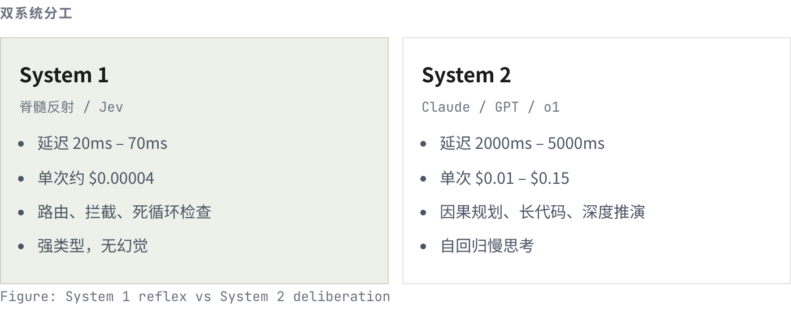
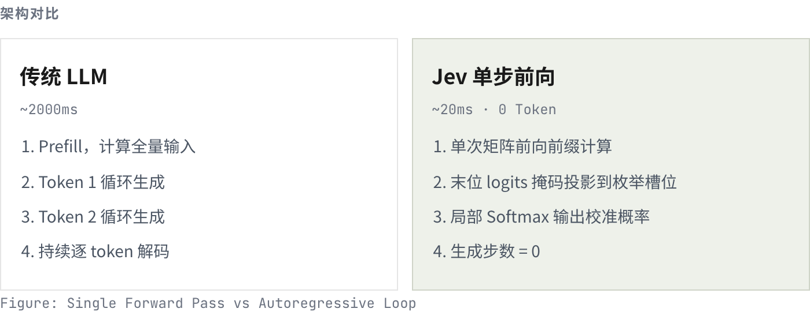
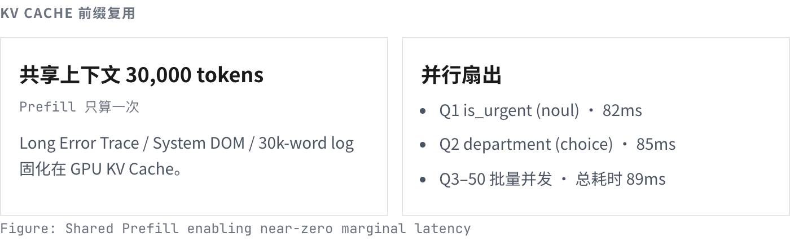
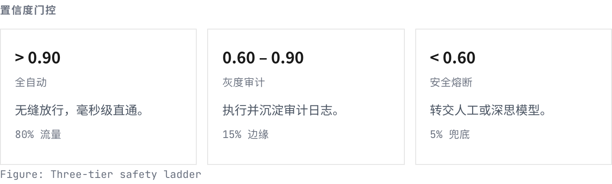
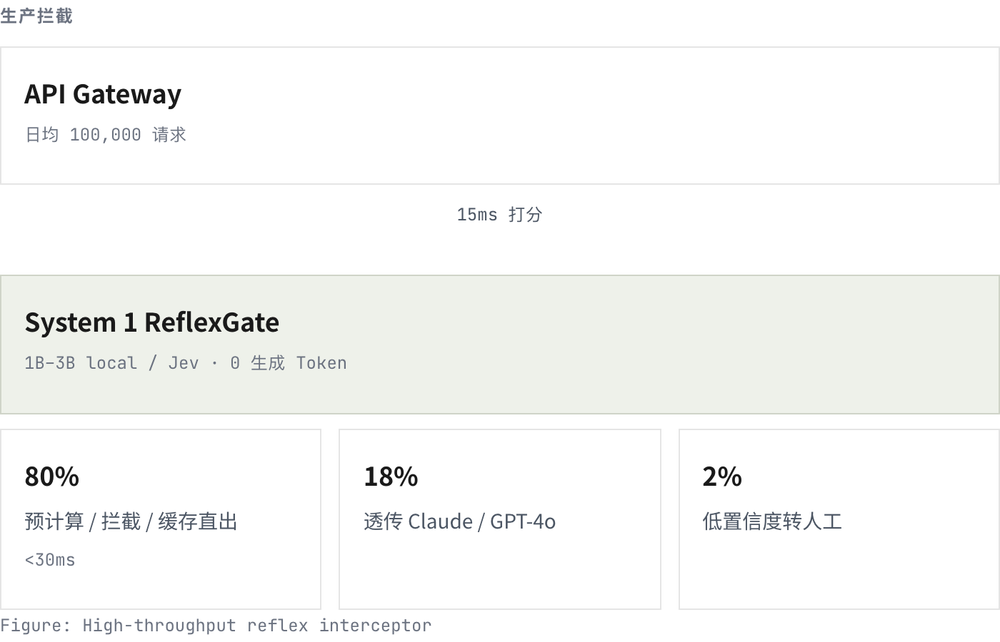

## Summary
Kuhung presents [[Jev]] as a [[SingleStepDecisionModel]] for typed, enumerated judgments rather than text generation, then reconstructs plausible implementations using final-position logits or an NLI cross-encoder. The article's useful contribution is a qualified engineering pattern: pair a fast classifier with deterministic rules, confidence-based escalation, and a generative model for harder cases; its many latency, price, calibration, agreement, and cost-saving figures are vendor, community, replay, or modeled results rather than one controlled independent evaluation.

## Key Claims
- [[Jev]] exposes Choice, Score, and Noul primitives that map context to enum selections, ordinal scores, or probability-like binary judgments without generating explanatory prose.
- A plausible implementation runs one forward pass, selects candidate-token logits or uses an NLI classification head, and normalizes only the bounded candidate set; the commercial implementation is not fully open, so this is reconstruction rather than confirmed internals.

- Shared-prefix KV caching can amortize one long-context prefill across many independent questions, but dependent questions still require sequential stages and very large fan-out eventually queues.

- Reported tests associate input growth from 360 to 29,835 tokens with median latency rising from 57.5 to 218 ms, and question fan-out from 1-100 to 1,500 with latency rising from roughly 70-100 to 610 ms; the article attributes this shape to one-time prefill and cache sharing.
- Raw Softmax over open-model logits is not a calibrated probability. The article attributes Jev's confidence quality to calibration-oriented training and recommends domain calibration, benchmark labels, shadow traffic, and human or stronger-model fallback before autonomous use.
- Candidate order and irrelevant options can change results, while multi-layer deception and causal reasoning can exceed a single forward pass; the candidate set and prompt layout are therefore part of the model behavior.
- Recommended compositions include parallel fan-out for independent dimensions, atomic scores combined by deterministic code, hierarchical pruning for large taxonomies, and [[OracleRouting|confidence-gated escalation]].

- A front-door reflex layer can block, route, cache, or escalate easy requests before a generative model, but the article's 80/18/2 traffic split and roughly 80% cost reduction are illustrative assumptions rather than measured production outcomes.

## Key Quotes
> "让预测结果决定业务动作，让置信度决定自动化等级。" - the article's separation between predicted action and permission to automate it.

> "明确技术的适用边界，往往比单纯看性能跑分更重要。" - framing limitations as part of architecture selection.

## Connections
- [[Jev]] - the proprietary service whose interface, claimed internals, benchmarks, and limits the article examines.
- [[SingleStepDecisionModel]] - captures the broader bounded-output, no-autoregressive-generation architecture.
- [[TextClassification]] - supplies the task family for intent routing, moderation, and other enumerated judgments.
- [[KVCacheAwareRouting]] - shared prefix state amortizes long-context prefill across independent candidate evaluations.
- [[OracleRouting]] - confidence thresholds route uncertain decisions to a stronger model or human reviewer.

## Contradictions
- The source strengthens the existing claim that Jev returns typed judgments, but qualifies the earlier pipeline's decision-support-only evidence by proposing autonomous high-confidence execution; no production outcome data in this source establishes that such execution is safe.
- The article reports replayed Jev-versus-Gemini examples, third-party tests, community reproductions, vendor claims, and a hypothetical cost model together. They support architecture hypotheses and measurement targets, not one controlled head-to-head benchmark.
- The statement that Jev confidence is calibrated is not accompanied by the calibration dataset, ECE curve, class-conditional reliability, drift results, or an independent replication. The cited 73.8% open-model agreement is not a Jev accuracy measure.

## Image Notes
All six local diagrams were opened. Five distinct evidence-bearing diagrams were retained at their semantic positions; source figure 04 was omitted because it duplicates the KV-cache diagram already retained from figure 03.
