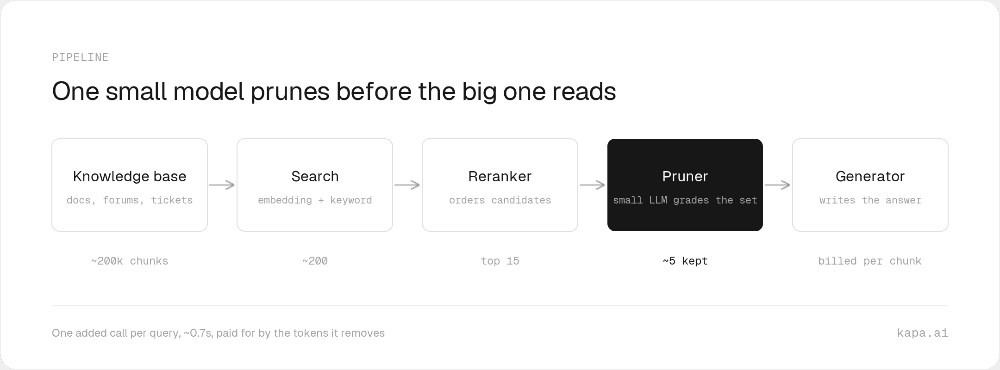
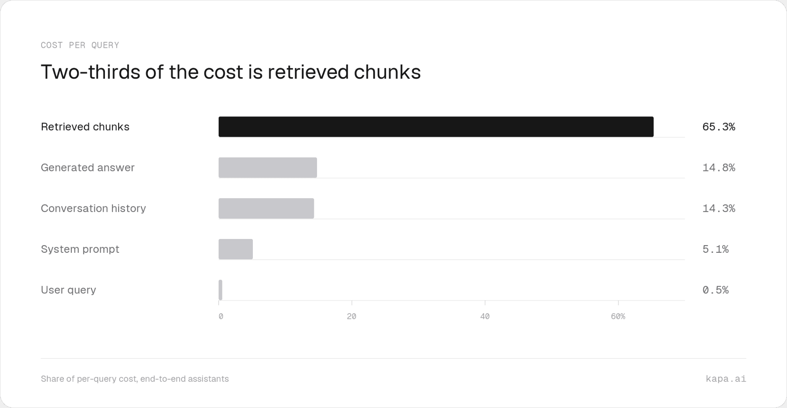
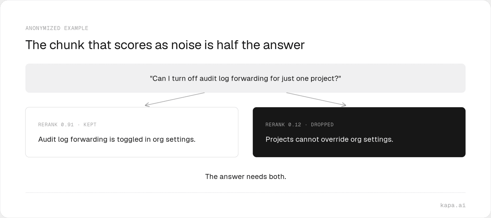
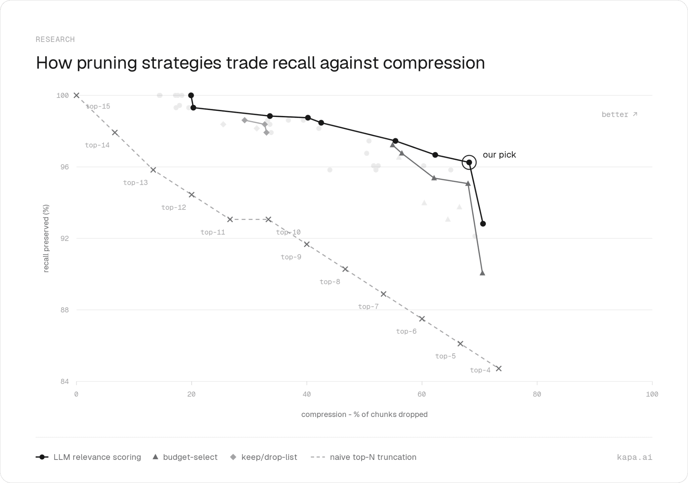

## Summary
[[LarsBaltensperger]] describes how [[KapaAI]] inserted a small listwise LLM between reranking and generation to remove retrieved chunks that the final answer does not need. Kapa reports choosing a configuration that drops about 68% of chunks while preserving every labeled necessary chunk for about 96% of questions, reducing per-query cost by about 34% after paying for the pruner and adding roughly 0.7 seconds of latency. The article's central technical claim is that pruning must judge the question and retrieved set together because a chunk can be necessary only in combination with another chunk, a dependency that pointwise reranker scores cannot observe.

## Key Claims
- A production [[RetrievalAugmentedGeneration]] pipeline can add a small-LLM pruning stage after retrieval and reranking but before the expensive generator, reducing roughly 15 reranked chunks to about five in Kapa's illustrated pipeline.

- Retrieved chunks account for 65.3% of Kapa's illustrated end-to-end assistant cost, compared with 14.8% for the generated answer, 14.3% for conversation history, 5.1% for the system prompt, and 0.5% for the user query.

- Fixed reranker-score cutoffs are unsafe because pointwise scores are neither calibrated across queries nor aware of dependencies among retrieved chunks; in the shown example, a 0.12-scored chunk stating that projects cannot override organization settings is required alongside a 0.91-scored chunk locating the audit-log toggle.

- The shipped listwise pruner grades every chunk in one call as essential, contributing, supporting, tangential, or unrelated, then applies a threshold while allowing a keep-top-k safeguard to retain the strongest reranked chunks regardless of grade.
- On Kapa's labeled questions and replayed month of production conversations, LLM relevance scoring forms a better compression-recall frontier than naive top-N truncation, a fixed chunk budget, or unscaled keep/drop selection; the chosen point is near 68% compression and 96% full-needed-set recall.

- The selected configuration reportedly lowers query cost by about 34% net of pruning cost and adds about 0.7 seconds to the critical path; Kapa treats that latency as easier to justify inside multi-call agents than in latency-sensitive single-shot answering.

## Key Quotes
> "The real question is never whether a chunk is relevant by itself, but whether it belongs to a set that together answers the question." - on set-dependent relevance.

> "A pruner is exactly as good as that tradeoff: compression gained per point of recall lost." - on evaluating context removal.

## Connections
- [[LarsBaltensperger]] - author explaining Kapa's production pruning design and evaluation.
- [[KapaAI]] - company that built and deployed the listwise RAG pruner.
- [[RAGContextPruning]] - the source's central method for removing retrieved evidence before generation.
- [[RetrievalAugmentedGeneration]] - fixed retrieval pipeline extended with a pruning stage.
- [[LLMContextManagement]] - pruning allocates a finite context and cost budget to higher-value retrieved evidence.
- [[AgenticRAG]] - agentic retrieval is the first rollout target because agents can search again and accumulate tool output across calls.

## Contradictions
- The source qualifies the idea that reranker scores alone can safely determine a universal relevance threshold: their ordering may be useful while their absolute values remain query-dependent and blind to cross-chunk dependencies.
- The 68% compression, 96% full-needed-set recall, 34% net cost reduction, and 0.7-second latency are first-party results. The article does not disclose the question count, corpus mix, pruner model, threshold, keep-top-k value, uncertainty, answer-quality impact, or an independently reproducible evaluation, so the operating point should not be generalized without local testing.
