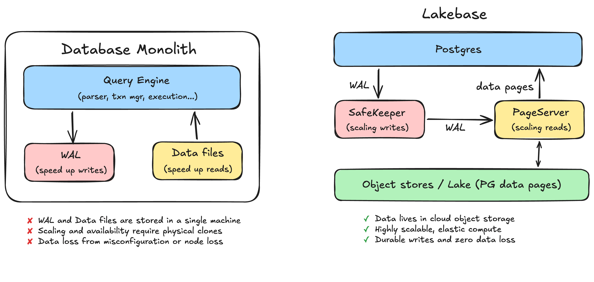
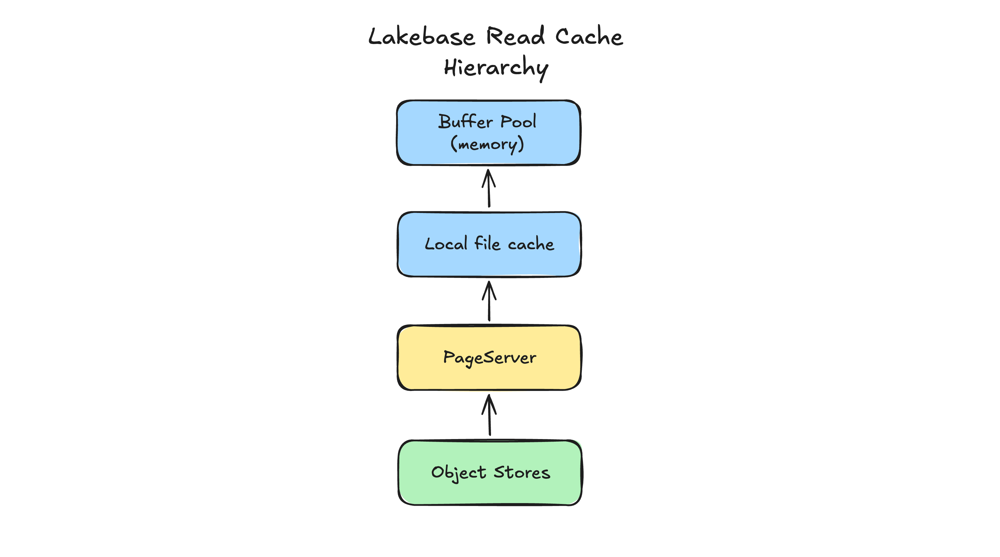
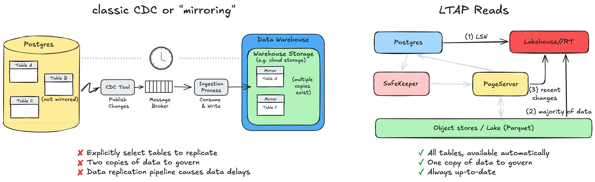

## Summary
[[ReynoldXin]] presents [[Lakebase]] as a disaggregated [[PostgreSQL]] architecture in which stateless compute sends WAL to quorum-replicated Safekeepers and obtains pages through Pageservers backed by object storage. The article then introduces [[LakeTransactionalAnalyticalProcessing|LTAP]], an announced extension that transcodes operational state into open columnar storage so transactional and analytical engines can read one governed copy while remaining separate compute systems. The architectural account is detailed, but its performance, durability, compression, and adoption claims are first-party and LTAP was still in transitional rollout.

## Key Claims
- A monolithic database keeps its WAL, data files, and query engine on one machine, coupling durability, availability, read scaling, and analytical interference to that machine and its physical clones.

- [[DisaggregatedTransactionalDatabase|Lakebase's disaggregated architecture]] sends WAL to Paxos-based Safekeeper quorum replication and lets Pageservers consume that WAL, reconstruct current pages, and materialize durable state into object storage while PostgreSQL compute remains replaceable.
- The read path checks PostgreSQL's memory buffer pool, then a compute-local file cache, then the Pageserver; this hierarchy is intended to keep most reads off the network while allowing storage capacity to grow independently.

- Stateless compute and versioned external storage make scale-to-zero, read replicas, failover, point-in-time recovery, and [[DatabaseBranching|metadata-based database branching]] consequences of the storage design rather than full-copy operations.
- [[LakeTransactionalAnalyticalProcessing|LTAP]] unifies transactions and analytics at the storage layer rather than inside one HTAP engine: PostgreSQL retains ACID transaction execution while Lakehouse engines scan Parquet represented through Delta or Iceberg.
- During materialization, LTAP preserves PostgreSQL values and row versions in columnar storage, including overflow text for values without a lossless native Parquet representation and physical heap addresses needed to reconstruct pages; indexes remain cache-tier structures that can be rebuilt.
- An analytical query obtains a PostgreSQL LSN, reads the materialized majority from object storage, and merges the small recent tail from the Pageserver, so PostgreSQL serves metadata rather than the analytical data scan.

- Unlike CDC or mirroring, the proposed model makes every table analytically visible by construction and avoids a separately selected replica set, ingestion pipeline, and governed second copy; very small tables may remain row-oriented when columnar metadata would cost more than it saves.

## Key Quotes
> "The key idea is to unify the two worlds at the storage layer rather than at the engine layer." - on LTAP's distinction from HTAP.

> "The database finally moves as fast as your code." - on metadata-based branching and recovery.

## Connections
- [[ReynoldXin]] - author and Databricks cofounder presenting the architecture.
- [[Lakebase]] - serverless PostgreSQL service whose storage path the article explains.
- [[Databricks]] - company developing Lakebase and the announced LTAP integration.
- [[PostgreSQL]] - transactional engine, value semantics, WAL, pages, MVCC history, and LSN boundary retained by the design.
- [[DisaggregatedTransactionalDatabase]] - separates transaction compute, WAL durability, page reconstruction, and object-store persistence.
- [[LakeTransactionalAnalyticalProcessing]] - storage-level unification of transaction and analytical access described by the source.
- [[DatabaseBranching]] - versioned storage turns cloning and recovery into metadata operations.
- [[ApacheParquet]] - columnar physical representation used for analytical access.
- [[ApacheIceberg]] - one open table-format layer named for exposing columnar snapshots.

## Contradictions
- The earlier [[p4385-pandis]] account describes PostgreSQL page-format objects as the durable shared representation, whereas this article presents LTAP's intended durable source of truth as columnar Parquet with row pages and indexes serving as caches. This is best read as an announced architectural evolution and transitional dual-write rollout, not two simultaneously universal descriptions.
- Claims of no meaningful additional latency, zero data loss, unlimited storage, more-than-tenfold compression, and superior isolation are vendor assertions without independent failure testing, benchmark methods, tail distributions, or complete cost evidence in this article.
- The proposed single-copy model still has asynchronous materialization and a recent-change merge path. Its consistency depends on correct LSN coordination, PostgreSQL-semantic transcoding, MVCC visibility, garbage collection, and reconstruction across both representations.
- LTAP was still being rolled out, with row-and-column dual writes used for verification. The article therefore does not establish mature production behavior, broad adoption, extension compatibility, recovery outcomes, or all-table performance.

## Image Notes
All three effective local image references were opened and retained at their semantic positions. They document the component boundaries and data flows, cache hierarchy, and CDC-versus-LTAP freshness mechanism rather than serving as decoration.
