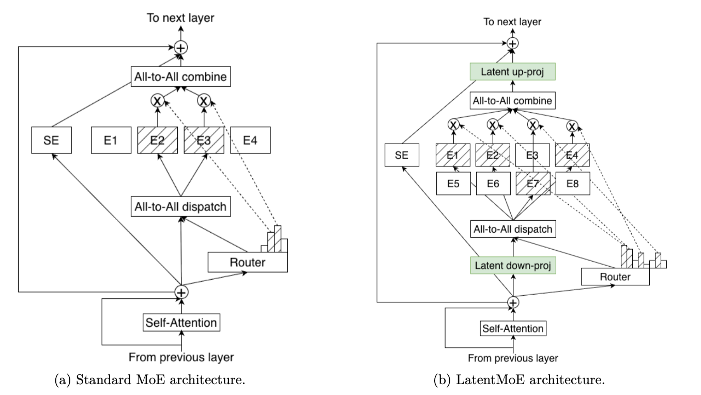

## Summary
[[Oilbeater]] explains [[LatentMoE]] as a sparse-expert variant that reduces MoE communication by projecting token activations into a smaller latent width before all-to-all dispatch and restoring the full width after expert outputs return. The article frames this as a memory- and network-traffic optimization whose added projection compute can be worthwhile when communication dominates execution time, and it says [[KimiK3]] uses a likely variant called Stable LatentMoE. Its architectural account is clear, but the post is a secondary explainer and does not provide the underlying K3 report or experimental setup for its quality and compression claims.

## Key Claims
- Standard MoE lowers per-token expert computation through sparse activation but can amplify device-memory and network traffic because routed token representations must travel to remote experts and their outputs must return.
- LatentMoE leaves routing on the original representation while projecting the expert-bound activation to a lower-dimensional latent representation, dispatching and computing in that narrower space, combining the returned outputs, and projecting them back to the model width.

- The article compares the mechanism to latent-channel [[KVCacheCompression]] in multi-head latent attention: both accept lossy compression to reduce a data-movement bottleneck, although they act on different tensors and execution paths.
- The author reports that a fourfold latent compression combined with more experts can preserve model performance, but does not identify the evaluated model, metrics, baselines, or underlying experiment in this article.
- Down- and up-projections add arithmetic, while narrower expert dimensions can offset some of that work; the intended end-to-end gain comes from reducing the more expensive memory and interconnect traffic rather than minimizing FLOPs alone.
- The article places LatentMoE alongside reduced precision, sparse expert activation, compressed KV caches, and sparse attention as examples of trading local fidelity or density for greater total model scale.
- The Kimi K3 launch material reportedly names Stable LatentMoE, which the author infers may be a variant of LatentMoE pending a detailed technical report.

## Key Quotes
> “LatentMoE 并没有尝试去改变通信拓扑，它的解决方法是通过压缩和解压的方式降低传输量。” — the article's distinction between changing the network topology and reducing bytes sent through it.

> “尽可能降低内存的开销而不是只关注计算量的下降。” — the stated optimization principle of prioritizing memory traffic over arithmetic count.

## Connections
- [[LatentMoE]] - compression-centered sparse-expert architecture explained by the article and diagram.
- [[MixtureOfExpertsLoadBalancing]] - adjacent routing problem whose execution cost also depends on expert communication and placement.
- [[FoundationModelKernelOptimization]] - broader discipline of optimizing exposed memory and network cost rather than nominal FLOPs alone.
- [[KVCacheCompression]] - analogous latent-compression strategy applied to attention state rather than expert-bound activations.
- [[KimiK3]] - model whose launch material reportedly names Stable LatentMoE.
- [[Oilbeater]] - author of the secondary technical explainer.

## Contradictions
- The claimed fourfold compression with preserved performance is not accompanied here by an experimental configuration, quality metric, compute comparison, or direct citation, so it should not be treated as independently verified or universally transferable.
- The article calls Stable LatentMoE “very likely” a LatentMoE variant; without the promised Kimi K3 technical report, its exact architecture and relationship to the depicted mechanism remain uncertain.
- The diagram explains the logical data path but does not quantify topology, collective implementation, batch shape, expert placement, load imbalance, latency, throughput, or training-versus-inference differences.
- Compression is lossy and projection work is not free. Whether reduced communication outweighs added arithmetic depends on hardware, parallelism, activation width, expert count, routing sparsity, and workload.
