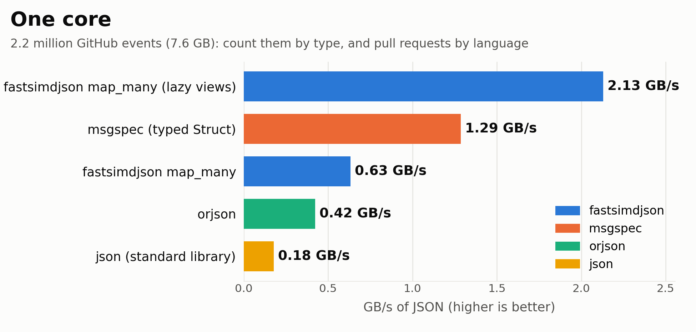
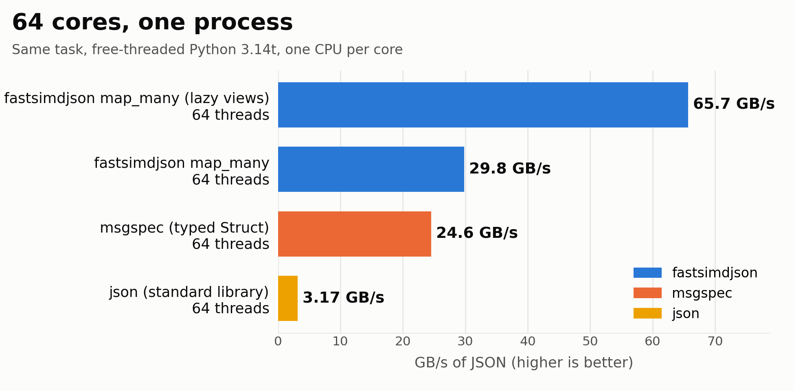

## Summary
[[DanielLemire]] benchmarks selective NDJSON processing in free-threaded [[Python]] 3.14 using 7.6 GB of decompressed GH Archive events. [[Fastsimdjson]] combines multi-threaded `map_many` processing with lazy views that materialize only accessed values; on the author's dual-Xeon 64-core server, the combination reportedly reaches 65.7 GB/s, compared with 24.6 GB/s for typed msgspec structures and 3.17 GB/s for the standard library. The result supports [[SelectiveJSONParsing]] and thread-local reduction as complementary optimizations, while remaining a best-of-seven, in-memory, single-machine benchmark on one selective aggregation task.

## Key Claims
- Free-threaded Python 3.14 permits CPU-bound Python work to execute across multiple threads without the traditional global interpreter lock serializing Python execution.
- [[SelectiveJSONParsing]] avoids constructing Python objects for unused fields: fastsimdjson's lazy views expose values on demand, while msgspec's typed structures declare the required fields in advance.
- Thread-local counters remove shared updates from the hot path; the main thread merges only a few dozen event-type counts and about one hundred language counts after parsing completes.
- On one core, the reported throughput is 2.13 GB/s for lazy fastsimdjson, 1.29 GB/s for typed msgspec, 0.63 GB/s for eager fastsimdjson, 0.42 GB/s for orjson, and 0.18 GB/s for the standard library.

- Across 64 cores in one process, lazy fastsimdjson reportedly reaches 65.7 GB/s and processes 7.6 GB in about 0.12 seconds, versus 29.8 GB/s for eager fastsimdjson, 24.6 GB/s for typed msgspec, and 3.17 GB/s for the standard library.

- The lazy 64-core result is about 31 times the lazy one-core throughput rather than a linear 64-fold speedup.
- The benchmark validates identical event and pull-request-language counts across implementations before comparing performance.

## Key Quotes
> "Python objects are created only for the values I access." - explanation of lazy-view materialization.

> "Nothing in the counters is shared, so the threads do not wait for each other." - rationale for thread-local aggregation.

## Connections
- [[DanielLemire]] - author of the benchmark and contributor to fastsimdjson.
- [[Fastsimdjson]] - Python simdjson binding whose eager and lazy `map_many` modes lead the reported multi-core comparison.
- [[Python]] - free-threaded 3.14 runtime used for the 64-thread benchmark.
- [[SelectiveJSONParsing]] - avoids materializing most of each roughly 3.4 kB event when only a few fields are needed.
- [[ParallelProgramming]] - partitions NDJSON events across threads and combines thread-local results after processing.
- [[GitHub]] - its public event stream, collected by GH Archive, supplies the benchmark dataset.

## Contradictions
- No direct contradiction with existing wiki claims was found. The result qualifies the existing introductory Python-parallelism material by demonstrating CPU-bound threads on a free-threaded interpreter rather than the older GIL-constrained default runtime.
- The comparison is author-run on one dual-socket Intel Xeon Gold 6548N server using Python 3.14.6, fastsimdjson 0.6.0, orjson 3.13.0, and msgspec 0.22.0; it does not establish performance on other processors, Python builds, library versions, schemas, document sizes, or access patterns.
- Data is decompressed and resident in memory before timing, best-of-seven results favor peak performance, and slow methods receive only one run. Disk, decompression, allocation pressure across repeated jobs, tail latency, power, and cost are outside the measurement boundary.
- Msgspec is given a typed selective schema, but orjson and the standard library materialize full objects; the benchmark therefore compares both parser implementations and object-materialization strategies rather than parser cores alone.
- The decorative cover depicts 74.8 GB/s, which is not a result in the article's tables or benchmark charts; it was opened and omitted rather than treated as evidence.

## Image Notes
All three local WebP images were opened. The decorative generated cover was omitted because its repeated 74.8 GB/s label conflicts with the article's reported 65.7 GB/s peak and adds no benchmark evidence. Both evidence-bearing bar charts were retained once at their semantic positions with descriptive filenames and alt text that matches the canonical manifest.
